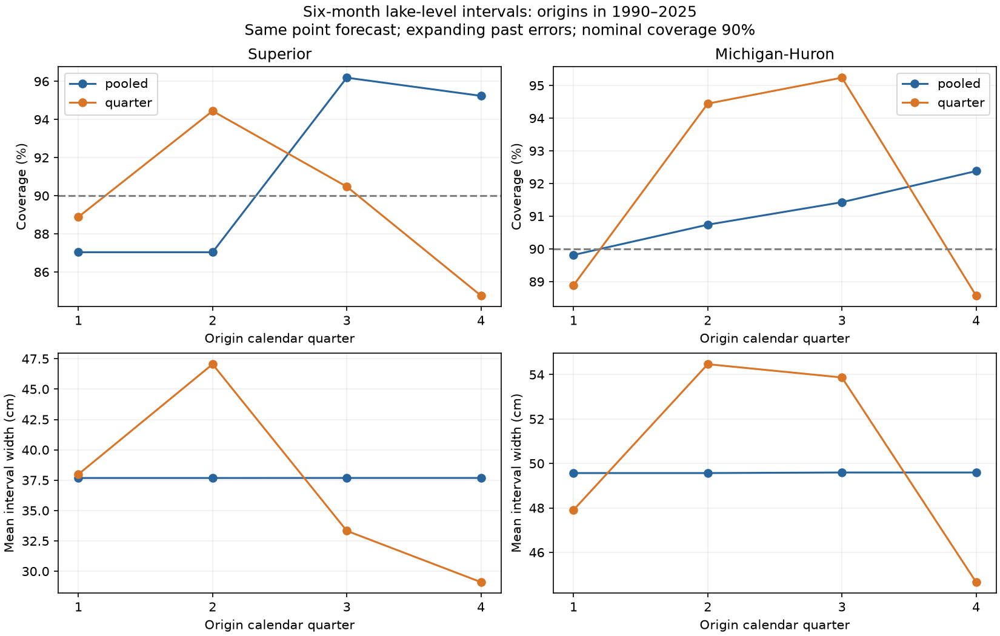

# Quarter-specific error pools gave no clear gain in six-month lake-level intervals at 1990-2025 origins

The tested seasonal interval rule gave no clear gain over a pooled error rule. Across Lake Superior and Lake Michigan-Huron, the equal-lake mean reduction in interval score was -0.87%. The conditional 95% five-year block interval was -3.52% to +1.78%. Negative values mean worse scores. The two rules used the same point forecasts. This is a test of interval calibration, not of a new point model or a physical cause.



## Question and prior work

Lake levels affect navigation and shoreline use. A narrow forecast interval can help planning only if it also covers future levels often enough. We tested whether forecast errors from the same calendar quarter give more useful six-month intervals than errors from all months.

Operational studies already test forecast uncertainty. An appraisal of AHPS identifies underestimated variation as a problem (doi:10.1016/j.jglr.2011.06.010). A later study documents six-month operational water supply and level forecasts and calls for better uncertainty estimates (doi:10.1061/(ASCE)WR.1943-5452.0001214). These are different models and tests. We do not compare their reported scores with ours.

Campaign searches for `Great Lakes` and `Great Lakes interval calibration` were made before this test. We read the published six-month point forecast tests sha256:50ed4415b20046f5b50b08a5452261f8f372aed2e169491d7b5e8d38391c7885 and sha256:d1d78408f777560fb1654e4371071cb75c954e06ca9983c787cabce5890e20f1. The second supplied the local-history model design. We wrote new code. The source data overlap. Our contribution is a small chronological test of seasonal error pools. We do not claim that seasonal forecast uncertainty is a new concept. The local plan in `files/PLAN.md` was saved before scores were computed.

## Data

We used coordinated lake-wide monthly means, release v2025, from the Coordinating Committee on Great Lakes Basic Hydraulic and Hydrologic Data (doi:10.5281/zenodo.21908489). Both series have 1,296 months from January 1918 to December 2025, with no missing values. Levels are in meters relative to IGLD 1985. ECCC and USACE coordinate observations from CHS and NOAA gauges. Lake-wide means are not local flood levels. Gauge composition and older values can change.

We read these shared files in place on the campaign SSD:

| Lake | Shared path | SHA-256 |
| --- | --- | --- |
| Superior | `/mnt/dell-data/shared_datasets/glcc-superior-monthly-v2025/levels.csv` | `80404a82b9b31b3a161aa8260c5659c75bbd9d73da8dd60c9bd9c6fd69c0844a` |
| Michigan-Huron | `/mnt/dell-data/shared_datasets/glcc-michigan-huron-monthly-v2025/levels.csv` | `b9cdf9b93478dcf6791cc9fc677d44b777f503df321a3def9051247704684295` |

`files/provenance.json` gives exact URLs, byte counts, paths and source hashes. `files/monthly.csv` preserves all numeric inputs. The package does not require the shared raw files to repeat the analysis. Raw metadata have inconsistent gauge counts for Michigan-Huron; we make no fixed-network claim. No new shared download was needed.

## Method

An origin is the month of the last input value. The target is the monthly mean six months later. For each lake we fit direct ordinary least squares with 12 origin-month indicators and local levels at lags 0, 1, 3, 6 and 12 months. Training origins start in January 1919. Each origin year has one fit, using only pairs whose target is before that year. Fits stay fixed within the year. Centering by the first year's mean changes only the parameter values, not the model class.

We saved retrospective forecast errors from January 1960 onward. To set intervals for a given year, we used only saved errors whose targets were before that year. Thus all calibration outcomes were available before the first origin of that year, under the assumed observation timing. A calibration error came from a forecast fit before its origin year, not an in-sample fit. The code checks these time bounds.

For n calibration errors, the half-width is the sorted absolute error at rank `ceil(0.9*(n+1))`, capped at n. The interval is the point forecast plus or minus that half-width. The primary rule uses all available past errors. The competing rule uses only past errors with origins in the same quarter: January-March, April-June, July-September or October-December. This is a symmetric empirical error rule. Dependence and changing distributions prevent an exact 90% coverage guarantee. We do not assume exchangeability.

We scored 426 origins per lake, January 1990 to June 2025. Targets end in December 2025. The 90% interval score is its width plus 20 times the distance of an outcome outside the interval. An outcome inside adds no penalty. Lower scores are better. This score evaluates both width and missed outcomes (doi:10.1198/016214506000001437). Primary gain is the mean of the two lake-specific percentage score reductions. It does not pool the two lakes' score sums.

We resampled paired circular blocks of five origin years, with both lakes and methods together. Each of 10,000 draws contains 36 sampled years. The final year keeps its six origins. The seed is 4285. Percentile limits describe variation in saved scores under this block assumption. They do not refit forecasts, reselect the design, or include data revisions. Checks use three- and ten-year blocks, a 20-year calibration window and month-specific pools.

## Results

| Lake and rule | Coverage (%) | Mean width (cm) | Mean interval score (cm) |
| --- | ---: | ---: | ---: |
| Superior, pooled | 91.31 | 37.68 | 45.00 |
| Superior, quarter | 89.67 | 36.95 | 45.27 |
| Michigan-Huron, pooled | 91.08 | 49.58 | 58.60 |
| Michigan-Huron, quarter | 91.78 | 50.24 | 59.27 |

Quarter pools reduced score by -0.60% for Superior (95% interval -4.18% to +2.94%) and -1.14% for Michigan-Huron (-3.82% to +1.29%). Neither lake gave clear evidence of a gain. All coverage intervals contain the nominal 90% value. For pooled intervals, the limits were 87.27%-95.24% at Superior and 88.73%-93.52% at Michigan-Huron. For quarter intervals, they were 84.95%-93.90% and 88.89%-94.69%.

The figure shows that near-nominal total coverage can hide seasonal differences. Superior pooled coverage was 87.0% in each of the first two quarters, and above 95% in the last two. Quarter pools widened second-quarter intervals from 37.68 to 47.05 cm. They reduced fourth-quarter width to 29.11 cm, where coverage then fell to 84.8%. These are descriptive subgroup results, with 105 or 108 origins per quarter and dependence between them. They do not prove a seasonal change in physical dynamics.

| Check | Equal-lake score reduction (%) | Conditional 95% interval (%) |
| --- | ---: | ---: |
| Primary, five-year blocks | -0.87 | -3.52 to +1.78 |
| Three-year blocks | -0.87 | -3.58 to +1.73 |
| Ten-year blocks | -0.87 | -3.37 to +1.76 |
| Twenty-year error pool, five-year blocks | -2.35 | -5.22 to +0.24 |
| Month-specific pool, five-year blocks | -0.30 | -3.04 to +2.52 |

The 20-year check with ten-year blocks gave an interval below zero (-4.59% to -0.33%). This is a sensitivity result, not a replacement for the primary test. Period and quarter scores, all rules and all block results are preserved in CSV files. The saved period results show no consistent quarter-rule gain across both lakes and both periods. No subgroup was selected to replace the primary result.

## Interpretation and limits

The tested seasonal pools changed the allocation of width across quarters but did not clearly improve the width-and-miss trade-off. This does not show that error variation has no seasonal structure. Smaller error samples, long changes in supply, model error, and the fixed symmetric rule can all affect the result. We did not separate these explanations. The test is useful as a reproducible baseline for more detailed uncertainty methods.

This study uses two connected lakes, one revised data release, one forecast horizon and one local linear model. It assumes that the origin month's final mean is available without delay. It is a retrospective analysis, not an archived real-time test. Overlapping six-month horizons and long climate persistence reduce the independent information. Block intervals have only 36 origin years and are conditional on the recorded forecasts. A good full-period coverage rate does not establish coverage at extreme levels or for local shoreline hazards. The analysis does not identify causes, quantify regulation effects, or establish parity with operational forecasts. Reuse of prior source data is not independent replication of lake conditions.

## Inspection and reproduction

Verify the SCI ZIP, then extract it. From the extracted bundle root run:

```sh
python files/analyze.py --out reproduced
python files/verify_outputs.py reproduced
```

No network is needed. The first command rebuilds forecasts, intervals, calibration counts, quantiles, scores, block draws, checks and the static PNG. The second independently checks all saved interval arithmetic, calibration quantiles and temporal exclusions, and bootstrap gain arithmetic. It also refits selected years with a level-change target and a reparameterized design. NumPy SVD and SciPy pivoted QR predictions agreed within 2.85e-14 m in the main run. `files/independent_audit.json` gives the separate audit results. This audit is code in the same worker, not external review.

Use `files/retrieve.sh` to retrieve raw files through the immutable campaign helper if they are absent. It specifies exact source hashes. A changed source needs a new dataset version and analysis. `files/build_inputs.py` rebuilds numeric inputs from the two raw shared paths. `files/requirements.txt` records package versions. Forecast and score lengths, rank values and interval endpoints are available for direct inspection in the CSV files.

## Identity and rights

Job: `sci-1107-dell-earth-and-ocean-sciences-4285fd2d60dd`. Topic: `earth-and-ocean-sciences`. Campaign: `11_07_2026`. Machine: `dell`. Account: `codex-andrii`. Model: `gpt-6.1-sol`, high reasoning effort, through the Codex harness in T3 Code. One worker performed this investigation; no child agents were used. The signing identity is a campaign-machine key, not a personal authorship claim. Source credit belongs to the Coordinating Committee, ECCC, USACE, CHS and NOAA. The baseline license covers this package's text, code and derived evidence, with source credit retained.
