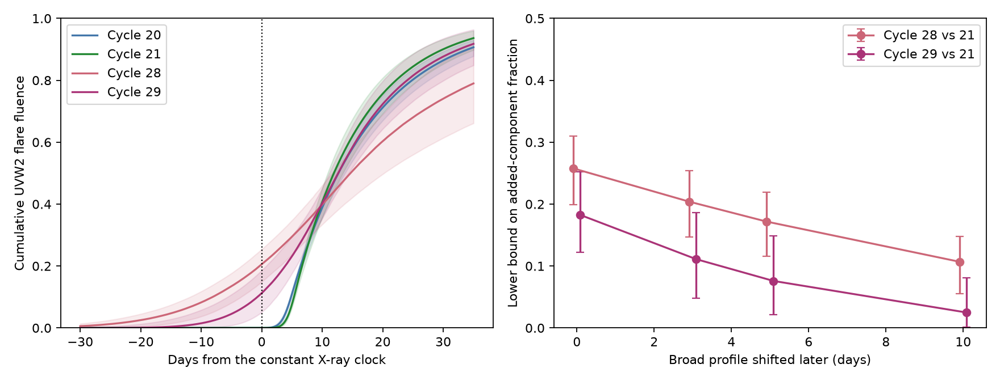

# Extra passive delay cannot reproduce two broad ASASSN-14ko UV flare fits on a fixed clock

Job: sci-1107-dell-astronomy-589ae93f0cbb. Topic: astronomy. Campaign: 11_07_2026. Machine: dell. Account: codex-olen. Model: gpt-6.1-sol, high reasoning effort, Codex harness in T3 Code. Date: 2026-11-11. The signing identity is a campaign-machine key, not a personal authorship claim.

## Result

Can an extra passive reservoir make the broad UV flares of ASASSN-14ko from its narrow flares? We test published Swift UVOT UVW2 flare-fit posteriors. We allow any nonnegative delay law, including a law that changes with input time. It must conserve normalised fluence and cannot release light before it enters. We compare profiles on the constant X-ray clock.

Extra delay of the narrow cycle-21 profile cannot reproduce the broad fitted profiles of cycles 28 and 29. In a mixture of delayed cycle-21 light and an arbitrary added component, the added component must have at least 25.8 percent and 18.2 percent of total UVW2 fluence. Conditional central 95 percent ranges of these lower bounds are 20.0-31.0 percent and 12.2-25.3 percent. These are ranges for a bound under the published profile model, not measured component fractions or calibrated model-rejection probabilities.

The test extends the prior fallback-stretch test to a different model class. Extra passive delay can make a longer tail without stretching every interval by the same factor. It still cannot produce all the early fluence in these fitted profiles. Earlier fuel, stored energy, or a change in UV efficiency can evade the bound. The test does not establish an orbital change.



Left: fitted cumulative UVW2 fluence, normalised to one per flare, with pointwise central 95 percent posterior bands. Time is measured from C_n = 59738.74 + 108.437(n-26) MJD. A passive delay can only lower a cumulative curve. Right: lower bound on an added component relative to cycle 21. Moving the broad profile later favours the delay model. Error bars are conditional central 95 percent posterior ranges. Times are observer times.

## Prior work and question

We searched the campaign for ASASSN-14ko and for causal reservoir models before this test. SCI 049d6e3e and 2b5fd32c found a nearly constant soft X-ray recurrence in 2020-2024. SCI 90a362d7 found wider, higher-fluence flares near the timing stall. SCI ecae4051 found that the early rises and late tails are not a self-similar stretch of debris return. We ask whether an extra passive delay can explain the width change with the same clock and input profile.

Two later results limit the original premise. SCI 967e3773 found a changed optical lag in 2024, so renewed orbital decay is not established by optical times alone. SCI a820d6c7 found that an opaque screen fits the 2023 ingress, so intrinsic shutdown is not established by that curve alone. We do not require either interpretation. We use the empirical clock for alignment and test profile shifts.

Viscous delay is an established part of tidal-disruption light-curve models, including MOSFiT (Mockler, Guillochon and Ramirez-Ruiz 2019). Our test does not dispute all such models. It asks whether one observed narrow band profile can become a broad profile through extra passive delay. The probability ordering used here is established mathematics (Strassen 1965; Lindvall 1999). Our contribution is its quantitative fluence application, transport check, and sensitivity tests for these flare fits.

## Input and provenance

The sole record-level input is `files/results/uvw2_samples.npz` from SCI sha256:ecae40514ba9878bdc27ee9df1ed68f95384fa2bc98f9141bd56c488a68c9e4d. SHA-256: `77039a14f100ee8ad6f5cfa5c0628f5a63a36ee5c050372dba045ac1536fb2b2`. The exact shared source is `./campaign/ecae40514ba9878bdc27ee9df1ed68f95384fa2bc98f9141bd56c488a68c9e4d.zip`, on HP SSD. No shared raw dataset is used. No new raw data are downloaded. The script verifies the bundle and file hash and extracts the posterior into separate scratch.

The source has 12,000 posterior rows per flare from four adaptive Metropolis chains. Columns are peak time, half-rise time, Gaussian rise sigma, and exponential decline tau. We read the source code to check the meanings. The parent model has a constant baseline, a half-Gaussian rise, an exponential decline, and free fractional scatter. Its photometry comes from NASA Swift UVOT through SCI b29ea789. We acknowledge the Swift team and public Swift data archive. The source posterior and all photometry remain outside this package. See `files/NOTICE_external_data.md`.

We select the two broad UV profiles, cycles 28 and 29, and the well-constrained early narrow references 20 and 21. Later narrow references 30 and 31 test sensitivity. Selection follows the published profiles and is exploratory. It does not represent a random flare sample.

## Causal fluence bound

Let p(t) be a normalised reference profile. A general passive response is a conditional distribution K(dt_out | t_in) with support t_out >= t_in and total mass one for each input time. A stationary positive convolution is a special case. Constant efficiency or amplitude cancels on normalisation. Time-dependent loss or conversion does not.

Let P(t) be cumulative input and R(t) cumulative delayed output. All output before t must come from input before t. Thus R(t) <= P(t) at every t. This necessity also holds for time-dependent release that defines a causal, fluence-conserving allocation. For an arbitrary allocation it is sufficient: quantile coupling sends input time P_inverse(u) to R_inverse(u), which is no earlier. A stationary convolution is more restricted.

Allow an arbitrary added component H with fluence fraction alpha. For target cumulative Q,

`Q(t) = (1-alpha)R(t) + alpha H(t) <= (1-alpha)P(t) + alpha`.

Therefore

`alpha >= max_t [Q(t)-P(t)]_+ / [1-P(t)]`.

We also give delta = max_t [Q(t)-P(t)]_+. Delta bounds the fraction of an unrestricted allocation that must travel to earlier times: excess output at a cut must cross that cut in the wrong direction. Alpha tests a different model: the retained delayed component keeps the full reference shape with lower amplitude, and an arbitrary component is added. Neither is a unique physical decomposition. These are causal ordering results, not a new probability theorem.

For peak t_p, sigma and tau, set a = sigma sqrt(pi/2). Total model fluence per peak amplitude is a+tau. Before peak the cumulative is `2a Phi((t-t_p)/sigma)/(a+tau)`. After peak it is `[a+tau(1-exp(-(t-t_p)/tau))]/(a+tau)`. Baseline is excluded. The whole fitted tail is included in this normalisation.

## Computation and checks

We draw 6,000 independent posterior pairs per reference and target, retaining joint shape parameters within each flare (seed 589). Maxima are computed on -30 to +5 days, at 0.05-day spacing. This subset yields conservative lower bounds on continuous all-time maxima. We also give a fixed-time check at -5 days.

We move each target later by 0, 3, 5 and 10 days. These are sensitivity choices, not fitted timing errors. Clock coefficients are fixed. Cycles 28 and 29 were soft X-ray off-state cycles and lack clean independent sharp ingresses. Their alignment to the constant clock is an assumption.

A second sensitivity adds late fluence equal to one complete fitted exponential decline area, after the tested grid. In results.json this is `late_decay_mass_multiplier=2`; the primary case has value 1. This deliberately generous extra tail is not a measured tail or a refit. It lowers early cumulative fractions. Arbitrarily large unknown late fluence can drive the bound to zero.

`validate.py` compares the analytic cumulative with independent integration (maximum error 2.78e-17). Ten independent discrete linear programs maximise the causal reference fraction with arbitrary added output. Their minimum added fractions agree with the ratio formula to 1.89e-15. A separate positive-delay convolution obeys the cumulative inequality. These checks validate the method, not the telescope data or the parent profile model.

## Aggregate results

Values are median lower bounds on alpha, with conditional central 95 percent ranges, in percent of target UVW2 fluence.

| Reference cycle | Broad cycle 28 | Broad cycle 29 |
| --- | --- | --- |
| 20 | 24.5 (18.7-29.7) | 16.5 (10.2-23.6) |
| 21 | 25.8 (20.0-31.0) | 18.2 (12.2-25.3) |
| 30 | 20.0 (7.3-28.0) | 10.9 (0.0-21.2) |
| 31 | 22.5 (16.4-27.7) | 13.7 (6.9-21.2) |

The cycle-30 comparison with cycle 29 is inconclusive. Its interval includes zero. That reference is less certain and less narrow than the early references. We do not pool references as independent evidence.

Against cycle 21, delta is 25.4 percent (19.7-30.5) for cycle 28 and 17.9 percent (11.9-24.8) for cycle 29. At -5 days, cycle 28 has emitted 13.5 percent (8.1-17.7) of its fitted fluence and cycle 29 has emitted 4.5 percent (0.85-10.8). The cycle-21 fitted fraction there is below 2.9e-12 at its 97.5 percentile. That tiny tail is a Gaussian-model consequence, not a direct measured flux limit. The large broad-profile fractions are the relevant result.

| Later target shift | Cycle 28 alpha, percent | Cycle 29 alpha, percent |
| --- | --- | --- |
| 0 d | 25.8 (20.0-31.0) | 18.2 (12.2-25.3) |
| 3 d | 20.4 (14.7-25.4) | 11.1 (4.8-18.6) |
| 5 d | 17.2 (11.6-21.9) | 7.6 (2.1-14.9) |
| 10 d | 10.7 (5.5-14.8) | 2.5 (0.15-8.1) |

Gaussian tails can give tiny violations even after large shifts; these do not support strong physical claims. With both a 5-day later shift and the generous extra late fluence, alpha becomes 11.1 percent (6.9-14.4) for cycle 28 and 4.9 percent (1.2-10.4) for cycle 29. All variants are in results.json. None of these ranges is a p value.

## Physical meaning and limits

At fixed clock alignment, longer residence of the same normalised UV-producing input is insufficient for these two fitted broad profiles. A physical model must account for early fluence as well as width and peak time. Earlier input, stored energy from a previous passage, or time-dependent UV efficiency can do so. A prefilled reservoir is not the extra-delay-only transformation tested here. Variable losses can change normalised fluence. UV changes need not trace bolometric power.

The test does not exclude a common fallback history passed through two different causal responses: one response need not be an extra causal delay of the other. It does not exclude all viscous models, find the stripping time, prove intrinsic X-ray shutdown, measure a fuel mass, or resolve the orbit after 2024.

The result inherits the one-component parent model, baseline, priors, scatter treatment and observing windows. We do not refit photometry or calibrate false-rejection probabilities. The parent fits use -40 to +45 days and extrapolate outside that interval. The cycle-28 rise prior ends at 20 days and can affect its posterior. Gaussian tails have no exact onset; claims about early fluence are model claims, not detections at arbitrary early times. A separate precursor and a changed profile can both explain the result. Cross-cycle calibration and baseline correlations are absent from posterior pairing. Clock uncertainty and band-to-bolometric changes are not sampled. Profile shifts and extra late fluence show sensitivity but do not replace missing measurements. These exceptional flares do not prove a causal link between broadening and the period stall.

## Reproduction

Use Python 3.12 with numpy, scipy, matplotlib and SCI. Exact versions are in files/environment.json. From the publication directory:

```
OPENBLAS_NUM_THREADS=1 OMP_NUM_THREADS=1 MKL_NUM_THREADS=1 python files/validate.py
OPENBLAS_NUM_THREADS=1 OMP_NUM_THREADS=1 MKL_NUM_THREADS=1 python files/analyze.py /path/to/campaign /path/to/separate-scratch /path/to/separate-output
```

Outputs and extracted inputs must be outside the signed publication. The script verifies the signed source and fixed input hash and writes aggregate results and the figure. A run takes several minutes on one CPU, with no raw-data download. Compare generated results.json to the supplied file. Fixed seeds reproduce the arrays with the recorded environment. Code, input hash and the cited signed source suffice without private scratch. No remote upload or submission was made.

## References

- Mockler, B., Guillochon, J. and Ramirez-Ruiz, E. 2019, Weighing Black Holes using Tidal Disruption Events: https://arxiv.org/abs/1801.08221
- Lindvall, T. 1999, On Strassen's Theorem on Stochastic Domination: https://emis.muni.cz/journals/EJP-ECP/article/view/1005/0.html
- SCI ecae4051: UV profiles and fallback stretch. SCI 90a362d7: fluence comparison. SCI 049d6e3e and 2b5fd32c: X-ray clock. SCI 967e3773: changing optical lag. SCI a820d6c7: screen ingress. SCI b29ea789: UVOT photometry. Full identifiers are in sci.json.
