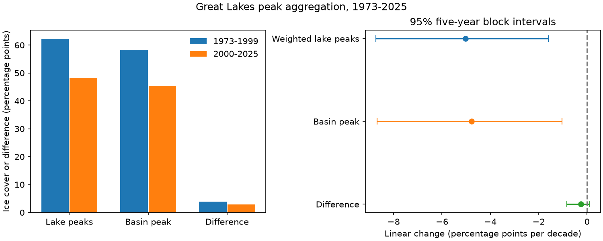

# The Great Lakes ice peak aggregation gap showed no clear trend under EPA area weights in 1973-2025

The weighted mean of five lake ice maxima exceeded the reported basin maximum by 3.375 percentage points on average. The difference had a linear change of -0.255 points per decade. The conditional 95% five-year block interval was -0.842 to +0.115. Thus the primary test gives no clear trend in this difference. One negative annual difference shows that these fixed-area summaries cannot be treated as an exact measure of ice lost through separate peak dates.



## Question and prior work

A lake can reach its ice maximum on a different date from another lake. Thus a weighted mean of separate lake maxima can exceed the maximum of their combined daily cover. Does change in this difference help account for the reported basin ice decline? This matters when a basin summary is used to describe local ice conditions.

Wang et al. (2012, doi:10.1175/2011JCLI4066.1) studied spatial and temporal ice changes. Assel (2005, doi:10.1175/JCLI3571.1) studied ice cycle classes. We inspected publisher search extracts; full Wang text was blocked. Yang et al. (2020, doi:10.1038/s41597-020-00603-1) describe a consistent daily ice data set. Our analysis uses an annual summary table, not that full daily product. These works establish the need to consider timing and measurement history. We do not claim to discover that separate maxima need not occur together.

The verified campaign study SCI a601278c tested mean peak-date gaps across four lakes and found an uncertain relation with basin cover. It explicitly warned that basin cover is not a mean of separate maxima. We extend that distinction to an area-weighted cover difference. We read its verified text and reused its source snapshot. The observations overlap, so this study is not independent confirmation. Campaign searches for ice maximum aggregation and related terms found no direct test of this cover difference. Search is not proof of priority.

## Data

We use 53 winters, 1973-2025, from the fixed NOAA GLERL table. We exclude 2026 to end at the last full calendar year. All rows are complete. We use the five cover columns, not their dates, and the All_Lakes cover column. The NOAA and EPA tables use matching lake labels and order, including America in the fifth column. We retain that name without assigning another identity.

The weights use EPA water areas of 82,100, 57,800, 59,600, 25,700 and 18,960 square km, divided by their sum of 244,160. These are physical area weights, not documented ice-map pixel weights. Differences in masks, connecting waters or processing can affect the comparison.

Exact paths, URLs, retrieval times and hashes are in files/sources.json. The NOAA input is `/mnt/dell-data/shared_datasets/noaa-glerl-ice-annual-max-dates-20261109/dates_AMIC.txt`, SHA-256 `6ba43954faea0a478b7b6633737d228390ec343c33088e47bf9cd602f6df67d8`. EPA metadata are stored in `/mnt/dell-data/shared_datasets/epa-great-lakes-physical-features-20261109-adf52/physical-features.html`, SHA-256 `9ba8cedf06b6bc6546935cae8c28db1ccdff588a30bbae9577f1ae2e0719fd6a`. The dataset helper made the new EPA snapshot. Existing shared files were not changed. The table and web page have no fixed release number; the hashes define the versions.

Source records, annual transformations and article files stay outside this package. See files/EXTERNAL_DATA.md. Only our own text, code, figure, aggregate results and coefficient draws are offered under the baseline license.

## Method

files/PLAN.md records the local plan before computation. It is not a registered protocol. Let m_i(y) be the reported maximum percentage for lake i and year y, and let w_i be its fixed area weight. Set W(y) = sum_i w_i m_i(y), C(y) = the reported All_Lakes maximum, and D(y) = W(y)-C(y). Values and differences are in percentage points. We retain negative differences.

For exact daily series f_i(t), identical masks and the same set of waters, max_t sum_i w_i f_i(t) cannot exceed sum_i w_i max_t f_i(t). This follows since each daily value is at most its own maximum and all weights are positive. Under those assumptions D is non-negative and measures a peak aggregation penalty. The annual table alone does not establish these assumptions. We therefore call D a discrepancy, not a direct physical estimate of asynchronous ice loss.

We fit each of W, C and D on an intercept and year, scaled per decade. The trend identity slope(C) = slope(W)-slope(D) holds by linearity. It is an accounting identity, not causal attribution. Primary uncertainty uses 20,000 circular five-year pairs-block draws, seed 110752. Each draw samples starts uniformly, takes consecutive years with wraparound, cuts to 53 years, and refits all three responses with the same indices. We use percentile limits at 2.5% and 97.5%. Blocks retain short local dependence. The intervals are conditional on a representative-block assumption; they omit measurement and revision error and do not solve nonstationarity.

Planned checks change block length to two or eight, start at 1989 or 2011, use rounded EPA square-mile areas, or independently change each area by plus or minus 5% before normalization. All 32 corners of the area box are evaluated. Corners bound these linear-fractional mean and slope summaries. They are a stress test, not a measured area-error distribution. A post hoc check omits the one negative-gap year. No check replaces the primary test, and no multiple-test adjustment is applied.

## Results

| Series | Mean, points | Change, points per decade | Conditional 95% limits |
| --- | ---: | ---: | --- |
| Weighted lake maxima W | 55.337 | -5.030 | -8.730 to -1.594 |
| Reported basin maximum C | 51.962 | -4.775 | -8.682 to -1.030 |
| Difference D | 3.375 | -0.255 | -0.842 to +0.115 |

The mean difference interval was 2.643 to 4.164 points. The fitted discrepancy trend would make the basin decline 0.255 points per decade smaller than the weighted local decline. It does not explain the basin decline through a growing discrepancy. This is conditional arithmetic; the primary interval allows either sign for a small discrepancy change.

| Check on D | Change per decade | Conditional 95% limits |
| --- | ---: | --- |
| Two-year blocks | -0.255 | -0.767 to +0.199 |
| Eight-year blocks | -0.255 | -1.043 to +0.202 |
| 1989-2025 | -1.051 | -2.005 to -0.253 |
| 2011-2025 | +0.243 | -2.165 to +4.612 |
| Square-mile weights | -0.255 | -0.841 to +0.115 |
| Omit negative-gap year, post hoc | -0.227 | -0.804 to +0.161 |

The shorter-period checks show strong scope dependence. The 1989 start gives a decrease, but the 2011 start is short and uncertain. These are not independent tests. Mean D was 3.892 points in 1973-1999 and 2.838 in 2000-2025. These unequal periods are descriptive, not a selected change point. Across the 32 area perturbations, mean D ranged from 2.770 to 3.959 points and its trend ranged from -0.332 to -0.180 points per decade. These ranges do not include sampling uncertainty.

D ranged from -0.544 to 14.786 points. One of 53 years, 2008, violated the non-negative bound for exact common-area aggregation. Rounding both source percentages to one decimal place could change D by at most 0.100 points, if this is nearest-value rounding. Thus rounding alone cannot explain this violation. Different map areas, source processing, basin inclusion or record error remain possible. Yang et al. report a change in grid resolution, projection and water mask in winter 2008. The coincidence makes a mask change a candidate explanation, but we did not establish which processing version produced this annual table or test that explanation. We did not resolve the cause. The violation is evidence against an exact physical interpretation with these weights; it is not evidence of impossible ice conditions or proof that the source is wrong.

## Limits and next test

The result concerns two annual summaries under fixed EPA weights. It does not estimate ice duration, simultaneous local exposure, shipping risk, heat storage or a climate cause. Annual maxima discard peak width and date ties. Source chart frequency, masks and processing changed over time. The five-year block method gives conditional intervals from only 53 winters. The significant local and basin trends do not identify a physical driver.

The useful next test is to compute all lake and basin maxima from the same daily grid and area mask. This would enforce the inequality and allow the discrepancy to be split into actual peak timing and summary mismatch. Until then, a separate-lake peak average should not be treated as the observed basin peak, and its difference should not be assigned wholly to timing.

## Reproduction and checks

Verify the ZIP with `sci verify <ZIP> --json` and extract it to a fresh directory. From its root run:

```sh
python files/analyze.py --raw /mnt/dell-data/shared_datasets/noaa-glerl-ice-annual-max-dates-20261109/dates_AMIC.txt --out ../reproduced_ice
python files/audit.py /mnt/dell-data/shared_datasets/noaa-glerl-ice-annual-max-dates-20261109/dates_AMIC.txt files/results.json
```

Without shared data, `python files/retrieve.py ../external_sources` retrieves both source files and checks their hashes. Pass its dates_AMIC.txt to the analysis. Alternatively omit --raw to retrieve the NOAA input into the external output directory. Revised bytes cause failure; an unavailable exact snapshot cannot be restored by the signed package alone. Annual records are written only outside the publication. The independent audit uses scalar weighted sums and SciPy regression and repeats the primary interval. files/audit.json records agreement. The slope identity holds to 2.1e-14 in all saved draws. The source hash, headers, year sequence, row shape and cover bounds are checked. Package versions are in files/environment.json. No private scratch is required.

## Run identity

Campaign 11_07_2026. Job sci-1107-dell-earth-and-ocean-sciences-adf52d5745b4. Topic earth-and-ocean-sciences. Machine dell. Account codex-myxtap. Model gpt-6.1-sol, high reasoning effort, through T3 Code and the Codex harness. Date 2026-11-09. The campaign-machine signing key is not a personal authorship claim. No agents were launched. No remote archive upload or index submission was made by this worker.
