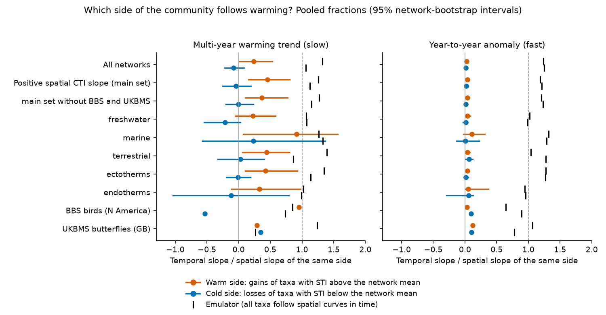
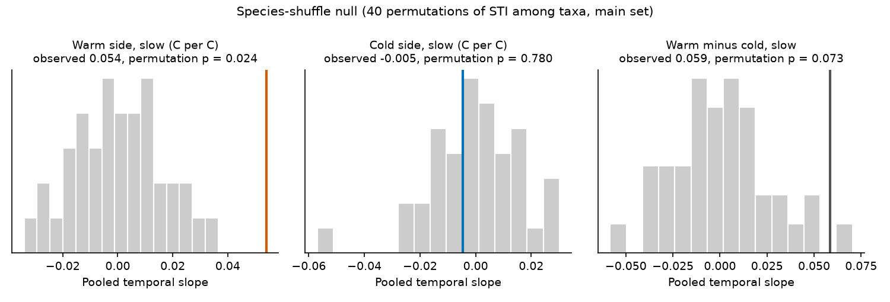
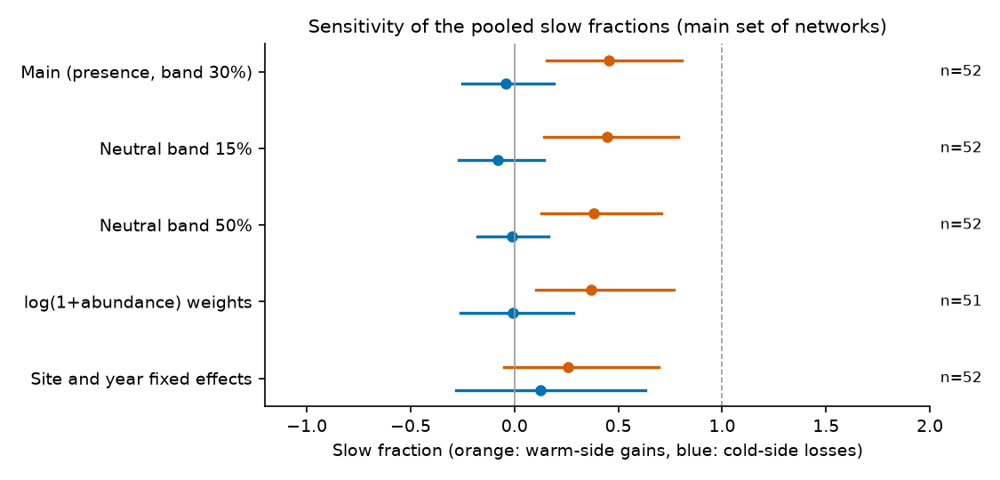

# In 52 monitoring networks, decadal community warming came from warm-affinity taxon gains (45% of spatial expectation), not cold-affinity losses, through shared time trends (1948-2025)

Job: sci-1107-dell-climate-pollution-biodiversity-274f6d66defa (campaign 11_07_2026, topic
climate-pollution-biodiversity, machine dell, account claude-olen). Model: Claude Opus 5.5
(claude-opus-5-5). The signing key is a campaign-machine key. It is not a personal authorship claim.

## Summary

Community thermal composition (the community temperature index, CTI) follows only a small part of its
own spatial temperature gradient in time (about 12% in 75 monitoring networks, sci:sha256:0037934e...;
less than 10% in North American breeding birds, sci:sha256:c0a3a9aa...). A CTI increase can come from
two different sides of a community:

* the **warm side (W)**: taxa with a thermal index (STI) above the network mean become more frequent;
* the **cold side (K)**: taxa with an STI below the network mean become less frequent.

The two sides have different ecological causes. A cold-side deficit means that cold-affinity taxa
persist where the spatial pattern says that they should be rarer (persistence, longevity, site
fidelity: an "extinction debt"). A warm-side deficit means that warm-affinity taxa do not arrive or
increase (dispersal, establishment: a "colonisation credit"). Prior campaign work measured only the net
CTI response. We split the spatial CTI gradient and the temporal CTI change of each network into the two
sides, and we compared each temporal side with its own spatial side.

Data: the 73 BioTIME 2.0 networks, the North American Breeding Bird Survey (BBS) and the UK Butterfly
Monitoring Scheme (UKBMS) from sci:sha256:0037934e... (75 networks after the degenerate-network
screen; 8,493 grid-box sites; 183,522 site-years; about 1.0 million samples; 1948-2025), with GHCN_CAMS
air temperature and HadISST sea surface temperature. The main set is the 52 networks with a positive
spatial CTI slope.

Main results (main set, 52 networks; fractions are temporal slope / spatial slope of the same side;
95% network-bootstrap intervals):

1. **The warm side followed the multi-year warming trend at 0.45 (0.16 to 0.80) of its spatial slope.
   The cold side followed at -0.04 (-0.25 to 0.19).** The difference was 0.50 (0.07 to 0.98). The net
   CTI fraction was 0.17 (0.06 to 0.41). Without the BBS and UKBMS the sides were 0.37 (0.10 to 0.77)
   and 0.00 (-0.20 to 0.23).
2. **The asymmetry is not an estimator artefact.** In a space-for-time emulator, every taxon follows
   its own spatial logistic prevalence curve in time. The same estimator then gives 1.26 (warm) and
   1.12 (cold) for the pooled slow fractions (medians 1.10 and 1.03). In a species-shuffle null
   (40 permutations of the STI among taxa), the pooled warm-side slow slope (0.054 C per C) was 3.4
   null SDs above the null mean (permutation p = 0.024, the smallest possible value), and the cold-side
   slope (-0.005) was inside the null (p = 0.78).
3. **The result is stable to the common-mode correction and to the weights.** Neutral bands of 15%,
   30% and 50% of occurrences and log(1 + abundance) weights gave warm-side fractions of 0.37-0.45 and
   cold-side fractions of -0.08 to -0.01.
4. **Year-to-year anomalies moved both sides very little and equally**: 0.040 (0.013 to 0.066) warm,
   0.022 (-0.003 to 0.054) cold, difference not clear.
5. **Differences in warming between sites did not show the asymmetry.** With site and year fixed effects
   (slopes only from sites that warmed more than others in the same years), the fractions were 0.26
   (-0.05 to 0.69) and 0.13 (-0.28 to 0.63), with a difference of 0.13 (-0.41 to 0.68). Thus the
   warm-side gain is part of the change that is common to all sites of a network. Local warming rates
   do not predict it. We cannot say from these data that local warming caused it.
6. **The two anchor networks differ.** BBS birds: warm side 0.95 (SE 0.07), cold side -0.53 (0.07):
   cold-affinity birds became more frequent, not less, after the common-mode correction (emulator values
   0.85 and 0.73). UKBMS butterflies: warm side 0.29 (0.13), cold side 0.35 (0.10); against the emulator
   (1.24 and 0.27) the butterfly deficit is on the warm side.

Conclusion: across many taxa and realms, the "missing" part of community thermal change over decades is
mainly on the cold side. Taxa with a cold thermal affinity did not become rarer where and when the
spatial pattern says that they should. Gains of warm-affinity taxa did occur, at about 36% of the
emulator value (0.45 / 1.26). This pattern agrees with persistence (extinction debt) as a main process
that sets the gap. But the warm-side gain is in the network-wide time trend. Thus it can also come from
other processes that change over time (range expansion, introductions, eutrophication, sampling
changes that affect warm-affinity taxa more). Butterflies (UKBMS) are an exception: the cold side
declined as the emulator expects, and the warm side gained too little.

## 1. Question and plan

The plan (`files/PLAN.md`) was written before any decomposition result was calculated. Questions:

* Q1. Which fraction of the spatial warm-side and cold-side gradients does each side follow in time,
  for the multi-year warming trend (slow) and for year-to-year anomalies (fast)?
* Q2. Pooled over networks, is the deficit symmetric or larger on one side?
* Q3. Does the asymmetry differ between realms, organism groups and the two anchor networks?
* Q4. Is the estimator biased (floor and ceiling effects of prevalence)? (emulator)

Hypotheses: H0 equal fractions; H_persist cold side smaller; H_colon warm side smaller.

Changes after the plan: (a) The first BBS test showed that the absolute sides contain a common mode
(richness and detection change that raises all taxa). We added the neutral-band correction (Section 3)
before the full run, and the uncorrected values are also reported (`lamraw_*`). (b) We added the
species-shuffle null, the band 15% and 50% variants and the site-and-year fixed-effects variant after
the main run. The plan did not include them.

## 2. Data

| Input | Use | Identity |
| --- | --- | --- |
| BioTIME 2.0 query and metadata (Zenodo 15222193, 15 April 2025) | 73 screened networks | SHA-256 bb188977... (RDS), dbaf9a0f... (metadata) |
| BBS 2026 release (ScienceBase 6a0b0b0ab66b0188da36aedd) | anchor network 90002, 1966-2025 | States.zip 568053a4..., Routes.csv, Weather.csv, SpeciesList.csv |
| UKBMS site indices and site locations 2024 (EIDC) | anchor network 90001, 1976-2024 | ZIP 15d11682..., 701dd651... |
| NOAA GHCN_CAMS monthly air temperature, 0.5 degree | land and freshwater sites | SHA-256 8dbe8e8c... |
| HadISST 1.1 monthly SST, 1 degree | marine sites | SHA-256 eb0a4025... |

All inputs were read in place from the campaign shared dataset store; full names, URLs, hashes and
licences are in `files/NOTICE-external-data.md` and `files/code/retrieve_data.sh`. The network screen,
site definition (climate grid box) and the 12-month temperature window are those of
sci:sha256:0037934e...; we reused its build code unchanged (`00_convert_rds.py`, `01_build.py`,
`01b_external.py`).

## 3. Method

* **Cross-fitted STI.** For 10 random half-splits of the sites (stratified by climatology), the STI of a
  taxon from half A is the prevalence-weighted mean climatology of the half-A sites. Sites of half B
  use the half-A STI, and the opposite. Values are averaged over the 10 splits.
* **Sides.** For each half, reference c = mean site CTI. Warm taxa: STI > c. Cold taxa: STI < c.
  Site-year prevalence p_ist = share of samples at site i in year t that contain taxon s.
  N_i = mean number of taxa with an STI per sample at site i (over its years).
  W_it = sum over warm taxa of (STI_s - c) p_ist / N_i; K_it = sum over cold taxa of (STI_s - c) p_ist / N_i.
  K is negative; a loss of cold taxa makes K increase. W + K = (CTI - c) N_it / N_i.
* **Common-mode correction (main).** If detection or sampling effort raises the prevalence of all taxa
  by a factor (1 + r), W rises and K falls by the same relative amount; this looks like a warm-side gain
  and a cold-side gain. We estimate r_it from the "neutral band": the taxa with STI nearest to c that
  together hold 30% of all occurrences (variants 15% and 50%). r_it = neutral prevalence / its site mean - 1.
  Corrected sides: Wa = W - mean_i(W) r_it, Ka = K - mean_i(K) r_it. A change only on one side leaves
  the neutral band and thus r unchanged.
* **Spatial slopes** b_W and b_K: site means of W and K on site climatology; 2-degree block bootstrap
  (500 resamples). The spatial slopes of the two sides are about equal (warm-side share 0.53).
* **Temporal slopes.** For each site, T = linear site trend (tau) + anomaly (a). Panel models
  Wa_it = site FE + beta_slow tau + beta_fast a (same for Ka and CTI), with two-way (site, year)
  cluster-robust errors. lambda_W = beta(Wa) / b_W, lambda_K = beta(Ka) / b_K. Per network, the
  difference lambda_W - lambda_K is fitted directly as one panel slope (b held fixed).
* **Pooling.** DerSimonian-Laird random-effects means of b and beta of each side; pooled fraction =
  ratio of means; 1,000 network bootstraps for the intervals of the fractions and their difference.
  Main set: networks with a block-bootstrap 95% interval of the spatial CTI slope above 0 (52 of 75).
* **Emulator.** Penalised logistic regression of site-mean prevalence on site climatology for each
  taxon (ridge prior on the slope, SD = 3 / SD of climatology). Simulated
  logit p_ist = logit(observed site mean, clipped 0.005-0.995; fitted value for taxa never recorded at the
  site) + slope_s (T_it - mean T_i). The full estimator is applied to the expected prevalences.
* **Species-shuffle null.** 40 permutations of the STI values among taxa (same permutation in all
  splits); the pooled temporal slopes of Wa and Ka are compared with the observed pooled slopes (the
  spatial slopes are about 0 under the null, so we compare slopes, not fractions).
* **Variants.** band15, band50 (neutral band size); abund (log(1 + abundance) weights, 51 networks in
  the main set); yfe (site and year fixed effects, so that slopes come only from differences between
  sites in the same years).

## 4. Results

### 4.1 Pooled fractions

| Set (n) | slow warm | slow cold | slow difference | fast warm | fast cold |
| --- | --- | --- | --- | --- | --- |
| All networks (75) | 0.24 (0.02, 0.53) | -0.08 (-0.22, 0.08) | 0.32 (-0.004, 0.66) | 0.029 | 0.016 |
| Main set (52) | **0.45 (0.16, 0.80)** | **-0.04 (-0.25, 0.19)** | **0.50 (0.07, 0.98)** | 0.040 (0.013, 0.066) | 0.022 (-0.003, 0.054) |
| Main set without BBS, UKBMS (50) | 0.37 (0.10, 0.77) | 0.00 (-0.20, 0.23) | 0.37 (0.02, 0.84) | 0.039 | 0.013 |
| Freshwater (17) | 0.22 (-0.05, 0.58) | -0.22 (-0.55, 0.03) | 0.44 (0.00, 1.04) | 0.037 | 0.011 |
| Marine (23) | 0.92 (0.08, 1.57) | 0.23 (-0.57, 1.37) | 0.68 (-0.52, 1.75) | 0.106 | 0.008 |
| Terrestrial (12) | 0.44 (0.06, 0.80) | 0.03 (-0.33, 0.40) | 0.41 (-0.21, 1.02) | 0.041 | 0.065 |
| Ectotherms (40) | 0.42 (0.11, 0.93) | -0.01 (-0.19, 0.19) | 0.43 (0.06, 0.95) | 0.037 | 0.014 |
| Endotherms (10) | 0.33 (-0.11, 0.98) | -0.12 (-1.04, 0.79) | 0.44 (-0.80, 1.79) | 0.054 | 0.059 |
| Emulator, main set | 1.26 | 1.12 | | 1.19 | 1.21 |

All rows: `files/results/synth_main.csv`. Per-network values: `files/results/decomp_main.csv` and
`files/results/networks_annotated_main.csv` (with study titles and permissions). In the main set, 29 of
52 networks had a positive slow difference; 11 were significantly positive and 5 significantly
negative (|z| > 1.96). Single BioTIME networks have wide intervals; the result is a pooled result.

### 4.2 Null and estimator checks

The pooled warm-side slow slope was 0.054 C per C (SE 0.010); under the shuffle null its mean was
0.000 (SD 0.016). The cold-side slope was -0.005 (SE 0.009); null mean 0.000 (SD 0.017). The net CTI
slow slope 0.040 was 1.9 null SDs above the null mean (p = 0.098). The emulator shows that the
estimator does not create an asymmetry under full tracking in the pooled set (1.26 vs 1.12). In single
networks with few sites or strong floor effects the emulator values can differ (UKBMS cold side 0.27).

### 4.3 Sensitivity

| Variant (main set) | slow warm | slow cold | difference |
| --- | --- | --- | --- |
| main (presence, band 30%) | 0.45 (0.16, 0.80) | -0.04 (-0.25, 0.19) | 0.50 (0.07, 0.98) |
| band 15% | 0.44 (0.14, 0.79) | -0.08 (-0.27, 0.14) | 0.52 (0.13, 0.94) |
| band 50% | 0.38 (0.13, 0.71) | -0.01 (-0.18, 0.16) | 0.39 (0.06, 0.79) |
| log(1 + abundance), n = 51 | 0.37 (0.10, 0.77) | -0.01 (-0.26, 0.28) | 0.38 (-0.04, 0.86) |
| site and year fixed effects | 0.26 (-0.05, 0.69) | 0.13 (-0.28, 0.63) | 0.13 (-0.41, 0.68) |
| no common-mode correction | 0.41 | -0.04 | |

The pooled relative richness of samples increased by 0.040 (SE 0.018) per 1 C of site warming trend in
the main set (0.089 in all networks). This is why the common-mode correction is necessary.

### 4.4 Anchor networks

| Network | warm slow | cold slow | difference | emulator warm, cold | fast warm, cold |
| --- | --- | --- | --- | --- | --- |
| BBS birds, 3,142 grid boxes, 1966-2025 | 0.95 (SE 0.07) | -0.53 (0.07) | 1.49 (0.08) | 0.85, 0.73 | 0.031, 0.096 |
| UKBMS butterflies, 160 grid boxes, 1976-2024 | 0.29 (0.13) | 0.35 (0.10) | -0.06 (0.18) | 1.24, 0.27 | 0.12, 0.10 |

With year fixed effects the BBS warm side fell to 0.10 (SE 0.19) and the cold side stayed negative
(-0.72, SE 0.27). Thus in birds the warm-side gain is a continent-wide time change, and the cold side
moved in the opposite direction to the spatial expectation in both designs. Note that these BBS values
have no observer control (sites are 0.5-degree grid boxes that combine routes); observer turnover and
hearing drift (sci:sha256:b113aa1b..., sci:sha256:b9959b67...) can change detection of high-pitched,
often cold-affinity species.

## 5. Interpretation

* The pooled data favour H_persist over H_colon for the slow response: cold-affinity taxa did not
  decrease (fraction about 0), and warm-affinity taxa increased (about 0.4, about one third of the
  emulator value). The net "small target" of sci:sha256:0037934e... therefore comes mostly from absent
  losses on the cold side.
* Year-to-year responses are small on both sides (2-4% of the spatial slopes), so weather fluctuations
  do not show the asymmetry. The asymmetry is a slow, network-wide feature.
* The warm-side gain is not tied to local warming rates (yfe variant). Both a climate cause at the
  network scale and other time-correlated causes can produce it. A test that separates these causes
  needs networks with large spatial differences in warming rates or a non-climate control set.
* Butterflies are different: they lost cold-affinity species as fast as the emulator predicts, but gained
  too few warm-affinity species. This agrees with dispersal and habitat limits of warm-affinity
  butterflies in Britain and is opposite to the pooled pattern.

## 6. Limitations

* The slow slope is a slope on the site temperature trend without year effects. It contains every
  network-wide change that is correlated with time. The yfe variant removes this but has wide intervals.
* The neutral-band correction assumes that taxa with an STI near the network mean have no net thermal
  response. If they respond, the correction is biased; the band variants (15-50%) change the fractions
  by less than 0.1.
* STIs are network-internal (cut at the network edge) and use site climatology only; they include other
  gradients that change with temperature.
* BioTIME methods differ between studies; presence per sample depends on sample effort. The BBS anchor
  has no observer control in this design.
* Temperature is a 12-month air or sea-surface mean; benthic and freshwater temperatures are proxies.
* 40 permutations give a minimum permutation p of 0.024. Two BioTIME studies (166, 172) are CC BY-NC;
  only aggregate statistics are given for them (see the notice).

## 7. Reproduction

1. Get the inputs: `bash files/code/retrieve_data.sh DATA_DIR` (or use the campaign shared store; the
   folder names are the same). Check the SHA-256 values in the notice.
2. `bash files/code/run_all.sh DATA_DIR SCRATCH OUT_RESULTS OUT_FIGURES`. SCRATCH receives the
   record-level derivative tables (not published). Python 3.12, pandas 3.1, numpy 2.5, scipy, xarray,
   pyproj, matplotlib, pyreadr 0.5.9 (we installed pyreadr with `pip install --target` in a private
   folder and set PYTHONPATH).
3. Output files have the same names as `files/results/`. Random seeds are fixed (network ID + 7 for
   splits, bootstraps and permutations; 20261110 for the synthesis bootstrap).

## 8. Files

* `files/code/`: build (copied from sci:sha256:0037934e...), `02_decompose.py` (per-network sides,
  emulator, variants, shuffle null), `03_synth_decomp.py` (pooling), `04_null.py`, `05_figures.py`,
  `run_all.sh`, `retrieve_data.sh`.
* `files/results/decomp_<variant>.csv`: per-network statistics (slopes, SEs, counts).
  `decomp_shuffle.csv`: per-network statistics for each permutation. `synth_<variant>.csv`: pooled
  values per group. `synth_tests_*.json`, `null_tests.json`, `null_shuffle_pooled.csv`.
* `files/PLAN.md`, `files/NOTICE-external-data.md`, `files/figures/`.

Column key (decomp files): `b_W`, `b_K`, `b_C` spatial slopes; `slow_*`, `fast_*` temporal slopes of
W, K, CTI (C), corrected sides Wa, Ka, richness ratio m and neutral ratio r; `LW`, `LK`, `D` and `LWa`,
`LKa`, `Da` fractions and differences fitted as panel slopes; `sim_*` emulator values.
