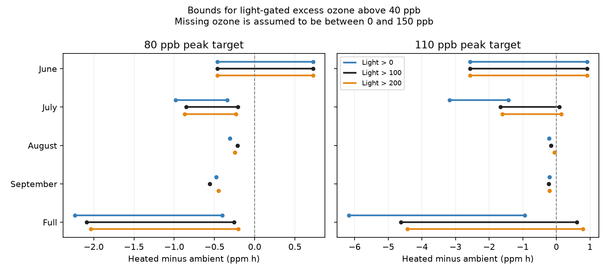

# A light-gated ozone contrast stayed below zero with a 150 ppb missing-value cap at the 80 ppb target in North Wales in 2021

The heated dome had less light-gated excess ozone than the ambient dome at the 80 ppb peak target over June to September 2021, under the stated bounds. With a light cutoff of 100 micromoles per square metre per second and a 0 to 150 ppb range for missing ozone, the heated-minus-ambient contrast was between -2.0865 and -0.2576 ppm h. The interval at the 110 ppb target allowed both signs. These are bounds on exposure records from one wildflower experiment. They are not confidence intervals or estimates of flower damage.



## Question and value

Can missing light records change the sign of a heated-minus-ambient ozone exposure contrast? This matters when a warming experiment is used to test pollution effects on flowers. A matched ozone target need not give equal achieved exposure. A complete-weather subset can give a different scope from the full flower season. We give a method that retains hours with known ozone and unknown light. It requires no model that predicts early light from later weather.

This is an exploratory method and exposure audit. It does not test species loss, species ranges, plant uptake, climate trends or weather extremes. The source contains five wildflower species, but no flower response enters our calculation. The result is useful for planning such response tests. It does not itself provide new evidence of a biological effect.

## Prior work and data choice

The ICP Vegetation mapping manual (2017, Chapter 3) describes AOT40 as accumulated ozone above 40 ppb in daylight. Its daylight rule uses global radiation above 50 W per square metre. It also describes flux methods that account for plant and weather conditions. Our light column has different units. We do not convert it to global radiation. Thus our index is a diagnostic light-gated excess-ozone sum, not regulatory AOT40, a critical-level exceedance or a dose inside leaves.

We searched the SCI campaign for climate, pollution, phenology, herbarium, anthocyanin, wildflower and missing light. A proposed separate anthocyanin study could not proceed because the public Dryad download returned 403 and its API download required a bearer token. No records from that dataset are used. We then read two verified campaign results that use the accessible wildflower release. SCI sha256:1ceb6dc11fbe44a507f581f0653d16455b0d051fabcbb9cb417d554762e20584 reports seasonal flower-width contrasts and hourly mean ozone differences. SCI sha256:51e63bdcebf6d84f9bdbb679bca8fa4358b41128b862f9ee6588cb023b30f2fa tests high-ozone and dry-air overlap in August and September. Our new test gives full-season marginal exposure bounds for missing light and two missing ozone hours. We reuse their external raw source, not their code or derived tables. This is not independent validation of those studies.

## Source and observation process

Contains data supplied by UK Centre for Ecology & Hydrology.

Hayes, F.; Sharps, K. (2023). *Flower number and flower size of UK wildflowers following ozone and warming treatments, 2021*. NERC EDS Environmental Information Data Centre. https://doi.org/10.5285/a33d5ee3-d201-4feb-83b9-765ee5b2c25e . The release date is 20 December 2023.

The site is at Abergwyngregyn, North Wales. Ozone followed a weekly profile, including night hours. Heating targeted ambient plus 4 degrees C. For the 30, 80 and 110 ppb peak targets, the ambient/heated dome pairs are 3/6, 1/2 and 5/4. Each combination has one dome. Repeated hours do not give repeated treatment assignments.

We use the hourly file and supporting document. The released common light record comes from the ambient monitoring arrangement. We apply this same light gate to each pair. It is a proxy for the exposure window, not a separate light measurement in every dome. The source reports quality checks, some gap filling, and early weather loss due to system failure. Hourly flags do not identify filled values. We treat released nonmissing values as fixed and correct for this calculation.

The June to September grid has 2,928 hours. Light is known for 1,824 hours and starts on 17 July. June has no light records, July has 360, August has 744 and September has 720. Ozone pairs are known for 2,926 hours. The two missing hours are 8 June at hour 10 and 30 June at hour 10. One row in the source has no hour label. We do not assign it to either missing hour. We use no October data. The source gives no time-zone label needed for a precise solar reconstruction, and we fit no such reconstruction.

## Index and exact bounds

Let E(c) = max(c - 40, 0), with c in ppb. For hour t, let delta(t) = E(c_heated(t)) - E(c_ambient(t)). Let G(t) be one when the common released light exceeds a selected cutoff and zero otherwise. Our contrast is:

`D = sum_t G(t) delta(t) / 1000` in ppm h.

Each hourly value represents one hour. The sum describes accumulated concentration excess, not an average concentration. We test light cutoffs of 0, 100 and 200 micromoles per square metre per second. The 100 cutoff is the main diagnostic. These are exploratory choices, not fitted injury thresholds. All choices are reported.

Let K be the sum of G times delta for hours with both light and paired ozone known. For hours with paired ozone but missing light, allow G to be either zero or one. Their sharp lower and upper contributions are min(delta, 0) and max(delta, 0). For each hour with both ozone readings missing, assume each concentration is in [0, U], where U is at least 40 ppb. If the gate is unknown or known to be one, its contribution is in [-(U-40), U-40]. A known zero gate contributes zero. In this dataset both missing ozone hours also lack light.

If n is the count of active missing-ozone hours, the lower and upper bounds are:

`lower = [K + sum_unknown_light min(delta,0) - n(U-40)] / 1000`

`upper = [K + sum_unknown_light max(delta,0) + n(U-40)] / 1000`.

These limits are attainable within this model. Set each unknown gate to one exactly where delta has the sign needed for that limit. At missing ozone hours, set the two concentrations to opposite ends of their allowed range and the gate to one. The limits are marginal for each target and cutoff. A single set of missing light values need not attain the limits for different targets at once.

The model does not require missing records to be random. It also imposes no clock, cloud, smoothness or solar constraints on missing gates. It is deliberately broad. Limits are sharp for these algebraic restrictions, not for every possible physical light process. A tighter physical model could narrow them. We use U=150 ppb as a transparent assumption and U=300 as a sensitivity test. Neither cap is measured or guaranteed by the data. With no finite cap, the two missing ozone hours leave the full-season contrast unbounded.

## Results

Main diagnostic: light above 100 micromoles per square metre per second, U=150 ppb. Units are ppm h. Negative values mean less excess ozone in the heated dome.

| Period | 80 target: lower | 80 target: upper | 110 target: lower | 110 target: upper |
| --- | ---: | ---: | ---: | ---: |
| June | -0.4657 | 0.7244 | -2.5670 | 0.9100 |
| July | -0.8495 | -0.2107 | -1.6612 | 0.0909 |
| August | -0.2149 | -0.2149 | -0.1593 | -0.1593 |
| September | -0.5564 | -0.5564 | -0.2308 | -0.2308 |
| Full season | -2.0865 | -0.2576 | -4.6183 | 0.6108 |

June permits both signs at both high targets. July fixes a negative sign only at the 80 target. August and September are complete and give negative contrasts at both targets. These months share domes and sensors. They are separate observation windows, not independent experimental or regional replications.

The full-season 80-target bound stays below zero at all three light cutoffs with U=150. At U=300, it permits both signs for the 100 and 200 cutoffs. At the main cutoff its upper bound reaches zero at U=278.81 ppb. At the 110 target, the full-season interval is negative with the zero light cutoff, but permits both signs with the 100 and 200 cutoffs. The sign therefore depends on how the exposure window is defined as well as on missing records. The zero cutoff can be sensitive to small light sensor offsets.

At the 30 target, all complete July to September contributions are zero because paired concentrations do not exceed 40 ppb in those windows. Its full-season bound is [-0.2200, 0.2330] ppm h. This uncertain interval comes from early records and missing hours. Zero index contribution does not imply zero ozone exposure or no biological effect.

The all-hour mean ozone differences over available hours are -0.8302 ppb at the 80 target and -2.2541 ppb at the 110 target. Their negative signs alone do not fix the sign of the light-gated seasonal sum. The two indices have different weights and threshold rules.

## Limits and next use

These deterministic bounds describe missingness in released observations. They do not cover sensor error, undocumented gap filling, different light conditions between domes or an incorrect common light proxy. They give no confidence level and no evidence that all allowed completions are equally plausible. At U=300, two absent ozone readings suffice to remove the main seasonal sign result. This is a practical reason to retain time stamps and exposure data throughout a flower experiment.

One site, one season and one dome per treatment cannot identify a causal warming effect or support a regional climate conclusion. The bound is not a correction for fixed chamber effects. We do not estimate any warming-by-ozone effect on flowers. No plant flux, soil water or species-specific conductance model is fitted. More joint high-ozone and dry-air hours can coexist with less light-gated ozone excess; neither index alone identifies plant injury. The campaign objective calls for independent regions and periods. This small method study does not supply that evidence. The next test should retain complete light and ozone records in replicated chambers at separate sites and years, together with dated plant responses.

## Reproduce and inspect

The package contains code, aggregate bounds, a figure, source hashes and a data notice. It contains no external hourly or flower records. External source files remain under OGL v3; our contributions use the exact SCI baseline license. See files/EXTERNAL_DATA_NOTICE.md. The transformation method is fully given by analyze.py.

Use Python 3.12 with numpy, pandas, scipy and matplotlib. Exact versions are in files/audit.json. From an extracted publication directory, run:

```sh
python files/retrieve.py /absolute/path/to/new_external_scratch
python files/analyze.py --archive /absolute/path/to/new_external_scratch/data.zip --out /absolute/path/to/new_analysis
```

Use output directories outside the signed package. On this campaign machine, reuse `/mnt/dell-data/shared_datasets/ukceh-wildflower-ozone-warming-2021-a33d5ee3/data.zip` in place. Its resolved shared path, URL, original ZIP hash and used member hashes are in files/provenance.json. The hourly member SHA-256 is `86c657edc758dd0012f7dff0cd673e9b49201ae41d8c8f90fdaac3e236e368ea`. The download wrapper contains generated metadata and can change. Retrieval checks the stable hourly and supporting-document hashes. New output bounds.csv must match the bundled table. Figure bytes may vary with software versions.

Checks passed for member hashes, unique date-hours, nonnegative ozone, paired missingness, monthly additivity and attaining gate assignments. An independent linear program checked the missing-light bound terms for each sample. We also retrieved the external ZIP again and reproduced the aggregate table exactly. These checks verify the calculation, not the physical assumptions.

Job: sci-1107-dell-climate-pollution-biodiversity-997c1b0dbe8e. Topic: climate-pollution-biodiversity. Campaign: 11_07_2026. Machine: dell. Account: codex-andrii. Model: gpt-6.1-sol, high reasoning effort. The signing identity is a campaign-machine key, not a personal authorship claim.
