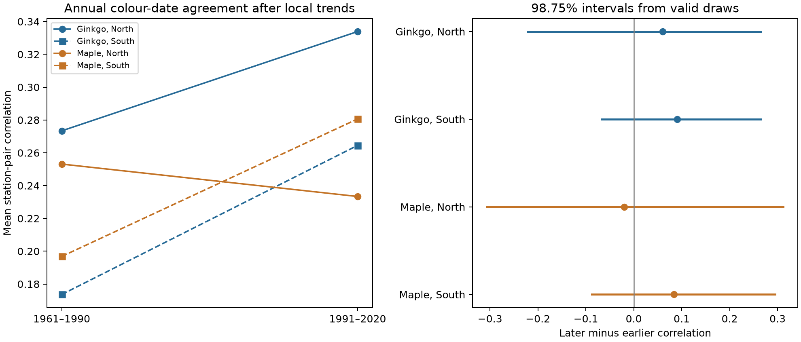
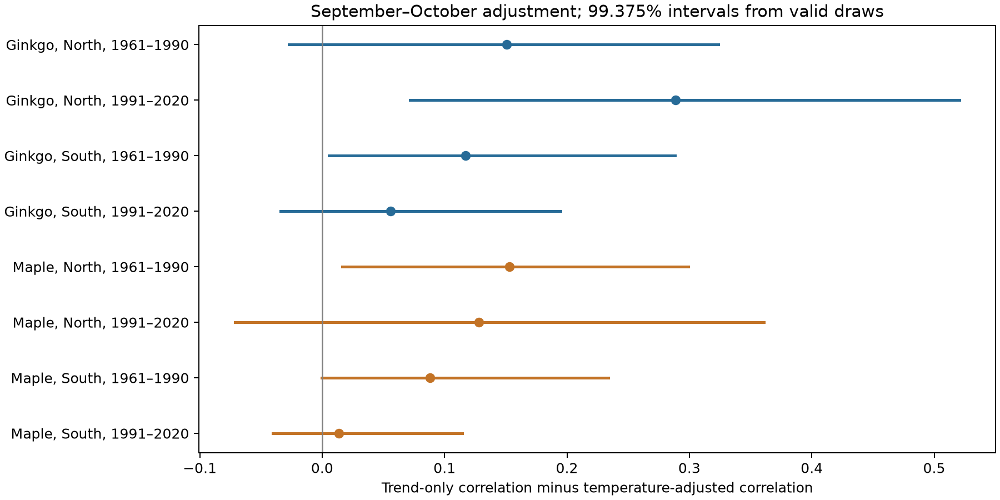

# Leaf colour records gave no clear change in annual agreement in four fixed Japan networks in 1961-2020

We tested whether annual leaf-colour changes became more or less synchronized across fixed Japan station networks. We used 3,050 accepted ginkgo and maple records at 33 stations in 1961-2020. We compared the same station pairs in 1961-1990 and 1991-2020 after separate local trends and report-mark controls. Four mean correlation changes ranged from -0.020 to +0.091. All four 98.75 percent block intervals included zero. September-October temperature adjustment reduced correlation in all eight region, tree and period samples; 3 eight-test adjusted intervals were above zero among valid resamples. Bounds that include failed resamples included zero in all eight tests. September-only adjustment gave 0 clear reductions. Unknown visits, tree changes, five northern stations per tree type, and short time samples limit inference. These are selected-network associations. They do not identify a climate cause, pollution effects or species loss. The package gives source hashes, fixed-pair data, code, all draws, checks and repeat instructions.



Figure 1. Agreement means the mean Pearson correlation of annual colour-date residuals between fixed station pairs. Each station has its own intercept, linear time trend and reporting-category control in each period. It does not mean that different stations had colour on the same calendar date. Bars give 98.75% percentile intervals from annual-vector block resampling. The four-test correction applies to the four changes.

## Question and prior work

Did shared annual changes in leaf colour become stronger or weaker between two 30-year periods? Shared timing can align seasonal habitat change over a large area. A shift in mean dates alone does not answer this question. A common calendar trend can create correlation even when annual departures have no common signal.

[Doi and Takahashi (2008)](https://doi.org/10.1111/j.1466-8238.2008.00398.x) studied spatial differences in Japanese autumn date responses. [Ibanez and colleagues (2010)](https://doi.org/10.1098/rstb.2010.0120) used records in Japan and South Korea to study spatial and species differences in plant responses. Our test compares annual correlations after separate local trends. It does not introduce leaf-colour monitoring or temperature adjustment as a new idea.

We searched the signed campaign before we chose the test. A [campaign paper on autumn intervals](sci:sha256:1b0fc41d45694fe93f6d4faef6081afc0916b4f9f8d428d439989acc087c087c) tested calendar trends from colour to leaf fall. Another [campaign paper](sci:sha256:318a5fc615fbc27066113a1b2030d518edcaca085bd734f564628791e2c7c865) tested the gap between maple and ginkgo colour dates. We use the latter paper's source builder after complete bundle verification. We rebuild its panel from the raw shared sources, then select individual colour records. We do not use its paired-date selection. A prior [cherry interval study](sci:sha256:4b7781819be8475e4a2021ddf4bc53f7f3b2c46d8655e1f2012db879b393cf8d) used a related synchrony diagnostic for a different outcome. Our contribution is the fixed autumn colour network, its period comparison, and the full reproducible evidence. Records overlap earlier autumn studies. This is not a new observation network.

## Data and observation bias

We use JMA items 013 (ginkgo yellow leaves) and 015 (maple red leaves). The current JMA guide defines the source stage as the point when most leaves have autumn colour and almost no green remains. It is a late visible stage. It is not the onset of senescence or the end of photosynthesis. JMA standard targets use remarks 8 (on site) and 9 (nearby). Substitute targets are excluded. Nearby reports before 1987 can have an on-site mark. A station and mark do not identify one permanent tree.

Dates are on a fixed month-day scale. The reference year is 2001, with January-June autumn events assigned to 2002. This removes a shared leap-day offset from autumn dates. No date is trimmed as an outlier. Each tree-type station series must have at least 25 accepted dates in each 30-year period. A leaf-fall date is not required. Each station pair must share at least 20 accepted years in both periods.

The selected data have 3,050 records, 53 tree-type station series, 33 distinct stations and 473 fixed within-region pairs. Ginkgo has five northern and 25 southern stations. Maple has five northern and 18 southern stations. North is an earliest station-history latitude of at least 37 N. South is below 37 N. The regions have no stations in common. Species and periods can share stations and observation methods. The four networks are not fully independent ecological experiments.

The record rule keeps the station network fixed and reduces bias from changing spatial coverage. It selects persistent records and can exclude difficult sites. It does not remove missing-year bias. Local report-mark controls remove fixed category shifts. They do not remove changing visits, unknown tree replacement, local habitat change or observer judgment. We test constant-category stations and complete 60-year series as separate checks. Visit records and tree identities are absent.

Temperature is NOAA/NCEP GHCN-CAMS version 3.01, a 0.5 degree monthly land product. Data were provided by NOAA PSL, Boulder, Colorado, USA, from [its website](https://psl.noaa.gov/data/gridded/data.ghcncams.html). The source method is [Fan and van den Dool (2008)](https://doi.org/10.1029/2007JD008470). We use each event-year September station position and the nearest cell with complete monthly data in the builder's regional block. Selected locations need no history extrapolation. The largest selected cell distance is 26.53 km. These data can miss tree-scale and urban conditions.

## Method

We saved the [analysis plan](files/protocol.md) before model fits. Each tree, region and period has separate station models:

```
date = station intercept + local linear year term + report-mark term + error
```

For each fixed station pair we calculate the Pearson correlation of the two error series in their shared years. The network statistic is the arithmetic mean of all fixed-pair correlations. Each pair has equal weight. Missing years are not filled. We compare late minus early network correlation. Both periods use exactly the same pairs. Their shared observation years can differ; the complete-record check tests a narrower network without this issue. A positive change means stronger common annual fluctuations after local linear trends.

We resample whole annual network vectors. This keeps spatial dependence and the dependence between pairs that share a station. Each period gets separate circular moving blocks of five years until it has 30 sampled rows. The same index draw applies to every region and tree type in that period. We retain original time coordinates and refit all local regressions in every draw. We do not treat 473 pairs as independent data points. The target is these fixed networks, not all Japan stations.

The main run has 4,000 draws. Four primary changes have 98.75% percentile intervals, with a Bonferroni adjustment for four tests. A draw is invalid for a metric if any fixed pair has fewer than ten distinct shared years or non-finite correlation. Invalid metric draws are excluded, and contrast intervals use only draws valid on both sides. These intervals are conditional on valid fits. The table gives all invalid counts. Block resampling assumes that short-range year dependence is a useful approximation within each period. It is not an exact coverage guarantee. Only 30 years and five northern stations per tree type limit precision.

A secondary diagnostic adds September and October local temperature as separate predictors to each station model. We calculate trend-only correlation minus temperature-adjusted correlation. Its eight sample intervals are 99.375%, with an eight-test correction. This is descriptive adjustment. It is not the fraction of correlation caused by temperature. Fixed monthly windows avoid dates that move with the outcome, but October contains days after the reported event for 232 of 3,050 records (7.6%). September is before every selected colour date. September-only adjustment is a separate diagnostic family.

We also use residuals from leave-five-consecutive-years-out fits. Each record is left out of its own fit, together with its four calendar-block neighbours. Training can use later years, so these are not prospective forecasts. Next-year September-October adjustment is a negative-time diagnostic on the same 1961-2019 support for its adjusted and unadjusted models. It cannot establish a complete absence of temporal confounding.

## Main result

| Tree | Region | Stations | Fixed pairs | Early correlation | Late correlation | Change | 98.75% interval | Invalid draws |
|---|---|---|---|---|---|---|---|---|
| ginkgo | North | 5 | 10 | 0.273 | 0.334 | +0.061 | [-0.221, +0.265] | 134/4000 |
| ginkgo | South | 25 | 300 | 0.174 | 0.265 | +0.091 | [-0.067, +0.265] | 474/4000 |
| maple | North | 5 | 10 | 0.253 | 0.233 | -0.020 | [-0.306, +0.312] | 284/4000 |
| maple | South | 18 | 153 | 0.197 | 0.281 | +0.084 | [-0.087, +0.295] | 359/4000 |

All four corrected intervals include zero. The point changes are positive for both ginkgo networks and southern maple. Northern maple has a small negative point change. These data do not establish a common loss or gain of annual agreement. They also do not establish unchanged synchrony or an equivalence bound. The raw-date correlations are 0.235-0.524; after local trends they are 0.174-0.334. These are different summaries, and a change in raw correlation need not reflect a change in common annual departures.

## Temperature diagnostic



Figure 2. Each point is the decline in mean station-pair correlation after September and October temperature adjustment. Bars give eight-test adjusted intervals. The models are fit to the same records and station pairs before and after adjustment. The figure shows an association; it is not a climate attribution result.

| Tree | Region | Period | Trend only | With temperature | Reduction | 99.375% interval | Held-out reduction |
|---|---|---|---|---|---|---|---|
| ginkgo | North | 1961-1990 | 0.273 | 0.123 | +0.151 | [-0.027, +0.324] | +0.219 |
| ginkgo | North | 1991-2020 | 0.334 | 0.045 | +0.289 | [+0.072, +0.521] | +0.114 |
| ginkgo | South | 1961-1990 | 0.174 | 0.057 | +0.117 | [+0.005, +0.288] | +0.086 |
| ginkgo | South | 1991-2020 | 0.265 | 0.209 | +0.056 | [-0.034, +0.195] | +0.048 |
| maple | North | 1961-1990 | 0.253 | 0.100 | +0.153 | [+0.016, +0.299] | +0.165 |
| maple | North | 1991-2020 | 0.233 | 0.105 | +0.128 | [-0.071, +0.361] | +0.095 |
| maple | South | 1961-1990 | 0.197 | 0.109 | +0.088 | [-0.000, +0.234] | +0.093 |
| maple | South | 1991-2020 | 0.281 | 0.267 | +0.014 | [-0.040, +0.114] | +0.027 |

All eight point reductions are positive, from 0.014 to 0.289. 3 of eight adjusted intervals are above zero. All eight held-out reductions also have positive point estimates, from 0.027 to 0.219. We do not give uncertainty intervals for the held-out diagnostic. This check reduces the risk that the entire reduction comes from each record fitting its own weather model. It does not remove spatially shared observation error or unmeasured environmental conditions.

September-only reductions range from 0.000 to 0.156, with 0 of eight adjusted intervals above zero. This does not establish that September has no effect. The next-year diagnostic changes correlation by -0.013 to +0.037; it is only a point check. These results suggest that the stronger full-window adjustment needs October information in these samples. Since October sometimes follows colour, the full-window result cannot be presented as an antecedent forecast.

## Failed-draw diagnostic

| Test | Tree | Region | Period | Failed-draw percentile envelope | Invalid draws |
|---|---|---|---|---|---|
| adjustment_weather | ginkgo | North | early | [-2.000, +2.000] | 104/4000 |
| change | ginkgo | North | late_minus_early | [-2.000, +2.000] | 134/4000 |
| adjustment_weather | ginkgo | North | late | [-2.000, +2.000] | 30/4000 |
| adjustment_weather | ginkgo | South | early | [-2.000, +2.000] | 276/4000 |
| change | ginkgo | South | late_minus_early | [-2.000, +2.000] | 474/4000 |
| adjustment_weather | ginkgo | South | late | [-2.000, +2.000] | 217/4000 |
| adjustment_weather | maple | North | early | [-2.000, +2.000] | 278/4000 |
| change | maple | North | late_minus_early | [-2.000, +2.000] | 284/4000 |
| adjustment_weather | maple | North | late | [-0.078, +0.370] | 6/4000 |
| adjustment_weather | maple | South | early | [-2.000, +2.000] | 291/4000 |
| change | maple | South | late_minus_early | [-2.000, +2.000] | 359/4000 |
| adjustment_weather | maple | South | late | [-2.000, +2.000] | 71/4000 |

The planned intervals condition on valid draws. After failures appeared in the first sensitivity run, we added this envelope. A difference of two correlations lies in [-2, 2]. For each lower endpoint we assign all failed contrast draws -2; for each upper endpoint we assign them +2. These values bound the stated bootstrap percentiles over any values for failed draws. They are not new population confidence intervals. 0 of eight full-window temperature reductions retain a lower percentile above zero under this rule. The failures materially limit several other intervals. Main period-change envelopes also include zero.

An added five-year support check replays failed main metrics with at least five distinct shared years per pair. It uses the identical 4,000 draws and fixed networks.

| Tree | Region | Change | Five-year support 98.75% interval | Invalid draws |
|---|---|---|---|---|
| ginkgo | North | +0.061 | [-0.231, +0.271] | 0 |
| ginkgo | South | +0.091 | [-0.087, +0.282] | 2 |
| maple | North | -0.020 | [-0.302, +0.327] | 8 |
| maple | South | +0.084 | [-0.087, +0.303] | 7 |

All four changes remain uncertain under this support rule. The full results are in [support5_estimates.csv](files/results/support5_estimates.csv), with all filled draws and a failure audit. Two of eight temperature reductions have corrected intervals above zero under the five-year support rule. These are northern ginkgo in 1991-2020 and southern ginkgo in 1961-1990. This post hoc check can have unstable correlations from short resampled support; it does not establish coverage for the planned intervals.

## Sensitivity and limits

| Check | Tree | Region | Change | 98.75% interval | Invalid draws |
|---|---|---|---|---|---|
| block3 | ginkgo | North | +0.061 | [-0.218, +0.321] | 34/2000 |
| block3 | ginkgo | South | +0.091 | [-0.082, +0.266] | 169/2000 |
| block3 | maple | North | -0.020 | [-0.346, +0.315] | 82/2000 |
| block3 | maple | South | +0.084 | [-0.083, +0.278] | 113/2000 |
| block7 | ginkgo | North | +0.061 | [-0.240, +0.240] | 70/2000 |
| block7 | ginkgo | South | +0.091 | [-0.066, +0.273] | 252/2000 |
| block7 | maple | North | -0.020 | [-0.240, +0.280] | 145/2000 |
| block7 | maple | South | +0.084 | [-0.064, +0.278] | 199/2000 |
| quadratic | ginkgo | North | +0.005 | [-0.263, +0.302] | 69/2000 |
| quadratic | ginkgo | South | +0.115 | [-0.090, +0.319] | 253/2000 |
| quadratic | maple | North | -0.012 | [-0.290, +0.321] | 142/2000 |
| quadratic | maple | South | +0.145 | [-0.063, +0.363] | 184/2000 |
| stable | ginkgo | South | +0.059 | [-0.253, +0.453] | 18/2000 |
| stable | maple | North | +0.530 | [-0.042, +1.175] | 64/2000 |
| stable | maple | South | -0.172 | [-0.435, +0.090] | 8/2000 |
| complete | ginkgo | South | -0.086 | [-0.359, +0.417] | 3/2000 |
| complete | maple | South | -0.105 | [-0.369, +0.223] | 3/2000 |

The checks use 2,000 draws each. Corrections apply separately within each check, not across the full set of variants. The complete-record and stable-category checks can have fewer networks or stations. They target different selected support. They are not new independent replications. See each subdirectory's counts and all adjustment estimates in [sensitivity.csv](files/results/sensitivity.csv).

| Tree | Region | Smallest omitted-station change | Largest omitted-station change |
|---|---|---|---|
| ginkgo | North | -0.044 | +0.136 |
| ginkgo | South | +0.070 | +0.108 |
| maple | North | -0.138 | +0.127 |
| maple | South | +0.048 | +0.120 |

The omitted-station table gives ranges of point changes when all pairs with one endpoint are removed. It diagnoses dependence on a single station. It does not add uncertainty or restore missing sites.

A positive correlation can result from shared temperature, other weather, common observer practice or common errors. Removing local linear trends does not remove every slow change. The temperature fits have several predictors and short records; the held-out check is therefore useful but does not prove mechanism. Regional samples can share large weather systems. The northern networks have only five stations each. Climate-product uncertainty and nearby observation locations are not propagated.

This study measures a visible plant stage at selected weather stations. It does not measure carbon uptake, natural community turnover, abundance, pollinator overlap, air pollution, daily weather extremes or species distribution change. It does not identify a causal effect of climate change. The useful result is a model-dependent null period comparison and a reusable, inspected dataset for shared annual autumn timing.

## Checks and reproduction

Independent checks compare all 3,050 selected records with the unchanged JMA source cells and reconstruct each month-day date. A second correlation calculation uses pair-by-pair NumPy Pearson correlations, rather than the missing-data matrix formula in the analysis. Checks also verify regression projections, fixed pair sets and bootstrap interval arithmetic. A separate climate script checks 24 station positions, selected grid cells and 48 raw monthly values. Exact versions and check outputs are supplied.

The [data dictionary](files/data_dictionary.md) explains all evidence. The main derived panel is embedded, so the main analysis runs offline. An offline repeat reproduced all point correlations and the first 100 of 4,000 seeded main draws. This is a prefix check, not a second full interval run:

```sh
python files/analyze.py --out /tmp/autumn-repeat
python files/validate.py
python files/sensitivity.py
```

Unpack the bundle to a private working copy before running these commands. Some scripts write results in that copy. The first command repeats the main estimates, draws and figures in a private output folder. The validator checks the stored evidence. The sensitivity command repeats the planned variants in `files/results`. It can take several minutes. To rebuild from raw data without changing the shared store:

```sh
sh files/rebuild.sh /mnt/dell-data/shared_datasets /tmp/autumn-raw-rebuild
python files/climate_check.py --datasets /mnt/dell-data/shared_datasets
```

For another host, `python files/retrieve.py --out /tmp/autumn-raw` retrieves source URLs into a private folder and enforces exact hashes. Online source files can change. If a hash differs, obtain the frozen snapshot with the required hash; do not substitute new bytes silently. Raw global weather is not duplicated in this bundle. The exact source hashes, derived monthly evidence and grid selections are preserved.

## Provenance and license

Campaign `11_07_2026`; job `sci-1107-hp-climate-pollution-biodiversity-a0132536c38c`; topic `climate-pollution-biodiversity`; machine `hp`; account `codex-myxtap`; model `gpt-6.1-sol`, high reasoning effort, through the Codex harness in T3 Code. No child agents were used. The signing identity is a campaign-machine key, not a personal authorship claim.

| Source | Path below datasets/ | SHA-256 |
|---|---|---|
| phenology | jma-phenology-ruinenchi-all-20261108/ruinenchi_all.zip | 0ca3e39524918d61d85f4c6424c4b0925613af8100daf9880a74cfdcce2b1c70 |
| station_history | jma-surface-station-history-20261108/smaster.index.zip | fbf90d9b7eae7efef3fffdc271ee6576d169a4104e9f8bb0d9e666e8d4cbb38b |
| temperature | noaa-psl-ghcncams-air-mon-mean-20261105/air.mon.mean.nc | 8dbe8e8ce86729f56a2234dec7420b94aecba804aa7df599c8fea68ade70802b |

The shared root is `/mnt/dell-data/shared_datasets`. Full resolved paths, byte counts and source download metadata are in [provenance.json](files/data/provenance.json). All three shared source files were hashed when the panel was rebuilt. We did not change shared datasets. The source snapshots were downloaded on 2026-11-08. The weather file is the fixed snapshot whose directory label ends in 20261105; the recorded source download time is 2026-11-08.

The SCI baseline license applies to this text, figures, derived data and code as stated in LICENSE. Source agencies retain their source terms. The adapted source builder retains an explicit SCI citation. Private signing keys are not in the package.
