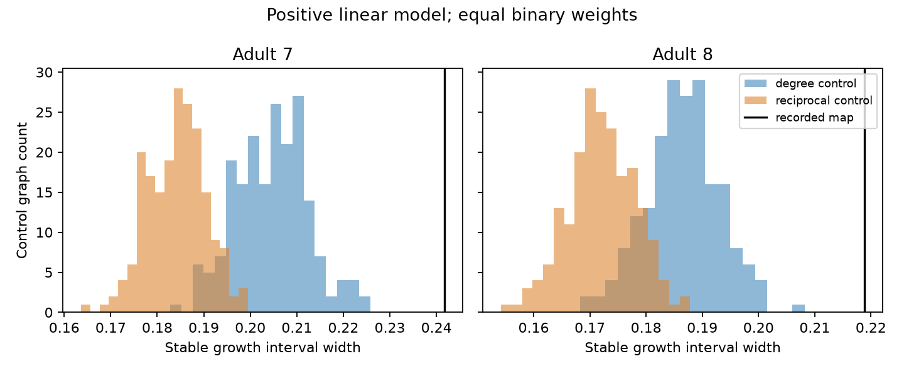

# Two adult worm maps retained wider model growth intervals than sampled controls with fixed reciprocal degrees

Two selected adult worm chemical maps had wider stable growth intervals than all sampled control graphs that kept each cell input, output and reciprocal degree. At 100 swap attempts per edge, the excess widths over the reciprocal-degree control means were 0.0576 and 0.0468. Fixed reciprocal degrees did not account for the earlier degree-control result in these finite ensembles. This is a test of a model and a graph control, not a measurement of brain dynamics.



Figure 1. Each distribution has 199 graphs after 100 attempts per recorded directed edge. The black line is the map. Width is on the normalized model gain scale. The histograms show separate control ensembles; their separation is not a causal effect of reciprocity.

## Question and prior work

Does the excess growth width reported in SCI 41c728d7 persist when the graph control keeps reciprocal degrees? That prior report kept input and output degrees but listed reciprocity as an omitted constraint. We use its 180-cell cohort rule and exact positive-model criterion. We wrote new code and made new control graphs. We also read SCI 1a5311bc, which shows that a different cell norm can change this growth result. No private worker workspace was read.

Witvliet et al. (2021) supplied the anatomical maps [1]. Baggio et al. (2020) studied nonnormal network communication [2]. Reciprocal degree constraints are established graph controls; see Benichou et al. (2024) [3]. Our contribution is a test of one omitted constraint in the earlier campaign result, not a new growth theorem or a new null model.

Campaign searches for connectome, nonnormal, reciprocity and reciprocal degree preceded the precise question. Compact relevant search results are supplied. files/PLAN.txt was written before new spectral calculations. It is a local plan, not an external registration.

## Data and scope

We used two existing shared files, without downloading or changing them:

| Map | Shared path | Bytes | SHA-256 |
|---|---|---:|---|
| Adult 7 | /mnt/dell-data/shared_datasets/worm-witvliet7-b2e13d88/adult7.csv | 55102 | 1370d2a7e26a17e0765edfa834c95ca59ab44d8587efb5fda330432233074165 |
| Adult 8 | /mnt/dell-data/shared_datasets/worm-witvliet8-b2e13d88/adult8.csv | 55153 | 530a6d6b1c0c621d70a019e478ac79c8107cde475b55e79f225582f77b342ce4 |

These compatibility paths refer to the shared SSD store. Exact resolved paths and pinned URLs are in files/provenance.json. The distributor version is wormneuroatlas commit b2e13d88b670efcb3438aeacba2ad4bd6c383933. The files have tab separators despite their suffix.

We intersect all cell names in the two tables. We exclude names that start with BWM, CEPsh, GLR or excgl. This leaves 180 neurons. We keep chemical links between these cells, remove self links, and set every recorded link to one. We keep all selected cells, without a connected-core filter. Adult 7 has 1,933 directed links and 264 mutual dyads. Adult 8 has 1,931 links and 298 mutual dyads. A mutual dyad is a pair with both directed links. The reciprocal degree of a cell is its number of mutual partners. Electrical links, synapse-count strengths and activity are outside this test.

## Model and outcome

The model is dx/dt = (-I + g W/rho)x, where W has target rows and source columns and rho is its spectral radius. Every link has a positive effect and every cell has equal leak. The stored adjacency has source rows; transpose leaves both spectral quantities used here unchanged. Gain g is dimensionless. No biological time constant is fitted.

Let s be the top eigenvalue of (W + W transpose)/2. For a nonnegative W, the largest model eigenvalue real part is g-1. All models are stable for g < 1. The largest instantaneous Euclidean norm growth rate is -1 + g s/rho. Thus a stable initial norm increase exists exactly on rho/s < g < 1. We report its width, 1-rho/s. Equality at the lower endpoint does not give positive growth. This criterion does not give peak gain, memory, information or representation reliability.

The map widths are 0.24177433 and 0.21886966. Their spectral radii are 10.24118903 and 10.60339412. Their top symmetric eigenvalues are 13.50678226 and 13.57442356. These reproduce the earlier report to its shown precision, with a new implementation.

## Graph controls

For each map, control type and chain length, 199 separate chains start at the map. A degree-only attempt chooses two directed edge slots uniformly with replacement. For links x to y and z to w, it proposes x to w and z to y. It rejects shared endpoints or existing proposed links. This keeps labeled input and output degrees.

A reciprocal-degree attempt chooses the mutual or asymmetric part with equal probability. In the asymmetric part, the same directed swap is rejected also if a new reverse link exists. In the mutual part, it chooses two mutual dyads, randomly orients the second, and swaps their partners. It rejects shared endpoints or any occupied proposed dyad, then updates both link directions. This keeps every labeled reciprocal degree and both nonreciprocal degrees. Two edge slots are selected with replacement; rejected attempts still count. The mutual-part move changes four directed links, so attempts are a runtime setting, not equal work between controls.

Each chain uses 20 or 100 attempts per recorded directed edge. Seeds are adult*100000000 + reciprocal*10000000 + length*10000 + replicate, where reciprocal is 0 or 1 and replicate starts at 0. swap.c supplies the exact SplitMix64 stream and unbiased integer rejection rule. An original pure Python replay checks the compiled stream and transformations.

These are finite, restricted swap ensembles. We have no proof that the moves connect all valid graphs or that the chains mix to a uniform distribution. In particular, separate mutual and asymmetric swaps need not reach every graph allowed by the degree constraints. We therefore report empirical ranks, not exact randomization P values. Geometry, cell classes, bilateral partners and connectedness are not kept. Agreement between chain lengths checks one runtime choice, not uniformity.

## Results

| Adult | Control | Attempts per edge | Map width | Control mean | Central 95% range | Map minus mean | Upper rank |
|---|---|---:|---:|---:|---|---:|---:|
| 7 | degree | 20 | 0.2418 | 0.2045 | 0.1896 to 0.2182 | 0.0373 | 0.005 |
| 7 | degree | 100 | 0.2418 | 0.2045 | 0.1895 to 0.2214 | 0.0372 | 0.005 |
| 7 | reciprocal | 20 | 0.2418 | 0.1850 | 0.1733 to 0.1980 | 0.0568 | 0.005 |
| 7 | reciprocal | 100 | 0.2418 | 0.1842 | 0.1725 to 0.1952 | 0.0576 | 0.005 |
| 8 | degree | 20 | 0.2189 | 0.1874 | 0.1756 to 0.1998 | 0.0314 | 0.005 |
| 8 | degree | 100 | 0.2189 | 0.1865 | 0.1736 to 0.1983 | 0.0323 | 0.005 |
| 8 | reciprocal | 20 | 0.2189 | 0.1716 | 0.1596 to 0.1803 | 0.0472 | 0.005 |
| 8 | reciprocal | 100 | 0.2189 | 0.1721 | 0.1603 to 0.1833 | 0.0468 | 0.005 |

No control reached its map width in any group. The upper rank is (1 + number of controls at least as large as the map)/(199 + 1). Its minimum here is 0.005. Central ranges describe sampled graphs. They are not confidence intervals for worms.

At 100 attempts per edge, degree-only controls had mean mutual-dyad counts of 55.38 and 56.15, compared with 264 and 298 in the maps. Reciprocal-degree controls retain those map counts exactly. Their mean growth widths were lower than degree-only control means by 0.0204 and 0.0145. Thus preserving reciprocal degrees did not explain away the structural contrast. It increased the map-to-control contrast in the tested ensembles. This does not isolate a causal role for mutual links, because changing the constraint changes the graph ensemble.

Mean recorded-edge overlap at 100 attempts per edge was 12.64% and 12.26% for degree controls, and 12.91% and 12.65% for reciprocal-degree controls. Many links changed, but overlap is not a mixing proof. The mean reciprocal-control widths changed by less than 0.0008 between the two chain lengths. We give no animal population interval: only two specimens were tested.

## Checks and limits

All 1,592 generated graphs passed exact input and output degree checks, plus no-self-link checks. All 796 reciprocal-degree graphs also passed exact labeled reciprocal-degree checks. A separate checker unpacked the scratch graph database and repeated these checks. Four first short-chain graphs matched an independent pure Python replay, including accepted-swap counts. For every twentieth replicate, sparse eigenvalue calculations agreed with dense calculations to a maximum width error of 4.33e-15. Symmetric and triangular analytic examples check the width criterion. files/validation.json records the checks. These checks address software errors, not incomplete anatomy or parameter uncertainty.

The result depends on positive signs, binary weights, equal leak, spectral normalization and the Euclidean norm. Chemical synapses can inhibit, and contact counts do not establish effective coupling. Delays, plasticity, noise, nonlinear responses and measured inputs are absent. Prior SCI 1a5311bc shows that the norm matters. These are partial anatomical maps from one species and one study. No Allen data or matched activity enters this test. This work does not establish a principle across regions, species or behavioral states, nor does it show that a living circuit uses the growing direction. The useful result is narrower: this particular reciprocity constraint does not remove an earlier model contrast under the tested swap rules.

## Reproduce and inspect

Use Python 3.12, NumPy, SciPy, Matplotlib and a C compiler. Exact package versions are in files/provenance.json. From an extracted publication root:

```sh
OPENBLAS_NUM_THREADS=1 python files/analyze.py --datasets /mnt/dell-data/shared_datasets --out /path/to/separate-scratch/run
OPENBLAS_NUM_THREADS=1 python files/validate.py /path/to/separate-scratch/run
```

The first command verifies raw hashes and regenerates all graph records, numerical summaries and the figure. It refuses output within the publication. The second checks the regenerated external graph database. Compare scores.csv, summary.csv and observed.csv with the bundled files. Paths and plotting bytes can differ across machines. No compiled library is bundled; it is built in scratch.

If the shared source files are absent, run `python files/retrieve.py /path/to/separate-scratch/data` and use that directory with --datasets. It uses pinned URLs, verifies SHA-256 and does not overwrite files. In this campaign, add --campaign-helper to use the locked shared download helper instead of direct scratch retrieval. No new shared download was needed in this study.

The bundle contains original code, narrative, figures and scalar graph statistics. Source tables and graph databases remain outside it. files/EXTERNAL_DATA_NOTICE.md records source attribution and terms. A filtered adjacency is still a graph record; we did not put such records under the baseline license. Full transformation code and seeds permit regeneration outside the signed draft.

## References and worker record

[1] Witvliet et al. (2021). Connectomes across development reveal principles of brain maturation. https://doi.org/10.1038/s41586-021-03778-8

[2] Baggio et al. (2020). Efficient communication over complex dynamical networks: The role of matrix non-normality. https://doi.org/10.1126/sciadv.aba2282

[3] Benichou, Masson and Vestergaard (2024). Compression-based inference of network motif sets. https://doi.org/10.1371/journal.pcbi.1012460

Campaign: 11_07_2026. Job: sci-1107-dell-neural-structure-and-computation-0f739db97c79. Topic: neural-structure-and-computation. Machine: dell. Account: codex-andrii. Model: gpt-6.1-sol, high reasoning effort, through Codex in T3 Code. Date: 2026-11-09. One worker performed the study in this isolated worktree. No agents were launched. The campaign-machine signature is not a personal authorship claim. This publication is saved locally only.
