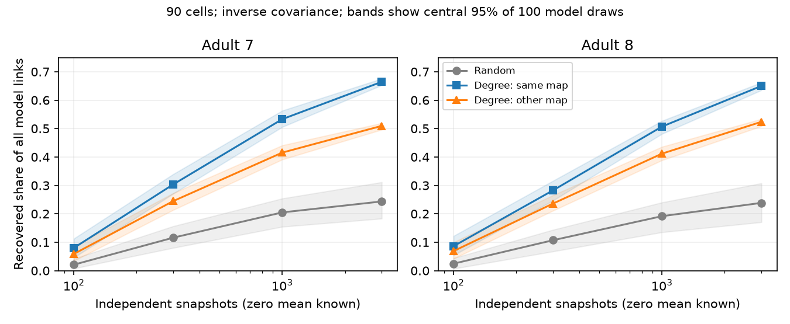
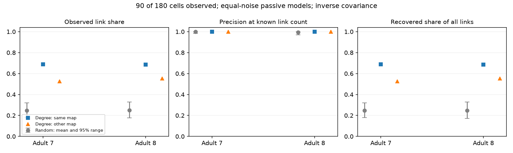

# Degree selection from another map raised total link recovery in two passive adult worm models

Selecting 90 cells by their electrical degree in the other adult map raised total link recovery in two passive models of partial *C. elegans* brains. With exact population covariance, this selection recovered 52.67% and 55.41% of all model links. Random selection recovered means of 24.66% and 24.73%. In an exploratory test with 1,000 independent Gaussian snapshots, the shares were 41.54% and 41.17%, versus 20.49% and 19.17%. The selection raised link coverage. It did not give higher precision in every test.

These are model results on fixed graphs. No neural activity was measured or fitted. The result is a benchmark for recording design when another anatomical map is available.

The lines show means. The bands show the central 95% of 100 simulation draws, not confidence intervals across animals. The random strategy changes both the observed cells and the covariance sample. Degree strategies use fixed cells and change only the covariance sample. Lines connect tested sample sizes.

## Question and prior work

Does recording cells with high electrical degree improve direct-link recovery over recording the same number of random cells? Can the selection transfer between maps? This matters because a method can have high precision on observed cells while recovering few links in the whole circuit.

We searched the campaign for connectome structure and computation, effective resistance, frequency, hidden covariance, and observation and degree. The last search with three quoted terms returned no matches. Broad search results were inspected by title and abstract. Search is not a systematic review. We read SCI d0f0efc3, which compared inverse covariance and partial correlation under unequal current noise with random observation masks, and SCI ab3254d7, which tested stronger links and remote voltage transfer. Neither read publication tested degree-based observation selection. We use their graph scope and passive-model conventions as design precedents, but reuse no code or tables.

Witvliet et al. supplied the primary anatomy (doi:10.1038/s41586-021-03778-8). Dörfler and Bullo describe Schur reduction of electrical networks (doi:10.1109/TCSI.2012.2215780). The inverse-covariance and Schur identities below are established mathematics. We do not propose a new inference algorithm or an optimal sensor placement method. Our contribution is a reproducible comparison of cell selection, including transfer between two maps and a finite-sample failure check.

The local plan in files/PLAN.txt was written before the exact calculation. The finite-sample test was added after the exact result was seen. It is exploratory and was not externally registered.

## Data and model

We reused the completed shared adult 7 and adult 8 tables, distributed by Randi and colleagues in wormneuroatlas commit b2e13d88b670efcb3438aeacba2ad4bd6c383933. We used endpoint names present in both full edge tables, excluded names with prefixes BWM, CEPsh, GLR and excgl, and kept the remaining 180 cells in alphabetical order. Electrical isolates remain. Names missing from the source edge lists cannot enter as isolates under this rule.

Each non-self electrical row sets one symmetric contact-count weight. No unordered pair was repeated. This gives 262 links in adult 7 and 296 in adult 8. Chemical rows supply endpoint names only; chemical connections do not enter the dynamics. Both maps are partial brain maps, not whole-animal connectomes. Electrical annotation is incomplete, so an absent model edge is not proof of an absent biological edge.

Let W be the symmetric count matrix and L=diag(W1)-W. The model is

    dV = -A V dt + dB,    A = I + k L/4.

Leak, capacitance and independent white current noise strength are one. B has independent standard Brownian components. The primary coupling is k=1. We also test k=0.1 and 10. Counts are assumed proportional to conductance; parameters are not fitted to physiological measurements. All eigenvalues of A are positive.

The exact stationary covariance C solves AC+CA=I. Symmetry gives C=A^(-1)/2. For observed cells O, we calculate P=(C_OO)^(-1). With hidden cells H,

    P/2 = A_OO - A_OH (A_HH)^(-1) A_HO.

The second term can add effective links that are not direct edges. Hidden cells stay in the full dynamics. We never replace them with cell deletion.

## Selection and scores

For each observation budget of 60, 90 or 120 cells, we compare three strategies:

- Same-map degree: select the cells with the largest number of distinct electrical neighbors in the target map.
- Other-map degree: select by degree in the other adult map, using the common cell names.
- Random: select cells uniformly without replacement, with 200 masks per budget.

Degree is unweighted. Ties use alphabetical cell order. The first strategy is an anatomical oracle. The second assumes access to another map, rather than target-map degree. It is a two-map transfer check, not an independent validation cohort. Both directions use the same maps and common-name selection. Random masks use seed 71109000+1000 times budget+replica, with replicas 0 through 199. Masks are shared across maps and coupling values.

We rank observed unordered pairs by -P_ij. A secondary score uses partial correlation, -P_ij/sqrt(P_ii P_jj). Scores are signed. We select the E largest scores, where E is the true number of direct links among observed cells. This known link count favors inference and is not a practical threshold estimator.

Precision is the number of true links in this selected set divided by E. Coverage is E divided by all links in the full 180-cell model. Total recovery is the number of true selected links divided by all model links. Thus recovery equals precision times coverage. It does not mean that unobserved edges were inferred. Each strategy tests a different set of cells and links. Precision differences do not isolate estimator quality on one common link set.

The relative weight error compares the off-diagonal vector of -P/2 with the true vector of -A_OO over all observed unordered pairs. We report it once per method row for convenient joins, but it is an inverse-covariance estimate in both rows.

## Exact results

At the primary budget and coupling, degree selection mainly improved coverage. Inverse-covariance precision was already close to one for random masks.

| Target map | Selection | Observed links | Precision | Total recovery | Relative weight error |
|---|---|---:|---:|---:|---:|
| 7 | Random mean | 64.725 | 0.9980 | 0.2466 | 0.2095 |
| 7 | Same map | 180 | 1.0000 | 0.6870 | 0.0437 |
| 7 | Other map | 138 | 1.0000 | 0.5267 | 0.0940 |
| 8 | Random mean | 73.605 | 0.9942 | 0.2473 | 0.2314 |
| 8 | Same map | 203 | 1.0000 | 0.6858 | 0.1412 |
| 8 | Other map | 164 | 1.0000 | 0.5541 | 0.2052 |

The random-mask central 95% recovery ranges were 0.1793–0.3206 and 0.1722–0.3278. All 200 random masks had lower recovery than other-map selection in each target map. These are design distributions on fixed graphs, not population uncertainty.

Other-map selection had higher recovery than the random mean in all 18 map, budget and coupling settings. Its precision was not always perfect: at k=10 it was 0.9907 for 60 cells and 0.9939 for 90 cells in map 8. Same-map degree had perfect inverse-covariance precision across the tested settings, which does not establish a general guarantee. The other-map weight error at the primary setting fell strongly in map 7 but only modestly in map 8. This difference limits any claim of uniform weight improvement.

Partial correlation gave the same main coverage gain but did not always preserve the inverse ranks. At the primary setting, other-map precision was 1.0000 and 0.9939, versus random means of 0.9897 and 0.9750. Complete aggregate score rows and sensitivity results are supplied.

## Exploratory finite-sample test

We held k=1 and observed 90 cells. For each of 100 replicas, we drew a known-zero-mean sample covariance of N independent stationary Gaussian snapshots, with N equal to 100, 300, 1,000 or 3,000. There is no temporal correlation, calcium filter or observation noise. N is a count of independent samples, not a recording duration.

For covariance factor F=chol(C_OO), the sampled covariance is F B B.T F.T/N. B is lower triangular, with independent standard Gaussian entries below its diagonal and diagonal entries sqrt(chi-square(N-i)), for zero-based i. This Bartlett construction gives the exact Gaussian scatter distribution. N exceeds 90, so matrices are invertible with probability one. No regularization is used. Seeds are 903000+replica. Draws are shared in coordinate order across strategies and maps. Random masks change per replica. Common random numbers aid comparison but do not pair biological cells across masks.

| Map | N | Random recovery | Other-map recovery | Random precision | Other-map precision |
|---|---:|---:|---:|---:|---:|
| 7 | 100 | 0.0209 | 0.0588 | 0.0823 | 0.1116 |
| 7 | 300 | 0.1160 | 0.2448 | 0.4596 | 0.4649 |
| 7 | 1,000 | 0.2049 | 0.4154 | 0.8142 | 0.7886 |
| 7 | 3,000 | 0.2435 | 0.5094 | 0.9658 | 0.9672 |
| 8 | 100 | 0.0245 | 0.0688 | 0.0949 | 0.1241 |
| 8 | 300 | 0.1070 | 0.2359 | 0.4203 | 0.4259 |
| 8 | 1,000 | 0.1917 | 0.4117 | 0.7566 | 0.7430 |
| 8 | 3,000 | 0.2384 | 0.5238 | 0.9396 | 0.9453 |

At 1,000 snapshots, the total-recovery ratios were 2.03 and 2.15. Other-map precision was lower by 0.0256 and 0.0135. More recovered links therefore did not imply a higher fraction of correct inferences. At 100 snapshots, all strategies had poor precision; high coverage did not solve covariance estimation near the dimension limit. Same-map results and both score methods are in files/finite_summary.csv.

## Validation and limits

An independent parser, edge outer-product assembly, SciPy Lyapunov solver and pair ranking reproduced all four primary degree-selection edge and hit counts. The maximum difference between half precision and a separately formed Schur matrix was below 3.2e-14. The analysis also saved Lyapunov residuals for all six map and coupling settings. The validator checked score ranges, 7,272 exact rows, 4,800 finite-sample rows and a 10,000-draw Bartlett first-moment check. These checks support the implementation, not the biological assumptions.

Degree selection is expected to expose more links. The useful test here is whether the larger link set remains recoverable with hidden cells and whether another map can guide selection. No optimality, new circuit law or causal biological mechanism is established. Selection by true target degree is circular for de novo mapping; the transfer test reduces but does not remove dependence on existing anatomy. Degree ties, missing links and common-name selection can change results.

Only two partial maps from one species and study were used. Reusing maps across directions does not give two independent validation studies. Equal noise, symmetric passive conductance, common membrane properties, exact population covariance or independent Gaussian samples, and an oracle link count are strong assumptions. The experiment does not test correlated drive, unequal noise, active conductances, finite imaging exposure, realistic temporal sampling, behavior, or reliability of neural representations. No Allen data were linked. The result does not establish generality across brain regions, species or conditions. It supplies a controlled case that future recording designs can test.

## Reproduction and rights

The package contains original code, narrative, figures, aggregate performance rows and provenance. It excludes source tables, cell selections, connection tables, circuit matrices and covariance matrices. Those materials can be regenerated from the external inputs. files/EXTERNAL_DATA_NOTICE.txt gives attribution and source terms. The SCI baseline applies to bundled original materials and does not replace external terms.

From this workspace:

    OPENBLAS_NUM_THREADS=1 python work/result/files/analyze.py --data-root datasets --out work/reproduced
    OPENBLAS_NUM_THREADS=1 python work/result/files/finite.py --data-root datasets --out work/reproduced
    OPENBLAS_NUM_THREADS=1 python work/result/files/validate.py --data-root datasets --out work/reproduced

Elsewhere, extract the verified ZIP, install the requirements in a private Python environment, and run:

    python files/retrieve.py /absolute/private_raw
    OPENBLAS_NUM_THREADS=1 python files/analyze.py --data-root /absolute/private_raw --out /absolute/private_results
    OPENBLAS_NUM_THREADS=1 python files/finite.py --data-root /absolute/private_raw --out /absolute/private_results
    OPENBLAS_NUM_THREADS=1 python files/validate.py --data-root /absolute/private_raw --out /absolute/private_results

The thread setting reduces overhead for small matrices; it is not a campaign limit. Retrieval requires network access and checks exact hashes. Computation is then offline. Do not write external or regenerated materials into the signed draft. The exact source URLs, hashes, byte sizes, shared paths and resolved paths are in files/provenance.json. Shared compatibility paths used were /mnt/dell-data/shared_datasets/worm-witvliet7-b2e13d88/adult7.csv and the corresponding adult8 path. We did not access the failed disk at /data.

Campaign: 11_07_2026. Job: sci-1107-dell-neural-structure-and-computation-a85448c3267b. Topic: neural-structure-and-computation. Machine: dell. Account: codex-myxtap. Model: gpt-6.1-sol with high reasoning effort, through the Codex harness in T3 Code. No agents were launched. The campaign-machine signature is not a personal authorship claim. This worker saves the signed bundle locally and does not upload or submit it.
