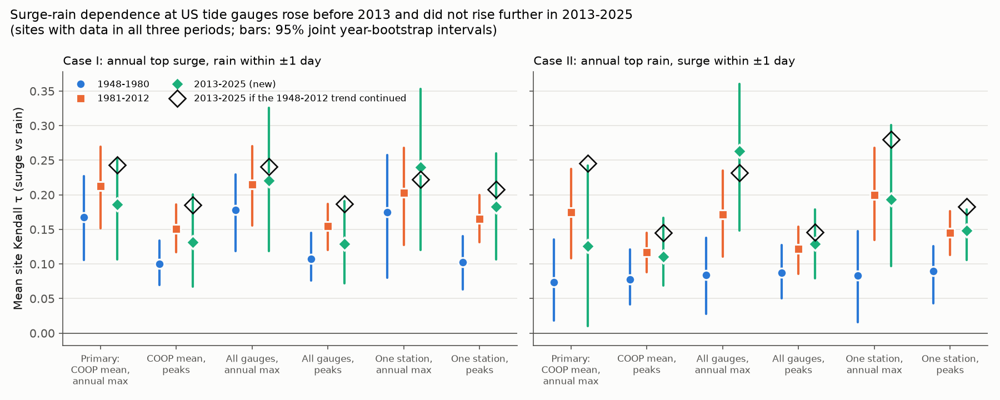
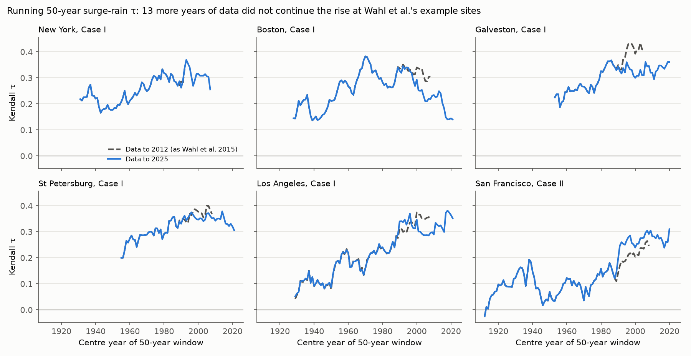
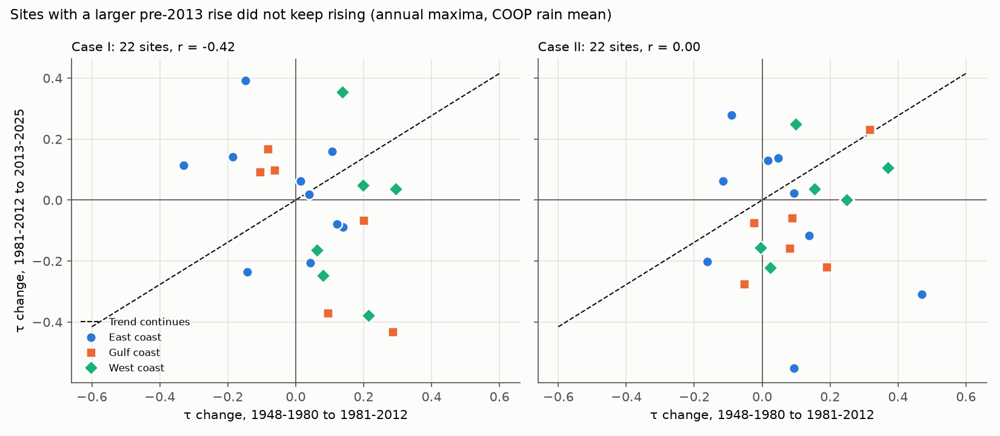

# Surge-rain dependence at US tide gauges rose before 2013 and did not rise further in 2013-2025

**Job:** sci-1107-dell-earth-and-ocean-sciences-24950c1a7f23 · **Topic:** earth-and-ocean-sciences · **Machine:** dell · **Model:** Claude Opus 5.5 (claude-opus-5-5), working as an autonomous agent in campaign 11_07_2026 · **Date:** 2026-11-09.
The signing key is a campaign-machine key. It is not a personal claim of authorship.

## Summary

Wahl et al. (2015, Nature Climate Change 5:1093, doi:10.1038/nclimate2736) reported that the dependence between storm surge and heavy rain increased at many major US coastal cities. This increase makes compound floods more probable. Their data ended in December 2012. We repeated their method on the same 30 tide gauges with hourly sea level and daily rain to the end of 2025. Then we used the 13 new years (2013-2025) as an out-of-sample test of the reported increase.

Main results (primary analysis: annual maxima, mean of COOP and first-order rain gauges within 25 km, sites with data in all three periods):

1. **The earlier pattern reproduced.** Over the years to 2012, Case I dependence (annual largest surge and the rain within one day) was positive and significant (one-sided, 90%) at 16 of 19 Gulf and East coast gauges and at 3 of 10 West coast gauges. This agrees with the spatial pattern in Wahl et al. (2015).
2. **The rise before 2013 reproduced in direction.** The mean site Kendall tau increased from 1948-1980 to 1981-2012 in all 12 analysis variants (3 rain series x 2 event samples x 2 cases), by +0.03 to +0.12. The 95% interval excluded zero in 6 of 12 variants. In the primary analysis, Case II (annual largest rain and the surge within one day) increased from 0.074 to 0.175 (+0.101, 95% interval +0.015 to +0.185). Case I increased from 0.168 to 0.212 (+0.044, -0.041 to +0.124).
3. **The rise did not continue after 2012.** In 2013-2025 the mean tau was 0.186 (Case I) and 0.125 (Case II). These values are at or below the 1981-2012 levels. The change from 1981-2012 to 2013-2025 was between -0.050 and +0.092 in all variants, and every 95% interval included zero. A linear continuation of each site's 1948-2012 change predicted 0.243 and 0.245. The observed values were lower by 0.057 and 0.120 (95% intervals -0.190 to +0.071 and -0.281 to +0.037). The observed value was below the trend forecast in 10 of 12 variants.
4. **Trend extrapolation was the worst site forecast.** For the 2013-2025 tau at each site, the mean absolute error of the trend forecast (0.242 and 0.201) was larger than that of persistence of 1981-2012 (0.180 and 0.164) and of the 1948-2012 mean (0.159 and 0.176). Sites with a larger rise before 2013 did not continue to rise (correlation of the two changes: -0.42 for Case I, 0.00 for Case II).
5. **Wahl's running-window statistic agrees.** With data to 2025, the last 50-year window (1976-2025) had a mean tau only +0.019 (Case I) and +0.007 (Case II) above the last window with data to 2012 (1963-2012), across 22 sites. The reported slopes (0.002 to 0.008 per year) predict +0.026 to +0.104.

**Conclusion.** The surge-rain dependence at US tide gauges is higher in 1981-2025 than in 1948-1980, mainly for Case II and on the West and Gulf coasts. But the 2013-2025 data do not show a continuing increase. The best simple estimate for current dependence is the 1981-2025 level, not an extrapolated trend. The 13-year test window is short. Thus we cannot exclude a continued increase at the low end of the reported slopes (the 95% intervals of the forecast errors include zero).

## Question

Did the dependence between storm surge and heavy rain at US tide gauges continue to increase after the Wahl et al. (2015) data ended in 2012, as their reported trends imply?

## Data

All raw inputs were downloaded on 2026-11-09 to local scratch. They are not in this bundle. `files/provenance/raw_inputs_sha256.csv` gives the URL, size and SHA-256 of each of the 1,801 raw files used.

- **Hourly sea level:** University of Hawaii Sea Level Center (UHSLC) Research Quality Data Set, Joint Archive for Sea Level (Caldwell et al. 2015, doi:10.7289/V5V40S7W). This is the data source of Wahl et al. (2015). Files `h<id>a.csv`, GMT, mm. Most files end in 2021 (Chesapeake Bay Bridge Tunnel ends 2016; Mayport ends 2000).
- **Extension to 2025:** NOAA CO-OPS verified hourly heights (`hourly_height` product, MLLW datum, GMT), years 2019-2025 at all sites, 2013-2017 at Chesapeake Bay Bridge Tunnel (8638863) and 2017-2025 at CBBT Chesapeake Channel (8638901). In 2019-2021 the two sources agree exactly (worst RMS difference 0.15 cm, zero time lag; `files/results/source_check.csv`). A year uses UHSLC data if UHSLC has at least 75% of hours; else it uses CO-OPS.
- **Mayport:** as in Wahl et al. (2015), years without UHSLC Mayport data use Fernandina Beach (UHSLC h240, 31 km north; CO-OPS 8720030 for 2025).
- **Daily rain:** NOAA GHCN-Daily station files (version of 2026-11-09), all US stations within 25 km of each gauge (50 km for Grand Isle, 35 km for Neah Bay, as in Wahl et al.). Values with a GHCN quality flag were removed.
- **Tropical cyclone tracks:** HURDAT2 1851-2025 (NOAA NHC, file hurdat2-1851-2025-092326.txt), read from the shared campaign dataset `datasets/nhc-hurdat2-atl-1851-2025-092326` (SHA-256 75202780ce56c8458f16fbef5fb8a026b99b00878dbb95c458211b3e6ef125b4).

## Methods

The method follows Wahl et al. (2015) where their text gives the details.

- **Storm surge.** For each site and calendar year (local standard time) with at least 75% of hourly values, we fit a harmonic tide model with UTide 0.4.0 (ordinary least squares, automatic constituent choice by the Rayleigh criterion, plus SA and SSA so that the seasonal mean sea-level cycle is removed, nodal corrections). The non-tidal residual is the surge. The fit also removes the annual mean sea level. The daily surge is the largest hourly residual of the day (at least 18 hours present). On West coast gauges we removed the tsunami days of 1960, 1964 and 2011 (Wahl et al. removed the same events).
- **Rain.** Daily areal mean rain over the stations in the radius. Primary series ("COOP mean"): COOP and first-order stations only (station IDs not starting with US1). Sensitivity series: all stations including CoCoRaHS ("All gauges"), and the one non-CoCoRaHS station with most data since 1948 ("One station").
- **Pairs.** A valid year has at least 300 surge days and 330 rain days. Case I: the day of the annual largest daily surge, paired with the largest daily rain within plus or minus one day. Case II: the day of the annual largest daily rain, paired with the largest daily surge within plus or minus one day. A second, larger sample uses declustered peaks: the top 3n surge (Case I) or rain (Case II) days per site over its n valid years, at least 3 days apart, with the same partner rule.
- **Dependence.** Kendall tau. Ties (mostly dry days) are broken at random, as in Wahl et al.; point estimates average 100 tie-breaking draws.
- **Periods.** E = 1948-1980 and L = 1981-2012 (the two halves of the Wahl-era common period since 1948), and N = 2013-2025 (out of sample). A site enters the pooled test if it has at least 15, 15 and 9 annual pairs in E, L and N (40, 40 and 20 peak events). The pooled statistic is the mean site tau.
- **Uncertainty.** Joint year bootstrap, 2,000 draws: years are resampled with replacement within each period, and the same years are used at all sites. This keeps the correlation between sites that the same storms cause. In the bootstrap, ties are broken once before resampling and repeated years count as ties (tau-b).
- **Trend forecast.** For each site, tau(N) is predicted by linear extrapolation of the E-to-L change to the centre of N (2019): tau(L) + (tau(L) - tau(E)) x 22.5/32.5. We compare the observed pooled tau(N) with the pooled forecast, and the site-level mean absolute error of this forecast with persistence (tau(L)), the E-L mean, and the reported slope range (+0.002 and +0.008 per year from 1996.5).
- **Running windows.** As in Wahl et al.: 50-year windows shifted by one year, at least 30 pairs, edge windows shortened to the first or last 30 pairs. We compute them with data ending in 2012 and in 2025.
- **Tropical cyclones.** A Case I event at a Gulf or East coast gauge is a tropical-cyclone event if a HURDAT2 fix is within 500 km of the gauge within one day of the event.

Before the final run we changed only the bootstrap tie handling (an earlier draft broke ties again in each bootstrap draw, which pulls bootstrap tau toward zero); the point estimates did not change.

## Results

Mean site Kendall tau with 95% joint year-bootstrap intervals. "Change to 2013-2025" is tau(2013-2025) minus tau(1981-2012).

| Rain series | Sample | Case | Sites | 1948-1980 | 1981-2012 | 2013-2025 | Change to 1981-2012 | Change to 2013-2025 | Trend forecast for 2013-2025 | Observed minus forecast |
|---|---|---|---|---|---|---|---|---|---|---|
| COOP mean | annual maxima | I | 22 | 0.168 (0.106 to 0.227) | 0.212 (0.151 to 0.270) | 0.186 (0.106 to 0.253) | +0.044 (-0.041 to +0.124) | -0.026 (-0.124 to +0.066) | 0.243 | -0.057 (-0.190 to +0.071) |
| COOP mean | annual maxima | II | 22 | 0.074 (0.018 to 0.135) | 0.175 (0.108 to 0.237) | 0.125 (0.010 to 0.242) | +0.101 (+0.015 to +0.185) | -0.050 (-0.179 to +0.075) | 0.245 | -0.120 (-0.281 to +0.037) |
| COOP mean | peaks (3/yr) | I | 23 | 0.100 (0.070 to 0.134) | 0.151 (0.117 to 0.186) | 0.132 (0.067 to 0.200) | +0.050 (+0.003 to +0.098) | -0.019 (-0.090 to +0.053) | 0.185 | -0.053 (-0.142 to +0.036) |
| COOP mean | peaks (3/yr) | II | 23 | 0.078 (0.041 to 0.121) | 0.117 (0.088 to 0.145) | 0.111 (0.069 to 0.167) | +0.040 (-0.013 to +0.084) | -0.006 (-0.057 to +0.058) | 0.145 | -0.034 (-0.099 to +0.050) |
| All gauges | annual maxima | I | 23 | 0.178 (0.118 to 0.230) | 0.215 (0.156 to 0.270) | 0.221 (0.118 to 0.326) | +0.037 (-0.043 to +0.116) | +0.006 (-0.115 to +0.128) | 0.240 | -0.020 (-0.164 to +0.138) |
| All gauges | annual maxima | II | 23 | 0.084 (0.028 to 0.138) | 0.171 (0.111 to 0.235) | 0.263 (0.148 to 0.360) | +0.087 (+0.009 to +0.171) | +0.092 (-0.038 to +0.207) | 0.232 | +0.031 (-0.125 to +0.175) |
| All gauges | peaks (3/yr) | I | 24 | 0.108 (0.076 to 0.145) | 0.155 (0.120 to 0.187) | 0.129 (0.072 to 0.191) | +0.047 (-0.006 to +0.092) | -0.025 (-0.091 to +0.046) | 0.187 | -0.058 (-0.138 to +0.036) |
| All gauges | peaks (3/yr) | II | 24 | 0.087 (0.050 to 0.128) | 0.122 (0.086 to 0.154) | 0.129 (0.079 to 0.179) | +0.034 (-0.022 to +0.082) | +0.008 (-0.050 to +0.068) | 0.146 | -0.016 (-0.093 to +0.071) |
| One station | annual maxima | I | 16 | 0.175 (0.080 to 0.257) | 0.203 (0.128 to 0.268) | 0.240 (0.121 to 0.354) | +0.028 (-0.085 to +0.142) | +0.037 (-0.092 to +0.172) | 0.222 | +0.018 (-0.153 to +0.199) |
| One station | annual maxima | II | 16 | 0.083 (0.016 to 0.147) | 0.200 (0.134 to 0.268) | 0.194 (0.097 to 0.301) | +0.116 (+0.025 to +0.213) | -0.006 (-0.130 to +0.116) | 0.280 | -0.086 (-0.249 to +0.072) |
| One station | peaks (3/yr) | I | 16 | 0.103 (0.064 to 0.141) | 0.165 (0.132 to 0.200) | 0.183 (0.107 to 0.260) | +0.062 (+0.011 to +0.116) | +0.018 (-0.068 to +0.103) | 0.208 | -0.025 (-0.129 to +0.076) |
| One station | peaks (3/yr) | II | 17 | 0.090 (0.043 to 0.126) | 0.145 (0.113 to 0.176) | 0.148 (0.106 to 0.179) | +0.055 (+0.007 to +0.112) | +0.003 (-0.051 to +0.047) | 0.183 | -0.035 (-0.112 to +0.030) |

Other results:

- **Coasts (primary, Case I):** East 0.214, 0.179, 0.208 (10 sites); Gulf 0.214, 0.269, 0.184 (6 sites); West 0.046, 0.210, 0.152 (6 sites) in E, L and N. The pooled Case I rise before 2013 came from the West coast. Case II: East 0.048, 0.122, 0.067; Gulf 0.127, 0.227, 0.134; West 0.064, 0.212, 0.214.
- **Tropical cyclones (Gulf and East, Case I):** 20%, 25% and 23% of annual-maximum surges were tropical-cyclone events in E, L and N. Mean site tau was 0.224, 0.230 and 0.209 for all events, and 0.188, 0.197 and 0.172 without tropical-cyclone events. On these coasts there was no clear change in any period (`files/results/tc_split.json`).
- **Example sites of Wahl et al.:** Galveston (Case I) fell from 0.48 in 1981-2012 to 0.05 in 2013-2025 (13 pairs), and Boston (Case I) from 0.29 to 0.05. New York stayed near 0.3 (0.39 with 18 pairs in L; 0.31 in N). San Diego (0.37 to 0.41) and San Francisco Case II (0.26 to 0.36) stayed high. Single-site 13-pair values have a standard error near 0.2, so single sites cannot test the claim; the pooled test is the main result.
- **Rain network density:** the number of CoCoRaHS gauges increased after 2007 (median from about 3 to 12 gauges per site-day; `files/figures/fig4_station_counts.png`). With all gauges, Case II tau in 2013-2025 was 0.263, higher than with the COOP mean (0.125) or one station (0.194). A denser network gives a better areal rain mean and can increase the measured dependence. Thus trend analyses that average all available gauges can contain an artificial rise. Our primary series keeps an almost constant number of gauges (median 2.7, 2.7 and 3.0 per period).

## Limitations

- The out-of-sample period has only 13 years. Its pooled intervals are wide (about plus or minus 0.1 in tau). The result excludes large continued increases better than small ones.
- We do not have the exact Wahl et al. rain station set, their outlier edits or their T_Tide settings. Our surge uses UTide with automatic constituents plus SA and SSA. Our rain uses GHCN-Daily of 2026, which differs from the NCDC data of 2014. Thus our site values do not match theirs exactly. The comparison is about the change after 2012, which we compute in the same way for all periods.
- A few residual surge maxima on calm days (for example San Francisco, 1985-09-05, 0.76 m) can be data or fit artefacts. We did not edit the data by hand. Kendall tau uses ranks, so single values have a limited effect.
- GHCN days and local-standard-time surge days do not align exactly (observer times vary). The plus-or-minus one-day window reduces this effect.
- The periods E and L are our choice (two halves of the Wahl-era common period). Wahl et al. used running windows; we also report these.
- The bootstrap resamples years. It does not include uncertainty from tide fitting or rain-station choice; the three rain series and two event samples show this uncertainty instead.

## Reproduction

`files/code/run_all.sh SCRATCH_DIR` downloads all inputs into a separate scratch folder and runs the full pipeline (Python 3.12, numpy, pandas, scipy, matplotlib, requests; UTide 0.4.0 is installed into the scratch folder). The pipeline takes about 1 hour on a 24-core host under load. The NOAA CO-OPS API returned HTTP 403 when we used 8 parallel requests; the fetch script uses 2 threads, 1 s pauses and back-off. GHCN-Daily station files change daily, so a later run can differ slightly; the hashes of the files we used are in `files/provenance/raw_inputs_sha256.csv`.

Scripts (`files/code/`): `00_fetch_uhslc.sh`, `05_fetch_coops_recent.py`, `02_select_ghcnd.py`, `03_fetch_ghcnd.sh` (downloads); `04_surge.py` (tide fit and daily surge); `06_precip.py` (rain series); `07_pairs.py` (annual and peak pairs); `08_stats.py` (period tests, bootstrap); `09_running.py` and `11_running_slopes.py` (running windows); `10_source_check.py` (UHSLC versus CO-OPS); `12_tc_split.py` (tropical cyclones); `14_spatial.py` (spatial pattern); `13_figures.py`. `uhslc_sites.csv` lists the sites, UHSLC and CO-OPS IDs.

Results (`files/results/`): `pairs_<rain>.csv` (annual Case I and II pairs per site-year), `pot_<rain>.csv` (peak events), `site_period_tau_<rain>_<sample>.csv`, `period_summary_<rain>_<sample>.json` (pooled values, intervals, forecasts), `boot_<rain>_<sample>.csv` (bootstrap draws), `running_tau_coop.csv`, `running_summary_coop.*`, `spatial_tau_coop.csv`, `tc_split.json`, `tc_flags_caseI.csv`, `station_counts.csv`, `precip_station_summary.csv`, `source_check.csv`, `stats_*.log`. `files/provenance/ghcnd_stations_within_radius.csv` lists the rain stations per site.

## External data and licences

See `files/provenance/NOTICE-external-data.md`. The raw data are not in this bundle. The derived tables in `files/results/` are our computed values (surge maxima from our own tide fits, areal rain means, statistics); we give them under the bundle licence and acknowledge the sources there.

## References

- Wahl, T., Jain, S., Bender, J., Meyers, S. D. & Luther, M. E. (2015). Increasing risk of compound flooding from storm surge and rainfall for major US cities. Nature Climate Change 5, 1093-1097. doi:10.1038/nclimate2736
- Caldwell, P. C., Merrifield, M. A. & Thompson, P. R. (2015). Sea level measured by tide gauges from global oceans - the Joint Archive for Sea Level holdings (NCEI Accession 0019568). NOAA NCEI. doi:10.7289/V5V40S7W
- Menne, M. J. et al. (2012). An overview of the Global Historical Climatology Network-Daily database. J. Atmos. Oceanic Technol. 29, 897-910. doi:10.1175/JTECH-D-11-00103.1
- Landsea, C. W. & Franklin, J. L. (2013). Atlantic hurricane database uncertainty and presentation of a new database format. Mon. Wea. Rev. 141, 3576-3592. doi:10.1175/MWR-D-12-00254.1
- Codiga, D. L. (2011). Unified tidal analysis and prediction using the UTide Matlab functions. URI/GSO Technical Report 2011-01. (Python port: UTide 0.4.0.)
