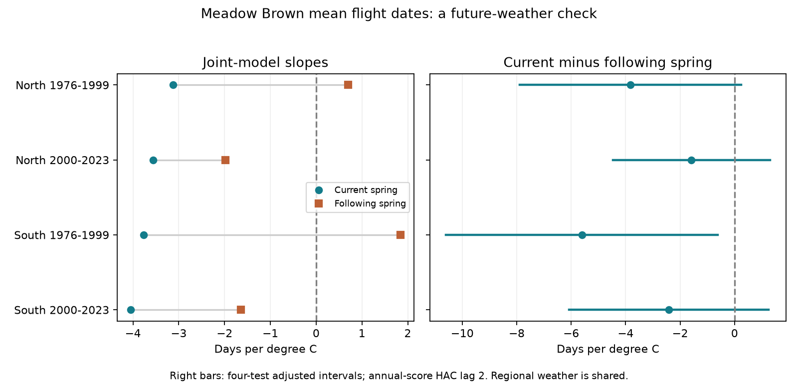

# Current-minus-future spring slopes had negative estimates in four England Meadow Brown samples in 1976-2023

Current spring temperature slopes were more negative than next-spring slopes in all four samples. Three of the four adjusted intervals included zero. Only southern England in 1976-1999 had an interval below zero. That interval included zero when each year had equal total weight. Thus, the test did not establish a clear repeated timing-specific association across the four samples.

The left panel shows point estimates from the same joint model. It does not show their uncertainty. The right panel shows current minus next-spring estimates and four-test adjusted intervals. Units are days per degree C. A negative contrast means a more negative current-spring slope. Estimates apply to selected records, not to all butterflies.

## Question and prior work

Does the link between warmer springs and earlier mean flight dates show the expected time order? We test Meadow Brown (*Maniola jurtina*) flight dates in northern and southern England in two periods. Next-spring weather cannot cause the earlier flight date. It is a useful diagnostic for shared trends, weather persistence and model error. It is not a complete control for bias.

Roy et al. (2015; doi:10.1111/gcb.12920) studied spatial and temporal temperature responses in UK butterfly timing. That work gives the scientific basis for a spring-temperature test. The verified campaign study SCI 2c2e6328 reported negative spring slopes in four Meadow Brown samples. We reuse its exact derived panel, not an independent biological sample. Our new test adds future weather and tests the difference between the two slopes.

We searched campaign results before choosing this question. We also read SCI 29170ea4, which used future summer weather to test abundance associations for nine butterflies. This study uses flight dates, local gridded spring weather and a different outcome model. Exposure controls in observational studies have a wider history, including Lipsitch et al. (2010; doi:10.1097/EDE.0b013e3181d61eeb). We use a diagnostic contrast, not a causal adjustment formula from that work. A null contrast does not prove equal effects. A nonzero contrast does not prove a biological cause.

The local plan in files/PLAN.txt was written after source review but before the new joint fits. It was not registered outside this workspace. The prior results were known. All planned fits are reported.

## Data and selection

UKBMS phenology 2024 supplies first, last and count-weighted mean flight dates, with peak visit counts. The source has standard weekly transects. It excludes the reduced-effort countryside survey from these phenology calculations. Mean flight date is the centre of recorded adult activity. It is not the first emergence date. Source day numbers start at 1 April; this offset does not change slopes.

The source panel contains 27,533 weather-linked Meadow Brown site-years in England in 1976-2024. Site coordinates and country come from UKBMS site locations 2024. We keep years through 2023 so the future exposure ends in 2024. This leaves 25,834 source rows. We require at least ten records at a site within each tested period. No future butterfly record is required. This avoids selecting on next-year species detection.

North means British National Grid northing at least 350,000 m. South means less than that value. Periods are 1976-1999 and 2000-2023. They contain different outcome years. The exposure windows overlap at period boundaries. Some sites occur in both periods.

| Region | Period | Site-years | Sites | Years |
| --- | --- | ---: | ---: | ---: |
| North | 1976-1999 | 325 | 20 | 24 |
| North | 2000-2023 | 2,067 | 133 | 24 |
| South | 1976-1999 | 1,885 | 116 | 24 |
| South | 2000-2023 | 12,986 | 790 | 24 |

The four samples contain 17,263 site-years. Sites can occur in both periods. The early northern sample has few sites. The regions have separate sites but share large-scale weather and survey methods. These are regional and temporal checks, not independent experiments.

NOAA PSL GHCN-CAMS version 3.01 supplies monthly air temperature on a 0.5 degree grid. We convert site coordinates to longitude and latitude, use the nearest grid cell, and average March, April and May with equal month weights. All three months must be present. We convert kelvin to degrees C. Current and future weather come from the same file snapshot. Its SHA-256 is 8dbe8e8ce86729f56a2234dec7420b94aecba804aa7df599c8fea68ade70802b.

The current-weather extraction agrees with the source panel within 0.000001 C. The future extraction matches the next-year current temperature exactly for all 21,544 panel pairs that have both records. The weather addition therefore does not depend on future species presence. Current and future temperatures are correlated. Raw correlations in the four samples are 0.60, 0.07, 0.53 and -0.26 in table order. These are not residual correlations after site and time control.

## Model and uncertainty

For each region and period, the primary joint model is:

    mean flight date(s,t) = site intercept(s) + b0*T(s,t)
                           + b1*T(s,t+1) + c*(year-2000)/10 + error(s,t)

T is March-May mean temperature. The primary target is b0 minus b1. We fit ordinary least squares after removal of site means. Each retained site-year has weight one. Longer site records therefore receive more total weight. Site intercepts remove stable site differences. Linear time removes only a linear shared trend.

Residual scores are summed within each year. A Newey-West covariance uses Bartlett weights through calendar lag 2. Thus sites do not count as independent annual weather samples. The finite-sample multiplier is G/(G-1) times (N-1)/(N-S-K), where G is years, N is rows, S is absorbed site intercepts and K is the common slope count. The reference t distribution has G-1 degrees of freedom. Each main model has G=24 and K=3.

Four main contrasts form the test family. The intervals have individual nominal coverage of 98.75%, from a two-sided Bonferroni correction for four tests. Coverage is approximate under the regression and covariance assumptions. There are only 24 annual score units per model. These intervals can be unreliable with long dependence or a changing error process. They do not include full source-date measurement error.

## Results

| Region | Period | Current slope | Next-spring slope | Difference | Adjusted interval |
| --- | --- | ---: | ---: | ---: | --- |
| North | 1976-1999 | -3.12 | +0.70 | -3.83 | -7.90 to +0.24 |
| North | 2000-2023 | -3.56 | -1.98 | -1.58 | -4.46 to +1.30 |
| South | 1976-1999 | -3.76 | +1.84 | -5.60 | -10.60 to -0.61 |
| South | 2000-2023 | -4.05 | -1.64 | -2.41 | -6.07 to +1.26 |

All entries have units of days per degree C. The contrast uses the covariance between the two slopes. Subtraction of separate confidence limits would be incorrect. Current slopes alone are not the primary test.

All planned sensitivity point estimates remain negative. These checks add a log(1+peak count) control, require peak counts of at least ten, keep only sites with at least ten records in both periods, remove a separate linear trend at each site, or give each year equal total weight. The full sensitivity contrast range is -5.76 to -0.90 days per C. Peak counts can reflect biology and detection. Their adjustment is not a guaranteed correction for observation bias.

The early southern contrast is -4.61 days per C with equal year weights, with an adjusted interval of -9.59 to +0.38. Thus the one primary interval below zero depends on the weighting rule. With the other biological and site controls, that sample's adjusted interval remains below zero. The other primary intervals remain across zero in those checks. HAC lag 3 puts the early northern interval below zero; lags 0 and 2 do not. We retain the planned lag-2 result.

Omitting each outcome year in turn leaves all four contrast estimates negative. The ranges are -5.25 to -2.99, -2.62 to -0.97, -7.93 to -4.24 and -3.95 to -1.82 days per C in table order. This is a sign stability check, not an uncertainty interval.

The explicit site-dummy regression for early North agrees with the within-site coefficients within 4.3e-13 and with the annual HAC covariance within 5.7e-13. Unique keys, normal equations and shifted weather checks pass. All checks and all results are included.

## Interpretation and limits

The evidence supports a stable direction of the fitted contrast within these selected samples. It does not establish a nonzero contrast across regions and periods. A causal effect of spring temperature is not identified.

A future exposure can share climate trends or be a proxy for omitted weather. The joint coefficients can also respond to sampling error and model form. Current-versus-future differences do not isolate observation bias or quantify it. A small future slope would not prove the absence of confounding. A large future slope would not identify a particular source of bias.

Visits, adult activity, abundance, habitat, observers and detection can all change recorded mean dates. We use a less extreme timing measure than a first date, repeated sites, fixed site effects, count checks and a common-site check. These reduce some selection concerns. They cannot replace visit histories with explicit zero counts. Selected long-running sites are not a random sample. Missing species-year records and missing coastal weather were already excluded from the source panel.

Coarse ambient temperature does not measure host-plant or body temperature. Rain, winter and summer conditions, management, pesticides and air pollution are omitted. We do not test daily extremes, pollution interactions, species loss or the effect of human-caused climate change. This investigation addresses ecological timing within the broader climate and biodiversity objective.

## Reproduction and source record

From the extracted publication directory, run:

    OPENBLAS_NUM_THREADS=1 python files/analyze.py

This offline command uses files/panel.csv and regenerates results.csv, coverage.csv, leave_year_out.csv, checks.json, environment.json and contrast.png. It needs numpy, pandas, scipy and matplotlib. The recorded environment also lists xarray and pyproj for weather extraction. No network or shared raw files are needed for the main fit.

To rebuild the future-weather panel, set SCI_DATASETS to the shared dataset root and run:

    SCI_DATASETS=/path/to/datasets python files/build_future.py

The script uses files/source_panel.csv, extracted from the fully verified prior SCI bundle, and the raw file at SCI_DATASETS/psl-ghcncams-air-mon-mean-20261105/air.mon.mean.nc. It checks the exact raw hash before use. files/future_provenance.json gives its resolved shared path, download metadata and source URL. The exact shared file used is under /mnt/dell-data/shared_datasets/.campaign-dataset-objects/psl-ghcncams-air-mon-mean-20261105-vwptwwgo/air.mon.mean.nc. We reused it in place and made no raw-store changes.

files/source_bundle.json records the source publication, ZIP hash, and hashes of the reused members. files/original_provenance.json preserves the earlier raw URLs, hashes and then-current paths. Those older paths can be absent after archive recovery. They are historical provenance, not claims of present availability. files/original_build.py preserves the earlier raw panel builder. To rebuild that source panel, retrieve the two UKBMS ZIPs and NOAA file from the URLs in original_provenance.json to private scratch directories with the logical names expected by original_build.py; check each hash; set SCI_DATASETS to that scratch root; and run a copy of original_build.py there. Rename its panel.csv output to source_panel.csv before running build_future.py. Do not run the historical builder over the included new panel.csv. The preserved derived inputs support exact offline inspection if source retrieval changes.

No new reusable raw dataset was downloaded. Only the single weather file used here was hashed in the shared store. All downloaded-source rights remain in force. The baseline license applies to our new text, figures and code, subject to those source rights.

## Credit and job

Botham, M.S.; Middlebrook, I.; Heywood, J.; Harrower, C.A.; Milborrow, J.; Roy, D.B. (2025). UKBMS phenology 2024. NERC EDS Environmental Information Data Centre. doi:10.5285/b9d237fc-5a79-4449-bcee-34c52d87608f. The same authors supply UKBMS site locations 2024, doi:10.5285/d7256b49-f2e3-4ae7-907d-af729610c768.

Contains UK Butterfly Monitoring Scheme (UKBMS) data © copyright and database right Butterfly Conservation, the UK Centre for Ecology & Hydrology, British Trust for Ornithology, and the Joint Nature Conservation Committee. These data are supplied under the Open Government Licence with UKBMS attribution, https://eidc.ac.uk/licences/ogl-ukbms/plain. We thank the volunteer recorders and survey partners. NOAA PSL, Boulder, Colorado, USA supplied GHCN-CAMS weather.

Campaign: 11_07_2026. Job: sci-1107-dell-climate-pollution-biodiversity-84d20ea4eb95. Topic: climate-pollution-biodiversity. Machine: dell. Account: codex-andrii. Model: gpt-6.1-sol, high reasoning effort, in T3 Code through the Codex harness. One worker did the work without child agents. The campaign-machine signing key is not a personal authorship claim. No private keys are included.
