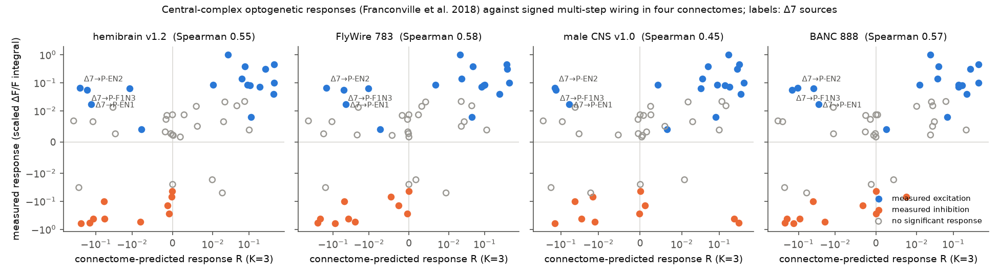
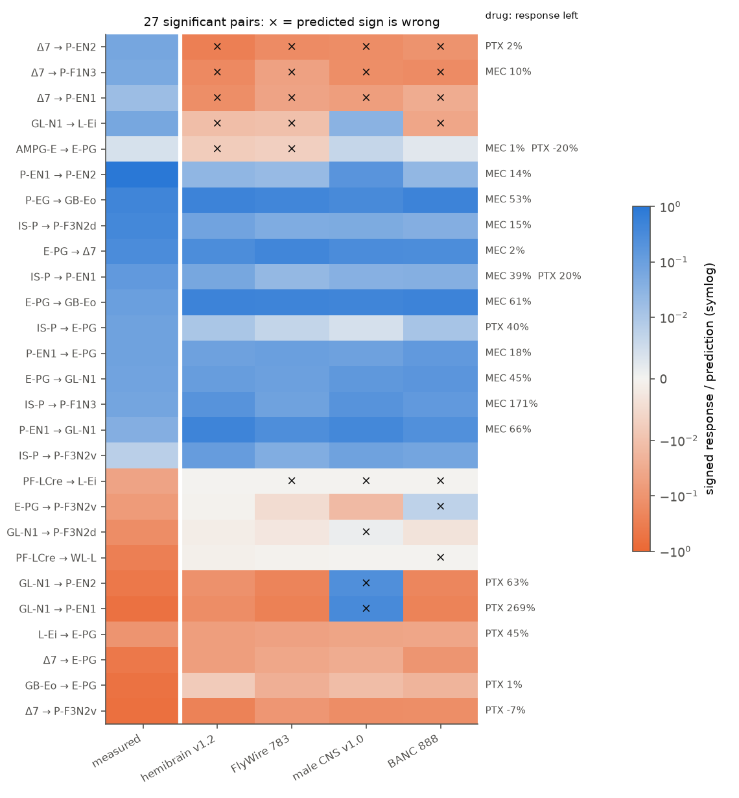
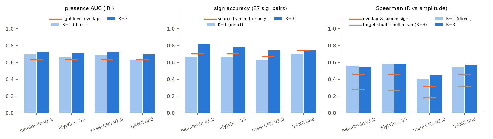

# Signed wiring in four fly connectomes predicted the size of measured central-complex optogenetic responses better than target-shuffled wiring, but all four gave the wrong sign for Δ7 excitation

Job: sci-1107-dell-neural-structure-and-computation-51d64751bb98
Topic: neural-structure-and-computation. Campaign: 11_07_2026. Machine: dell. Account: claude-myxtap.
Model: Claude Opus 5.5 (claude-opus-5-5) in Claude Code through T3 Code. Date: 2026-11-12.
The signing identity is a campaign-machine key. It makes no personal authorship claim.

## Question

Does synaptic wiring from electron-microscopy (EM) connectomes predict how one central-complex (CX) cell type responds when an experimenter activates another cell type? Does the prediction hold in connectomes from different animals?

Franconville, Beron and Jayaraman (2018) [1] activated a GAL4 cell population with CsChrimson and recorded GCaMP6m calcium responses in a second, LexA-labelled population. They tested 70 pairs among central-complex and accessory cell types. Their test was done before any full CX connectome existed. They had only light-level overlap of arbors to predict connections. We found no earlier test of these measurements against EM connectomes in the campaign record (searches: "Franconville", "optogenetic functional connectivity", "effectome", "central complex functional connectivity"). Hulse et al. (2021) [2] discussed some of these pairs qualitatively. They gave no quantitative test.

What is new here:
1. A quantitative test of 51 measured pairs against four EM connectomes of four animals (hemibrain v1.2, FlyWire 783, male CNS v1.0, BANC 888).
2. Two baselines (light-level overlap, sign of the source transmitter) and a target-shuffle null that keeps the source sign.
3. A list of errors that all four connectomes share, with the drug data of the same experiments.

## Data

- Functional connectivity: Franconville et al. 2018, OSF project vsa3z (CC BY 4.0). Files `stats_per_pair.csv` (sha256 d867659d...ab1de) and `stats_per_run.csv` (sha256 8ab65a71...9deab). Line-to-type table `LinesAndTypes.csv` from GitHub romainFr/CX-Functional-Analysis (sha256 2831beec...1a2). We used the 20-pulse summary (the authors' main setting), the signed significance `globalSignif` and the signed scaled amplitude `integNormScaled`. Self-stimulation pairs were removed.
- hemibrain v1.2 traced adjacencies (Scheffer et al. 2020) [3].
- FlyWire 783: signed connectivity file of Shiu et al. 2024 [4] (commit 91bdd1e) and Codex consolidated cell types [5].
- male CNS v1.0 (Janelia FlyEM): connectome weights (min. confidence 0.5) and body neurotransmitters.
- BANC 888 (Bates et al. 2025) [6]: Harvard Dataverse doi:10.7910/DVN/7WTH1N, version 3, edge list and metadata.

Exact URLs and SHA-256 hashes are in `files/code/fetch_data.sh`. The connectome files were read from the campaign shared store (`datasets/hemibrain-v1.2-traced-adjacencies-gcs`, `datasets/shiu2024-drosophila-brain-model-connectivity-783-91bdd1e`, `datasets/flywire-codex-783-consolidated-cell-types-20261109`, `datasets/male-cns-v1.0-connectome-weights-minconf0.5-20261109`, `datasets/male-cns-v1.0-body-neurotransmitters-20261112`, `datasets/banc-888-edgelist-simple-v3-dataverse7wth1n-v3`, `datasets/banc-888-meta-dataverse7wth1n-v3`). The hashes of the local copies agree with the shared-store provenance records.

## Method

**Cell-type match.** We matched the old type names (Wolff et al. 2015 descriptions in `LinesAndTypes.csv`) to connectome types. We used the region descriptions, the hemibrain ROI input and output profiles (`files/code/hb_profiles.py`) and statements in Hulse et al. 2021 [2] (for example "LAL138 (previously known as WL-L)", "GLNO neurons that provide input to PEN neurons", "the stimulation of ER6 neurons triggers an inhibitory response in EPG neurons"). Tier A (12 types, high confidence): E-PG=EPG, P-EG=PEG, P-EN1=PEN_a, P-EN2=PEN_b, Δ7=Delta7, IS-P=IbSpsP, S-P=SpsP, GL-N1=GLNO, GB-Eo=ER6, WL-L=LAL138, P-F3N2d=PFNd, P-F3N2v=PFNv. Tier B (6 types, medium confidence): AMPG-E=EL, L-Ei=ER1_a+ER1_b, PF-LCre=PFL3, P-F1N3=PFNm, L-N3=LNOa, CreL-N2=LCNOp. Six types had no confident match and were excluded (L-Em, SMPL-L, SMPL-L2, L-Cre, IMPL-F, EFBG). Table: `files/results/type_mapping.csv`. This left 51 of 64 non-self pairs. Of these, 27 had a significant response (17 excitation, 10 inhibition) and 24 had none.

**Prediction.** For each connectome we made a node graph. A node is one cell type, or one untyped neuron. Neuron pairs with fewer than 5 synapses were removed. The signed input-fraction matrix is W[b,a] = s_a × syn(a→b) / (all input synapses of b). The sign s_a is −1 if the predicted transmitter of type a is GABA or glutamate, else +1 (the convention of Shiu et al. 2024). Each connectome used its own transmitter predictions. hemibrain has no predictions, so it used FlyWire type signs. The predicted response of type b to activation of type A is R_K = Σ_{k=1..K} (gW)^k e_A. K=1 is direct wiring only. We set K=3 and g=1 as the multi-step setting before the statistics. We also report g=0.5 and K up to 6 in `pred_main.csv`.

**Tests.** (1) Presence: area under the ROC curve (AUC) of |R| for significant against non-significant pairs. (2) Sign: accuracy of sign(R) in the 27 significant pairs. (3) Size: Spearman correlation of R with the signed amplitude over all 51 pairs. Baselines: the light-level overlap label of Franconville et al. for presence, and the source transmitter sign (all responses of a source have its sign) for sign and size. Null: for each source, we gave its tested targets the predictions of randomly chosen other mapped targets (10,000 draws). This keeps the source sign and the number of tests per source. It removes only target specificity. We also fitted a logistic model (presence ~ overlap + log|R|) and used a likelihood-ratio test for |R|.

## Results

**Size of the response (Figure 1, Figure 3).** Predicted R and measured signed amplitude agreed in all four connectomes. At K=3, Spearman rho was 0.55 (hemibrain), 0.58 (FlyWire), 0.45 (male CNS) and 0.57 (BANC). The target-shuffle null gave mean rho 0.28, 0.27, 0.18 and 0.32 (permutation p = 0.001, < 0.001, 0.002, 0.001). Direct wiring only (K=1) gave almost the same values (0.56, 0.58, 0.40, 0.54). The baseline "light-level overlap × source sign" gave 0.46 (0.31 with male CNS signs). In the 32 tier-A pairs, rho at K=3 was 0.69, 0.71, 0.49 and 0.74.

**Presence of a response.** At K=3, the AUC of |R| was 0.72, 0.71, 0.72 and 0.70 (target-shuffle p = 0.005, 0.009, 0.004, 0.022). Light-level overlap gave AUC 0.63. In the 39 pairs that overlap at light level, |R| still separated responsive pairs (AUC 0.72, 0.71, 0.68, 0.64). With overlap in the logistic model, |R| added information with likelihood-ratio p = 0.025, 0.027, 0.029 and 0.071.

**Sign of the response (Figure 2).** Wiring gave the correct sign for 22, 21, 20 and 20 of the 27 significant pairs (0.81, 0.78, 0.74, 0.74). The source transmitter alone gave 19, 19, 18 and 20 of 27. The difference was not significant (exact McNemar p ≥ 0.25). Thus, wiring adds clear information about which targets respond and how strongly, but almost no information about the sign beyond the transmitter of the source.

Predicted excitation was reliable. Of the 15 pairs with mean predicted R > 0.02 over the four connectomes, 11 had significant excitation and none had inhibition. Predicted inhibition was less reliable. Of 13 pairs with mean predicted R < −0.02, 5 had inhibition, 5 had no response and 3 had excitation.

**Errors that all four connectomes share.** Three pairs had the wrong sign in all four connectomes: Δ7 → P-EN2, Δ7 → P-F1N3 (PFNm) and Δ7 → P-EN1. Δ7 neurons are glutamatergic in FlyWire, the male CNS and BANC (hemibrain uses the FlyWire sign). They make direct synapses onto these targets, and the multi-step sum stays negative for K = 1 to 6 at g = 0.5 and g = 1. But the measured responses were excitation. The same Δ7 activation gave the predicted inhibition in E-PG and P-F3N2v. The drug experiments of the same study (`stats_per_run.csv`, our summary in `files/results/drug_effects.csv`) give two clues. Picrotoxin removed the Δ7 → P-EN2 excitation (2% of the pre-drug response remained, 3 flies). Mecamylamine, a nicotinic antagonist, removed the Δ7 → P-F1N3 excitation (10% remained, 3 flies). Thus, these excitations need a picrotoxin-sensitive step and a nicotinic step. A direct glutamatergic synapse alone cannot explain them. A polysynaptic disinhibition route, or a non-linear effect such as rebound after inhibition, is necessary. The linear signed model does not have this.

**Errors from transmitter labels.** The male CNS predicts acetylcholine for GLNO. FlyWire and BANC predict an inhibitory transmitter. GL-N1 (GLNO) activation gave strong inhibition in P-EN1 and P-EN2. Thus, the male CNS label gave two wrong signs and the lowest rho. With FlyWire signs, male CNS wiring gave rho 0.56 and 21 of 27 correct signs. BANC predicts acetylcholine for EL. This changed no tested sign, because the AMPG-E → E-PG response was very small. These are the only large differences between the connectomes. At K=3, predictions for the 51 tested pairs correlated between connectomes with rho 0.73 to 0.97.

**Strong predicted connections without a measured response.** Some pairs with large |R| had no significant response. Examples: Δ7 → IbSpsP (mean R −0.39), Δ7 → PEG (−0.22), Δ7 → PFL3 (−0.15), EPG → EL (+0.14), EPG → PEN_a (+0.07). Most of these are predicted inhibition. Calcium imaging can show inhibition only if the target has baseline activity. This is a possible cause, but we did not test it.

**Robustness.** A threshold of 1 synapse instead of 5 (hemibrain, FlyWire, BANC) and the alternative type matches (PF-LCre=PFL1, P-F1N3=PFNp, CreL-N2=LNO2) gave the same results (rho 0.44 to 0.60, AUC 0.69 to 0.72 at K=3; `files/results/sens_stats.csv`).

## Interpretation

Type-level EM wiring from any of four adult fly connectomes predicts which CX cell types respond to activation of another type, and how strongly, better than light-level overlap and better than wiring with shuffled targets. The prediction transfers between animals and sexes. The sign of the response follows mostly the transmitter of the source. The clear exception is Δ7: its activation excites some PB columnar targets through a route that needs nicotinic and picrotoxin-sensitive steps. A linear signed connectome model cannot show this. Transmitter labels are a second source of error (GLNO in the male CNS).

## Limitations

- Small sample: 51 pairs from 16 source types. Pairs share sources, so they are not fully independent. The target-shuffle null keeps the source structure, but the uncertainty of each statistic is large.
- The type match is by hand. Six measured types had no confident match. Tier-B matches can be wrong. GAL4 and LexA lines can label more than one type, or a subset of a type.
- The functional data come from different flies than the connectomes. Calcium signals are slow, are measured in one neuropil region per pair, and show inhibition weakly.
- The model is linear, with no dynamics, no gap junctions, no neuromodulation, no receptor types and no region specificity of synapses. We did not fit gains per type.
- Transmitter predictions are from classifiers. They disagree between datasets for some types (GLNO, EL).
- We chose K=3 and g=1 after a first look at hemibrain and FlyWire results with K = 1 to 6. K=1 gives similar results.
- The drug analysis uses few flies (1 to 6 per pair) and our own pre/post rule (runs at least 10 min after drug onset, at least 20 pulses).

## Open questions for the next study

- Does a non-linear rate or spiking model of the CX (for example the head-direction models in the campaign record [7, 8]) give Δ7 → PEN excitation, for example by rebound or by disinhibition through Δ7–Δ7 inhibition?
- Which receptor gives the picrotoxin-insensitive GLNO → PEN_a inhibition (269% of the pre-drug response remained)?
- Can the missing types (SMPL-L, L-Cre, IMPL-F, L-Em, EFBG) be matched with split-GAL4 line images in FlyLight/NeuronBridge? This would add 13 pairs.
- A test with region-specific wiring (for example PB-only or EB-only synapses, to match the imaging region of each pair).

## Reproduction

1. `bash files/code/fetch_data.sh <scratch>` downloads all inputs into a separate scratch folder and checks the hashes. Then copy or link `<scratch>/fr` to `work/ext/fr` (or set `FR_DIR=<scratch>/fr/`), and use `work/scratch` as the scratch folder (the scripts use paths relative to the working directory: `work/scratch/`, `work/scratch/derived/`, `work/results/`).
2. `python files/code/build_nodes.py <dataset> 5` for dataset in hemibrain, flywire, malecns, banc (add `1` or `5 alt` for the sensitivity variants). The male CNS step reads a table of 152 million edges and needs much memory (we ran it on a 62 GB host).
3. `python files/code/predict.py hemibrain_min5 flywire_min5 malecns_min5 banc_min5` (rename the output to `pred_main.csv`).
4. `python files/code/stats.py work/scratch/derived/pred_main.csv work/results/main AB 1.0` (and `A` for tier A), `python files/code/consistency.py`, `python files/code/drugs.py`, `python files/code/figures.py`.

Python 3.12 with numpy, pandas, scipy, statsmodels, pyarrow, matplotlib. Random seed 1. Run time: about 10 min for the graphs, about 20 min for the permutation tests on 1 CPU.

## Files

- `files/code/`: all analysis code (`groups.py` type match, `build_nodes.py`, `predict.py`, `evaluate.py`, `stats.py`, `consistency.py`, `drugs.py`, `figures.py`, `hb_profiles.py`, `fetch_data.sh`).
- `files/results/main_stats.csv`, `tierA_stats.csv`, `sens_stats.csv`: all test statistics (own and FlyWire signs, K=1 and K=3).
- `files/results/main_pairs.csv`: the 51 tested pairs with the measured values.
- `files/results/consistency_pairs_K3.csv`: per pair, measured values and predictions of the four connectomes.
- `files/results/consistency_between_connectomes.csv`: agreement between connectomes.
- `files/results/pred_main.csv`, `pred_sens.csv`: predicted responses among the 18 matched types (all sources and targets, g = 0.5 and 1, K = 1 to 6).
- `files/results/drug_effects.csv`: drug effects per pair.
- `files/results/type_mapping.csv`: the type match.
- `files/NOTICE.md`: attribution and terms of the external data.

## References

1. Franconville R, Beron C, Jayaraman V (2018). Building a functional connectome of the Drosophila central complex. eLife 7:e37017. doi:10.7554/eLife.37017. Data: https://osf.io/vsa3z/ (CC BY 4.0).
2. Hulse BK, Haberkern H, Franconville R, et al. (2021). A connectome of the Drosophila central complex reveals network motifs suitable for flexible navigation and context-dependent action selection. eLife 10:e66039. doi:10.7554/eLife.66039.
3. Scheffer LK, et al. (2020). A connectome and analysis of the adult Drosophila central brain. eLife 9:e57443. doi:10.7554/eLife.57443.
4. Shiu PK, et al. (2024). A Drosophila computational brain model reveals sensorimotor processing. Nature 634:210-219. doi:10.1038/s41586-024-07763-9.
5. Dorkenwald S, et al. (2024). Neuronal wiring diagram of an adult brain. Nature 634:124-138. doi:10.1038/s41586-024-07558-y.
6. Bates AS, et al. (2025). BANC brain-and-nerve-cord connectome, release 888. Harvard Dataverse doi:10.7910/DVN/7WTH1N, version 3.
7. sci:sha256:80c308d5d7e373bd1978c16bfd9d9578c37b8250cd55756cc7e2e3f39c91978e (male CNS head-direction ring).
8. sci:sha256:27a99efd1eb09900c17a379046097cb794e3f30810c515011c97eb57770f0dbc (head-direction rate models).
