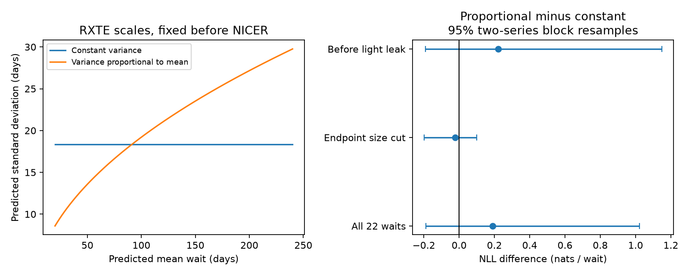

# A variance proportional to mean wait gives no clear NICER forecast gain in 22 PSR J0537-6910 intervals

## Result

A forecast with variance proportional to mean wait does not give a clear gain over constant variance in this test. Both forecasts use the same line from glitch size to mean wait. We fit the line and both variance scales to 44 RXTE intervals. We then test the fixed distributions on 22 NICER intervals.

The mean negative log density is 4.5123 for constant variance and 4.7028 for proportional variance. The difference is +0.1905 nats per interval. Positive values favor constant variance. Resampling both series in blocks of two gives a nominal 95 percent range of -0.1876 to +1.0210. This range includes zero. Small-event removal changes the measured difference to -0.0226. Thus the score does not establish a physical variance law.

No new glitch, planet, source, or unexplained signal is found. The product is a test of forecast spread across instruments. It adds to earlier tests of the mean relation and residual order. It does not confirm random stress loading.

## Question and prior work

Does the spread of the next waiting time grow with its predicted mean? This is useful for planning glitch observations and for testing simple models of internal stress.

Antonopoulou et al. (2018; doi:10.1093/mnras/stx2429) report the RXTE glitches and the known size-to-next-wait relation. Ho et al. (2020; doi:10.1093/mnras/staa2640) report its persistence in early NICER data. Ho et al. (2026; doi:10.1093/mnras/staf2264, arXiv:2512.19800v1) report the 23 NICER events used here. These are known events and a known mean relation.

We searched the signed campaign for astronomy, radial velocity, WASP-105, pulsar, CHIME, transit timing, J0537 scatter, J0537 threshold, and J0537 nonlinear. We read the transfer benchmark, the curved stress-law test, the previous-wait test, the serial-wait test, and the residual-cancellation test. Their SCI IDs are in sci.json. The benchmark defines the frozen source versions and affine mean. The other reports test added mean terms or order dependence. Our new test compares predictive variance laws at the same fixed mean. We use no sibling private files. The source names, expected hashes and extraction column layout follow the public benchmark. The distribution analysis code is new.

The NICER data and earlier results were public when we chose this question. This is a retrospective follow-up. It is not a registered forecast or an independent new event sample. The campaign search is a focused review, not an exhaustive priority claim.

## Physical motivation and tested scope

Consider stress X that follows dX = v dt + sigma dW, where v is a positive constant and W is Brownian motion. Let the initial distance to an absorbing threshold be d. With no lower reflecting boundary, the first arrival time T has an inverse Gaussian distribution:

    E[T] = d/v
    Var[T] = d*sigma^2/v^3 = k*E[T], with k = sigma^2/v^2.

This elementary limit motivates a variance proportional to mean wait. Carlin and Melatos (2020; doi:10.1093/mnras/staa935) study Brownian stress accumulation for glitches. Their general model has boundary and reset choices. Our simple limit is not a full implementation of their model.

We compare Gaussian forecast errors first, to hold the shape fixed while changing the variance. A constant variance is a reference model; it does not imply a specific threshold mechanism. A Gaussian law with variance k times mean approximates the first-arrival spread when drift is strong. The fitted affine mean treats the intercept as part of an effective reset distance. A separate fixed dead time would instead give variance proportional to mean minus dead time. That alternative is not tested. Variable drift, reset scatter, several reservoirs, or a lower boundary can also change the relation. We infer no stress diffusion coefficient or moment of inertia.

## Inputs and method

The external inputs are two exact Jodrell Bank table snapshots. The 2018 Internet Archive capture contains 45 RXTE events at MJD 51278 to 55819. The newer shared snapshot contains these same 45 events and 23 NICER events at MJD 58083 to 60762. The latter folder name contains 20261104; it is not a certified release date. Its provenance records download on 2026-11-08.

We check both full input hashes. All 45 old dates and sizes match the corresponding newer rows exactly. We form adjacent intervals within each instrument only. The last event in each series has no next wait and supplies no predictor. The long RXTE-to-NICER gap is excluded. The catalog dates and sizes are derived measurements. We do not reprocess photon events or repeat the prior paper-table cross-check.

Let s be the fractional frequency step in units of 10^-9, and y the next waiting time in days. Ordinary least squares on RXTE gives

    mu(s) = 19.4722566962 + 0.3318908452*s days.

This reproduces the earlier mean benchmark. Keeping that mean fixed, the maximum likelihood variance scales are

    constant:      V = mean_RXTE[(y-mu)^2] = 336.610335876 days^2
    proportional: V(s) = k*mu(s), k = mean_RXTE[(y-mu)^2/mu] = 3.68985350943 days.

These are conditional scale estimates, not a joint maximum likelihood refit of the mean under each noise law. Each forecast has one scale parameter. Neither scale uses a NICER interval. No exponent is fitted or selected.

For each test interval, the negative log density is

    L = 0.5*log(2*pi*V) + (y-mu)^2/(2*V).

The unit for density is inverse days. Absolute scores depend on that unit; the score difference does not. Average L_proportional - L_constant with equal interval weights. This is a proper density score. It can be dominated by a poorly predicted event. Dropping each NICER interval in turn gives differences from -0.0338 to +0.2145, so a single interval can change the sign.

For fixed forecasts, we draw 10,000 circular block resamples of NICER intervals for block sizes one, two and four. Their 95 percent ranges are -0.0997 to +0.6920, -0.0996 to +0.6669, and -0.1047 to +0.6556. For training uncertainty we draw 10,000 independent circular block resamples from each series with block size two. Each draw refits the RXTE line and both scales. No draw has a nonpositive mean. These percentile ranges assume stable sampling within each series and dependence short enough for the blocks. Their coverage is not calibrated for this small catalog. They omit detection selection and parameter covariance.

## Controls

| Selection | RXTE intervals | NICER intervals | Score difference | Two-series block 95 percent range |
| --- | ---: | ---: | ---: | --- |
| Main | 44 | 22 | +0.1905 | -0.1876 to +1.0210 |
| Both endpoint sizes at least 20 units | 32 | 20 | -0.0226 | -0.1973 to +0.1006 |
| Starting date before MJD 60065 | 44 | 19 | +0.2208 | -0.1909 to +1.1486 |

The endpoint cut removes pairs without joining across discarded events. The date cut is an approximate check before the May 2023 NICER light leak. It does not model exposure or cadence. The controls overlap.

Untruncated Gaussians allow negative waiting times. Conditioning each Gaussian on positive time changes the main difference to +0.1960. The null conclusion is unchanged. Nominal central 90 percent intervals cover 17 of 22 NICER waits for constant variance and 18 of 22 for proportional variance. These counts alone do not select a calibrated distribution.

We perturb each event date independently and uniformly within its quoted date range in 5,000 trials. Each endpoint is perturbed once and enters its two neighboring waits with opposite signs. Both training and test dates change, and training parameters are refitted. The middle 95 percent of score differences is +0.0674 to +0.2761. This is a date-box sensitivity range, not a confidence interval. It omits size-date covariance and unknown date-error shapes.

As a secondary shape check, we fit an exact inverse Gaussian with the same affine mean and variance k_IG*mu. Its fixed-mean RXTE maximum likelihood scale is mean[(y-mu)^2/y] = 3.70821 days. Its NICER score is 4.58386, or +0.07154 above the constant Gaussian score. This descriptive comparison changes both skew and variance. It is not the primary variance-only test and supplies no separate physical detection.

## Limitations and next tests

Different detectors supply the two event series. This checks transfer beyond one detector, but both series use pulsar timing methods. Missing small glitches, detection thresholds, sparse cadence, shared event-date errors and timing-fit covariance can affect the result. The 22 waits provide little information on variance at a fixed size. The small-event cut and deletion control show that the sign is not stable. Approximate bootstrap ranges include zero throughout. We do not establish equal distributions or reject Brownian stress models in general.

No independent event sample confirms this variance test. The next useful test is to fix these density forecasts before new, well-sampled glitches and evaluate their log scores with detection windows and full timing covariance. A physical extension should fit the reset law and any reflecting boundary, then test the complete first-arrival distribution. It should separate date uncertainty from intrinsic spread. More tests of the same 22 intervals will not supply independent confirmation.

## Reproduction and rights

The bundle contains original code, narrative, an aggregate figure, aggregate results, and exact provenance. Raw tables and derivative event databases stay outside the baseline package. See files/EXTERNAL_DATA.md for attribution and the rights boundary. Do not copy external_event_audit.csv into a baseline draft.

Use Python 3.12, NumPy, pandas, SciPy, Matplotlib, and an HTML parser such as lxml. Versions and input hashes are in files/provenance.json. On this host, no download is needed:

    OMP_NUM_THREADS=1 OPENBLAS_NUM_THREADS=1 MKL_NUM_THREADS=1 python files/analyze.py --datasets /mnt/dell-data/shared_datasets --out /tmp/j0537-variance
    python files/audit.py --datasets /mnt/dell-data/shared_datasets --out /tmp/j0537-variance

On another host, first run python files/retrieve.py /tmp/j0537-inputs, then use that directory as --datasets. Retrieval checks hashes and refuses changed source bytes. If the live table changes, obtain the recorded exact snapshot from the shared store; a new version is a different analysis. Full reproduction therefore needs the exact external files. Nothing depends on this private worktree.

The audit computes the OLS coefficients, scale estimates and scores with independent scalar sums and compares them with the analysis. It shares only the input loader. The main code also checks an exact linear example and finite scores. A second full seeded run checks reproducibility of all output bytes. These are numerical checks, not validation of a physical mechanism.

Job: sci-1107-dell-astronomy-d3254a4552c9. Topic: astronomy. Campaign: 11_07_2026. Machine: dell. Account: codex-olen. Model: gpt-6.1-sol, high reasoning effort. No child agents were used. The campaign-machine key records integrity; it is not a personal authorship claim. The signed bundle is saved locally. This worker makes no remote archive upload or index submission.
