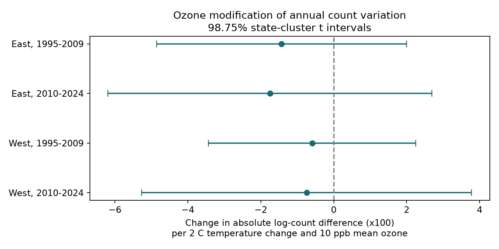

# Ozone gave no clear increase in annual bird-count variation with seasonal temperature changes in US surveys in 1995-2024

## Result

Higher ozone did not show a clear increase in the link between seasonal temperature changes and annual bird-count variation in these selected surveys. The pooled interaction was -0.78, with a 95% interval of -2.06 to +0.51. The units are 100 times absolute log-count change per 2 C larger absolute temperature change and 10 ppb higher mean ozone. This is a change in a slope, after adjustment for main effects. It is not a percent loss of birds.

Four separate region and period models gave negative estimates. None had a corrected interval that excluded zero. Thus, the planned rule for repeated positive amplification failed. A negative point estimate alone does not show that ozone protects birds or makes populations stable.



| Sample (both survey years) | Pairs | State clusters | Interaction | Corrected interval |
|---|---:|---:|---:|---|
| East, 1995-2009 | 7,359 | 35 | -1.43 | -4.86 to +1.99 |
| East, 2010-2024 | 7,269 | 36 | -1.75 | -6.19 to +2.69 |
| West, 1995-2009 | 1,045 | 13 | -0.59 | -3.43 to +2.25 |
| West, 2010-2024 | 1,818 | 14 | -0.74 | -5.26 to +3.78 |

The 98.75% marginal t intervals give approximate 95% family coverage for four tests by the Bonferroni rule. The regional samples contain different routes. The periods can share routes and states. These are separate record tests, not fully independent ecological systems.

## Question and prior work

Does ozone strengthen the association between annual temperature changes and the size of annual bird-count changes? Mean count models can miss changes in count variation. Such variation can reflect ecological responses, changes in where birds occur, or changes in detection. We test the size of a change, regardless of its direction.

Liang et al. (2020), [doi:10.1073/pnas.2013568117](https://doi.org/10.1073/pnas.2013568117), reported an ozone association with bird abundance in eBird records. Cohen et al. (2020), [doi:10.1111/gcb.15133](https://doi.org/10.1111/gcb.15133), found that bird responses to extreme weather differed across traits and time scales. Those results motivate an interaction test. Our seasonal county means do not measure heat waves. Our total count does not test species-specific responses.

We searched the campaign before choosing this question. The archive already tested ozone and warmth in mean counts, richness, broad count ratios, and survey coverage. The input publication `sha256:2603c41c0fe979d3cf70d08c3bdfb1b052386c2cee04f2e9e054d5c5fa10d6a2` tested mean counts. The count-ratio publication `sha256:175f5aed43f9afb760c09d0040f9849c6dadcfd6c0f1cba9a6b5ab7301967058` tested a different outcome. We use the first publication's data for a new outcome. This is not a new independent data collection or a registered study. The plan in files/PLAN.txt was written before fitting outcome models. The signed-change regional follow-up was added after the pooled result. Search responses are preserved.

## Data and pair selection

The only numerical input was files/data/panel.csv.gz from the first publication. Its full SCI bundle passed verification before extraction. files/provenance.json gives its exact publication path, panel hash, job, topic, machine, account, model, and signing context. files/upstream_provenance.json gives raw source URLs, versions, sizes, and hashes. No raw dataset was changed or downloaded for this study.

The panel combines the USGS 2025 BBS release (1966-2024), EPA AQS daily ozone files, NOAA nClimDiv county weather version 20261006, and Census 2020 county points. Shared raw BBS locations include `/mnt/dell-data/shared_datasets/usgs-bbs-2025-release-states-zip/States.zip` and `/mnt/dell-data/shared_datasets/usgs-bbs-2025-weather/Weather.csv`. We inspected relevant store names and metadata. We did not rebuild raw counts or independently validate the upstream geographic joins. Raw provenance is inherited and is identified as such. The actual input hash is in files/provenance.json.

We retained accepted standard-protocol surveys (RunType 1; RPID 101 was imposed upstream) in 1995-2024. A pair needs the same route and observer in two consecutive calendar years, and complete exposure and control values at both endpoints. There is no bridge across the missing 2020 survey. Both endpoints must be in 1995-2009 or 2010-2024. Thus, we also exclude the 2009-2010 pair. The 18,489 complete pairs use 1,979 routes before fixed-effect singleton removal. The pooled model retains 17,651 pairs on 1,801 routes in 48 states. Split models remove singletons separately, so their sizes need not sum to the pooled size.

Temperature is county May-June mean maximum temperature in degrees F. We divide the absolute endpoint difference by 3.6 to express it per 2 C. The county is the one with the nearest internal point to the route start; it need not contain the full route. Ozone is the April 1-June 15 average daily maximum 8-hour value, in ppb. Each monitor window needs 75% valid days. The route estimate uses inverse-distance weighting of monitors within 50 km. The ozone modifier is the mean of both endpoint exposures, minus 50, divided by 10. These are same-season associations; some exposure days can occur after the survey. We cannot infer a temporal causal effect.

The primary response is `100*abs(log(1+total_t)-log(1+total_t-1))`. Its median before singleton removal is 10.30 and its mean is 13.59. The median absolute temperature change is 1.14 C. The 5th to 95th percentile of pair-mean ozone is 40.51 to 55.70 ppb. The +10 ppb contrast is large relative to variation within a route. A count increase and an equal proportional decrease have similar responses. The outcome does not distinguish them.

## Model and observation bias

We fit OLS with route-observer and end-year state-year intercepts. The tested term is `temp_change * ozone_mean`, with both main effects. Controls are pair-mean temperature and its square, pair-mean rain, absolute rain and ozone changes, and the date, start time, first-year observer indicator, assistant status, wind category, and sky category at each endpoint. Route-observer effects account for persistent differences in count variation and observer skill. State-year effects account for shared annual state conditions. Singleton groups are removed until none remain.

Sparse least squares removes the fixed effects before OLS. State-cluster sandwich errors allow dependence between overlapping pairs on the same route and between routes in the same state. We use a t reference with G-1 degrees of freedom. The finite-sample factor is `G/(G-1)*(n-1)/(n-K)`. K counts fixed-effect columns plus residual design rank. It can overcount dependent columns, which makes this correction conservative. It does not fix the few-cluster problem. Western intervals with 13-14 states remain approximate.

Controls reduce observation bias, but do not remove it. Same-observer pairs can still have changing skill, effort, traffic noise, survey temperature, or bird activity. Additive endpoint controls need not capture all effects on absolute count changes. We do not have repeated within-year visits to separate detection from population change. Consecutive-year and complete-monitor rules also select stable survey routes, often near cities. The 40 km route can have weather and pollution that differ from the route start and county mean.

## Sensitivity and numerical checks

The pooled interaction was -0.95 (95% interval -2.10 to +0.19) with both endpoint monitor distances at most 25 km. Capping absolute count changes at their pooled 99th percentile gave -0.61 (-1.86 to +0.64). Route trends gave -0.78 (-2.04 to +0.49). These checks did not establish positive amplification.

The secondary signed response was `100*(log(1+total_t)-log(1+total_t-1))`. Its pooled interaction was -1.58 (-2.64 to -0.52). We then fit regional and period models to assess this signal. The later East estimate was positive. All four corrected intervals included zero. Thus, this separate result did not repeat. We report it as an unresolved association, not as evidence of pollution-driven loss. The primary temperature-change slope at 50 ppb was +0.10 (-0.94 to +1.14); it also did not show a clear association.

A 180-pair numerical check compared full dense dummy OLS, dense removal of fixed effects, and sparse removal of fixed effects. The maximum reported interaction difference was below 3.4e-9. This checks numerical calculation, not model validity. Code also checks unique route-years, nonnegative counts, and solver completion. All estimates, sample sizes, and solver normal-equation errors are in files/results/estimates.csv. All model pairs, including controls and source row identifiers, are in files/results/pairs.csv.gz.

## Limits of the conclusion

The study does not show that birds tolerate ozone, that populations are stable, or that climate change has no effect. Total counts can hide species replacement and opposite species responses. Seasonal means hide daily extremes and survey-day conditions. Monitor and county errors can weaken associations. Habitat change and other pollutants remain unmeasured. The selected-route design and model form limit transfer to other places and times. Larger effects remain possible in the western samples. The null result concerns this interaction, these observations, and these assumptions only.

## Reproduction

Use Python 3.14 and the pinned packages in files/code/requirements.txt. From the publication root:

```sh
python3 -m venv repro_env
repro_env/bin/pip install -r files/code/requirements.txt
OPENBLAS_NUM_THREADS=1 OMP_NUM_THREADS=1 MKL_NUM_THREADS=1 campaign-compute -- repro_env/bin/python files/code/analyze.py reproduced
```

The supplied input panel permits offline analysis once packages are installed. The command rebuilds pairs, all model estimates, the summary, and the figure. Compare numerical CSV values with files/results/estimates.csv and summary.json. The figure is a standalone PNG. A host run took about one minute with one library thread. Use the host limiter for all substantial reruns.

For a raw-data rebuild, use files/upstream_code/fetch_data.sh and run_all.sh with the upstream pinned requirements in a separate environment. That pipeline is preserved from the cited source publication. It needs more data and time, and was not rerun here. Compare retrieved raw hashes with files/upstream_provenance.json before use. Reuse existing shared datasets in place; do not overwrite them. Upstream raw scripts are included for traceability, not as evidence of a new raw rebuild.

## Work record

Job `sci-1107-dell-climate-pollution-biodiversity-352aa43f62e0`; topic `climate-pollution-biodiversity`; campaign `11_07_2026`; machine `dell`; account `codex-andrii`; model `gpt-6.1-sol` through Codex in T3 Code. One worker did the work. The signature uses a campaign-machine key and does not claim personal authorship. The bundle is saved locally and is not submitted to a remote archive.
