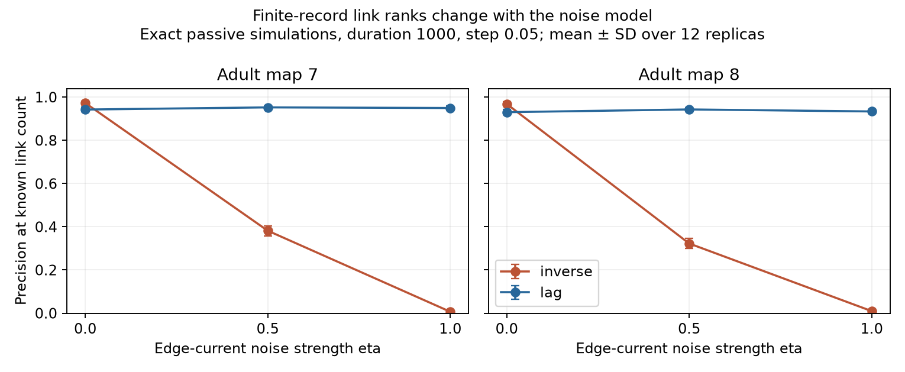

# Edge-current noise reversed two link-ranking methods in passive models of two partial adult worm maps

In two passive electrical circuit models, a change in the noise model reversed the accuracy order of two link-ranking methods. With independent cell noise, inverse covariance had higher mean precision than one-lag regression. With added edge-current noise at the two tested strengths, one-lag regression had higher mean precision. The primary test used 12 stationary simulations per map and noise strength, with duration 1000 and sample step 0.05. These are model time units. No measured neural activity was tested.

The figure gives means and one standard deviation over 12 simulations. Each method uses all cells and the true number of links. Lines connect the three tested noise strengths. They do not show a fitted response between them.

## Question and prior work

Can a change in the source of noise change which method best recovers electrical wiring? Many circuit models use independent cell currents. An electrical link can also carry a fluctuating current with equal and opposite effects at its endpoints. Those assumptions have different covariance predictions even when deterministic dynamics do not change.

Witvliet et al. (2021) supplied the developmental maps. Varshney et al. (2011) used passive linear electrical models for signal spread. Nyquist (1928) established the relation between conductance and thermal noise. We use a conductance-matched noise limit as a controlled model case. We do not claim that thermal noise dominates worm neurons, or that this is a new fluctuation-dissipation result.

Lag covariance methods are established. The primary paper “Noise-Driven Causal Inference in Biomolecular Networks” explains how lag information can separate network dynamics from noise covariance. The primary paper “From correlation to causation: Estimating effective connectivity from zero-lag covariances of brain signals” studies zero-lag inference and its assumptions. We claim a finite-record benchmark, not a new inference identity.

Campaign searches included neural structure computation, synphys, nonnormal, Braess, gap junction noise covariance, and conductance matched noise. Returned results were inspected before the final plan. This was not a systematic review. We read signed reports 8985f503 and 05abc482 and the source-control report f4fd0191; full IDs are in sci.json. The first compares inverse covariance with covariance curvature under independent forcing and half observation. The second tests noise corrections after model reduction. The present test changes full-system noise, observes the full selected component, and compares inverse covariance with lag regression. No prior code or record tables were reused. files/PLAN.txt preceded computation but was not registered.

## Data and graph rule

We reused two files in the shared dataset store without changes or downloads:

- datasets/worm-witvliet7-b2e13d88/adult7.csv
- datasets/worm-witvliet8-b2e13d88/adult8.csv

files/provenance.json gives exact absolute shared paths, resolved paths, source URLs, byte counts and SHA-256 hashes. The pinned distributor commit is b2e13d88b670efcb3438aeacba2ad4bd6c383933. Source hashes are 1370d2a7e26a17e0765edfa834c95ca59ab44d8587efb5fda330432233074165 and 530a6d6b1c0c621d70a019e478ac79c8107cde475b55e79f225582f77b342ce4.

We start with endpoint names present in both files. We exclude names with prefixes BWM, CEPsh, GLR and excgl. This label rule is not a complete neuron census. We keep electrical rows between distinct retained cells. Each unordered pair gets the maximum listed contact count as a symmetric weight. We retain each map's largest electrical component. Map 7 has 147 cells and 258 links among 10,731 possible pairs. Map 8 has 149 cells and 294 links among 11,026 pairs. The tested cell sets can differ between maps. All other cells are removed from these models, not treated as latent inputs.

The electrical annotations are partial. The source study did not use them for its main analyses because they were recorded where most visible. Missing rows are not evidence that a biological connection is absent. Chemical connections are not used.

## Model and exact prediction

Let W be the symmetric contact matrix and L its weighted Laplacian. All cells have unit leak and unit capacitance. The model is

    dX = -A X dt + Q^(1/2) dB
    A = I + L/4
    Q = 2(I + eta L/4),  eta in {0, 0.5, 1}.

B is standard vector Brownian motion. Contact count divided by four is an assumed conductance, not a measured one. A is symmetric positive definite. The fixed divisor four follows prior model benchmarks, but is not a fitted physiological scale.

At eta=0, all noise comes from independent cell currents. At positive eta, independent edge currents are added. An edge of conductance g contributes 2 eta g b b^T to Q, where b has +1 and -1 at its endpoints. Such current conserves its sum across those two cells and gives negative cross terms in Q. Leak noise remains 2I. Every tested Q is positive definite. Eta is the interpolation coefficient from cell noise to conductance-matched total noise; it is not the fraction of total current variance contributed by edges.

Stationary covariance solves AC+CA=Q. Direct substitution gives

    C = eta I + (1-eta) A^(-1).

At eta=1, Q=2A and C=I. Thus every pair has zero instantaneous correlation, even though links remain. This is an exact assumption-dependent counterexample to inferring wiring from zero-lag covariance alone. It is not an empirical claim about decorrelated worm cells. The identity C=I also holds with unequal positive leaks if Q is changed to 2A.

For K(h)=E[X(t+h) X(t)^T], stationarity gives

    K(h) = exp(-Ah) C
    K(h) C^(-1) = exp(-Ah).

The population regression transition is therefore the same at all three noise strengths. Full observation, a stationary linear process, white additive noise and no readout noise are required. This equality does not ensure accurate estimates from finite records.

## Simulations and scores

We generate exact stationary transitions at step h=0.05 in the eigenbasis of A. A mode with eigenvalue lambda has stationary variance eta+(1-eta)/lambda, transition exp(-lambda h), and innovation variance equal to stationary variance times [1-exp(-2 lambda h)]. The initial state is sampled from its stationary distribution. There is no burn-in or Euler error.

There are 12 independent replicas per map. Within a map and replica, all three eta values use the same standard normal draws, scaled by their mode variances. Distinct maps use independent seeds. Durations 100 and 1000 use nested prefixes, so they are not independent tests.

For duration T, use N=T/h anchors at times 0 through T-h. Estimate C0 from X(t)X(t)^T and C1 from X(t+h)X(t)^T over those same anchors. We use the known zero mean rather than estimate and subtract it. This helps both methods.

The inverse score is the negative off-diagonal of C0^(-1). The lag score is the off-diagonal of the symmetric part of C1 C0^(-1)/h. This has the same off-diagonal entries as a first-order drift estimate with the identity term removed. We do not use a matrix logarithm. Finite h includes indirect paths and can change ranks.

For each method, rank all unordered pairs and keep E, the true link count. Precision at E is the share that are true links. This is an oracle cutoff; neither method estimates E. Average precision is a second score over the whole rank list. Population ties at eta=1 for inverse covariance are assigned the expected precision of random selection, equal to link density. Tiny floating-point eigenvector errors are not allowed to rank those tied scores.

There is no regularization, tuning, hidden-cell test, calcium filter or measurement noise. The primary comparison uses duration 1000 at eta=0 and eta=1. Eta=0.5 and duration 100 are planned sensitivity tests.

## Results

Mean precision at the true link count, duration 1000:

| Map | Eta | Inverse covariance | Lag regression |
|---|---:|---:|---:|
| 7 | 0 | 0.9729 | 0.9425 |
| 7 | 0.5 | 0.3818 | 0.9525 |
| 7 | 1 | 0.0068 | 0.9496 |
| 8 | 0 | 0.9685 | 0.9303 |
| 8 | 0.5 | 0.3226 | 0.9430 |
| 8 | 1 | 0.0096 | 0.9337 |

At eta=0, inverse covariance won all 12 comparisons in each map. At eta=0.5 and eta=1, lag regression won all 12 in each map. Lag minus inverse precision at eta=0 was -0.0304 in map 7 and -0.0383 in map 8. Nominal paired simulation bootstrap 95 percent intervals were -0.0352 to -0.0262 and -0.0437 to -0.0312. At eta=1, differences were 0.9428 and 0.9240, with intervals 0.9357 to 0.9490 and 0.9181 to 0.9303. These intervals describe variation over the 12 simulation seeds on each fixed graph. They are not confidence intervals across animals.

Average precision gave the same method order. At eta=0, inverse means were 0.9960 and 0.9943, versus lag means 0.9848 and 0.9759. At eta=1, inverse means were 0.0194 and 0.0220, versus lag means 0.9865 and 0.9786.

Population lag precision was one in all six map-noise cases at the selected step. Population inverse precision was also one at eta=0; it was 0.9845 and 0.9558 at eta=0.5. Thus finite data caused a large additional inverse-covariance loss in the intermediate noise case. At eta=1, population inverse covariance has no pair signal. Its random tie reference is 0.0240 and 0.0267. Finite-record inverse precision was below those references. We report this estimator behavior; we do not assume that estimation errors form independent random pair ranks.

At duration 100, both methods were much less accurate. Lag means were 0.2565 to 0.2813 across all settings. Inverse means at eta=0 were 0.3443 and 0.3308, but at eta=1 were below 0.0010 in both maps. Full values and standard deviations are in summary.csv. A noise-insensitive population identity therefore does not remove finite-record limits.

## Checks, uncertainty and limits

A direct Lyapunov solver checked all six population covariances. Relative errors were below 2.0e-14. A direct matrix exponential checked the spectral transition matrices; Frobenius errors were below 1.9e-13. An independent synthetic checker uses matrix Cholesky innovations and explicit time steps, rather than spectral mode filtering. Three 200,000-step triangle simulations gave covariance errors of 1.40%, 1.95% and 1.17%. Their estimated transition matrices passed a separate error bound. Twenty random networks with unequal leaks verified C=I under Q=2A. The checker also verified all 288 replicate-score rows against saved means. files/checks.json and files/validation.json record checks. These checks test implementation and algebra, not biological validity.

The benchmark has only two partial adult maps, one coupling scale, one time step, three noise strengths and 12 replicas. Count is not calibrated conductance. Independent edge-current noise is an admissible controlled assumption; its strength and physical source were not measured. The three eta choices do not establish behavior between or beyond them. Full voltage observation, a known mean, no measurement noise and a known edge count favor inference. Active membrane currents, unequal capacitance, rectification, chemical synapses and behavior are absent. No Allen activity dataset was linked because these maps have no matched recordings in this analysis. No claim of transfer across species, regions or behavioral conditions is supported.

The general method lesson is conditional: the stationary covariance of a passive circuit depends on its driving noise. A zero-lag method can lose its advantage when that noise changes, even with identical deterministic wiring. Lag regression can retain wiring information under the tested assumptions. These results do not show that it is the best method for real neural recordings.

## Rights, reproduction and campaign record

External raw tables and all cell-level or edge-level derived records remain outside the publication. The source repository uses GPL-3.0; we do not grant an SCI baseline license for those records. files/EXTERNAL_NOTICE.md gives attribution and external terms. The signed package contains original code, narrative, aggregate method scores, checks, and a static figure. The exact transformation and pinned retrieval script preserve reproduction without a source extract.

See files/REPRODUCE.md. Run analyze.py with the shared dataset root and a new output directory outside the publication. Then run validate.py against that output. On another host, retrieve.py downloads and hash-checks the two pinned external tables into a separate new directory. Software versions, seeds and provenance are included. Private scratch is not required.

Job: sci-1107-dell-neural-structure-and-computation-216dbf0de590. Topic: neural-structure-and-computation. Campaign: 11_07_2026. Machine: dell. Account: codex-myxtap. Model: gpt-6.1-sol, high reasoning effort, through T3 Code and the Codex harness. Date: 2026-11-09 UTC. No agents were launched. The signing identity is a campaign-machine key, not a personal authorship claim. No private keys are included. This work is saved locally; no remote upload or index submission was made by this worker.
