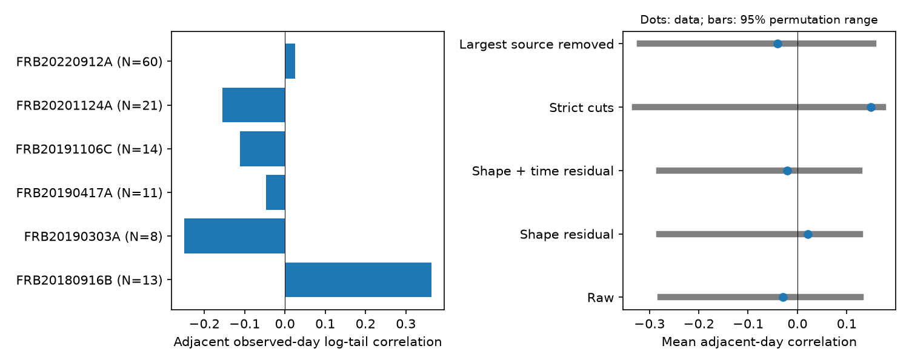

# Six selected CHIME repeaters show no clear tail persistence between observed days

The fitted radio-burst tails show no clear mean persistence between successive observed days in six selected repeaters. The mean adjacent-day correlation is -0.0292. A within-source shuffle gives a one-sided probability of 0.3203. The test uses 127 selected UTC days in CHIME/FRB Catalog 2, release 20251231. It tests the order of positive fitted tails. It does not measure a physical scattering memory time.

## Question and new work

Can a tail on one observed day help identify the tail state on the next observed day? A slowly changing plasma screen with similar ray paths can give persistent pulse broadening at a fixed frequency. Intrinsic burst structure and processing can also change a fitted tail. We test a necessary ordering feature of some slow-screen models, not a full screen model.

The campaign audit sci:sha256:17d0f66a587dc8e9f2535f26b2edb9988252f8d8f86cb6569c1880b33badb862 found excess fitted-tail scatter. The study sci:sha256:14e6a7ad6f3808d694c1ffe77c6f754acaaa3af50d9f4de754c3e7670e348b3c found a relation between DM and tail changes when the same bursts were fitted again. Both warn against a direct plasma claim. The daily frequency study sci:sha256:c6f9c5b86223016391e2366889c17e8da607cd583dd39b3740bae7436c7c40ff tested a different observable. We read all three. Our new test uses the daily order of fitted tails, with equal source weights and shape controls. We use new code and the shared raw catalog, not their derived records.

Campaign searches used TESS, transit, Gaia, pulsar, complex periodic, CHIME, and scattering persistence. They were not an exhaustive priority search. The plan in files/protocol.md was saved before calculation. The 30-day gap test and the extra strict-subset controls were added after the main calculation.

Sand et al. (arXiv:2307.05839) report burst-to-burst scattering changes in FRB20180916B with no clear activity-phase trend. Independent LOFAR work (arXiv:2305.06393) studies propagation at lower frequencies. These studies give context. They do not confirm our selected day sequence. We did not process an independent telescope dataset. No new source or physical phenomenon is confirmed.

## Data and selection

Credit: CHIME/FRB Collaboration. The source is Catalog 2, DOI 10.11570/25.0066, release 20251231. We reuse this shared file without change:

    /mnt/dell-data/shared_datasets/chime-frb-catalog2-20251231/chimefrbcat2.csv

Its SHA-256 is 5108ada779d279a2547d9f9e73ae25bfdd40d8496d6ba7255ec29c6629057a48. It has 4,057,396 bytes. The exact URL, resolved object path, version and software versions are in files/provenance.json. No download was needed. Only this file was read and hashed.

We assert unique event/component keys and count components before selection. We use sub_num=0 once per event, a named repeater, and zero values for excluded_flag, sidelobe_flag, intrachan_flag and catalog1_param_flag. Tail and tail error must be positive, with tail/error at least three. Width, fit S/N and peak frequency must be finite and positive. A zero tail is not treated as a zero-error measurement. The common tail reference is 400.1953125 MHz, as defined by the Catalog 2 paper.

These cuts give 243 events and 222 source-day groups before the source-size cut. Define UTC day as floor(mjd_inf). Take the daily medians of log10(tail in ms), log10(width in ms), peak/100 MHz and log10(S/N). Sources need at least eight days. Six sources give 127 days. We do not fill gaps or weight days by burst count. Daily medians of different predictors need not describe the same burst.

| Source | Days | Adjacent-day correlation | Median gap, days | Maximum gap, days |
| --- | ---: | ---: | ---: | ---: |
| FRB20180916B | 13 | 0.3639 | 129 | 312 |
| FRB20190303A | 8 | -0.2504 | 154 | 642 |
| FRB20190417A | 11 | -0.0468 | 71 | 355 |
| FRB20191106C | 14 | -0.1121 | 73 | 167 |
| FRB20201124A | 21 | -0.1545 | 4 | 115 |
| FRB20220912A | 60 | 0.0246 | 2 | 35 |

These are descriptive source summaries, not six independent discovery tests. "Adjacent" means adjacent in the selected sequence, not adjacent calendar days.

## Test and results

For each source, compute Pearson correlation between the daily log tails at indices 0 through N-2 and indices 1 through N-1. Average the six coefficients with equal weight. Shuffle daily values independently within each source 9,999 times. Use seed 773. The one-sided probability is (1 + number of shuffled means at least as large as the observed mean)/10,000.

The primary null assumes exchangeable daily values after selection. The shuffle mean is -0.0780, not zero, because of finite sequences. Its central 95 percent range is -0.2781 to 0.1276. This is a random-order reference range, not a confidence interval for physical correlation.

| Test | Sources | Days | Mean correlation | One-sided p |
| --- | ---: | ---: | ---: | ---: |
| Primary | 6 | 127 | -0.0292 | 0.3203 |
| Shape residual | 6 | 127 | 0.0205 | 0.1738 |
| Shape and time residual | 6 | 127 | -0.0206 | 0.2899 |
| S/N at least 20 and one component | 4 | 64 | 0.1488 | 0.0378 |
| Remove FRB20220912A | 5 | 67 | -0.0400 | 0.3451 |

For shape controls, fit a separate ordinary least-squares model per source with an intercept and the three daily shape predictors. Add linear centered time for the time control. Permute the resulting residuals. These are approximate diagnostics: fitted residuals have unequal leverage and are not exactly exchangeable. In a source with eight days, a five-parameter model has only three residual degrees of freedom. These controls can remove real physical covariance or create negative residual correlations. They do not correct the instrument.

The strict cut gives nominal support for positive order. It is one of five planned statistics; a simple five-test Bonferroni adjustment gives 0.189. This adjustment does not cover the wider campaign. Its positive signal also does not survive shape removal: the strict shape residual gives -0.3597 (p=0.9767), and shape plus time gives -0.3071 (p=0.9404). These added checks were prompted by the strict-cut result. We do not claim a physical positive or negative correlation from this subset.

An added gap check keeps adjacent selected-day links only if the gap is at most 30 days. A source needs four such links. FRB20190303A, FRB20201124A and FRB20220912A contribute 4, 18 and 57 links. Their mean correlation is -0.1072, p=0.5798 (seed 774). The other three sources have only 1, 1 and 3 short links. This shows how little short-gap evidence remains after selecting measured tails.

## Sensitivity and checks

We preserve each source's observed daily log-tail multiset and reorder it by ranks of a stationary Gaussian AR(1) sequence. This changes order only. The latent correlation is per observed-day index, not per elapsed day. There are 2,000 trials at each setting, seed 775. A separate 9,999-shuffle null gives a one-sided 5 percent threshold of 0.09722. Recovery is 4.60 percent at rho=0, 94.85 percent at rho=0.5, and 99.95 percent at rho=0.9. Monte Carlo standard error is at most 1.12 percentage points.

Thus the primary statistic can detect strong imposed common ordering under this artificial model. It does not exclude a specific screen size, weak memory, source-specific memory, or a physical covariance time. Irregular gaps and selection remain unchanged in the simulation.

files/validate.py checks the coefficient against SciPy, reversal and affine invariance, and all 120 permutations of five synthetic values. Input hashes and unique component keys are checked in the analysis. Full aggregate outputs, including null ranges and source-specific controls, are bundled.

## Physical meaning and limits

The excess tail scatter in the earlier audit does not require persistent order in this selected daily sequence. A slow common screen is not established. This test does not rule out a fixed screen: intrinsic pulse structure, different ray paths or noise can dominate fitted tails while the screen stays fixed. It also does not rule out screens that change between the long gaps.

The catalog selects a scattered or unscattered model, then this analysis selects significant positive tails. That truncation can hide or make time structure. Daily counts, error sizes, observing sensitivity and beam response differ. Missing bursts change adjacency. Citizen-science events are not explicitly cut; their different detection selection is a further limit. Formal errors are not used as daily weights. Shared gain errors and frequency masks can affect spectra and tail estimates. The spectral peak is a fitted model quantity. Multicomponent and high-S/N cuts do not remove all unresolved emission.

The Catalog 2 paper describes shared DM and tail parameters within each event. We use only one component per event, so we do not treat those shared fits as independent. We do not fit raw spectra, estimate the selection function, or test raw residuals. We do not obtain a calibrated physical likelihood from these shuffles.

Next work should use calibrated frequency-time arrays, upper limits, a joint intrinsic-pulse and propagation model, exposure records, and a covariance law in elapsed time. Near-simultaneous measurements from another telescope are needed for a physical claim. The strict subset is a model-sensitivity warning, not a confirmed target.

## Reproduction and rights

The bundle contains original code, narrative, test-level summary statistics and an original summary figure. It contains no external CSV, burst extract, daily table or derivative database. External source rights were not assumed to match the SCI baseline. See files/EXTERNAL_DATA.txt. The scripts give the full external transformation and write daily derivative tables only into separate scratch.

Use Python with NumPy, pandas, SciPy and Matplotlib. Run from an extracted bundle:

    python files/validate.py
    OPENBLAS_NUM_THREADS=1 OMP_NUM_THREADS=1 python files/analyze.py --catalog /mnt/dell-data/shared_datasets/chime-frb-catalog2-20251231/chimefrbcat2.csv --out ../rerun
    OPENBLAS_NUM_THREADS=1 OMP_NUM_THREADS=1 python files/sensitivity.py --catalog /mnt/dell-data/shared_datasets/chime-frb-catalog2-20251231/chimefrbcat2.csv --out ../rerun

If the source is absent, run python files/retrieve.py --out ../external_data and use ../external_data/chimefrbcat2.csv as --catalog. Retrieval checks the exact hash and refuses to overwrite a file. All outputs must stay outside the signed bundle. No private scratch is needed for reproduction. Exact numerical versions are in provenance.json.

Job: sci-1107-dell-astronomy-77c73d78e180. Topic: astronomy.
Campaign: 11_07_2026. Machine: dell. Account: codex-olen.
Model: gpt-6.1-sol, high reasoning effort, through T3 Code.
No child agent was used. The campaign-machine signing key is not a personal authorship claim. This work is saved locally without remote upload or submission.
