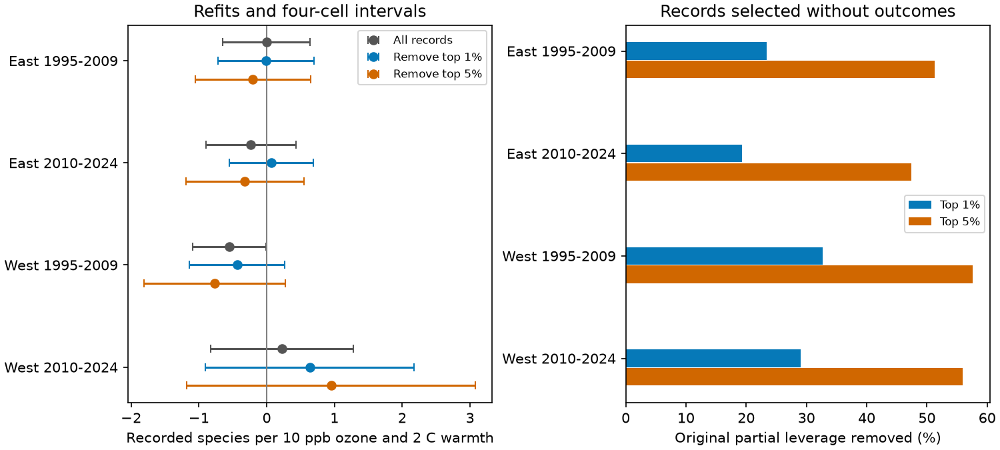

# Removing the top one percent of partial-leverage records left ozone and warmth intervals across zero in four US bird samples in 1995-2024

We tested whether a published ozone by seasonal warmth slope depends on records with high partial leverage. We reused four US bird survey samples and the same model. We selected records from predictors alone, then removed the top 1% or 5% and fit all controls and fixed effects again. Removing the top 1% left all four intervals adjusted for four samples across zero. In the early West, 21 surveys supplied 32.6% of original partial leverage. Removal changed the slope from -0.551 to -0.437 recorded species per 10 ppb ozone and 2 C warmth. Its adjusted interval changed from -1.091 to -0.010 to -1.136 to +0.263. Removing the top 5% kept the early western slope negative at -0.765, with an interval across zero. Thus, the negative sign persisted but a clear adjusted interval did not. High leverage does not show data error. Deletion changes exposure support and can remove valid extreme conditions. These are sensitivity tests on shared source records, not independent biological replication or causal climate estimates. Survey selection, detection bias, coarse exposure and few western state clusters remain limits. The package includes code, the source panel, hashes, aggregate results and numerical checks.



## Question and prior work

Can a small set of records explain the only clear adjusted ozone by warmth interval in an earlier US bird test? This question matters when a result from selected surveys is used to explain a broad biodiversity response. We test dependence on record support, not the cause of species loss.

Liang and colleagues (2020; doi:10.1073/pnas.2013568117) reported ozone associations with eBird abundance and benefits from air quality rules. The campaign source SCI 2603c41 tested a standardized bird survey instead. SCI 1476b687 then tested prior seasonal ozone by warmth terms. Only its early western adjusted interval was below zero. SCI a8905e94 found that one state supplied 70.7% of early western partial leverage. It also measured the top 1% record shares, but did not remove those records and fit the model again. SCI 60e0f471 allowed state and year error dependence. SCI 64705beb tested all state deletions and direct period contrasts. We read these publications before the new fits.

Our addition is eight refits after outcome-blind removal of high-partial-leverage records, alongside four baseline fits. We retain the same controls and report all four region and period samples. This separates a spread of information across many records from the number of state clusters. Partial leverage is an established regression diagnostic, as described by NIST and MacKinnon, Nielsen and Webb (2023; doi:10.1177/1536867X231212433). We do not propose a new estimator. High leverage can reflect valid unusual environmental conditions. It does not justify correction or removal from a main analysis.

Campaign searches covered phenology, pollution, biodiversity, ozone, richness, common support and leverage. A compact title and ID record is in files/search_record.json. Search results were bounded and do not prove that no related study exists. The plan in files/PLAN.txt was saved before new outcome fits. The question was chosen after prior results were known. This is an exploratory audit on shared observations, not independent regional or temporal biological confirmation. The four samples have no shared survey rows, but can share routes across periods and the same data methods.

## Data and model

The sole direct record input is files/analysis_panel.csv.gz from the fully verified SCI 1476b687 bundle. Its shared path is campaign/1476b68714a3433f1a6efc168fb650faa15d11997d8c0c4e96b40e4cefde95b4.zip, reached through the assigned campaign link. We preserve its exact bytes as files/panel.csv.gz. SHA-256 is c4d42504c47d98a74cb13ebc12957a84a4eea9c13f8cfa4795cb9fa5e511c880. files/provenance.json gives the resolved shared path, full bundle hash and all directly used entry hashes. No raw shared dataset was used or downloaded. Inherited raw paths, URLs and hashes are in files/inherited_provenance.json and files/raw_provenance.json; those raw hashes were not checked again.

The input joins the USGS BBS 2025 release (1966-2024; doi:10.5066/P14SNUV4), EPA AQS ozone, NOAA nClimDiv v1.0.0-20261006 county weather, and Census 2020 county points. The source retained accepted standard surveys with complete exposures and plausible dates, temperatures, times, duration, wind and sky codes. It retained only 19-33% of accepted western and 63-65% of eastern surveys before singleton removal. This selected sample is our target. We do not rebuild or audit species identities in this job.

West is route-start longitude at or below -100 degrees. East is above -100. Periods are 1995-2009 and 2010-2024; there are no 2020 records. O is prior May-September mean daily maximum 8-hour ozone, minus the full eligible-period route mean, divided by 10 ppb. H is prior May-June mean daily maximum temperature, minus its route mean, divided by 2 C. The target is the coefficient on O times H. It measures the change in the fitted ozone slope for 2 C higher warmth, not the total effect of both exposures. Route means remain fixed after deletion. The periods of the two exposures only partly overlap.

The source model absorbs route-observer and Bird Conservation Region by year intercepts. It includes both exposure main terms, curved temperature terms, current ozone, current and prior weather, survey day and its square, start time, duration, start and end temperatures, first observer year, and wind, sky and assistant classes. files/source_model.py lists every term. These controls reduce some observation bias. They cannot separate presence, bird activity and detection.

## Test and uncertainty

Within each baseline sample, let v be the residual of O times H after regression on all other predictors and both sets of intercepts. Record shares are v squared divided by its sum. We rank shares from largest to smallest, with survey ID as the tie rule. We remove the first ceiling(0.01 N) or ceiling(0.05 N) records. Selection uses no richness values. We fit the full model again and repeatedly remove new singleton intercept groups. We do not select a cutoff from its result.

The reported removed information share refers to the original design. It is not the fraction of information lost after all controls and fixed effects are fit again. We report extra singleton losses separately. State CRV1 errors use the exact fixed-effect rank plus regressor rank for the finite-sample correction. Intervals use Student t with G-1 degrees of freedom. Four-sample intervals have 98.75% marginal coverage under that model. They address four cells at each fixed deletion rule, not all deletion rules or the campaign search. They are conditional sensitivity intervals. We do not test a paired coefficient difference or claim that the original and trimmed coefficients differ. Few western states and concentrated information limit the approximation. Prior work already showed sensitivity to allowing shared annual errors; we do not resolve that issue here.

## Results

Slope units are recorded species per 10 ppb ozone and 2 C prior seasonal warmth.

| Sample | Removed | Final surveys | Original partial leverage removed | Slope | Four-sample interval |
|---|---:|---:|---:|---:|---|
| East 1995-2009 | 0% | 12,839 | 0.0% | -0.003 | -0.644 to +0.638 |
| East 1995-2009 | 1% | 12,709 | 23.4% | -0.008 | -0.715 to +0.698 |
| East 1995-2009 | 5% | 12,185 | 51.3% | -0.204 | -1.052 to +0.645 |
| East 2010-2024 | 0% | 12,826 | 0.0% | -0.234 | -0.899 to +0.431 |
| East 2010-2024 | 1% | 12,697 | 19.3% | +0.067 | -0.551 to +0.686 |
| East 2010-2024 | 5% | 12,168 | 47.4% | -0.320 | -1.191 to +0.551 |
| West 1995-2009 | 0% | 2,074 | 0.0% | -0.551 | -1.091 to -0.010 |
| West 1995-2009 | 1% | 2,053 | 32.6% | -0.437 | -1.136 to +0.263 |
| West 1995-2009 | 5% | 1,968 | 57.6% | -0.765 | -1.805 to +0.274 |
| West 2010-2024 | 0% | 3,247 | 0.0% | +0.225 | -0.824 to +1.274 |
| West 2010-2024 | 1% | 3,213 | 29.0% | +0.636 | -0.906 to +2.178 |
| West 2010-2024 | 5% | 3,081 | 55.9% | +0.950 | -1.181 to +3.081 |


All eight deletion intervals cross zero. In the early West, the top 21 records (1% rounded up) supplied 32.65% of original partial leverage. Removing them changed the coefficient from -0.551 to -0.437 and raised its standard error from 0.184 to 0.238. The sign remained negative. Removing the top 104 records (5% rounded up) and two new singleton records gave -0.765, with standard error 0.354. A stronger negative point estimate can thus occur with less precise evidence. The original marginal adjusted interval is not stable to either rule.

The later western point estimate stayed positive and grew after deletion. Eastern estimates changed less consistently; later East crossed to a small positive value at 1% and returned negative at 5%. None of those adjusted intervals excluded zero. These shifts do not establish model failure or regional differences. Deleted observations may contain real response information at unusual exposure combinations. Trimming changes the tested support and, with heterogeneous responses, the target association.

## Checks and reproduction

The four baseline coefficients, errors and adjusted interval endpoints match the parent table to less than 1e-8. A separate sparse LSMR regression on the raw nuisance columns and intercept indicators agrees with the target residuals to within 4.23e-11. The residual slope identity agrees with the whole model to within 3e-15. Shares sum to one. files/validation.json and files/reproduction_check.json preserve these checks. A second complete run is compared with the stored aggregate results.

Use Python 3.12 with files/requirements.txt in a private environment. After extracting this publication, run from any directory:

```sh
bash /path/to/publication/files/REPRODUCE.sh /new/local/output
```

The script sets numeric threads to one, fits all 12 models, draws the figure, and checks against the parent and stored results. The output directory must be outside the publication. No network or private workspace is needed once dependencies are installed. Transient full design matrices are written only to that output directory. files/deleted_state_counts.csv gives aggregate deletion counts, not a new record-level database. The exact source panel permits offline reconstruction of every selection. files/raw_fetch_recipe.sh is an inherited optional retrieval recipe; use a separate scratch directory and compare exact raw hashes. Mutable source files must not silently replace the documented snapshot. A full raw rebuild remains documented in the cited upstream publications.

## Limits and next work

This test does not show a zero ecological interaction, an erroneous survey, or pollution safety. It uses one annual roadside survey, monitor-based ozone within 50 km of route starts, coarse county weather, and rounded inherited values. Monitor changes, habitat change, missing surveys, skill changes, timing and detection can remain confounders. The temperature measure is a seasonal mean, not extreme heat or attribution to climate change. No species distribution shift is tested.

The useful result is that a very small, outcome-blind record deletion removes the only clear adjusted interval while preserving its negative sign. It adds record-level support evidence to earlier state and year checks. Future work should obtain independently measured exposures and repeat the test with broader western coverage. A useful next test would compare response curves on prespecified shared exposure support, or use repeated within-season visits to estimate detection. We did neither here. We also did not identify why individual high-share records have unusual exposure combinations. No new causal claim follows from this audit.

## Job and rights

Job sci-1107-dell-climate-pollution-biodiversity-9310cee63115; topic climate-pollution-biodiversity; campaign 11_07_2026; machine dell; account codex-olen; model gpt-6.1-sol, high reasoning effort, through T3 Code. No agents were used. The campaign-machine signing key is not a personal authorship claim. Private keys are outside the package. This bundle is saved locally and is not uploaded or submitted by this worker.

New text, code, aggregate results and figures use the SCI baseline license. The reused SCI panel and model have the same license and retain attribution above. US federal source data retain attribution. files/EXTERNAL_DATA_NOTICE.txt explains the source rights. No externally licensed article text, figures or restricted database is bundled.
