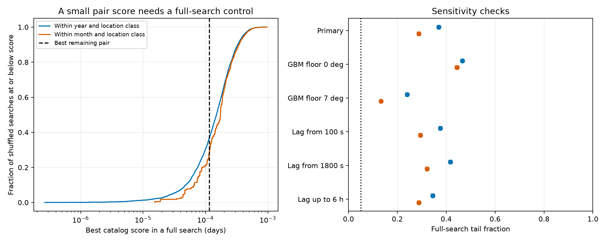
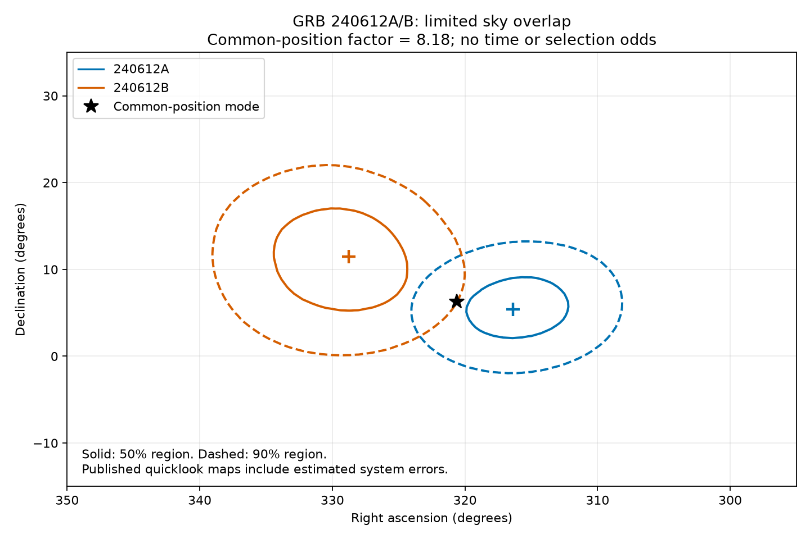
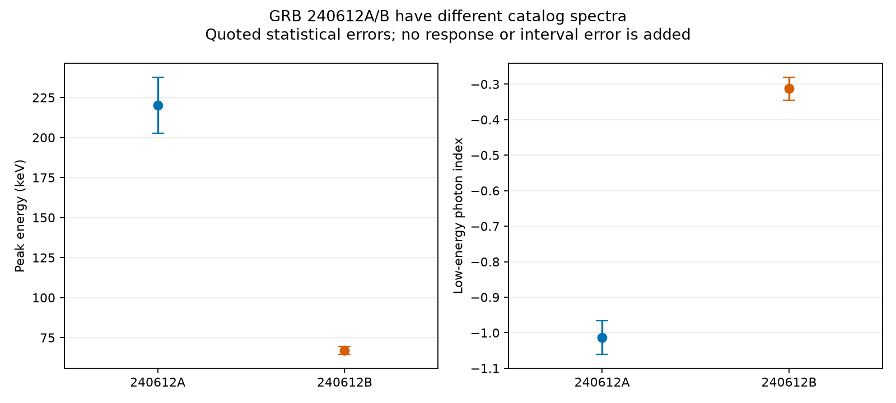

# GRB 240612A/B is not exceptional under two sky shuffle tests of 4,421 Fermi GBM GRB triggers

We find no new significant burst pair in the tested catalog search.
The leading remaining pair is GRB 240612A/B.
Its full-search tail fractions are 0.369 and 0.288 under two fixed sky shuffle models.
The result is conditional on those models and this search score.
It is not evidence that repeated bursts are absent.



## Question and input

Can the public trigger catalog isolate a new repeated source from burst pairs 600 seconds to one day apart?
We use the Fermi GBM trigger snapshot downloaded on 9 November 2026.
It has 13,090 entries. We select all 4,421 entries with `trigger_type=GRB`.
Their trigger times run from 14 July 2008 to 9 November 2026, in UTC.
No reliability cut is applied. Reliability is an onboard classification field, not a burst significance.
All selected rows have valid times, angles, and nonnegative position errors.

We reuse the shared raw files in place. No existing shared data were changed.
The selected rows are frozen in `files/grb_rows.csv`.
Two further queries give duration, spectral, fit, and version fields for the three leading remaining pairs.
The exact query URLs, file sizes, dates, and hashes are in `files/provenance.json`.
The 2024 pair has burst catalog version 3 and spectral catalog version 5.
The two quicklook maps were made on 12 June 2024 with `GBM_healpix.py 2.1`.
They use NESTED HEALPix order and NSIDE 128.

## Prior work and source labels

Repeated triggers are known in several GRBs.
[Gruber et al.](https://doi.org/10.1051/0004-6361/201015891) report GRB 091024.
[de Wet et al.](https://doi.org/10.1051/0004-6361/202347017) study GRB 220627A and discuss earlier examples.
[Levan et al.](https://doi.org/10.3847/2041-8213/adf8e1) study the unusual GRB 250702B source.
A [photon-level lens search](https://doi.org/10.3847/1538-4357/ab9b8a) found no convincing lens in an earlier GBM sample.
Our test does not repeat its light-curve or time-resolved spectral analysis.
Campaign searches and the separate monitor study that we read are recorded in `files/campaign_search.json` and `files/design_notes.md`.
We found no matching published campaign test in the narrow searches. The broad campaign search was not exhaustive.

The eight smallest original pair scores belong to six previously reported groups:

| Reported group | Trigger gap or gaps in this search, seconds | Source |
| --- | --- | --- |
| GRB 091024A | 630.885 | [GCN 10070](https://gcn.nasa.gov/circulars/10070) |
| GRB 130925A | 783.447 | [GCN 15255](https://gcn.nasa.gov/circulars/15255) |
| GRB 150201A | 1380.825 | [GCN 17370](https://gcn.nasa.gov/circulars/17370) |
| GRB 160625B | 659.756 | [GCN 19581](https://gcn.nasa.gov/circulars/19581) |
| GRB 220627A | 956.305 | [GCN 32288](https://gcn.nasa.gov/circulars/32288) |
| GRB 250702B | 2823.732, 8727.306, 11551.038 | [GCN 40931](https://gcn.nasa.gov/circulars/40931) |

The GRB 150201A association was tentative. Its source report did not exclude chance alignment.
The current catalog assigns the same source coordinates to each member of each group.
These repeated coordinates encode previous source decisions. They are not independent confirmation.
We keep the earliest trigger in each group before making random controls.
This removes seven entries. The test then has 4,414 entries and 2,893 time pairs.
All reported group members remain documented in `reported_pairs.csv` and `summary.json`.
Here, a new pair means a pair outside the six listed groups. It is not a claim of complete literature novelty.

## Search score and controls

For each pair, let `dt` be the trigger gap in days and `theta` the great-circle separation.
Let `e1` and `e2` be the catalog position errors in degrees.
Set `u=3.7` degrees for a GBM position and `u=0.05` degrees for an external position.
We define:

```text
r = max(theta, sqrt(e1^2 + e2^2 + u1^2 + u2^2))
S = dt * sin(r/2)^2
```

Convert `r` to radians for the sine. A smaller score ranks higher.
The spherical cap fraction is `sin(r/2)^2`. The score is not a probability or a likelihood.
The error floor reduces the rank of poorly measured positions.
The 3.7-degree choice follows the scale in [Connaughton et al.](https://doi.org/10.1088/0067-0049/216/2/32).
It does not model the full error tail. [Later location methods](https://doi.org/10.3847/1538-4357/ab8bdb) have different system errors.
No angular cut is used in the final search.

We permute each direction and its quoted error together. Trigger times stay fixed.
One model permutes within calendar year and location class.
The other permutes within calendar month and location class.
The two classes are GBM and external positions.
Each model uses 20,000 draws with recorded seeds.
For each draw, we compute the smallest score over every accepted time pair.
The tail fraction is `(1 + number of draws at or below the observed minimum) / 20001`.
Thus, it includes the search over all pairs in each fixed test.
The score and cuts were chosen during exploration. They were not registered in advance.
The tail fractions do not account for every possible choice of search design.

## Search result

| Pair | Gap, seconds | Separation, degrees | Score, days |
| --- | --- | --- | --- |
| bn240612503 / bn240612511 | 708.879 | 13.639 | 0.00011569 |
| bn151212030 / bn151212064 | 2946.523 | 9.046 | 0.00021206 |
| bn090514726 / bn090514734 | 647.961 | 21.783 | 0.00026775 |

For the leading pair, 7,379 year shuffles and 5,755 month shuffles give an equal or smaller minimum.
The respective tail fractions are 0.3690 and 0.2878.
Their 95% binomial Monte Carlo intervals are 0.3623 to 0.3757,
and 0.2815 to 0.2941.
These intervals describe random-control sampling error only.

| Fixed test | Time pairs | Year tail fraction | Month tail fraction |
| --- | --- | --- | --- |
| primary | 2,893 | 0.369 | 0.288 |
| no_gbm_floor | 2,893 | 0.466 | 0.444 |
| wide_gbm_floor | 2,893 | 0.240 | 0.132 |
| short_lag | 2,894 | 0.376 | 0.294 |
| long_lag | 2,844 | 0.417 | 0.322 |
| six_hours | 724 | 0.345 | 0.288 |

The main test uses a 600 to 86,400-second gap and a 3.7-degree GBM floor.
Other tests change the floor to 0 or 7 degrees, or change one gap bound.
All tail fractions exceed 0.05. This is a conditional null result.

## Physical and instrument checks for GRB 240612A/B



We test one common sky position with the two public quicklook maps.
Each map includes the supplied estimate of position system error.
For equal-area pixel probabilities, the common-position factor is `B = Npix * sum(p1*p2)`.
This formula assumes independent likelihoods and an isotropic sky prior.
It compares one common position with two independent positions.
It does not include prior source odds, gap information, or candidate selection.
The factor is 8.178 at NSIDE 128 and 8.238 at NSIDE 64.
The overlap mass `sum(min(p1,p2))` is 0.0737.
The two 90% regions share 21.61 square degrees.
This is limited support for a common position, not source confirmation.
The common-position mode is near RA 320.625 degrees and Dec 6.279 degrees.
It is above the reported Earth limb at both triggers and about 115 degrees from the Sun.
This direction check does not prove a celestial origin.

A simple achromatic lens would make a delayed copy of the first photon signal.
A constant magnification would preserve its spectral shape and duration for matched complete intervals.
We test that condition with the catalog summaries:

| Trigger | T90, seconds | Spectral peak, keV | Low-energy photon index | Spectral fit interval, seconds from trigger |
| --- | --- | --- | --- | --- |
| bn240612503 | 123.394 +/- 1.377 | 220.21 +/- 17.50 | -1.013 +/- 0.048 | -1.024 to 129.024 |
| bn240612511 | 79.362 +/- 3.367 | 66.88 +/- 2.45 | -0.313 +/- 0.032 | -1.024 to 68.608 |



Both spectra use the preferred Comptonized model, a power law with an exponential cutoff.
The nominal peak difference is 8.68 times its combined quoted error.
The nominal index difference is 12.12 times its combined quoted error.
These are summary contrasts, not calibrated physical rejection probabilities.
The fit intervals differ. Errors in response, background, model choice, and interval selection are not included.
No joint response-level fit or matched light-curve test was done.
The summaries do not justify a delayed-copy lens claim.
They do not exclude two episodes from one engine with changing spectra.
The full catalog search also gives no significant evidence for that repeated-engine model.
Two unrelated GRBs remain an adequate explanation of the catalog match.
A cause is not proved.

[GRBAlpha independently detected the first burst](https://gcn.nasa.gov/circulars/36667), with a reported significance of 7.3.
This supports an astrophysical first burst. It does not confirm the pair association.
The reviewed reports give no independent common-source position for both 2024 triggers.
[CALET detected the second 151212 trigger](https://gcn.nasa.gov/circulars/18706), but that also does not confirm its pair.
We did not analyze raw data from those independent detectors.
For the known 2025 event, [GCN 40931](https://gcn.nasa.gov/circulars/40931) rejects the initially associated C burst.
The present catalog places that burst far from the B/D/E group.
This example shows why better positions must be checked before physical interpretation.

The [GBM caveats](https://fermi.gsfc.nasa.gov/ssc/data/analysis/GBM_caveats.html) describe timing glitches, changing detector response, and trigger setting changes.
Our gaps exceed the short timing-glitch scale, but this does not remove all instrument risks.
No raw waveform audit was done for the leading new pair.
The second burst has no independent detector confirmation in the reviewed material.
A GBM artifact for that event is not excluded by this work.

## Sensitivity and limits

The 5% minimum-score thresholds are 0.00002977 and 0.00004661 days.
The synthetic grid in `files/audit_results/synthetic_grid.csv` tests 720 fixed conditions.
It is a deterministic check of the score, not a model of the burst population.
For two GBM positions, the floor alone limits the effective radius to at least 5.233 degrees.
Even with zero quoted error and equal positions, a gap above 1234 seconds cannot pass the year threshold.
The corresponding month limit is 1933 seconds.
Hour-separated events with two broad GBM positions therefore have low power in this primary score.
Precise external positions can give much stronger catalog evidence.
The no-floor check still does not make the leading remaining pair significant.

The shuffle models assume exchangeability within each group.
They preserve coarse sky and location-error distributions, not exact spacecraft exposure or occultation at each trigger.
They cannot replace an exposure model or an empirical matched-background analysis.
Trigger settings, missed bursts, source labels, and response fits change with time.
The test excludes untriggered bursts, pairs outside the gap range, and other trigger classes.
It does not measure the completeness of a search for physical repeaters.
No rate limit or absence claim follows. No new source, lens, or planet is confirmed.

## Inspection and reproduction

All main calculations run offline from the included tables and probability arrays.
The tested Python versions are in `files/job.json` and `files/requirements.txt`.
Use a private environment if the required packages are absent.
From the unpacked publication root, run:

```bash
python files/analysis.py --input files/grb_rows.csv --out reproduced/results --draws 20000 --seed 110716
python files/map_analysis.py --frozen files/map_results/maps.npz --out reproduced/maps
python files/audit.py --files files --out reproduced/audit
python files/validate.py --files files --out reproduced/validation.json
```

The first command reproduces the rankings and random-control results.
The second needs only NumPy and Matplotlib for the frozen map route.
The third redraws the catalog figures from the signed numerical evidence.
The fourth independently enumerates all time pairs and uses Astropy sky angles to check the full ranking.
It also checks every stored tail count and the 2024 catalog version fields.
Small last-bit differences can occur across numeric libraries.

To rebuild input tables from the shared raw data, run:

```bash
python files/prepare_inputs.py --raw-root /mnt/dell-data/shared_datasets --out rebuilt_inputs
python files/map_analysis.py --raw-root /mnt/dell-data/shared_datasets --out rebuilt_maps
```

The raw map route also needs Astropy and astropy-healpix.
`files/retrieve.py --target NEW_LOCAL_DIRECTORY` supplies a hash-checked retrieval recipe.
A live query can change and fail the old hash. The included frozen evidence then remains usable offline.
The GCN archive is not needed for numeric reproduction.
`files/circular_index.json` records the exact archive members and their hashes for the cited reports.
The reports are cited, not relicensed or copied as full text.

The six used raw file paths and SHA-256 hashes are:

- `/mnt/dell-data/shared_datasets/fermi-gbm-trigger-catalog-20261109/fermigtrig.vot`: `5757fc789e67e992e9c3be3d0a862b1ed20d0c9fa0db9540ffd0c9323ed53155`.
- `/mnt/dell-data/shared_datasets/gcn-circulars-archive-json-20261108/archive.json.tar.gz`: `640a6efaae9953dc2224b28f44fd874493ba472c0ab7fd2a13b79966a9114df7`.
- `/mnt/dell-data/shared_datasets/fermi-gbm-bn240612503-rt-map-20261109-e16c058a/localization.fit`: `3b90973039afe4c359706d3e57aaf4708a65de64ce231d20e29c79701964778e`.
- `/mnt/dell-data/shared_datasets/fermi-gbm-bn240612511-rt-map-20261109-e16c058a/localization.fit`: `e2f66059687e5207236991280ebf26e08f17e124223073ff5015716479702711`.
- `/mnt/dell-data/shared_datasets/fermi-gbm-six-pair-burst-rows-20261109-e16c058a/burst_rows.vot`: `6603e4693e2a8ac90027cf6537cc44ab6520a7c20bdfbd9e34fe9ef18d5dac80`.
- `/mnt/dell-data/shared_datasets/fermi-gbm-six-pair-fit-metadata-20261109-e16c058a/fit_metadata.vot`: `02f863d1c1eb0f0d455e5c3219cd062b7fddc8ebb87c13ba9adc06b1d3b5b2d3`.

## Job and signing identity

Job: `sci-1107-hp-astronomy-e16c058a4e55`. Topic: astronomy.
Machine: hp. Account: codex-andrii. Model: gpt-6.1-sol, high reasoning effort.
One worker performed the investigation. No child agents were used.
The signing identity is a campaign-machine key. It is not a personal authorship claim.
The publication is saved locally in campaign 11_07_2026. No remote archive submission is made.
