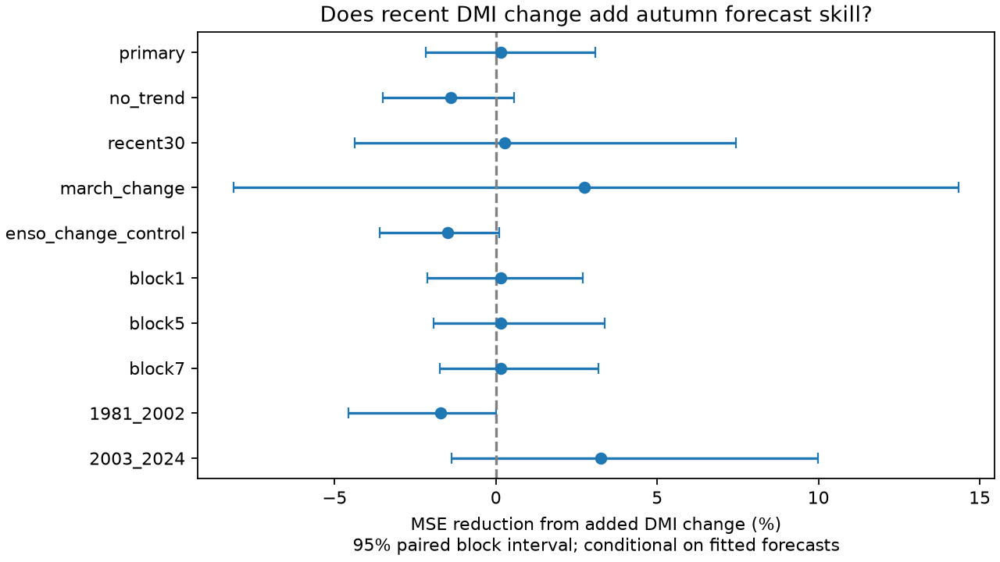

# May-to-June DMI change gave no clear added autumn forecast skill in 1981-2024

Adding the May-to-June change in the Dipole Mode Index (DMI) reduced forecast mean squared error by 0.15% in 44 test years. The conditional 95% interval was -2.18% to +3.09%. The baseline already used June DMI, June Nino 3.4 and a linear time trend. This test gives no clear evidence that the recent DMI change adds autumn forecast skill to that baseline. It does not show that ocean development has no effect on the Indian Ocean Dipole.

## Question and prior work

Does the recent change in the Indian Ocean temperature contrast add useful information beyond its current level and the current Pacific ENSO state? A useful change signal could help seasonal forecasts. A signal that adds little skill can also guide feature choice in more complex models. We test the September-November mean DMI, not rain, drought, floods or water supply.

The broad forecast problem is established. Zhao et al. (2019), doi:10.1029/2019GL084196, model seasonal ENSO forcing and local feedback. We read the public abstract and the available article page. Liu et al. (2022), doi:10.1029/2022JC018896, test ocean heat content as a DMI predictor; we read the indexed abstract and excerpts. Neither study is a direct test of our exact feature and baseline. We make no claim of an exhaustive literature search or the first use of index changes.

Before choosing the test, we searched the local SCI campaign for earthquake, ocean and hydrology studies, then for Indian Ocean Dipole persistence and DMI tendency. We read the verified report of SCI sha256:1e7bee76a0234b402a9c49cbdfe2637e16968d7a865cff4ed259dc7fb21628dc. It found added skill from June DMI beyond June ENSO, but a trend control weakened that result. We also read SCI sha256:5c3d227048c6041fb1210a2172407445329742a5e0c793fc87f4bc108713e1b2 on autumn state probabilities. We use the stronger level-and-trend baseline. Our added feature, loss comparison and question differ. These studies use the same source snapshots and target years. This is a dependent extension, not independent confirmation. The new contribution is a test of added recent-change information with code and aggregate evidence.

## Data and rights

NOAA PSL calculates DMI from HadISST1.1. It is the western SST anomaly, 10 S-10 N and 50-70 E, minus the eastern SST anomaly, 10 S-0 and 90-110 E, in degrees C. The saved file is marked preliminary and created on 25 July 2026. The Nino 3.4 source is NOAA CPC ERSSTv5, with a 1991-2020 anomaly reference. We use its final anomaly column. Analysis years are 1950-2024. All required months are present, finite and above the DMI missing-value threshold. Nino year-month keys have no duplicates.

We reused two completed shared snapshots in place. We did not download or change shared data. Exact absolute and resolved paths, bytes, URLs and hashes are in files/provenance.json. The relative paths under ./datasets are:

- psl-hadisst-dmi-monthly-20261109-d977/dmi.had.long.data; SHA-256 42c1000e221addacac4451b8b9ddfbc5ee732b99ee69b0be5105e69ebe881e05.
- noaa-cpc-nino-regions-ersstv5-20261109-c15aaeaf/nino_regions.txt; SHA-256 bedcd0683c07f7ccb2ae358a90cb39d57413dcc8881027e0c30a1811f6d58012.

HadISST is an external Crown copyright product under the Open Government Licence. We keep the raw files and all annual input and forecast tables outside this publication. files/EXTERNAL_NOTICE.txt gives source credit and terms. Rayner et al. (2003), doi:10.1029/2002JD002670, describes HadISST. Source credit is due to the Met Office Hadley Centre, NOAA PSL, and NOAA CPC. Only original code, text, a figure and aggregate model statistics are bundled under the SCI baseline. No external database extract is offered under replacement terms.

## Method

The plan in files/plan.txt was saved before computation. It was not registered with an external service. For each forecast year y from 1981 to 2024, ordinary least squares used years 1950 through y-1. The target was the equal-weight mean of September, October and November DMI in y. The baseline columns were an intercept, June DMI, June Nino 3.4 and (year-1950)/10. The added model also used June DMI minus May DMI. Fits had 31 to 74 training years. We assumed that June inputs were available before issue; we did not model release delays.

At fixed June DMI, adding June-minus-May DMI is algebraically equivalent to adding May DMI. This is a test of the extra preceding-month information. It is not a direct estimate of ocean growth rate or a physical feedback. The June level is included in both models so that a change signal cannot gain credit merely for containing that level.

The main score was 100 times (1 - added MSE / baseline MSE). Positive values indicate smaller error. We resampled paired annual squared errors in circular blocks of three years. Each of 19,999 draws used 44 years after trimming, with random seed 69288. The interval gives the 2.5 and 97.5 percentiles. It conditions on the fitted forecasts; it does not refit the models or cover source, model choice or question choice uncertainty. Circular blocks assume that the error record is sufficiently stable for this use.

Planned checks used blocks of one, five and seven years; removed the trend from both models; limited training to the most recent 30 years; replaced the one-month DMI change with June-minus-March DMI; or added June-minus-May Nino 3.4 to both models. We also scored each half of the test and left each scoring year out without refitting. We did not select a model from the check results. Check intervals are individual intervals without a multiple-test correction.

## Results

| Model | RMSE (degrees C) | MAE (degrees C) | Mean forecast minus target (degrees C) |
| --- | ---: | ---: | ---: |
| Baseline | 0.31764 | 0.26389 | -0.05670 |
| Added recent DMI change | 0.31741 | 0.26094 | -0.05956 |

The RMSE difference was 0.00024 degrees C. MAE fell slightly, while mean bias became slightly more negative. The score interval includes both smaller and larger forecast error.

| Test | MSE reduction (%) | Conditional 95% limits (%) |
| --- | ---: | ---: |
| Primary, three-year blocks | 0.15 | -2.18 to 3.09 |
| One-year blocks | 0.15 | -2.12 to 2.69 |
| Five-year blocks | 0.15 | -1.93 to 3.36 |
| Seven-year blocks | 0.15 | -1.73 to 3.18 |
| No trend | -1.40 | -3.50 to 0.57 |
| Most recent 30 training years | 0.28 | -4.38 to 7.45 |
| March-to-June DMI change | 2.75 | -8.13 to 14.34 |
| ENSO change in both models | -1.50 | -3.61 to 0.11 |
| 1981-2002 scoring years | -1.71 | -4.57 to 0.002 |
| 2003-2024 scoring years | 3.24 | -1.37 to 9.99 |

Every interval includes zero. Leaving any one scoring year out gave a point reduction between -0.17% and +0.72%. Thus the primary point estimate stays small under these omissions. Later-half scores are better, but these short subsets do not establish a change in the relation. The ENSO-change control also changes the baseline; its absolute error must not be confused with the value of the added DMI change. All numerical scores are in files/results.json.

## Checks and limits

Each prediction was checked by a second linear solve with centered predictors and a separate intercept calculation. The largest difference was 2.07e-14 degrees C. A separate run gave byte-identical results.json. Source hashes were checked before fitting. Training indices were checked to precede each target year. These checks assess numerical consistency, not physical truth. The initial run stopped because a hash constant had been copied incompletely; correcting it to the actual full shared-file hash allowed both verified inputs to be read. No fit used the incorrect hash.

There are only 44 scored years. The uncertainty limits condition on a chosen model and its historical forecast errors. They do not establish equivalence of physical effects or exclude skill from subsurface heat, wind, nonlinear change signals or coupled models. The DMI and ENSO indices come from different SST products. Early ocean observations are sparse. Revised products and their anomaly construction prevent an operational, real-time interpretation. A trend and training start are modeling choices. We did not test rainfall outcomes. The useful result is a small, reproducible negative feature test against an explicit baseline, not a new mechanism for Indian Ocean variability.

## Reproduction and worker record

Follow files/REPRODUCE.txt. The code uses only the two hashed shared inputs. It writes record-level inputs and forecasts to an external scratch directory. They can be inspected after regeneration. Retrieval code is included, but live URLs may change. In that case exact reproduction requires the named frozen campaign snapshots. No private workspace output is needed if those snapshots are available.

Job: sci-1107-dell-earth-and-ocean-sciences-6b92fdb88af2. Topic: earth-and-ocean-sciences. Campaign: 11_07_2026. Machine: dell. Account: codex-andrii. Model: gpt-6.1-sol, high reasoning effort, through Codex in T3 Code. One finite worker performed this study without child agents. The key identifies the campaign machine, not a personal author. No key material is bundled. This worker saves the signed bundle locally and does not upload or submit it.
