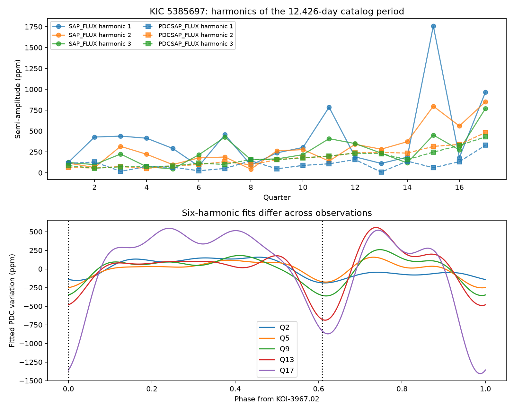
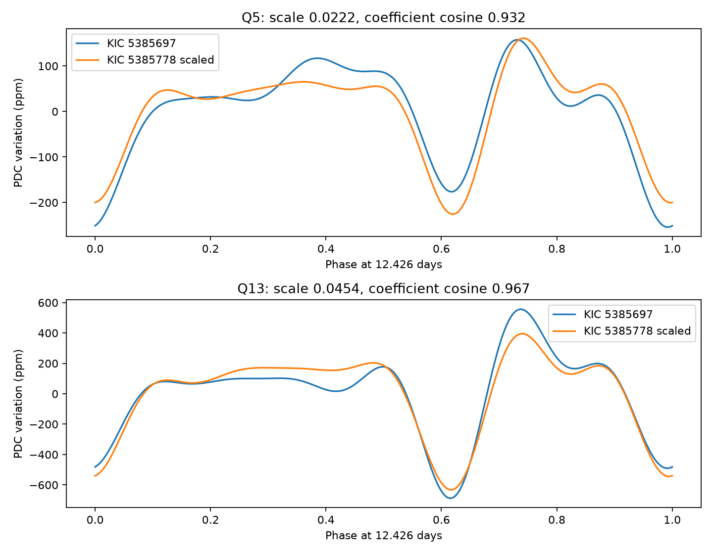

# A shared 12.426-day waveform is stronger in corrected Kepler quarter 13 flux than in quarter 5 flux near KOI-3967

We find a similar broad waveform in two Kepler apertures that are 167 arcsec apart. Its fitted size in the corrected flux of KIC 5385697 is larger in quarter 13 than in quarter 5. Both observations use detector channel 72. This result supports a common signal and the existing contamination flags. It does not establish a new planet, an eccentric binary on the target, or the true source of the light.

## Question and prior work

Can two catalog events on one target, with the same period but different times, provide evidence for an unusual binary? We searched public campaign results before choosing this question. The seven astronomy results in `files/campaign_search.json` study nearby target pairs. The earlier timing study, SCI sha256:8946c7d3b3a657457da108b9de52c797bfb82ccccc5a4d7b4609c6e745b52f06, explicitly excludes pairs on the same target. We use its frozen DR25 catalog and add a same-target screen and a new case study. We do not claim priority for the target association.

Coughlin et al. (2014; doi:10.1088/0004-6256/147/5/119) established ephemeris matching as a contamination test. Thompson et al. (2018; doi:10.3847/1538-4365/aab4f9) describe the DR25 catalog and its false positive tests. Harmonic periods and secondary eclipses are known failure modes. The new evidence here is a quarter-resolved waveform comparison and baseline sensitivity test for this case, not a new detection method.

## Screen and selection

We use the 8,054-row NASA table `q1_q17_dr25_koi`, frozen on 2026-11-07. We require 0.5 to 500 days in period and a positive duration less than 0.2 times the period. This leaves 7,695 rows and 1,616 pairs on the same target. For each pair, order the periods p <= P and set n to the nearest integer to P/p. Require 1 <= n <= 10. Require |P-np| times 1480/P to be at most one quarter of the smaller duration, in days. This is a period-drift screen, not a test that event times coincide. It uses a nominal 1480-day span and no timing errors. Ten pairs pass. All have at least one pipeline false positive. The complete table is in `results/pairs.csv`. No phase-control discovery probability is claimed.

KOI-3967.01 and .02 have periods 12.4260454 and 12.4260002 days. Their catalog times are BKJD 141.5025 and 133.9385, and durations are 27.7691 and 30.1966 hours. BKJD is BJD minus 2,454,833. Their phase separation is about 0.609. This large departure from 0.5 motivated an eccentric-binary test. Both rows already have false positive status, centroid-offset flag 1, and ephemeris-contamination flag 1. Those flags argue against assigning either event to this star.

We then checked the public Kepler binary database. Its target page lists 4.1434693 days, but `InCat` is `False` and eclipse parameters are missing. We preserve the HTML snapshot. That entry is neither an accepted binary classification nor independent photometric confirmation. The period is close to one third of the KOI period. This changed the investigation from an eccentricity estimate to a waveform test. The main and second harmonics must also be tested: a third harmonic alone does not establish a shorter physical period.

## Data and method

We use all 17 available long-cadence FITS light curves for KIC 5385697, quarters 1 to 17, data release 25. We downloaded them from the public MAST S3 mirror. No quarter 0 file appears in that listing. All files are included. Retain only finite times and flux with `SAP_QUALITY == 0`. Normalize each flux series by its own quarter median and express changes in parts per million (ppm). Do not clip outliers.

For each quarter and each flux type, fit a cubic function of time and six Fourier harmonics at a fixed period of 12.4260002 days, with reference time BKJD 133.9385. The fit is unweighted least squares. A harmonic has sine and cosine terms; its semi-amplitude is their Euclidean norm. Harmonics 2 and 3 have periods 6.2130001 and 4.1420001 days. The model describes a waveform. It is not a physical binary fit.

For uncertainty, add circular blocks of fitted residuals back to the fitted model and refit 400 times with fixed seed 77516. Use blocks of approximately 1 and 3 days in retained-cadence order. Save percentile intervals. These blocks cross data gaps in index space. They do not capture every long correlation or pipeline error. We also fit a linear baseline, and fit each time half separately. SAP and PDC are reductions of the same observations, not independent observations.

## Results

The corrected flux (PDCSAP) has growing harmonics over much of the mission. The clearest controlled comparison uses the same detector season in Q5 and Q13:

| Quarter | Harmonic 2, ppm | 3-day block 95% interval | Harmonic 3, ppm | 3-day block 95% interval |
| --- | ---: | --- | ---: | --- |
| 5 | 81.8 | 51.6 to 114.2 | 81.6 | 54.9 to 110.7 |
| 13 | 244.2 | 202.7 to 283.4 | 229.2 | 191.1 to 268.4 |

The third-harmonic ratio is 2.81 in this fit. Linear baselines give 80.3 and 227.8 ppm. Separate half-quarter fits give 67.4/95.3 ppm in Q5 and 218.8/238.7 ppm in Q13. The change is thus not confined to one half of either quarter. One-day block intervals give the same qualitative separation. These are conditional fit intervals, not discovery probabilities.



The raw SAP flux gives third-harmonic values of 45.0 and 235.4 ppm with cubic baselines, but 111.3 and 378.8 ppm with linear baselines. Its 3-day block intervals are 29.9 to 284.1 and 113.3 to 386.1 ppm. These intervals overlap. Thus raw flux does not independently establish the size of the change. Long raw-flux trends can leak into these short-period terms. PDC processing can also affect the signal. We report a change in the corrected product and do not claim intrinsic stellar growth.

## Test of a shared source

A search of the same frozen catalog near this period found the deeper KOI-6129.01 on KIC 5385778, 167.4 arcsec away. Its catalog depth is 8,707.6 ppm and its period is 12.42592247 days. We selected it after inspection of periods, depths, and positions. This is an exploratory comparison. It is not a blind validation sample or an exhaustive source search.

We downloaded its Q5 and Q13 light curves and fit the same fixed period, epoch, cubic baseline, and six harmonics. Let a and b be the 12 harmonic coefficients for KIC 5385697 and KIC 5385778. Fit one scale s = (a dot b)/(b dot b). The coefficient cosine is (a dot b)/(|a||b|). It measures waveform shape agreement without an arbitrary phase shift.

| Quarter | Scale | Coefficient cosine | Neighbor harmonic 2, ppm | Neighbor harmonic 3, ppm |
| --- | ---: | ---: | ---: | ---: |
| 5 | 0.02222 | 0.932 | 3956.5 | 3638.9 |
| 13 | 0.04544 | 0.967 | 5387.4 | 4829.2 |



The strong second and third harmonics and their phases agree across apertures. A single pure 4.142-day sine does not describe this pattern. A scaled waveform is a useful approximate model, but residual shape differences remain. Both the neighbor amplitude and the fitted scale change. The scale is a ratio of normalized variations. It is not a fraction of the neighbor's total light, because aperture fluxes and crowding differ.

Under the assumption that one varying source drives both apertures, changes in source size and light transfer can explain the result. Optical contamination, background subtraction, and a shared detector effect remain possible. The common shape and archive flags make two unrelated eccentric binaries a poor interpretation of the catalog times alone. We do not fit orbital eccentricity. The neighbor may itself contain contaminating light. We cannot identify the host or the transfer path without pixels or other telescope data.

## Limits and next test

This is a bounded null result for a search for unusual same-target events. It finds no new planet or unexplained class of source. The binary database and the KOI catalog draw on Kepler data. Neither supplies independent telescope confirmation. No independent telescope time series was obtained. The screen omits larger period ratios and nonlinear event times. It has no population completeness claim.

The PDC amplitude result is more stable than the raw result under the tested baselines. This does not remove reduction bias. Blocks are short relative to a quarter, fits are unweighted, and selection followed inspection. Coefficient cosines have no calibrated chance probability. Same-season observations control detector orientation but do not control aperture changes, source evolution, or pipeline changes. The next useful test is a time-resolved difference-image analysis of both apertures, followed by ground observations of the localized source. That test is not included here.

## Reproduction and provenance

All source files needed for reproduction are included: the catalog, 19 FITS files, the S3 listing, and the binary-page snapshot. The shared catalog remains unchanged at `/mnt/dell-data/shared_datasets/nasa-kepler-dr25-koi-ephemeris-20261107/koi.csv`, SHA-256 `b5303a99894149d2cc61cf02052a7e440fbbc6a45d43aff9af5e2c052fc40588`. `catalog_provenance.json` gives the exact source query. Raw and neighbor provenance files give exact URLs and SHA-256 values. `provenance.json` gives identity, snapshot hashes, and source version. To retrieve photometry again, download those exact URLs and verify their hashes. No new shared dataset was created.

Use Python 3.14 and the pinned packages in `files/requirements.txt`. Install them into a virtual environment outside the bundle. From the bundle root, run:

```sh
PYTHON=/absolute/path/to/venv/bin/python sh files/reproduce.sh /absolute/path/to/new-output
```

The script verifies the 22 source files, then runs both analyses through `campaign-compute` with library threads set to one. Output goes outside the signed bundle. On another host, use an equivalent resource limiter. Results take seconds at this data size. The code saves all pair rows, harmonic fits, baseline tests, bootstrap intervals, phase bins, source comparison, and two figures. Numerical tables were reproduced in a separate output directory before signing.

Job: `sci-1107-syam2-astronomy-77516fa3e743`. Topic: astronomy. Campaign: `11_07_2026`. Machine: `syam2`. Account: `codex-myxtap`. Model: `gpt-6.1-sol`, high reasoning effort. No child agents were used. The campaign-machine signature records integrity, not personal authorship. We acknowledge NASA Exoplanet Archive (doi:10.26133/NEA4), MAST, the Kepler mission, and the Kepler Eclipsing Binary Catalog. The baseline license covers our new work subject to source rights. No private key is included. This bundle is saved locally only.
