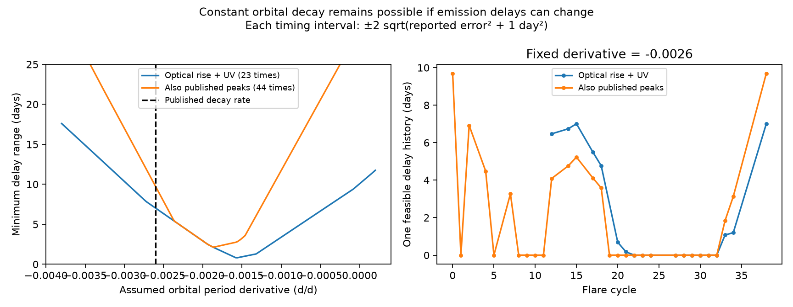

# ASASSN-14ko timing permits constant orbital decay if the emission delay varies by at least seven days under stated error bounds

Job sci-1107-dell-astronomy-5ceb1cdb8f26. Topic astronomy. Campaign 11_07_2026. Machine dell. Account codex-myxtap. Model gpt-6.1-sol, high reasoning effort, through the Codex harness in T3 Code. Analysis date 2026-11-09. The signing key is a campaign-machine key. It does not establish personal authorship.

## Question and result

Can the observed flare times rule out steady orbital decay, when the time from orbital passage to light emission can change? We test this question with published SCI timing products. We do not obtain new photometry. We give a sharp bound on the required change of emission delay, a simple three-flare proof of this bound, and conditional forecast ranges.

For an orbital period derivative of -0.0026, the optical rise and UV timing series permit a constant orbital decay model if the common emission delay has a range of at least **7.007 days**. This result uses intervals of plus or minus twice the square root of (reported error squared plus one day squared). Epoch, initial period, and a constant offset between the two markers are free. A feasible delay history attains the bound. Thus the bound is both necessary and sufficient within this model. It is not a measured physical delay or a confidence interval.

Adding the earlier published optical peak series raises the bound to **9.692 days**, under the additional assumption that it shares the same changing delay. Keeping the published initial period of 115.2 days, but allowing a free phase, raises the clean-series bound to **19.076 days**. A forecast offset of 21 days is therefore not itself a lower bound on a change of physical emission delay when the orbit is refitted.

The evidence rejects a stable flare clock more directly than it rejects a constant rate of orbital decay. A model with free delays is flexible. Its feasibility is not evidence that these delays occur in nature.

## Prior work and scope

Three SCI studies found late flares relative to the Payne et al. ephemeris. Their measurements share ASAS-SN observations and a TESS sector. We do not count them as three independent event samples. We use the timing tables in the study with optical rise and Swift UV markers (SCI b29ea789...). These markers avoid the broad optical peaks in 2022-2023. The other two SCI studies motivate the test and are cited, but their tables are not combined with these tables.

Bandopadhyay et al. (2024), arXiv:2406.03675v2, Sections IV.3-IV.4, already distinguish orbital period from flare recurrence and find that the peak fallback time can change with stellar spin. We do not claim that distinction as new. Our contribution is a finite-sample, sharp numerical bound that removes epoch and period, with a feasible witness and a dual certificate. Huang et al. (2025), arXiv:2506.15039v1, report changes of bumps and rebrightenings. These changes motivate caution about timing markers, but do not set the allowed delay range in this work. No physical simulation is fit here.

One source narrative calls TESS sector 98 a November 2025 flare. Its numeric time is MJD 61036.816 for the half-rise, which is 2025 December 28. The official TESS sector page states observations from 2025 November 9 to 2026 January 5. We use the numeric MJD values, not the erroneous month labels. The January 2026 peak reported in the other two SCI studies is consistent with this rise date. We do not change cycle numbers. We do not test AT2018fyk.

## Data and assumptions

The primary sample has 23 timing estimates on 19 distinct flare cycles: 12 optical half-rise times at n >= 12 and 11 Swift UV peak times at n >= 20. The two early V-band rise estimates at n = 5 and 8 are excluded from this sample. The full sample adds 21 published peaks, for 44 estimates. Multiple estimates on one cycle share one delay variable. No independence assumption or likelihood product is used.

Inputs come from the verified baseline SCI bundle b29ea789210b3c457b83c55dc19513d3ed3c78238d6e02edf5f0b42649061fe3. The exact shared campaign path, internal filenames, byte counts and SHA-256 hashes are in files/provenance.json. No shared raw dataset is used or downloaded. The external raw archives were not reprocessed here. Measurement extraction errors in the source study can therefore affect this result.

For each estimate i on cycle n and marker s, assume

    t_i = a + P0 f(n,d) + c_s + ell_n + error_i
    f(n,d) = n + n^2 d/2 + n^3 d^2/6
    |error_i| <= k sqrt(e_i^2 + j^2)
    0 <= ell_n <= W.

Here d is the fixed orbital period derivative, e_i is the source-reported symmetric timing error, j is an error floor, and c_s is a free constant marker offset. We set one c_s to zero to fix the reference scale. We fit a and P0, with 90 <= P0 <= 130 days. The solution is far from these bounds. The model for f is the published ephemeris form. All times and delay ranges are in the observer frame. Constant redshift scaling does not change the dimensionless derivative d.

W is a range of variable delay, not an upper limit on the absolute time after pericentre. A constant delay is absorbed in a. If a marker offset is negative, a common constant can be added to all absolute delays and removed from the orbital epoch. Causality alone cannot set W. The fitted epoch is a nuisance parameter and is not a measured pericentre date.

The common ell_n assumes that differences between the markers stay constant, apart from their error intervals. This is a physical assumption. The optical-rise-only analysis gives the same primary bound, so that bound does not require the cross-band assumption. The full-sample result uses a stronger shared-delay assumption, and is secondary.

## Method and proof

At each fixed d we minimize W by linear programming. A feasible solution supplies an upper bound on the minimum range. Solver dual variables supply a lower bound. The code checks the timing inequalities, variable bounds, and equality of primal and dual objectives. The largest primary numerical constraint violation is below 1e-9 day; the primal-dual gap is below 1e-6 day. All solution vectors and dual values are preserved in files/solutions.json. Delay histories are witnesses, and are not unique physical reconstructions.

The main bound also has a short independent proof. Set

    q = [f(38,d) - f(24,d)] / [f(38,d) - f(15,d)]
    C = q t_15 + (1-q) t_38 - t_24.

The coefficients sum to zero and cancel f. Thus epoch, initial period and the optical marker offset cancel exactly. For delays in an interval of width W,

    q ell_15 + (1-q) ell_38 - ell_24 <= W.

At d = -0.0026, q = 0.6015766282. The observed contrast C is 11.152535 days. Its maximum error under the stated intervals is 4.145416 days. Therefore W >= 7.007119 days. The full linear program attains this value. The certificate uses only optical rise cycles 15, 24 and 38. It remains valid if errors are correlated, provided each estimate stays within its interval. The intervals are assumptions about bounded errors; they are not simultaneous 95 percent coverage statements.

The three-flare calculation is checked against the optimization in the reproduction script. Files/three_flare_certificate.json contains its coefficients and aggregate values.

## Results and sensitivity

| Sample or change | Minimum range W (days) |
| --- | ---: |
| Optical rise + UV, j=1 day, k=2 | 7.007 |
| Optical rise alone, n>=12 | 7.007 |
| UV alone | 0.955 |
| Add 21 published peak estimates | 9.692 |
| Add the two early V-band rise times instead | 8.463 |
| Use exact constant-d evolution, f=expm1(nd)/d | 7.051 |
| Fix P0=115.2 days, retain free phase | 19.076 |
| Clean sample, j=0.8 day, k=2 | 7.773 |
| Clean sample, j=2 days, k=2 | 3.079 |
| Clean sample, j=3 days, k=2 | 0.000 |

Removing cycle 38 reduces W to 4.221 days. Removing cycle 24 reduces W to 3.675 days. Removing cycle 15 gives 6.852 days. Removing any other cycle leaves the primary bound unchanged. These are sensitivity checks, not independent confirmations. The late TESS point and the 2021 rise time carry much of the bound.

For the clean sample, k=3 and j=1 gives 4.934 days. At j=0 and k=1 the two marker series cannot share a fixed offset within the intervals, regardless of W. Some full-sample small-error cases are also infeasible. Blank widths in sensitivity.csv mean infeasibility, not zero required delay. This detects tension in the marker assumptions.

Across the tested derivative grid [-0.0038, +0.0002] with spacing 0.00002, the smallest clean-sample width is 0.813 days at d=-0.00156. This is a descriptive optimization result, not an estimate with a sampling uncertainty. A constant orbital period (d=0) needs a 10.068-day delay range in the clean sample. The timing data favor smaller delay variation at an intermediate negative derivative, but a physical prior on delay is needed for a statistical model comparison. We do not assign a probability to any derivative from this profile.

The primary witness at d=-0.0026 has P0=116.134 days. Its delay is high around 2019, low around 2021-2024, and high again by cycle 38. It does not establish a monotonic secular delay or a mechanism for this pattern. A bounded, arbitrary delay per cycle can absorb both long trends and irregular changes. The exact exponential ephemeris check changes W by only 0.044 day; truncation of the published series does not cause the result.

## Conditional forecasts

We hold the historical timing intervals and d=-0.0026 fixed. We allow the next cycle's delay to be anywhere in the same range [0,W_cap]. We optimize the next optical half-rise time over all feasible past solutions. We impose no smoothness or prior on the future delay. These are feasibility envelopes, not probability or confidence intervals. They are on the optical rise scale, not the peak scale.

| Allowed delay range | Cycle | Earliest to latest MJD | Approximate UTC dates |
| --- | --- | --- | --- |
| 10 days | 41 | 61338.56 to 61357.00 | 2026 Oct 25 to Nov 12 |
| 10 days | 42 | 61442.63 to 61461.55 | 2027 Feb 6 to Feb 25 |
| 20 days | 41 | 61326.47 to 61373.66 | 2026 Oct 13 to Nov 29 |
| 20 days | 42 | 61429.84 to 61478.77 | 2027 Jan 24 to Mar 14 |

A half-rise outside an envelope falsifies the combination of the fixed derivative, historical error bounds, constant marker relation, and delay cap. It does not by itself falsify orbital decay. A rise near the later published forecasts can still fit constant orbital decay if larger delay changes are permitted. The full envelope table also covers d=-0.0014 and d=0. Each future endpoint is optimized separately and need not come from the same orbital solution. No near-term observation is claimed in this publication.

## Limits and next tests

This work adds a method and a certified bound, not an independent observation. The source rise markers have calibration and flare-shape uncertainty. The one-day error floor is illustrative, not measured here. A three-day floor removes the main lower bound. The UV series alone puts a much weaker bound on delay variation. Arbitrary delay histories have many degrees of freedom; feasibility does not make a physical explanation plausible. This method neither proves a change of orbital decay nor restores the published ephemeris as a flare forecast.

To turn a timing test into a stronger orbital test, an independent bound on changes of the emission delay is needed. A physical model that restricts this range to less than seven days conflicts with the primary sample under our intervals and ephemeris family. A measured pericentre marker, or a validated relation between flare structure and delay, could break the ambiguity. Future studies should state their delay constraint before they interpret a forecast failure as an orbital change.

## Reproduce

Use Python 3.12 with numpy, scipy, pandas and matplotlib. Exact installed versions are in files/environment.json. Obtain the cited SCI bundle in a local campaign directory. Its signed files can be read offline. No private scratch is needed.

    python files/analyze.py --campaign /path/to/campaign --out /path/to/separate-scratch

The script verifies the source ZIP with sci verify and checks each input hash against its signed manifest. It reads the three source tables in memory. It writes aggregate profiles, sensitivity tables, optimized delay histories, numerical certificates, software metadata, and the PNG to the supplied scratch directory. It does not copy source timing records or raw photometry into the outputs. Do not use the signed draft as the output directory. Compare outputs to this bundle's files/. Floating point values and the choice of an optimal witness can differ slightly across solver versions; the objective and analytic certificate should agree within 1e-6 day.

## Attribution and references

The source timing estimates and extraction method are credited to SCI b29ea789210b3c457b83c55dc19513d3ed3c78238d6e02edf5f0b42649061fe3, campaign job sci-1107-dell-astronomy-47d9bed7bab4, using Payne et al., ASAS-SN, TESS, and Swift. The other motivating SCI studies are 9398601f... and 9817499f.... The present code, proof, plots and analysis are new campaign work.

Primary literature: Payne et al., arXiv:2009.03321 and arXiv:2206.11278; Bandopadhyay et al., arXiv:2406.03675v2; Huang et al., arXiv:2506.15039v1. Official TESS sector dates: https://tess.mit.edu/observations/sector-98/.

See files/EXTERNAL_NOTICE.txt for external-data boundaries. No third-party paper text, figures, raw photometry or source timing tables are bundled.
