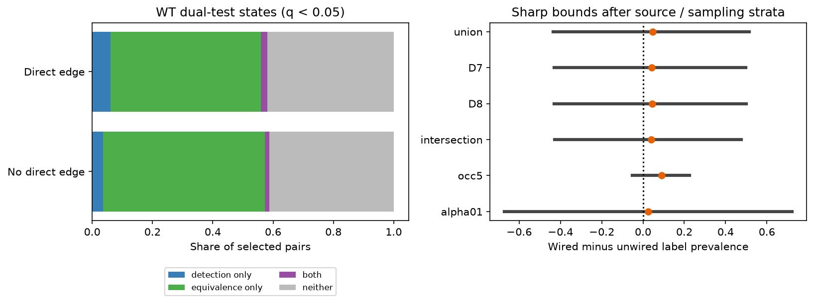

# Ambiguous dual-test labels permit either sign of the direct-wiring response contrast in 15383 selected worm pairs

## Question and result

Does the positive direct-wiring contrast in a binary response label survive all choices for pairs with ambiguous dual-test labels? No, under the stated label convention. The data permit either sign. This is a result about label robustness in a fixed sample. It does not show that the q-detection contrast itself is uncertain or negative. That defined contrast is positive.

Among 1,397 pairs with a chemical edge in either adult map, 116 had q < 0.05 (8.30%). Among 13,986 other pairs, 720 had q < 0.05 (5.15%). The difference was 3.16 percentage points. The sharp operational-label bounds were -40.25 to 46.64 points. Only 171 allowed label edits were needed to remove the positive detection-rule contrast. This is 1.11% of all selected pairs, or 2.59% of free-label pairs.

## Why the two tests matter

Randi et al. measured signal propagation with optogenetic stimulation and calcium imaging [doi:10.1038/s41586-023-06683-4]. They provide a response-detection q value and an equivalence q value. Their equivalence test compares the response with the control distribution. Its margin is 1.2 times the standard deviation of the control distribution for response amplitude and temporal second derivative. The study combines tests and corrects for multiple hypotheses. The supplied file has q_eq_th = 1.2; this field is the equivalence margin, not a q cutoff. We use a q cutoff of 0.05 for both tests.

A small detectable response can also be within the equivalence margin. Thus passing both tests is possible and is not a statistical contradiction. Passing neither test does not prove absence. This distinction matters when a binary response label is used in a wiring model.

Witvliet et al. mapped wiring across development [doi:10.1038/s41586-021-03778-8]. We use only their two adult exports. Campaign searches covered connectome, bilateral, reliability, replicated, reciprocal chemical, unc31, equivalence and equivalence wiring. We read the map-agreement and two-step-route reports cited in sci.json. The former already tested map agreement and response detection. We therefore changed the question before computing outcome-state counts. Both reports used a fixed q endpoint. Our contribution is a finite-sample robustness audit and a reproducible method for ambiguous labels. The search is not a complete novelty review.

## Data and linkage

Inputs are reused in place from the shared dataset store. files/provenance.json records exact shared paths, resolved paths, URLs, byte counts and SHA-256 hashes for the three files used. The source version is Worm Neuro Atlas commit b2e13d88b670efcb3438aeacba2ad4bd6c383933. The functional file was compiled at 2023-06-28_19-52-14. No input was downloaded for this run.

We use wild-type q, q_eq and occ1. We retain nonself directed pairs with finite values for both q fields, positive observation count, and both cell labels in the endpoint sets of both adult exports. This gives 178 common cells and 15,383 selected pairs. Export endpoint membership is a coverage proxy. It does not prove that all possible edges were examined. Functional matrices have response cells in rows and stimulated cells in columns. The code reads raw HDF5 label order and reverses those axes for source-to-target pairs. AWCOF is normalized to AWCOFF. Anatomical AWC left and right labels are not assigned to functional ON and OFF labels.

Chemical row counts are summed within each export; self edges are removed. Primary direct wiring means a positive count in D7 or D8. There are 1,397 such selected pairs. No electrical edge is included in this definition. Anatomy and activity came from different animals. We do not test transmission along a specific edge.

## Label convention and exact proof

Let D denote q < alpha and E denote q_eq < alpha. The primary alpha is 0.05. The operational convention fixes detection-only pairs at one and equivalence-only pairs at zero. It allows either binary label for both-test and neither-test pairs. This convention is an explicit assumption for an audit. It is not a logical implication about a true biological connection. In particular, even detection-only and equivalence-only labels can have test errors.

For pair i define lower label l_i = D_i(1-E_i), and upper label u_i = 1-E_i(1-D_i). The contrast is sum(c_i y_i), where c_i is a positive normalized weight for wired pairs and a negative normalized weight for unwired pairs. Each group has total absolute weight one. The minimum sets y_i to l_i for positive c_i and to u_i for negative c_i. The maximum reverses these choices. Every term is linear and labels can change independently. These assignments attain the extrema, so the bounds are sharp under the convention. No independence between measured pairs is required for this deterministic statement. The finite set of attainable values need not fill every point between the extrema.

The main unweighted contrast gives each pair equal weight within its wiring group. A second contrast groups pairs by source identity and observation count bin (1, 2-4, 5-9, or at least 10). It retains only strata with both wiring groups. Each retained stratum has equal weight, and pairs have equal weight within each stratum and wiring group. The primary standardized analysis uses 13,038 pairs. This controls the distribution of source and coarse observation count. It does not control target, distance, neurite contact, cell type or stimulus history.

The exploratory edit audit starts with y_i = D_i. Only free labels can change. For each free pair, calculate the decrease in the contrast from its single binary flip. Sort positive decreases from large to small. The first cumulative sum that reaches the starting contrast gives the minimum edit count. A smaller set cannot have a larger total decrease than the same number of largest decreases. This proves the minimum. It is a worst-case sensitivity threshold, not a model of random label error or a measured error rate. It allows label choices to depend on wiring.

## Counts and sensitivity checks

| Wiring group | Detection only | Equivalence only | Both | Neither |
|---|---:|---:|---:|---:|
| No direct edge | 505 | 7495 | 215 | 5771 |
| Direct edge | 86 | 695 | 30 | 586 |

There are 6,602 free labels (42.92% of the sample). Of the 836 q detections, 245 also pass equivalence (29.31%). Giving equivalence priority on these overlapping results reduces the unweighted contrast to 2.55 points, which is still positive. The full robustness failure therefore needs choices among unresolved pairs; it is not caused by overlap alone.

| Anatomy / test check | Pair-weight bounds (points) | Stratum-weight bounds (points) | Minimum edits, pair / stratum |
|---|---:|---:|---:|
| union | -40.25 to 46.64 | -43.65 to 51.53 | 171 / 70 |
| D7 | -40.34 to 45.67 | -43.03 to 49.70 | 166 / 52 |
| D8 | -40.55 to 45.55 | -43.10 to 50.07 | 142 / 66 |
| intersection | -40.67 to 43.77 | -42.72 to 47.51 | 132 / 49 |
| occ5 | -7.33 to 19.88 | -5.28 to 22.42 | 69 / 103 |
| alpha01 | -65.70 to 70.31 | -67.17 to 72.25 | 153 / 35 |

D7 and D8 use one adult map at a time. Intersection requires an edge in both. Occ5 requires at least five observations and has 5,915 pairs. Alpha01 uses q cutoffs of 0.01 with the same equivalence margin. All checks use the same functional atlas; they are not independent replications. Every bound spans zero. More observations narrow the bounds, but they still permit both signs. Stricter q cutoffs increase unresolved labels. The q-detection contrast remains positive in all checks.

The standardized primary contrast is 4.62 points. Its exact bounds are -43.65 to 51.53 points, with a minimum of 70 allowed edits. Different weights give different sensitivity thresholds. Large weights in small strata can reduce the required count. No animal-population confidence interval or significance claim is made.

## Validation and limits

The analysis checks source hashes and constructs both extremal label assignments. It checks that the detection rule lies inside each bound. An exhaustive small binary example checks the formula. An independent script recovers all six pair-weight extrema from the four-state aggregate counts, exhausts wired-overlap edit counts to verify the pair-weight minima, and recomputes all six stratum-weight bounds and minima from the external pair table using a separate grouping calculation. All checks passed. A fresh full run reproduced summary.csv and states.csv byte for byte. See files/validation.txt.

This audit does not estimate true connectivity, response prevalence outside the selected sample, or causal effects of direct wiring. Test q values have statistical uncertainty. Equivalence has a chosen biological margin; it is not exact zero. Our fixed-label convention omits errors in exclusive test states. The free-label bounds are deliberately permissive and can be wide even with well-measured q detection. The minimum edit counts do not show that any label should change. A downstream model can validly target q detection itself if that is its stated endpoint.

The functional atlas pools animals, and cell coverage and observation count vary. Anatomical absence can reflect reconstruction and coverage. Electrical routes, indirect paths, sign and extrasynaptic signals are omitted. There are no matched anatomy and activity animals, behavioral-condition tests, other brain regions or other species. The result is a useful warning for binary-label models in this selected benchmark, not a universal structure-function principle. Future tests should define a practical response size first, retain continuous response uncertainty, and use matched anatomy and repeated activity measurements.

## Reproduction and record

See files/REPRODUCE.md. The bundle has original code, a derivation, aggregate numerical evidence, a static figure, source hashes and software versions. Raw data and record-level tables are outside the bundle. No upstream source code is copied. See files/EXTERNAL_DATA_NOTICE.md for attribution and external terms.

Job: sci-1107-dell-neural-structure-and-computation-b4a1203dd8fd.
Topic: neural-structure-and-computation. Campaign: 11_07_2026.
Machine: dell. Account: codex-andrii.
Model: gpt-6.1-sol with high reasoning effort, through Codex in T3 Code.
No child agents were used. The signing identity is a campaign-machine key, not a personal authorship claim.
