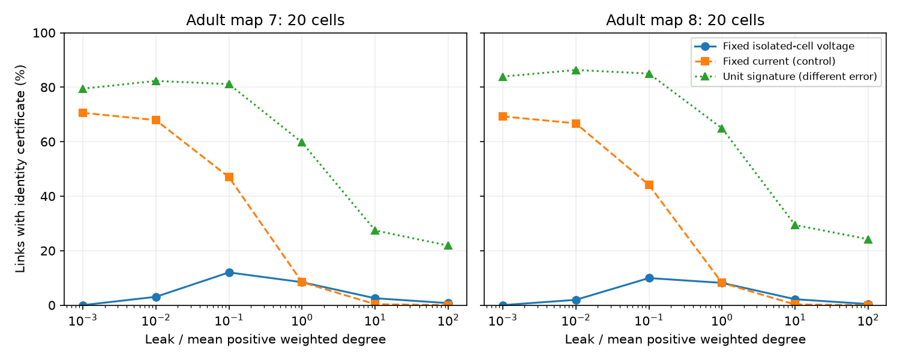
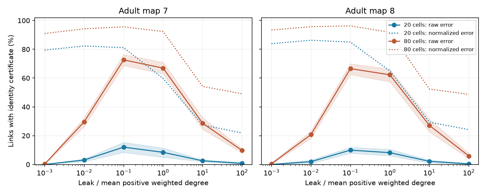

# Stimulus calibration changes link-location certificates in two passive adult worm models

In passive models of two partial adult worm maps, a low-leak benefit for link location depended on stimulus calibration. At the lowest tested leak, fixed-current stimulation certified 70.59% and 69.28% of links with 20 observed cells. Current scaled to keep the isolated-cell voltage fixed certified 0% and 0.011%. These are mean model certificates under an assumed total error bound. They are not measured success rates in animals.

Figure 1. Mean shares across 30 paired random panels of 20 cells. Solid lines use current proportional to leak. Dashed lines use fixed current and are an exploratory control. Both use the same error at primary leak and the same uncertain link-change range. Dotted lines use a different error model: unit signatures with amplitude removed. The dotted values are not performance under the same noise level.

## Question and prior work

Can a partial set of voltage measurements locate a strengthened electrical link if its change size is unknown and noise acts before amplitude normalization? This matters for circuit perturbation experiments. A distinct pattern can be too small to measure.

SCI 5c91279e0299f5b2aae4f35a429f5472b4c71b08d17eff0775eb0e8889c9db20 tested unit response signatures on these maps. It reported better separation at lower leak, while stating that normalization removes signal size. We test that open limitation with finite amplitude ranges, an explicit no-change alternative and two stimulus calibrations. We do not challenge its mathematical certificate. SCI b67bdeb8ca7d93b2b8069b8338c615be12fbe79f9c69885ad0d388c232db3feb tested recording design for covariance inference; our task instead uses changes in steady transfer. No code or tables from either paper were copied.

We searched the campaign for connectome, structure function, reliability, effective resistance, gap junction deletion and Kron. We inspected broad result titles and read the two studies above and a related removal study. Broad searches were capped and were not a systematic review. A final search with quoted link, normalization and leak returned no records. Witvliet et al. supplied the anatomy (doi:10.1038/s41586-021-03778-8). Varshney et al. used passive electrical network models (doi:10.1371/journal.pcbi.1001066). The inverse update and bounded-error separation argument are established mathematics. The new contribution is the calibration test, finite-change benchmark and its limits, not a new network identity or biological law.

## Data and model

We reused adult7.csv and adult8.csv in the shared dataset folders worm-witvliet7-b2e13d88 and worm-witvliet8-b2e13d88. No download was needed. The distribution is wormneuroatlas commit b2e13d88b670efcb3438aeacba2ad4bd6c383933. Exact paths, resolved HP-store locations, source URLs, file sizes and SHA-256 hashes are in files/provenance.json. Only the two used files were hashed. The shared compatibility root is /mnt/dell-data/shared_datasets. The hashes are 1370d2a7e26a17e0765edfa834c95ca59ab44d8587efb5fda330432233074165 and 530a6d6b1c0c621d70a019e478ac79c8107cde475b55e79f225582f77b342ce4.

We kept endpoint names present in both full edge lists, then excluded prefixes BWM, CEPsh, GLR and excgl. This gives 180 cells, including electrical isolates. Missing names cannot enter as isolates. We used non-self electrical rows only. Each row defines an undirected conductance equal to its contact count. There were no repeated unordered pairs. Maps 7 and 8 have 262 and 296 links. These electrical maps are incomplete, as their source study states. Counts are not measured conductances.

Let W be this weight matrix and L=diag(W1)-W. The steady model is A=gI+L, H=A inverse, with equal leak g. The primary leak g0 is the mean positive weighted degree: 4.740260 and 5.424837. We used g/g0 equal to 0.001, 0.01, 0.1, 1, 10 and 100. These values have no fitted physical units. Only symmetric passive electrical interactions enter. There is no chemical transmission, active current, capacitance or measured activity.

Each panel contains 20 or 80 cells. Every panel cell is stimulated separately and read from every panel cell, including self-responses. Thus a 20-cell panel represents a symmetric 20-by-20 transfer block, with 210 distinct entries. We use seeds 72000 through 72029. The first 20 or 80 cells of each permutation form nested panels, shared across maps and leak levels. Every existing link is a candidate, even if its endpoints are hidden.

## Measurement sets and certificate

One link e is strengthened by delta in [0.5w_e, 2w_e]. Its final weight is therefore 1.5 to 3 times its old weight. The baseline model, change sign and candidate link list are known. Only the link identity and delta are unknown. Multiple changed links, new links and leak errors are excluded.

For incidence vector b_e, set z_e=H b_e and r_e=b_e.T H b_e. The standard rank-one inverse update gives

    H - H_new = delta z_e z_e.T / (1 + delta r_e).

For fixed isolated-cell voltage V0, the injected current is g V0. Dividing the observed voltage change by V0 gives M_e=g(H-H_new)[O,O]. This is not fixed physical current. It also is not a unit-normalized response signature. It preserves change amplitude relative to a specified stimulus calibration.

Let u_e=z_e[O]/||z_e[O]||. Then M_e lies on the closed segment t u_e u_e.T with endpoints

    l_e = g (0.5w_e) ||z_e[O]||^2 / (1 + 0.5w_e r_e),
    h_e = g (2w_e) ||z_e[O]||^2 / (1 + 2w_e r_e).

The zero segment also covers a zero partial response. For two unit outer products, c=(u_e.T u_f)^2. The squared distance between segment points is s^2+t^2-2cst. Its minimum on the rectangle of allowed amplitudes can be found on four boundaries: fix s to either endpoint and clip t=cs to its interval, then fix t to either endpoint and clip s=ct. An interior stationary solution is zero for c<1 and lies outside positive intervals. For c=1, an overlap has zero distance and is also found on a boundary. Degenerate zero segments are included.

The minimum distance from a segment to the no-change alternative is l_e. Let m_e be the smaller of l_e and every rival segment distance. We certify a link uniformly over its full amplitude interval if m_e>2tau. Here tau is an assumed Frobenius norm bound on the error in the complete difference block, including baseline error. It is not a bound per matrix entry, per trial, per neuron, or on a normalized signature. Off-diagonal entries count twice in this full-block norm. The triangle inequality guarantees that every allowed measurement is closer to its true segment than to every rival and zero. Equality is not certified. Failure means that this uniform guarantee fails; it need not imply failure at every actual amplitude.

We tested tau=0.001 and 0.0001. No instrument justifies these choices. They are sensitivity assumptions. We also compute the earlier unit-signature rule, sqrt(2-2c)>0.10 against each rival, with a nonzero-response requirement. That rule assumes error at most 0.05 after normalization, has no no-change alternative, and is not directly comparable at a common raw noise level.

## Results and calibration control

At tau=0.001, the fixed-isolated-voltage certificate gave the following mean shares for 20 cells:

| Leak / g0 | Map 7 | Map 8 |
|---|---:|---:|
| 0.001 | 0.000% | 0.011% |
| 0.01 | 3.05% | 1.95% |
| 0.1 | 12.01% | 9.94% |
| 1 | 8.42% | 8.18% |
| 10 | 2.53% | 2.17% |
| 100 | 0.75% | 0.41% |

The largest grid values occur at 0.1g0 in both maps. This does not locate a continuous optimum. With 80 cells at 0.1g0, the shares are 72.63% and 66.57%; at 0.001g0 they are 0.25% and 0.46%. At the smaller error bound 0.0001, the 20-cell shares at 0.1g0 rise to 46.98% and 44.12%. Both errors still give their largest 20-cell grid means at 0.1g0. Complete aggregates, including detection-only counts, are supplied.

Figure 2. Solid lines use fixed-isolated-voltage stimulation and tau=0.001. Bands show the 10th to 90th panel percentiles. Dotted lines are unit-signature results under their different error assumption. Panel spread is design variation on fixed maps, not an animal confidence interval. No p-value or population interval is reported.

After seeing the first results, we added a fixed-current control. It uses g0(H-H_new) and the same tau, so both raw-error tests agree at g=g0. The injected current is now g0V0 at every leak. At 0.001g0, this control certifies 70.59% and 69.28% of links with 20 cells, versus 8.42% and 8.18% at g0. Thus the low-leak penalty in the primary test depends on scaling the current down with leak. It is not evidence that a fixed physical instrument loses sensitivity whenever leak falls. The control was exploratory; it was not in the original local plan.

There is a simple reason for the primary test's two limits. In any finite undirected graph, b_e is orthogonal to the constant vector in its connected component. Thus (gI+L) inverse b_e has a finite limit as g approaches zero. With bounded delta, g(H-H_new) then approaches zero. At high leak, H b_e is of order 1/g, so the same response is of order 1/g and again approaches zero. Any positive fixed error bound therefore removes all certificates sufficiently near both limits. This is a consequence of the passive model and calibration, not a new theorem about brains. Fixed-current responses do not have the first vanishing factor.

## Validation, limitations and next tests

Full inverse solves checked five evenly spaced links in each map at both amplitude endpoints and all six leaks. The largest element error was 6.17e-16. Independent bounded optimization checked 144 anatomical segment comparisons; maximum distance error was 1.39e-17. A second explicit-matrix test checked 100 synthetic segment pairs, including parallel pairs; maximum discrepancy was 1.75e-9. All 1,440 panel rows passed range checks, nesting with more cells, and monotonicity with lower error. These checks test software and algebra, not biology.

The sample has two maps from one study and species. It does not test cross-species, region or behavioral generality. We did not use Allen data or link activity from different animals to these maps. No experimental detection or classification was performed. Known baseline, stable gains, equal leak, count-based conductance and one link change are strong assumptions. The finite amplitude lower bound is essential: allowing delta to approach zero removes any uniform certificate against no change. Missing electrical annotations and unequal or changing leak can alter all results.

The useful conclusion is a measurement-design requirement: state the stimulus calibration and the error scale before comparing circuit identifiability. A follow-up should use measured current and voltage errors, uncertain baseline conductance and a justified amplitude range. It should test whether the partial measurement sets still separate when leak itself changes. Those tests remain open.

## Reproduction and rights

The package contains original code, text, figures and aggregate model summaries. It excludes external tables, cell lists, link records and conductance or response matrices. Filtering was not used to relicense an external database. files/EXTERNAL_DATA_NOTICE.txt gives attribution and identifies the external source license. files/REPRODUCE.md gives pinned, hash-checked retrieval and offline analysis commands that write outside the signed package. No private scratch is needed. files/PLAN.txt records choices before calculation and the added control. It is not an external registration.

Campaign 11_07_2026. Job sci-1107-dell-neural-structure-and-computation-0695450d5c97. Topic neural-structure-and-computation. Machine dell. Account codex-olen. Model gpt-6.1-sol, high reasoning effort, through the Codex harness in T3 Code. No agents were launched. The campaign-machine signature is not a personal authorship claim. This worker saves the bundle locally and does not upload or submit it.
