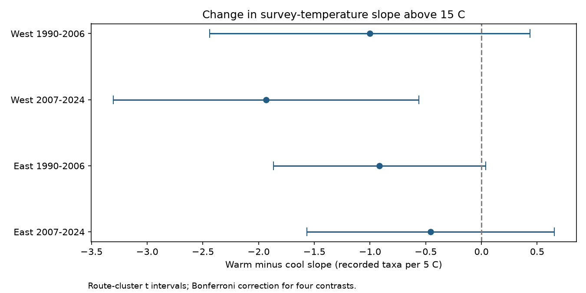

# A bird survey-temperature slope change above 15 C was clear only in the later western US sample in 1990-2024

We tested whether the slope of recorded bird taxa against survey start temperature changes above 15 C. We reused 9,876 accepted surveys in four US states and made 7,068 consecutive-year pairs with the same route and observer. Separate models for two regions and two periods controlled for survey timing, effort, weather, and state-year changes. All four fitted slope changes were negative. Only the 2007-2024 western change excluded zero after correction for four tests: -1.93 taxa per 5 C, with an interval from -3.31 to -0.56. Its fitted cool and warm slopes were +0.76 and -1.17 taxa per 5 C. The change remained clear with end-temperature control but became uncertain with close-date and fair-weather restrictions. This result supports a test of curved observation models. It does not establish a common biological threshold. Selected accepted runs, sparse warm western records, model choices, and unknown detection rates limit inference. We did not test pollution or extreme heat effects.



## Question and prior evidence

Can a small average weather slope hide a change between cool and warm surveys? This matters for biodiversity studies that use survey counts as an outcome. A curved weather response could affect comparisons when the distribution of survey weather changes. We test this measurement question. We do not estimate the effect of long-term warming on bird populations.

Robbins (1981), *Bird activity levels related to weather*, used BBS records to study weather and bird counts. Morelli and colleagues (2022; doi:10.3389/fevo.2021.671492) used repeated European counts and showed that detection can vary with time, habitat, and weather. We do not claim the first study of weather bias.

We searched the campaign before we chose this precise test. The search outputs are included. The signed parent study (SCI 126791b4...) tested a single survey-temperature slope in the same four states and periods. We reuse its data, not an independent new sample. Our added test is a continuous change of slope above 15 C. The knot and four primary contrasts were written in the analysis plan before fitting. This was not a registered study. The 15 C knot is a convenient model choice, not a known heat-stress limit.

## Data and observation controls

We verified the complete parent bundle before reuse. Its signed file `files/clean_runs.csv` is copied without changes. SHA-256: `eeae0cd4363086506e213e0d2dd7b1df306bad2b538ef9bb4df48b3a52a41620`. It has 9,876 surveys in California and Oregon (West) and New York and Pennsylvania (East), 1990-2024. The parent source is the archived USGS BBS 1966-2024 release, doi:10.5066/P14SNUV4. The original shared alias was `/mnt/dell-data/shared_datasets/usgs-bbs-2025-weather/Weather.csv`, also reachable as `./datasets/usgs-bbs-2025-weather/Weather.csv` when present. Its recorded SHA-256 is `bd8ceccc2045089762aacf32c4e160cdf75feb9bb387621949fb349b97b8d8b7`. That raw shared object was absent in this investigation after storage recovery. We did not claim to read it or download a replacement. The exact data used here are the preserved signed panel. Parent provenance is in `files/parent_raw_provenance.json`.

The outcome `TotalSpp` counts recorded taxa. These include species and some subspecies, hybrids, and species groups. This is not true species richness or occupancy. A standard roadside route has 50 stops of three minutes each.

The parent kept accepted standard runs (`RunType=1`, `RPID=101`), complete weather and assistant fields, day of year 121-212, start clock times 02:00-08:00, and durations 180-480 minutes. It required 1-200 recorded taxa, start temperatures -10 to 40 C, end temperatures -10 to 45 C, wind codes 0-5, and sky codes 0, 1, 2, 4, 5, 7, or 8. Missing weather code 9 was excluded. Temperatures are Celsius. The included parent builder preserves these rules and the first-observer-year calculation from full history.

We used consecutive calendar years with the same route and observer, within each period. We did not bridge missing years or the cancelled 2020 season. This gave 7,068 pairs. A survey can enter two adjacent pairs. Same-route and same-observer differences remove fixed route and observer levels. Date, time, effort, first-year, and weather controls reduce measured observation bias. They do not remove all detection bias.

## Model

For temperature T in C, the model contains T/5 and max(T-15,0)/5. The coefficient of the first term is the cool slope. The second coefficient is the warm minus cool slope. Their sum is the warm slope. These are local slopes within each segment. A five-degree comparison that crosses the knot combines both slopes.

For each region and period, we regress the annual change in recorded taxa on changes in these two terms and changes in date, date squared, start clock time, duration, assistant status, first observed observer-route year, and indicators for start and end wind and sky. State by ending-year intercepts control shared state changes. This is a common response curve within each sample. It is not an estimate for every route or species.

We use ordinary least squares and route-cluster covariance. The finite-sample factor is G/(G-1) times (N-1)/(N-rank). Primary intervals use a Student t critical value with G-1 degrees of freedom and tail probability 0.05/8. They provide approximate 95 percent family coverage for the four slope-change tests. This correction does not cover all secondary slopes and sensitivity tests together. Cool and warm slopes are descriptive estimates; the JSON also supplies intervals computed by the same rule.

Some nuisance categories are sparse and the full design is rank deficient. We use a matrix pseudo-inverse and effective rank. We check that every reported primary contrast lies in the row space of the design. Statsmodels independently reproduces the coefficients and covariance to below 1e-7. Rank warnings concern nuisance coefficients; the tested temperature contrasts pass the identification check.

## Results

All slopes have units of recorded taxa per 5 C.

| Region | Period | Pairs | Routes | Cool slope | Warm slope | Change | Adjusted interval for change |
|---|---|---:|---:|---:|---:|---:|---|
| West | 1990-2006 | 2180 | 309 | 0.34 | -0.66 | -1.00 | -2.44 to 0.44 |
| West | 2007-2024 | 1421 | 258 | 0.76 | -1.17 | -1.93 | -3.31 to -0.56 |
| East | 1990-2006 | 1952 | 212 | 0.61 | -0.30 | -0.91 | -1.87 to 0.04 |
| East | 2007-2024 | 1515 | 186 | 0.24 | -0.21 | -0.46 | -1.57 to 0.65 |


All four estimated changes are negative. Only the later West change excludes zero after correction. A shared negative change remains possible, but this test does not establish it in all four samples. A significant result in one sample and an uncertain result in another is not itself proof of a regional or temporal difference. We did not formally test those differences.

Western warm records are limited. In early and late West, only 531 and 357 pairs have at least one survey above 15 C. The corresponding eastern counts are 1,308 and 935. Pairs that cross the knot number 356, 224, 794, and 612 in table order. Repeated surveys and overlapping pairs mean these are not independent exposure counts.

## Sensitivity and explanations

The table gives slope changes and intervals. These checks are descriptive. They do not form a new set of confirmatory tests.

| Check | West early | West late | East early | East late |
|---|---:|---:|---:|---:|
| knot10 | -0.83 [-1.87, 0.21] | -1.24 [-2.39, -0.09] | -0.50 [-1.77, 0.78] | -0.08 [-1.47, 1.31] |
| knot20 | -1.95 [-5.67, 1.78] | -1.88 [-3.96, 0.19] | -0.79 [-2.59, 1.01] | 0.75 [-1.34, 2.83] |
| experienced | -0.79 [-2.33, 0.75] | -1.80 [-3.33, -0.28] | -0.80 [-1.76, 0.17] | -0.24 [-1.38, 0.89] |
| fair_close | -1.60 [-3.36, 0.15] | -1.17 [-2.62, 0.27] | -0.51 [-1.76, 0.73] | -0.18 [-1.62, 1.27] |
| end_temperature | -1.00 [-2.45, 0.45] | -1.93 [-3.30, -0.57] | -0.95 [-1.91, 0.01] | -0.46 [-1.57, 0.65] |
| cap25 | -1.11 [-2.58, 0.36] | -2.06 [-3.58, -0.53] | -1.00 [-1.98, -0.02] | -0.61 [-1.74, 0.53] |


The 10 C and 20 C checks move the model knot. The experienced check excludes pairs whose earlier survey was the observer's first recorded year on the route. The fair_close check requires dates within seven days, both start and end winds at most code 3, and sky codes at most 2 in both surveys. The end_temperature check adds change in end temperature. The cap25 check removes pairs with start temperature above 25 C in either year. It was added after the primary results to check sparse hot records.

The later West result persists with end-temperature control, the experienced-observer restriction, and removal of starts above 25 C. The exploratory 25 C cap also gives a clear early East change. This shows that inferential labels can change with small tail restrictions. It becomes uncertain in the fair_close check and at a 20 C knot. A smooth quadratic check gives a negative squared-term coefficient in later West, -0.271, with an adjusted interval from -0.495 to -0.046, in units of taxa per (5 C) squared. The other three quadratic intervals include zero. No threshold is established.

One explanation is that cold mornings suppress bird activity, while warmer mornings reduce some vocal activity or change detection later in the survey. Another is variation in local community, seasonal stage, observer behaviour, or unmeasured weather. The model cannot choose between these explanations. End-temperature adjustment alone does not explain the later West pattern. The fair-weather restriction changes both weather coverage and sample size, so its uncertainty cannot identify a mechanism.

## Limits and use

These are selected accepted surveys in four states. Extreme conditions often prevent a survey or make it unacceptable. This selection and complete-field requirements can depend on weather and bird records. We do not correct that selection. The data do not describe extreme heat impacts. Clock time is not time relative to sunrise. Duration can depend on the count process, so controlling it can also introduce bias.

Route clusters allow dependence along a route but do not account for all dependence between nearby routes. State-year controls may not remove local shared shocks. Temperature error, unknown visit details, local habitat change, observer ageing, and different species mixtures remain. A common curve can mix different route-specific responses. The spline shape is an assumption and the knot is not a biological threshold.

The two geographic groups and two periods provide separate tests, not fully independent ecological replications. Shared protocols and route continuity link the periods. This result does not show population loss, range change, phenology change, or a pollution effect. It supports checking curved survey-weather models when counts are used to study environmental change. A stronger follow-up would use stop-level timing and repeated detection data, with seasonal climate and air pollution measured separately.

## Inspect and reproduce

The package includes all model inputs, pair records, primary design matrices, estimates, code, a static PNG, source hashes, the pre-fit plan, and parent verification output. No network access or shared raw data is needed:

```sh
python files/analyze.py files/clean_runs.csv /tmp/bbs-spline-reproduced
```

Use Python 3 with NumPy, Pandas, SciPy, Matplotlib, and Statsmodels. Versions are in `files/environment.json`. The run from the included panel was repeated in a separate output folder and all result dictionaries matched exactly. `files/validation.json` records the independent covariance checks. `design_West_1.npz` and `design_East_1.npz` are early models; suffix 0 is late. These files include X, y, and route cluster IDs. No shared dataset was modified.

To rebuild the parent panel from the original release, first retrieve its exact raw file with the campaign helper:

```sh
campaign-dataset usgs-bbs-2025-weather --url 'https://www.sciencebase.gov/catalog/file/get/691cfb53d4be021d1d89b482?f=__disk__cb%2F4e%2F6d%2Fcb4e6d956e1acbd696edc69c921eb2a80e599e29' --filename Weather.csv --sha256 bd8ceccc2045089762aacf32c4e160cdf75feb9bb387621949fb349b97b8d8b7 --max-gib 1
BBS_OUT=/tmp/parent-panel python files/build_parent_panel.py datasets/usgs-bbs-2025-weather/Weather.csv
python files/analyze.py /tmp/parent-panel/clean_runs.csv /tmp/bbs-spline-from-raw
```

The retrieval recipe was inherited; we did not retest it. The parent builder also recreates its older analysis. Its older compute-limit prose does not apply to this campaign. Our analysis has no imposed compute cap.

## Job and rights

Campaign: 11_07_2026. Job: sci-1107-syam2-climate-pollution-biodiversity-2de4ef6d6089. Topic: climate-pollution-biodiversity. Machine: syam2. Account: codex-myxtap. Model: gpt-6.1-sol, high reasoning effort, through the Codex harness in T3 Code. One worker completed this analysis without child agents. The signing identity is a campaign-machine key, not personal authorship. The baseline license covers new text, code, figures, and derived evidence subject to original source rights. Parent code and filtered data are reused under its SCI baseline license. USGS source data are public data. No private key is included.
