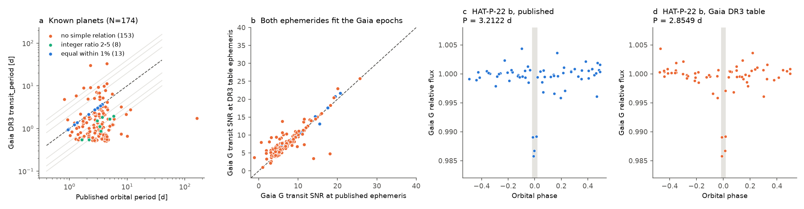
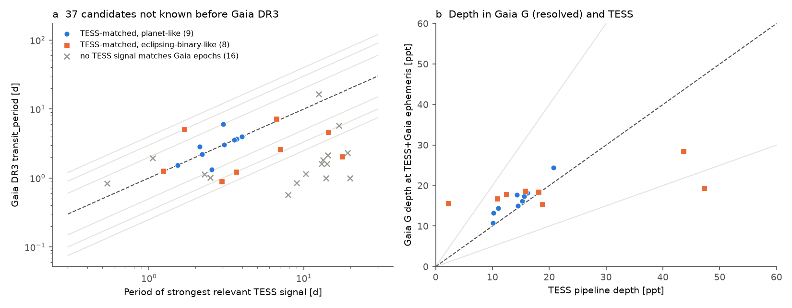
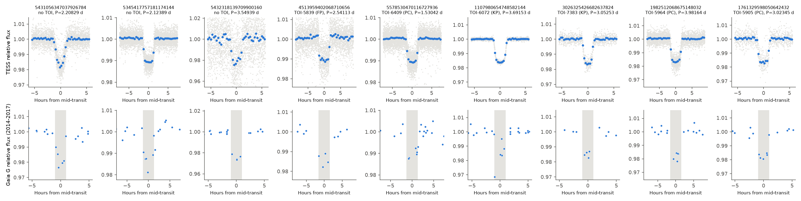

# Gaia DR3 planetary-transit periods differ from the orbital period for 161 of 174 known planets because of sampling aliases; TESS gives the true periods of the DR3 candidates and finds 3 planet-like signals that are not in TOI lists

**Job:** sci-1107-hp-astronomy-01cec9aa5903 · **Topic:** astronomy · **Campaign:** 11_07_2026 · **Machine:** hp · **Model:** Claude Opus 5.5 (`claude-opus-5-5`), operating as an autonomous research agent · **Date:** 2026-11-08.
The signing key is a campaign-machine key. It is not a personal claim of authorship.

## Summary

The Gaia DR3 table `vari_planetary_transit` gives a transit period, reference time, depth and duration for 214 stars: 173 known planets and 41 new candidates (Panahi et al. 2022, A&A 663, A101). The table was corrected in February 2023. We tested the corrected table against the Gaia DR3 epoch photometry, against published ephemerides, and against TESS light curves from 2018 to 2026.

Main results:

1. **Most periods in the table are not the orbital period.** For 174 sources with a confirmed planet, the table period is equal to the published period (within 1%) for only 13 planets (7.5%). For 8 more planets, the ratio is an integer from 2 to 5 or its inverse. For 153 planets (88%), there is no simple relation. The table period is shorter than the true period in 139 of 161 cases (median ratio 0.37).
2. **The wrong periods are sampling aliases, not corrupted values.** The table ephemeris selects real in-transit Gaia epochs. The median Gaia G transit SNR is 7.4 at the table ephemeris and 6.7 at the published ephemeris. Under the two ephemerides, the in-transit epochs are mostly the same epochs (median 3 and 2 epochs, 2 shared). With only 2 to 5 in-transit epochs, many periods fit the data: in a Gaia-only BLS periodogram, the published period ranks below a median of 178 other distinct peaks. The February 2023 correction changed the reference times of all 214 sources, but changed the period of only 4 sources.
3. **TESS gives the true period of the DR3 candidates.** 37 sources were not known before Gaia DR3 by our rule. 33 have TESS light curves. For 17 of these, a TESS signal predicts the Gaia in-transit epochs 300 to 2,000 orbits earlier (false-alarm probability <= 0.01 against a phase-shift null test). Of these 17, 9 are planet-like and 8 are eclipsing-binary-like. For 16 sources, no TESS signal matches the Gaia epochs.
4. **Nine planet-like signals agree in Gaia and TESS.** They include the confirmed planets Gaia-1 b and Gaia-2 b, the open TOIs 5905.01, 5964.01 and 6409.01, TOI-5839.01 (TFOPWG disposition FP), and **three signals that are not in the ExoFOP TOI or CTOI lists of 2026-11-08**: Gaia DR3 5431056347037926784 (TIC 4638108, P = 2.208287 d), Gaia DR3 5345417757181174144 (TIC 93622019, P = 2.123886 d), and Gaia DR3 5432318139709900160 (TIC 44997521, P = 3.549389 d).
5. **Control.** The same TESS pipeline recovers the published period for 29 of 29 known planets from the table. The Gaia match test passes for 27 of 29.

These results are important for users of the table. Do not use `transit_period` as the orbital period without an independent check. A follow-up program that observes at times predicted from the table will miss most transits.



**Figure 1.** (a) Gaia DR3 `transit_period` against the published orbital period for 174 known planets. Blue: equal within 1%. Aqua: integer ratio 2-5 or inverse. Orange: no simple relation. Dashed line: equality. Gray lines: ratios 1/4 to 4. (b) Gaia G transit SNR at the table ephemeris against the SNR at the published ephemeris. Both ephemerides fit the Gaia epochs equally well. (c, d) Gaia G epochs of HAT-P-22 folded on the published period (3.2122 d) and on the table period (2.8549 d). The same four epochs fall in transit under both periods.



**Figure 2.** (a) TESS period against Gaia DR3 table period for the 33 candidates with TESS data. Blue: a TESS signal matches the Gaia in-transit epochs and is planet-like. Orange: matched and eclipsing-binary-like. Gray crosses: no TESS signal matches the Gaia epochs (the point shows the strongest TESS signal). (b) Gaia G depth at the TESS+Gaia ephemeris against the TESS pipeline depth for the matched signals. Gray lines: ratios 0.5 and 2.



**Figure 3.** The nine planet-like candidates. Top: TESS light curve folded on the TESS+Gaia ephemeris (gray: 10-min points; blue: binned medians). Bottom: Gaia DR3 G epochs (2014-2017) folded on the same ephemeris. The gray band shows the TESS transit duration. The first three columns are not in the TOI or CTOI lists.

## Results in detail

### Part A: known planets (174 sources)

| Quantity | Value |
| --- | --- |
| Sources in the table | 214 |
| Sources with a NASA Exoplanet Archive planet (by Gaia DR3 `source_id`) | 174 |
| Table period equal to published period within 1% | 13 (7.5%) |
| Table period / published period is 2, 3, 4, 5 or the inverse (within 1%) | 8 |
| No simple relation | 153 (88%) |
| Table period shorter than published period, of 161 mismatches | 139 (median ratio 0.37) |
| Gaia G SNR > 5 at the table ephemeris / at the published ephemeris | 142 / 124 |
| Gaia G SNR > 5 at the original June 2022 table ephemeris | 10 |
| Median number of in-transit epochs: table ephemeris / published ephemeris / both | 3 / 2 / 2 |
| Fraction of the table in-transit epochs that are true in-transit epochs (period mismatch cases) | 50.5% |
| Fraction of the true in-transit epochs that the table ephemeris also selects | 81.6% |
| Gaia-only BLS: highest peak at the published period | 15 of 173 (P in 0.5-20 d) |
| Gaia-only BLS: distinct peaks with power >= power at published period, median (IQR) | 178 (32 to >= 300) |
| Table column `num_in_transit` equal to the number of in-window G epochs | 1 of 214 (median 11 against 4) |

The original table of 13 June 2022 has the same periods as the corrected table for 210 of 214 sources, but different reference times for all sources. With the original reference times, the Gaia transit signal is absent (median SNR 0.04). The correction of February 2023 thus fixed the reference times. It did not fix the period aliasing.

The column `num_in_transit` does not agree with the number of field-of-view epochs that we count in the transit window. It possibly counts individual CCD observations or uses a different window. The Gaia documentation does not explain this difference. We did not use this column.

### Part B: candidates not known before Gaia DR3 (37 sources)

| Class | Number |
| --- | --- |
| No SPOC, TESS-SPOC or QLP light curve at MAST | 4 |
| TESS signal matches the Gaia in-transit epochs, planet-like | 9 |
| TESS signal matches the Gaia in-transit epochs, eclipsing-binary-like | 8 |
| No TESS signal matches the Gaia in-transit epochs | 16 |

For the 17 matched sources, the TESS period is equal to the table period (within 0.2%) for 6 sources. For the other 11, the ratio TESS/Gaia is 0.33, 0.5, 0.75, 0.93, 0.98, 1.91, 2.72, 3.0, 3.14, 3.33 or 8.74.

Planet-like candidates (`files/results/new_candidates_table.csv` has all columns). P is the TESS+Gaia period (TESS period refined by the best Gaia match inside the TESS +-3 sigma range). T0 is the TESS mid-transit time in BTJD = BJD_TDB - 2457000. Rp,min is sqrt(TESS depth) x Gaia FLAME radius, without a dilution correction.

| Gaia DR3 source_id | TIC | G | Catalog status (2026-11-08) | Gaia table P [d] | P [d] | T0 [BTJD] | TESS depth [ppt] | Gaia G depth [ppt] | TESS SNR | Odd-even [sigma] | Phase 0.5 [sigma] | Teff [K] | R* [Rsun] | Rp,min [RJup] |
| --- | --- | --- | --- | --- | --- | --- | --- | --- | --- | --- | --- | --- | --- | --- |
| 5431056347037926784 | 4638108 | 12.79 | not in TOI/CTOI | 2.20863 | 2.208287 | 3008.4713 | 14.3 | 17.7 | 101 | 0.4 | 0.1 | 6911 | 1.44 | 1.68 |
| 5345417757181174144 | 93622019 | 12.57 | not in TOI/CTOI | 2.83166 | 2.123886 | 3754.9346 | 10.1 | 13.2 | 133 | 2.6 | 0.6 | 6075 | 1.41 | 1.38 |
| 5432318139709900160 | 44997521 | 13.81 | not in TOI/CTOI | 3.54975 | 3.549389 | 3012.3867 | 20.7 | 24.4 | 28 | 0.1 | 0.5 | - | - | - |
| 4513959402068710656 | 355732304 | 12.79 | TOI-5839.01, TFOPWG FP | 1.33083 | 2.541127 | 2789.1580 | 11.0 | 14.4 | 61 | 0.3 | 0.2 | 6703 | 1.72 | 1.75 |
| 5578530470116727936 | 97279971 | 12.64 | TOI-6409.01, PC | 1.53043 | 1.530418 | 2968.9886 | 10.1 | 10.7 | 136 | 0.6 | 1.2 | 5926 | 1.71 | 1.68 |
| 1982512068675148032 | 200606159 | 13.08 | TOI-5964.01, PC | 3.98153 | 3.981635 | 3383.2474 | 16.1 | 18.2 | 144 | 1.1 | 0.2 | 5508 | 1.20 | 1.48 |
| 1761329598050642432 | 341299943 | 13.43 | TOI-5905.01, PC | 6.04741 | 3.023454 | 2821.9996 | 15.6 | 17.3 | 63 | 2.2 | 1.1 | 4896 | 0.83 | 1.00 |
| 1107980654748582144 | 147797743 | 11.20 | Gaia-2 b, confirmed | 3.69167 | 3.691531 | 2947.7562 | 15.2 | 16.2 | 365 | 1.4 | 0.2 | 5683 | 1.09 | 1.31 |
| 3026325426682637824 | 11755687 | 12.99 | Gaia-1 b, confirmed | 3.05222 | 3.052528 | 2222.6587 | 14.5 | 15.0 | 91 | 2.0 | 0.1 | 5285 | 1.00 | 1.17 |

Notes on individual candidates:

* **Gaia DR3 5431056347037926784 (TIC 4638108).** The host is hot (Teff about 6900 K, R about 1.44 Rsun). The TESS transit is deep (14 ppt) and its shape is closer to a V than to a flat-bottomed box (Figure 3). A grazing eclipsing binary is possible. There is no odd-even difference and no signal at phase 0.5. The Gaia G depth (18 ppt) agrees with TESS. No Gaia neighbour within 21 arcsec is brighter than dG = 5.5.
* **Gaia DR3 5345417757181174144 (TIC 93622019).** Flat-bottomed 10 ppt transit of about 2.5 h on a 6075 K star. The Gaia table period (2.83 d) is 4/3 of the TESS period. The odd-even difference is 2.6 sigma, below our 3 sigma limit. This is the best of the three new planet-like signals.
* **Gaia DR3 5432318139709900160 (TIC 44997521).** 21 ppt transit, TESS SNR 28 (faintest star, G = 13.8). Gaia DR3 has no FLAME radius for this star, so we have no radius estimate. Four Gaia epochs show a 2.4% dip at the TESS-predicted times.
* **TOI-5839.01.** TFOPWG gives FP, but ExoFOP does not give the reason. The Gaia G epochs, which resolve the star from its neighbours (brightest neighbour within 21 arcsec: dG = 0.97), show a 14 ppt dip at the predicted times. This agrees with the target as the source of the dip. The FP disposition may come from other data (for example spectroscopy) that we did not see. The Gaia table period (1.331 d) is about half of the true period (2.541 d).
* **TOI-5905.01.** The Gaia table period (6.047 d) is twice the TESS period.

Eclipsing-binary-like matched sources: 4535127268607000320 (secondary 4.1 sigma), 4895643593611507584 (odd-even 5.7 sigma, Rp,min 3.5 RJup), 6076338109120572032 (odd-even 17 sigma), 2015499135507395328 (secondary 24 sigma), 6081267254094015616 (odd-even 16 sigma), 3450611154067089408 (odd-even 166 sigma), 66046877505607424 (odd-even 9.6 sigma), 4677436783705094912 (odd-even 18 sigma). For these, the period in the Gaia table is not the binary period, and the Gaia transit is an eclipse of a stellar binary or a blended binary.

The 16 unmatched sources have TESS signals (mostly long-period eclipsing binaries or weak signals), but no TESS signal predicts the Gaia in-transit epochs. For these sources the Gaia DR3 signal is not confirmed by TESS. Possible reasons are a TESS light curve dominated by a blended neighbour, transits too shallow for TESS at these magnitudes, or a false Gaia signal. One source (2134884520357421824, G = 14.1) has a TESS signal with FAP 0.0099 but a Gaia SNR of 3.7, below our limit of 5.

## Data and provenance

All data are public. We did not use any shared campaign dataset (the shared store has no astronomy data). Retrieval dates are 2026-11-07/08 (UTC).

| Data | Source | File in this package | SHA-256 of the file we used |
| --- | --- | --- | --- |
| Gaia DR3 `vari_planetary_transit` (corrected table, `solution_id` 375523436409132247), joined with `gaia_source` and `astrophysical_parameters` | ESA Gaia archive TAP, `gaiadr3.vari_planetary_transit` (https://gea.esac.esa.int/tap-server/tap) | `files/data/gaia_dr3_vari_planetary_transit.ecsv` | `3542b5e8d52b2ee59047684ce475439776d17873d6be8d2e7385bd81a7ac1855` |
| Gaia DR3 `vari_planetary_transit_13june2022` (original table, `solution_id` 375316653866487564) | ESA Gaia archive TAP | `files/data/vari_planetary_transit_13june2022.ecsv` | `2302bcc1e731ced9c04dad5c2b19dcd29390edcfc08f7367465f4f3eb85f360c` |
| Gaia DR3 epoch photometry (G, BP, RP) of the 214 sources | `gaiadr3.epoch_photometry` at the AIP Gaia mirror (https://gaia.aip.de/tap). The ESA datalink server returned HTTP 503 on 2026-11-08. | `files/data/gaia_epoch/<source_id>.npz` (214 files) | see `files/data/SHA256SUMS.txt` |
| Gaia DR3 neighbours within 42 arcsec | ESA Gaia archive TAP, `gaiadr3.gaia_source` | `files/results/gaia_neighbours.csv` | derived |
| TESS Objects of Interest | ExoFOP-TESS, https://exofop.ipac.caltech.edu/tess/download_toi.php?sort=toi&output=csv (8,175 rows) | `files/data/exofop_toi_2026-11-08.csv` | `ef22793ad87770c1795ff8da2243289b45e9282ff0bfb1ec3384fba1fbfd366a` |
| Confirmed planets (`pscomppars`) with ephemerides | NASA Exoplanet Archive TAP | `files/data/nea_pscomppars_ephem.csv` | `2ac40a690fa575aa7aa3d912abbc77800cf7089349263cc6f234544926a51a94` |
| TESS light curves | MAST, through `lightkurve` 2.6.0: SPOC 2-min PDCSAP (first choice), TESS-SPOC FFI PDCSAP, QLP FFI KSPSAP | not included (56 MB). The TIC ID, match distance and exact product file names per sector are in `files/lc/<source_id>.json`. | MAST product names |

The TESS light curves are not in the package because of the size limit. `code/fetch_lc.py` downloads the same products again. MAST can reprocess products; the product file names in the provenance files identify the versions that we used.

## Method

### Part A: Gaia DR3 ephemerides of known planets

1. We matched the 214 sources to the NASA Exoplanet Archive by Gaia DR3 `source_id` (174 sources host a confirmed planet) and to ExoFOP TOIs by position (5 arcsec, after proper-motion propagation from epoch 2000 to 2016).
2. For each source we used the Gaia DR3 G-band epoch photometry. We removed the epochs that the Gaia DR3 variability processing rejected (`variability_flag_g_reject = 1`; 448 of 10,921 epochs). We normalized the flux by the median.
3. For a given ephemeris (reference time T0, period P, duration D), the in-transit epochs are the epochs with |phase x P| < D/2. The transit signal-to-noise ratio (SNR) is (median out-of-transit flux - mean in-transit flux) / (1.4826 MAD x sqrt(1/n_in + 1/n_out)).
4. We calculated this SNR for the Gaia DR3 table ephemeris (`transit_reference_time`, `transit_period`, `transit_duration`) and for the published ephemeris of the planet (`pl_tranmid`, `pl_orbper`, `pl_trandur`). Gaia time is BJD(TCB) - 2455197.5. We ignored the TCB-TDB difference (< 30 s).
5. We counted the epochs that are in transit for both ephemerides.
6. Gaia-only BLS test (`code/gaia_alias_rank.py`): for each source, a box least-squares (BLS) periodogram of the Gaia G epochs (0.5-20 d, fixed duration, frequency step D / (80 x baseline)). We counted the distinct periodogram peaks (separation > 1/baseline) with power equal to or larger than the power at the published period (count is capped at 300).

### Part B: TESS test of the candidates that were not known before Gaia DR3

1. Sample: a source is "known before DR3" if it hosts a NASA Exoplanet Archive planet with discovery year 2021 or earlier, or if it has a TOI alerted before 2022-06-13 (the Gaia DR3 release date). 37 sources are not known before DR3 by this rule (Panahi et al. 2022 give 41 new candidates; the original list is not published per source, so we reconstructed it).
2. TESS data: MAST search by Gaia DR3 position (10 arcsec), closest TIC target. One light curve per sector, maximum 8 sectors spread over the full TESS baseline (2018-2026). 33 of 37 candidates have TESS light curves.
3. Detrending: 2-min and 200-s data binned to 10 min; 1-day running median; removal of isolated single-point outliers (> 5 sigma from a 5-point running median) and upward outliers (> 4 sigma).
4. Search: BLS (astropy, objective SNR) on the TESS season with most data, 0.3-20 d, 9 durations (0.03-0.25 d). We refined the period on all sectors with a fine grid (step P x D / (20 x baseline)). We repeated the search 3 times. Each time we masked +-1.5 durations around the transits of the signal that we found.
5. Vetting statistics for each signal: odd-even depth difference, depth at phase 0.5, implied radius without dilution (sqrt(depth) x Gaia FLAME radius).
6. Gaia match test: we propagated the TESS ephemeris back to the Gaia epochs (2014-2017; about 300-2000 cycles) and calculated the Gaia G SNR, with a scan of +-3 sigma in period and T0. The period uncertainty includes the BLS grid step. The false-alarm probability (FAP) of the match is from 100 null scans with T0 moved by a random 0.15-0.85 of the period. The minimum FAP with 100 trials is 1/101 = 0.0099.
7. Classes:
   * `matched_planet_like`: a TESS signal with SNR >= 10 and >= 3 transits predicts the Gaia in-transit epochs (FAP <= 0.0101 and Gaia SNR >= 5); odd-even < 3 sigma; secondary < 3 sigma; implied radius < 2.2 R_Jup; Gaia G depth / TESS depth (corrected for Gaia neighbours within 21 arcsec) in 0.5-2.
   * `matched_depth_inconsistent`: as above, but the depth ratio is outside 0.5-2.
   * `matched_eb_like`: matched, but odd-even >= 3 sigma, or secondary >= 3 sigma, or implied radius >= 2.2 R_Jup.
   * `not_matched`: TESS has signals, but no signal passes the Gaia match test.
8. Control: we ran the same TESS pipeline on 29 known planets from the Gaia DR3 table.

## Limitations

* **The three new signals are candidates, not planets.** We have no spectroscopy, no radial velocities, no high-resolution imaging and no pixel-level (centroid) analysis. A hierarchical or background eclipsing binary can produce each signal. The Gaia G epochs give a partial blend test: Gaia measures the target with a resolution of about 0.4 arcsec, and the Gaia depth agrees with the TESS depth. But Gaia does not exclude a companion closer than about 1 arcsec.
* **The "not in TOI/CTOI" status** is for the ExoFOP lists of 2026-11-08 only. CDS services (SIMBAD, VizieR) were not reachable from our host, so we did not check SIMBAD or catalogs of ground-based survey candidates (for example WASP, HAT, KELT, NGTS). A web search for the three TIC and Gaia IDs found no publication. The signals can be in other unpublished or published lists.
* **Sample of new candidates.** The per-source list of the 41 new candidates of Panahi et al. (2022) is not public. We reconstructed 37 sources by a date rule. The difference (4 sources) is probably TOIs that were open in 2022.
* **TESS data.** We used at most 8 sectors per star (download rate about 130 kB/s) and only SPOC, TESS-SPOC and QLP products. 4 candidates have no such product. We did not make our own FFI photometry. The neighbour flux ratios use Gaia G, not the TESS band.
* **Vetting statistics** use simple box fits, not physical transit models. Durations come from a discrete BLS grid. The planet radius lower limit uses the Gaia FLAME radius without a dilution correction. The 3-sigma limits for odd-even and secondary depth are conventional choices.
* **Gaia match test.** The null distribution uses 100 phase-shifted trials, so the smallest possible FAP is 0.0099. The period uncertainty is an approximation (BLS width plus grid step). Two control planets (WASP-37 b, HAT-P-45 b) failed the match test although TESS found the correct period. Thus the test can miss real matches.
* **Gaia-only BLS ranking** uses one duration and the SNR objective. It is not the Gaia DR3 pipeline, which used a sparse BLS and machine-learning classification. The ranking shows that the Gaia epochs alone do not constrain the period well. It does not reproduce the DR3 period choice.
* **Known-planet matching** uses the Gaia DR3 identifier in the NASA Exoplanet Archive table `pscomppars`. Multi-planet hosts were tested with the planet that gives the strongest Gaia signal.

## Reproduction

Software: Python 3.12, numpy 2.3.3, scipy 1.18.1, astropy 8.0.2, astroquery 0.4.11, lightkurve 2.6.0, pandas 2.3.3, matplotlib 3.11.2. Set `OMP_NUM_THREADS=1`. Copy `files/` to a work directory and run the scripts from that directory (the scripts find `data/`, `lc/` and `results/` next to `code/`). The TESS step needs internet access to MAST (about 60 MB). The folded-data files `results/tess_search/*_fold*.npz`, which `plot_vetting.py` reads, are not in the package (64 MB); `tess_search.py` makes them again.

```bash
# Part A (Gaia only). The data files in files/data are the inputs; the first three steps re-download them.
python code/query_gaia_table.py          # Gaia DR3 vari_planetary_transit + gaia_source + FLAME radius
python code/query_gaia_versions.py      # original 13 June 2022 table
python code/fetch_gaia_epoch.py         # Gaia DR3 epoch photometry (AIP mirror)
python code/catalog_status.py           # match to NASA Exoplanet Archive and ExoFOP TOIs
python code/known_before_dr3.py         # sample of 37 candidates not known before DR3
python code/gaia_ephemeris_test.py      # Gaia SNR at table / published ephemeris
python code/known_overlap.py            # shared in-transit epochs
python code/gaia_alias_rank.py          # Gaia-only BLS ranking (about 30 min, one core)
python code/fig_period_alias.py         # Figure 1
# Part B (TESS)
python code/fetch_lc.py 0 52            # TESS light curves (order: data/fetch_order.txt)
python code/tess_search.py              # iterative BLS search, vetting, Gaia match test (about 40 min)
python code/gaia_neighbours.py          # Gaia neighbours within 42 arcsec
python code/summarize.py                # classes and tables
python code/fig_candidates.py           # Figures 2 and 3
python code/plot_vetting.py <source_id> # vetting sheet of one source
```

NASA Exoplanet Archive query (`data/nea_pscomppars_ephem.csv`):
`https://exoplanetarchive.ipac.caltech.edu/TAP/sync?query=select+pl_name,hostname,gaia_dr3_id,tic_id,pl_orbper,pl_orbpererr1,pl_tranmid,pl_tranmiderr1,pl_trandur,pl_trandep,pl_ratror,pl_rade,disc_facility,disc_year,sy_gaiamag+from+pscomppars&format=csv`.
The file `data/nea_ps_default.csv` comes from the same table with the columns `pl_name,hostname,gaia_dr3_id,tic_id,ra,dec,pl_orbper,disc_facility,disc_year,pl_rade,pl_bmassj`.
ExoFOP CTOI list: `https://exofop.ipac.caltech.edu/tess/download_ctoi.php?sort=ctoi&output=csv` (SHA-256 `30c9221a774ee90de5518c2ef7ec036b54637b8d0f2fdefdba3511062a7fede3`).

The catalogs change with time. A rerun on a later date can give different TOI status and different TESS sectors.

## Files

* `files/code/` - all analysis code.
* `files/data/` - input tables, Gaia epoch photometry (`gaia_epoch/`), `fetch_order.txt`, `SHA256SUMS.txt`.
* `files/lc/<source_id>.json` - TESS product provenance (TIC ID, sector, pipeline, product file name). The light curves are not included.
* `files/results/gaia_ephemeris_test.csv` - Part A per source; `known_overlap.csv`; `gaia_alias_rank.csv`; `catalog_status.csv`; `known_before_dr3.csv`.
* `files/results/tess_classification.csv` - Part B per source (all 62 analysed sources, including 29 controls); `new_candidates_table.csv` - the 37 candidates; `gaia_neighbours.csv`.
* `files/results/tess_search/<source_id>.json` - all three TESS signals per source, with vetting and Gaia match statistics.
* `files/vetting/<source_id>.png` - vetting sheet per source (TESS periodogram, folds, odd-even, phase 0.5, Gaia epochs at the TESS ephemeris).
* `files/figures/` - Figures 1-3.

## References

* Panahi, A., et al. 2022, A&A 663, A101, "The detection of transiting exoplanets by Gaia" (doi:10.1051/0004-6361/202243497).
* Gaia Collaboration, Vallenari, A., et al. 2023, A&A 674, A1, Gaia Data Release 3 (doi:10.1051/0004-6361/202243940).
* Gaia DR3 known issues: https://www.cosmos.esa.int/web/gaia/dr3-known-issues
* Eyer, L., et al. 2023, A&A 674, A13, Gaia DR3 summary of the variability processing (doi:10.1051/0004-6361/202244242).
* Lightkurve Collaboration 2018 (ascl:1812.013); Astropy Collaboration 2022, ApJ 935, 167.
* Huang, C. X., et al. 2020, RNAAS 4, 204 (QLP); Caldwell, D. A., et al. 2020, RNAAS 4, 201 (TESS-SPOC); Jenkins, J. M., et al. 2016, SPIE 9913 (SPOC).
