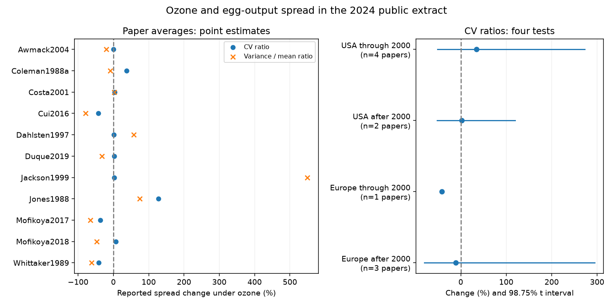

# Ozone egg-output spread had no clear common change in 11 papers from 1988-2019

Elevated ozone did not give a clear common change in reported relative egg-output spread in this public data extract. The equal-paper estimate for the coefficient of variation (CV) was -1.96%, with a conditional 95% interval from -24.95% to +28.07%. Eight of 11 paper averages were positive, but a two-sided sign test gave P=0.2266. These results do not establish no effect.

## Question and contribution

Does ozone change variation in insect egg output relative to its mean? Such variation can matter to population persistence. We test this pollution question within the wider climate and biodiversity objective. We do not test temperature, extreme weather, climate change, field population persistence or species distributions. Source reports of experimental spread do not necessarily measure variation among individual insects.

Ryalls et al. (2024), DOI 10.1038/s41467-024-49729-5, studied mean invertebrate performance across pollutants. Nakagawa et al. (2015), DOI 10.1111/2041-210X.12309, introduced a CV ratio method. Senior et al. (2020), PMID 32431099, developed its corrections. Our new analysis tests egg-output spread and compares two mean-scaling rules. It uses a first-order correction for both log SD and log mean. A prior campaign study of timing spread used a correction for log SD only (sci:sha256:5dd3b6b931e24720ba370a2e40c5558c3056d82909915817114d9cb7fa4d8848). Its endpoints differ from ours. We do not validate its timing results. Other campaign tests used this workbook for mean abundance and reproduction contrasts. We reuse no code from those tests.

We searched published campaign results before fixing this question. The searches in files/campaign_search.json are a limited novelty check, not a full review. This analysis is exploratory. We inspected labels, sample sizes and some values before we chose the rules. There was no preregistration. The 2000 publication-year split is a simple fixed split, not a biological breakpoint.

## Data and selection

We reused the 981-row Supplementary Data 1 workbook in the shared dataset store. The exact file path, URL, size and SHA-256 are in files/provenance.json. Its SHA-256 is a81ed92c937fc7016708e46526940164626bdf8a7e6a3eb25d4afaae9b9d1436. No new shared data were downloaded or changed.

There are 61 rows marked O3 and reproduction. We selected 44 egg-output rows from 11 papers in 1988-2019. We used an explicit list of 16 endpoint labels in files/analyze.py. It includes egg counts, embryo counts, fecundity, egg deposition, egg masses and egg output rates. We excluded six timing rows, a nymph count with an added constant, three wing-morph proportions, an intrinsic growth rate, two population-growth rows and four oviposition-success percentages. All 44 selected rows have finite positive means and SDs, and at least two units per treatment. Observed sample sizes range from 3 to 29. Controls and outcomes can be shared within a paper.

Countries are USA, China, UK, Finland and Germany. China supplies one paper and is included in the overall average but not the USA-Europe tests. Country is the source label, not an independent regional data archive. Publication year is not experimental year. The early European cell has only one paper. The two regions and two periods contain disjoint papers, but species, facilities, authors and methods can overlap. These are not four independent field replications.

## Calculations and assumptions

For exposed and control groups, let X be mean egg output, S the source SD (Dev_e or Dev_c), and n the source sample size. We compute the following independent-group first-order estimators:

    rr = log(Xe/Xc) + 0.5 * [Se^2/(ne*Xe^2) - Sc^2/(nc*Xc^2)]
    vr = log(Se/Sc) + 0.5 * [1/(ne-1) - 1/(nc-1)]
    cvr = vr - rr
    vmr = 2*vr - rr

The cvr statistic is the log ratio of coefficients of variation. The vmr statistic is the log ratio of variance-to-mean ratios. We also show uncorrected cvr. The correction assumes that reported S and n describe sample dispersion and sample size, with suitable finite-sample behavior. Small n, skewed counts, and derived errors can violate these conditions. This is not a higher-order bias correction. Treatment groups can be correlated; their covariance is unavailable.

CV uses SD proportional to mean as a reference. Variance/mean uses variance proportional to mean, as for Poisson counts. Neither is a universal model for eggs per cage, plant, female, egg mass or attack. Under a strict Poisson model a mean fall alone raises CV. Comparison of these statistics tests whether a conclusion depends on the scaling rule. It does not fit a full mean-variance law or identify a biological mechanism. The ratios are invariant to a common unit multiplier in each exposed-control pair, but not to an added constant.

We average each log statistic within each paper and then across papers. This gives equal weight to each paper, not each row. We do not use inverse-variance weights, since unknown within-paper dependence and error origin would make them hard to justify. More doses and endpoints within one paper still affect its average. The overall intervals are Student t intervals across paper means. They require independent, representative paper effects and appropriate sampling behavior. They are conditional summaries, not reliable population bounds. For four region-period CV tests, 98.75% t intervals give a Bonferroni family bound under the same assumptions. We report no interval for a one-paper cell. Secondary variance/mean and sensitivity intervals are descriptive.

## Results

| Paper | Region | Rows | Mean change (%) | CV change (%) | Variance/mean change (%) |
| --- | --- | ---: | ---: | ---: | ---: |
| Awmack2004 | USA | 2 | -21.29 | +0.44 | -20.60 |
| Coleman1988a | USA | 8 | -51.59 | +37.28 | -8.77 |
| Costa2001 | USA | 14 | -4.46 | +3.50 | +2.35 |
| Cui2016 | Other | 4 | -35.57 | -42.47 | -78.67 |
| Dahlsten1997 | USA | 2 | +52.24 | +1.77 | +57.69 |
| Duque2019 | Europe | 4 | -36.03 | +2.83 | -32.36 |
| Jackson1999 | USA | 3 | +514.06 | +2.79 | +548.84 |
| Jones1988 | USA | 2 | -66.52 | +128.09 | +74.20 |
| Mofikoya2017 | Europe | 2 | -14.56 | -36.54 | -65.59 |
| Mofikoya2018 | Europe | 2 | -53.81 | +7.32 | -46.80 |
| Whittaker1989 | Europe | 1 | +10.32 | -41.38 | -62.08 |

The overall mean-output estimate was -13.44% (95% interval -48.66% to +45.96%). The overall variance/mean estimate was -16.79% (-55.57% to +55.81%). The uncorrected CV estimate was -0.81% (-24.85% to +30.92%). Neither scaling rule established a common spread increase. The Jones and Coleman paper averages show why the scaling rule matters: both have lower means and higher CVs, but their variance/mean changes differ in sign.

| Region and publication years | Papers | CV change (%) | 98.75% interval (%) |
| --- | ---: | ---: | --- |
| USA through 2000 | 4 | +34.53 | -51.49 to +273.09 |
| USA after 2000 | 2 | +1.96 | -52.56 to +119.14 |
| Europe through 2000 | 1 | -41.38 | not estimated |
| Europe after 2000 | 3 | -11.19 | -80.03 to +294.98 |

The USA estimates are positive in both periods, but both adjusted intervals include zero. Europe has a negative estimate in both periods, but only the later period has enough papers for a t interval, which also includes zero. Thus the data do not establish a shared increase across regions and periods. Low support must not be replaced by treating rows as independent experiments.

## Sensitivity and observation bias

The N5 check gave -1.92% CV change (-30.39% to +38.21%; 9 paper units). The N10 check gave -17.72% CV change (-63.14% to +83.67%; 3 paper units). The no_Costa check gave -2.49% CV change (-27.73% to +31.57%; 10 paper units). The no_hatched check gave -1.97% CV change (-24.95% to +28.05%; 11 paper units). The combine_Mofikoya check gave -0.26% CV change (-24.86% to +32.40%; 10 paper units). The N filters change the paper and endpoint mix as well as sample size. The grouped Mofikoya check combines two papers under one author-group value; it is a dependence check, not proof that all other papers are independent. The full sensitivity results and leave-one-paper-out results are in files/results.json.

Equal paper weights address unequal numbers of reported outcomes. They do not correct selective outcome reporting, publication bias, nonrandom species selection, survival selection or extraction error. The source review reports that some SDs were formed by aggregation, and four effect sizes in one paper used imputed SDs. We could not assign all selected error origins from the workbook. An imputed SD can create an apparent variance result. The analysis therefore concerns reported dispersion in the extract, not established individual reproductive heterogeneity. Source SDs can describe chamber, plant, cage or other aggregate units. We did not audit every original paper or recover unit-level counts. A formal publication-bias model for this small, mixed-endpoint sample would not solve these problems.

Pollution doses, duration, plant hosts and insect taxa differ among papers. Shared authors or facilities may also reduce the effective sample size. The sample cannot separate direct ozone toxicity from plant-mediated effects or changes in measurement. We did not infer exposure trends from publication years. We did not measure a climate-pollution interaction. Future tests need common egg-count endpoints, treatment-unit IDs, raw counts, zeros and deaths, error definitions, and factorial temperature and ozone treatments at separate sites and years.

## Reproduction and validation

Use Python 3.12 with files/requirements.txt. Install extra packages only in a private environment. From an extracted publication:

    python files/retrieve.py --external ../external-source
    python files/analyze.py --raw ../external-source/supplementary_data_1.xlsx --out ../reproduced --scratch ../external-derived

On the campaign machine, replace the raw path with datasets/ryalls2024-invertebrate-pollution-moesm4/supplementary_data_1.xlsx relative to the worktree. The retrieval code refuses to write into the publication or overwrite different source bytes. The analysis enforces the source hash and writes the selection audit and record-level calculations into the separate scratch directory. All code needed for these steps is bundled. No private workspace file is needed after source retrieval.

Checks include complete positive inputs, an exact source hash, direct CV-ratio agreement, invariance under common unit scaling and the identity vmr-cvr=vr. A second run reproduced results.json and paper_results.csv byte for byte. The code records package versions in results.json. Figure bytes can vary by software environment. These checks validate arithmetic and repeatability, not original measurements or biological inference.

Source rights and attribution are in files/EXTERNAL_DATA_NOTICE.txt. The original workbook and record-level derivatives remain outside this package. The signed package contains our code, narrative, new figure and attributed aggregate calculations. These materials are eligible for the SCI baseline license. Source CC BY 4.0 attribution remains required. No private key is bundled.

Job: sci-1107-dell-climate-pollution-biodiversity-bab93c09e829. Topic: climate-pollution-biodiversity. Campaign: 11_07_2026. Machine: dell. Account: codex-andrii. Model: gpt-6.1-sol with high reasoning effort. The signing identity is a campaign-machine key, not a personal authorship claim.
