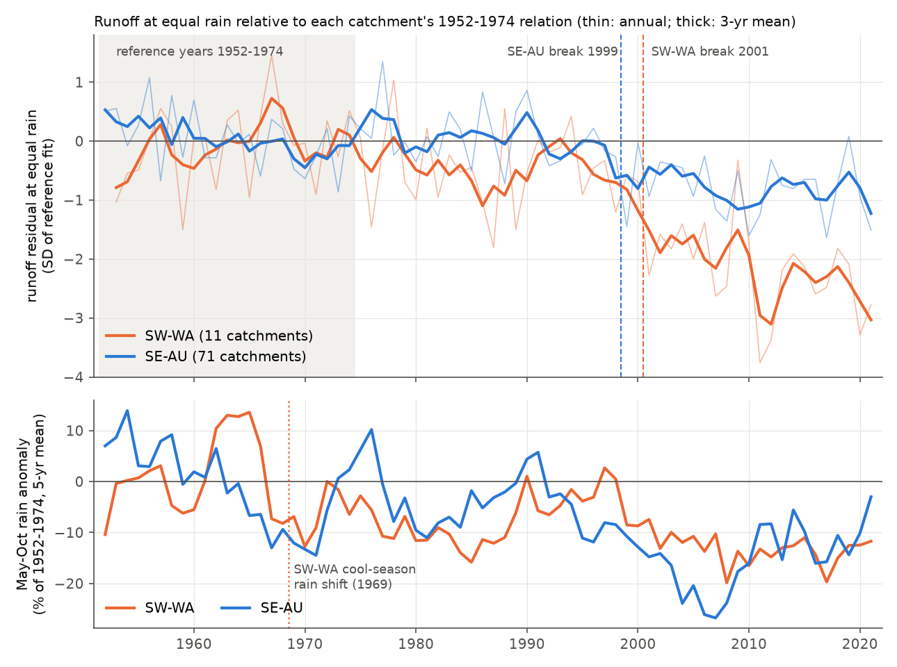
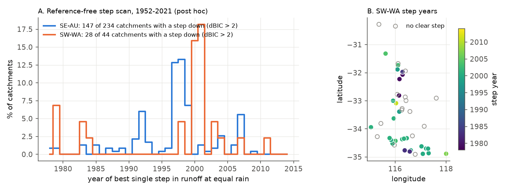
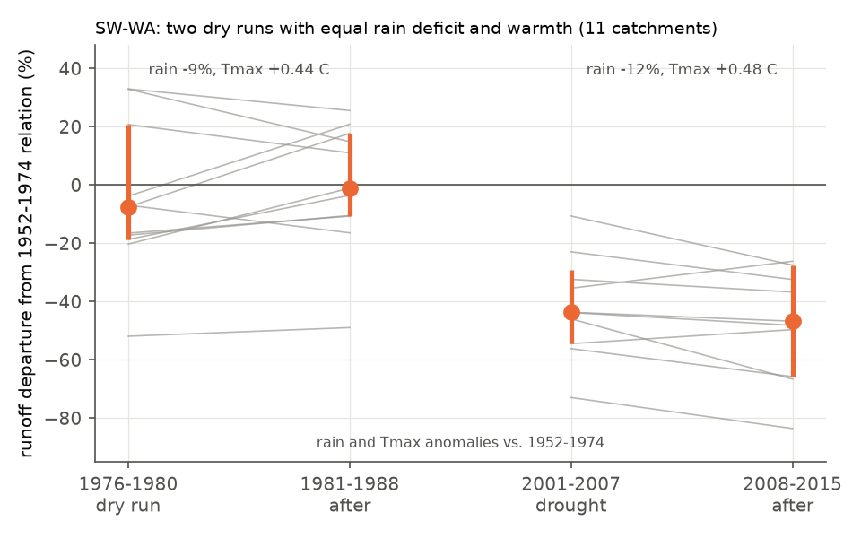

# South-west Western Australian runoff at equal rain did not fall after the 1970s rain decline, but fell 25-45% from 2000-2001, two to three years after the south-east Australian drop (CAMELS-AUS, 1952-2021)

Job `sci-1107-dell-earth-and-ocean-sciences-ae556a671db0`, campaign 11_07_2026, topic earth-and-ocean-sciences, machine dell, account claude-sci. Model: Claude Opus 5.5 (`claude-opus-5-5`) in Claude Code (T3 Code). The signing key is a campaign-machine key. It is not a personal authorship claim.

## Summary

**Question.** After 1997, south-east Australian (SE-AU) runoff fell 12-25% below the 1951-1996 rainfall-runoff relation and stayed low. Earlier campaign work excluded many local causes. The open question is this: is the deficit a climatic, multidecadal response to less cool-season rain, or a state shift that a drought starts? South-west Western Australia (SW-WA) gives an independent test. Its cool-season (May-October) rain fell in a regime shift near 1969-1975, about 25 years before the SE-AU shift. Its rain fell again after 2000. Earlier campaign work put SW-WA into one "southern Australia" group (sci:sha256:df943002). It did not test when SW-WA runoff efficiency changed relative to its own rain shift.

**Hypotheses (plan written before any SW-WA efficiency result; `files/ANALYSIS_PLAN.md`).**
H1: runoff efficiency falls when the cool-season rain regime falls. Then SW-WA runoff in 1975-1996 is 10% or more below its pre-1975 relation.
H2: efficiency falls at about the same calendar time in both regions (1995-2003), independently of the earlier SW-WA rain shift. Then the SW-WA 1975-1996 departure is between -10% and +10%, and the 1997-2021 departure is -10% or lower.
H3: each region shifts after its own deepest drought. For SW-WA this drought started in 2001. The plan said that timing alone cannot separate H2 from H3.

**Method.** CAMELS-AUS v2.03 daily flow and catchment rain (AGCD; SILO as a check), calendar years, 1952-2021. Per catchment, sqrt(Q) = a + b P + c P(t-1), fitted on complete years 1952-1974. Window departure = sum of observed flow / sum of predicted flow - 1. Regional value = median over catchments, with a 95% bootstrap interval over catchments. We used the same code and the same 1952-1974 reference years for both regions: 11 SW-WA catchments and 71 SE-AU catchments have 12 or more reference years. Post hoc: a second reference period (1975-1996) for 47 SW-WA and 230 SE-AU catchments, and a reference-free scan for one step in each long record (44 SW-WA, 234 SE-AU).

**Main results.**

1. **The 1970s rain decline did not lower SW-WA runoff at equal rain (H1 rejected for the regional median).** Relative to 1952-1974, SW-WA rain in 1975-1996 was 7% lower (median catchment; 10% lower relative to 1911-1974). The runoff departure was -5.3% (95% interval -8.9 to +11.7%; 11 catchments). It was -7.9% in 1975-1986 and -0.8% in 1987-1996. In standard units, the 1975-1996 residual was -0.33 SD (-0.61 to +0.15). Thus a small early loss is possible, but a loss of the post-1997 size is not.
2. **SW-WA runoff efficiency fell in 2000-2001 (planned H2 decision rule met).** The SW-WA departure was -28% (-40 to -19%) in 1997-2009 and -51% (-71 to -39%) in 2010-2021. All 11 catchments were below the relation in both windows. The best single step in the regional index was in 2001 (BIC gain 35; catchment bootstrap 95% interval 2001-2001). In SE-AU it was in 1999 (BIC gain 21; 1998-1999). Per catchment, 10 of 11 SW-WA catchments had a clear step down; 8 of them were in 1997-2003 and none in 1975-1996. The best rain step in SW-WA was in 1969 (May-October rain, bootstrap 1968-1969). The SW-WA efficiency step came 32 years after its rain step.
3. **The SW-WA step came with little further rain decline.** Relative to its own 1975-1996 relation (47 catchments, post hoc), SW-WA runoff was -5.8% (-14.3 to -0.4%) in 1997-2000 (rain +2%), -24.7% (-32.2 to -22.6%) in 2001-2009 (rain -4%) and -45.4% (-50.6 to -36.6%) in 2010-2021 (rain -6%). The comparable SE-AU values were -18.8%, -29.0% and -23.6%. The SE-AU loss started in 1997; the main SW-WA loss started in 2001. A second SW-WA step followed the record-dry year 2010 (two-step regional fit: 2001 and 2011).
4. **Reference-free scan (post hoc).** In 28 of 44 long SW-WA records (64%), one downward step in runoff at equal rain gave a BIC gain above 2. With permuted residuals, this occurred in 1.6% of cases. The median step year was 2000 (interquartile range 1998-2001), and 68% of the steps were in 1997-2003. In SE-AU, 147 of 234 records (63%) had a step, median 1998 (1993-1999). The median step size was -46% (SW-WA) and -41% (SE-AU) of mean flow. With SILO rain the medians were 2001 and 1998.
5. **Exception: some fully forested SW-WA catchments did step after the 1970s.** Six SW-WA steps (21%) were in 1979-1984. They were all in catchments with 93-100% of native forest kept: Yarragil Brook, Darkin River and Canning River (1979, northern jarrah forest), Shannon and Weld rivers (1983) and the Helena River (1984). A two-step scan found a second, later step in three of these. Across SW-WA steps, the step year was earlier where more native forest remained (Spearman rho -0.43, p = 0.02). It was not related to the local 1975-1996 rain decline (rho +0.23, p = 0.25).
6. **Two SW-WA dry runs with equal rain deficit and equal warmth had different outcomes (post hoc).** In 1976-1980, rain was -14.1% and annual Tmax was +0.44 C (rain relative to 1911-1974, Tmax relative to 1952-1974). In 2001-2007, rain was -14.7% and Tmax +0.48 C. Relative to the 1952-1974 relation, runoff was -7.5% (-18.6 to +20.8%) during the first run and -1.1% (-10.7 to +17.7%) in the 8 years after it. It was -43.7% (-54.4 to -29.2%) during the second run and -46.7% (-65.7 to -27.5%) after it. All 11 catchments were lower after the second run than after the first. With the 1960-1974 reference (14 catchments), the first run gave -17.4% during and -10.2% after; the second gave -47.3% and -48.6%. Thus the earlier run had a smaller, partly recovered loss in that set.
7. **Form.** The ratio of the rain slope after and before the step depended on the transform. In the square-root model, the SW-WA 2010-2021 ratio was 0.86 (0.73 to 1.00) and the SE-AU ratio was 0.87 (0.83 to 0.90). In the log model, the ratios were 1.74 and 1.01. Thus our data do not show one clear form of the SW-WA change.

**Conclusion.** The SW-WA record does not agree with a simple climatic model in which runoff efficiency follows the cool-season rain regime. A 10% regime decline left most SW-WA catchments on their earlier relation for about 25 years. In both regions, efficiency fell within a few years around 1997-2001 by similar fractions (about 20-30% first). It stayed low. In SW-WA it fell again after 2010. The SW-WA step came 2-3 years after the SE-AU step, in the first year of the deep SW-WA drought of 2001-2007. The main loss did not come in earlier SW-WA dry runs of equal depth and equal warmth. In SE-AU, the WWII drought also did not start a loss (sci:sha256:4e9ae7e7). Thus droughts of equal depth started a persistent loss after about 1997 but not before, in two regions 2,500 km apart. Candidate explanations must explain why. A long run of low rain (as in SW-WA after 1975) can make a catchment more sensitive, but SE-AU had no such run before 1997. Annual Tmax does not separate the SW-WA dry runs. The main open question changes from "what is special in SE-AU after the Millennium Drought" to "what changed in southern Australian catchments, or in droughts, near 1997-2001".

**Limitations.** Only 11-14 SW-WA catchments have flow before 1975. Most long SW-WA records are in forested catchments in a small area (31-35 S, 115-118 E). The regional rain step in 1969 has weak BIC support because rain varies much from year to year; the 1975-1996 rain mean is nevertheless 7-10% lower than earlier. Many SW-WA catchments had land changes: clearing in the 1950s-1970s, which raised runoff and salinity in some catchments, forest logging and thinning, bauxite mining, and dieback. We did not model these, but forested and cleared subsets gave the same timing (2001). The annual model is simple and has three parameters. The H2/H3 timing rule cannot separate a common calendar trigger from region-specific drought triggers. The two SW-WA dry-run comparisons and all reference-free scans are post hoc. Flow data end in 2021 (CAMELS-AUS); we did not test 2022-2025. Annual Tmax is only one temperature measure; we did not test vapour pressure deficit or rain timing within the year.

## Figures



**Figure 1.** Top: mean standardised runoff residual relative to each catchment's 1952-1974 relation (thin: annual; thick: 3-year centred mean). Dashed lines: best single step in the out-of-sample years (SE-AU 1999, SW-WA 2001). Bottom: May-October rain anomaly, % of 1952-1974, 5-year centred mean. The SW-WA rain fell from 1969. SW-WA runoff at equal rain did not fall in the same way until 2001.


**Figure 2.** Median runoff departure by window with 95% bootstrap intervals over catchments. A: planned analysis, reference 1952-1974. B: post hoc, reference 1975-1996 (more catchments). Grey numbers: median rain anomaly of the window relative to the reference.



**Figure 3.** A: year of the best single downward step in runoff at equal rain, for long records with a BIC gain above 2 (% of all long records per region). B: SW-WA catchment outlets coloured by step year; open circles have no clear step. The early (1979-1984) steps are in fully forested catchments.



**Figure 4.** SW-WA departures (11 catchments, 1952-1974 relation) during and after two dry runs with equal rain deficit and warmth. Grey lines: catchments. Orange: median with 95% bootstrap interval.

## Robustness (SW-WA departure 1975-1996 / 1997-2009 / 2010-2021; regional step year)

| Variant | SW-WA n | 1975-1996 | 1997-2009 | 2010-2021 | SW-WA step | SE-AU step |
| --- | --- | --- | --- | --- | --- | --- |
| Main (AGCD, 1952-1974, 12+ years) | 11 | -5.3% (-8.9, +11.7) | -28.0% | -51.0% | 2001 | 1999 |
| SILO rain | 11 | -2.2% (-11.4, +11.1) | -21.4% | -53.4% | 2001 | 1999 |
| Reference 1960-1974, 10+ years | 14 | -8.7% (-17.6, +3.9) | -32.6% | -53.3% | 2001 | 1999 |
| Forested (native forest kept 80% or more) | 5 | -8.9% (-51.4, +10.2) | -33.7% | -60.4% | 2001 | 2007 |
| Cleared (less than 80% kept) | 6 | +10.0% (-6.5, +17.5) | -24.8% | -48.6% | 2001 | 1998 |
| Mean flow 5 mm/yr or more | 11 | same as main | | | 2001 | 1999 |

SE-AU, main: +3.9% (0.0, +5.9) in 1975-1996, -17.6% (-22.0, -12.6) in 1997-2009 and -22.5% (-26.5, -15.2) in 2010-2021.
The forested SE-AU subset (37) gave a best step in 2007 with a wide interval (1999-2007). All results: `files/results/summary_*.json`.

## Other checks (post hoc; `files/results/posthoc_checks.txt`)

- **Record-low droughts do not time the steps.** In SE-AU the 5-year running rain mean set a new record (since 1911) in 1944 (WWII drought) and next in 2006, after the 1997 step. In SW-WA the 3-year mean set records in 1979 and 1987 without a regional step.
- **Temperature.** SE-AU annual Tmax had a step in 1997 (+0.20 C in 1975-1996 to +0.86 C in 1997-2009, relative to 1952-1974). SW-WA warmed gradually (+0.23, +0.54, +1.00 C). Its runoff step in 2001 did not come with a Tmax step.

## Relation to earlier work

- Petrone et al. (2010, Geophys. Res. Lett.) found change points in SW-WA streamflow near 1969/1975 and a further decline in 1989-2008 without a matching rain decline. Hughes, Petrone and Silberstein (2012) linked the runoff ratio to groundwater storage, which falls in dry years. Kinal and Stoneman (2012) reported that groundwater disconnection from the stream about halved the runoff fraction in a forested catchment. Campion et al. (2026, EGUsphere preprint) found that 63% of 54 western Australian catchments shifted to a lower-flow state, more often in uncleared forest. Our results agree with these and add one point: in a common annual framework, the main SW-WA efficiency step is in 2000-2001, 2-3 years after the SE-AU step and 25-30 years after the SW-WA rain shift. The early steps in the most forested catchments agree with the groundwater-disconnection explanation.
- The Chile megadrought had no deficit at equal rain (sci:sha256:491b96f6). The SE-AU drop did not occur in Germany or Great Britain (sci:sha256:87bf6677). Together with this result, the persistent loss is specific to southern Australia after about 1997, and it is not a smooth response to a lower rain regime.

## Data

| Input | Source and version | Use | In bundle? |
| --- | --- | --- | --- |
| CAMELS-AUS v2.03 (Fowler, Zhang and Hou 2025, ESSD 17:4079, doi:10.5194/essd-17-4079-2025), Zenodo record 14289037, CC BY 4.0 | Shared campaign copies used in place: `datasets/camels-aus-v2.03-zenodo14289037-{streamflow,hydrometeorology,mastertable}` (SHA-256 in `files/provenance/`) | Daily flow (mm/d), AGCD and SILO catchment rain, AGCD Tmax, attributes (outlet, NVIS forest) | No raw or annual values. Only per-catchment departures (%), step years, relative step sizes, rain anomalies (%) and regional indices |

See `files/DATA_NOTICE.md` for the terms and credit lines.

## Files

- `files/ANALYSIS_PLAN.md`: plan written before the SW-WA efficiency results. Its SHA-256 and time are in `files/provenance/plan_hash_before_results.txt`.
- `files/code/`: `get_data.sh` (download and hash check), `build_annual.py`, `build_tmax.py`, `analyze.py` (analyses A-E), `breakscan.py`, `twobreak.py`, `posthoc_checks.py`, `figures.py`, `reproduce.sh`.
- `files/results/`: `summary_<variant>.json` (window departures, steps, form), `departures_<ref>.csv` (per catchment and window), `regional_index_<variant>.csv`, `catchment_breaks_*.csv`, `breakscan_*`, `twobreak_catchments.csv`, `tmax_regional_*.csv`, `posthoc_checks.txt`.
- `files/provenance/`: shared dataset provenance (source URL, SHA-256), SHA-256 of the extracted CSV members and of the derived annual tables (not bundled).

## Deviations from the plan

- The efficiency step search used only out-of-sample years (1975-2021, step years 1977-2016), because residuals in the reference years have zero mean by construction. The rain step search used 1952-2021 with step years 1960-2016.
- Windows were added after the first run: 1997-2000, 2001-2009, 1988-1996, 2003-2011, 1976-1980, 1981-1988, 2001-2007 and 2008-2015 (post hoc). Windows shorter than 9 years need 3 complete years; longer windows need 5.
- The 1975-1996 reference, the reference-free scans, the two-step scan, the dry-run comparison, the Tmax and record-low checks are post hoc.

## Reproduce

```
bash files/code/reproduce.sh <CAMELS_DIR> <SCRATCH>
```
`CAMELS_DIR` holds `03_streamflow.zip`, `05_hydrometeorology.zip` and `CAMELS_AUS_Attributes_Indices_MasterTable.csv`. If they are absent, `get_data.sh` downloads them from Zenodo and checks SHA-256. The script writes only into `SCRATCH`. Python 3.12 with numpy, pandas, scipy and matplotlib; about 20 minutes on 2 CPUs (most of it is extraction from the 1.7 GB zip). We ran the script end to end from the shared copies on 2026-11-12. The extracted CSV members and the annual tables matched the SHA-256 values in `files/provenance/`. All bundled results and figures come from that run (record-level columns removed from the step-scan tables).

## References

- Fowler, K. J. A., Zhang, Z., Hou, X. (2025). CAMELS-AUS v2. Earth Syst. Sci. Data 17, 4079. doi:10.5194/essd-17-4079-2025
- Hughes, J. D., Petrone, K. C., Silberstein, R. P. (2012). Drought, groundwater storage and stream flow decline in southwestern Australia. Geophys. Res. Lett. 39, L03408. doi:10.1029/2011GL050797
- Petrone, K. C., Hughes, J. D., Van Niel, T. G., Silberstein, R. P. (2010). Streamflow decline in southwestern Australia, 1950-2008. Geophys. Res. Lett. 37.
- Kinal, J., Stoneman, G. L. (2012). Disconnection of groundwater from surface water causes a fundamental change in hydrology in a forested catchment in south-western Australia. J. Hydrol. 472-473, 14-24.
- Campion, N., et al. (2026). Comparing drivers of hydrological shifts across regions: the case of southern Australia. EGUsphere preprint egusphere-2026-378.
- Saft, M., Western, A. W., Zhang, L., Peel, M. C., Potter, N. J. (2015). The influence of multiyear drought on the annual rainfall-runoff relationship: an Australian perspective. Water Resour. Res. 51, 2444-2463. doi:10.1002/2014WR015348
- Peterson, T. J., Saft, M., Peel, M. C., John, A. (2021). Watersheds may not recover from drought. Science 372, 745-749. doi:10.1126/science.abd5085
