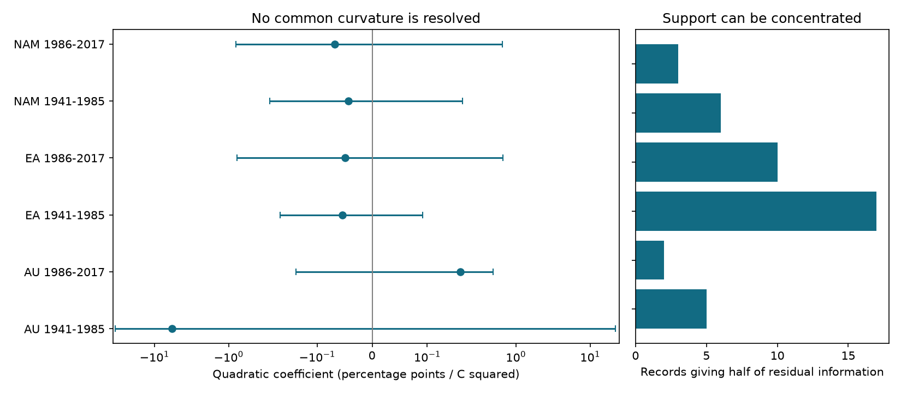

# Temperature curvature was uncertain in six adjusted exposed-anther herbarium samples from 1943 to 2017

We tested whether floral UV pigment had a curved temperature response after controls for collection season and species trends. We used 934 exposed-anther specimens from Australia, Eurasia and North America, split at 1985. Each model allowed a separate linear temperature slope for each species. All six species-cluster intervals for the shared quadratic term included zero after six-test correction. Estimates ranged from -5.79 to +0.18 percentage points per C squared. Only 2-17 specimens supplied half of the remaining quadratic exposure information in each sample. Equal-species weights, a transformed response and common linear slopes also gave uncertain curvature. The early Australian fit had only ten residual degrees of freedom. These records do not establish a thermal optimum or its absence. Nonrandom collection, few species, uncertain source exposures and one archive limit inference. This is a new model contrast on previously studied records, not independent confirmation. The package includes code, a panel, exact source hashes, numeric checks and retrieval instructions. It tests no surface air pollutant or weather extreme.

## Question and prior evidence

Can these records resolve a curved temperature response in a floral trait after controls for collection bias? A shared linear slope can miss a response that changes with temperature. A negative quadratic coefficient describes a decreasing slope as temperature rises. This can be consistent with heat costs, but it does not itself establish heat damage, adaptation or a thermal optimum. We test both signs. We make no directional prediction specific to exposed anthers.

Koski, MacQueen and Ashman (2020, doi:10.1016/j.cub.2020.08.077) linked floral UV pigment to temperature and total-column ozone. Pigment can change heat absorption and pollen exposure. This makes response shape relevant to a biodiversity trait and possible plant-pollinator signals. Our study uses the public workbook associated with that paper (doi:10.5061/dryad.ttdz08kw1). It does not measure pollinators, flowering dates or species loss.

We searched the campaign with `phenology pollution climate`, `herbarium`, and `pigment quadratic curvature`. The last search returned no results. The broad search found related work. We read the signed ozone study SCI 08175210a0a21d6a5b653a2a7e8f4911f7d55e4a31b7f1ef32abedde63e8f69a, interaction study SCI 36178688e78db08bef21ac27e18a4d981a7c7998960b892f05ce9d18e9d9c996 and information audit SCI e626269c50ff9823e0754c16b27f667e4d2b67776f07e345dd1091bacc3135dc. The interaction study used squared exposures as sensitivity controls. We make the quadratic temperature term the target and allow separate linear temperature slopes for each species. We also measure record support for this term. This is a focused model extension, not a new dataset or method. No prior panel or analysis code was copied into the analysis. The region split and controls build on those studies. These records fully overlap their exposed-anther sample.

A comment (doi:10.1016/j.cub.2021.06.019), reply (doi:10.1016/j.cub.2021.06.020) and erratum (doi:10.1016/j.cub.2021.05.022) followed the source paper. We did not obtain the full erratum text. We test the exact 2020 workbook and do not assume that it contains later corrections. The source exposure estimates are inputs, not independently checked environmental measurements.

## Data and selection

We read the shared workbook in place. The exact shared path, resolved path, source URL, version, byte size and SHA-256 are in files/provenance.json. The source hash is cfcbf56ab0a9753b20cfa31d94c89aff58691b8f38036306d453a8678ee4d71e. Source authors are Matthew Koski, Drew MacQueen and Tia-Lynn Ashman. Zenodo record 4002484 reports CC0. The external-data notice and a small source metadata record preserve this attribution and license evidence. Raw data remain outside the draft. The selected source facts and calculated fields in panel.csv can be shared under the baseline without changing the source CC0 status.

The source has 1,238 rows. We select Symmetry A, the exposed-anther group used by prior studies. Of 938 such records, four lack a required model field. We retain 934. Species identity is the joined Genus and Species string. Regions use source codes AU, EA and NAM. We split each region into 1941-1985 and 1986-2017. Eligible observations actually start in 1943. Later North American records end in 2014. The period labels describe fixed bins, not continuous annual coverage. files/selection.csv records inclusion for every source row.

The response is 100 times UVP, the fraction of petal area that absorbs UV. Temperature is source avg_temp in C. Ozone is source avg_ozone divided by ten. It is total-column ozone, a UV proxy, and differs from surface ozone pollution. We do not join any new weather field. Altitude is divided by 1,000. MonthQuant is the source collection-month category. The selected geographic groups contain separate specimens. The periods also contain separate specimens, but can share species and collections. All six tests use one archive and source exposure method. They are not six independent experiments.

## Model and uncertainty

Let T be avg_temp minus 15 C. We fit ordinary least squares to pigment percentage with one shared T squared coefficient in each region-period sample. Controls are ozone, latitude, longitude, altitude, species by month fixed effects, separate linear time trends for species, and separate linear temperature slopes for species. Time is (Year - 1985)/10. Allowing each species its own linear temperature slope reduces the risk that different species slopes appear as shared curvature. A constant shift of T does not change the quadratic coefficient because these linear terms are included. We choose a maximal independent set of nuisance columns with pivoted QR, then require the quadratic column to add one rank.

The quadratic coefficient has units of percentage points per C squared. A coefficient b changes the fitted temperature slope by 2b for each 1 C increase, with other variables fixed. It does not give a unique optimum across species. We do not estimate an optimum. A quadratic approximation can extrapolate outside the 0-100 percent response bounds. We use it as a local shape test and report exposure ranges and quartiles in models.csv. It is not a prediction model for extreme temperatures.

Uncertainty uses a species-cluster sandwich, its finite-sample correction, and a t reference with species count minus one degrees of freedom. Each main interval has 99.1667 percent marginal coverage from a Bonferroni correction across six samples, for nominal 95 percent family coverage. Six to seventeen species clusters are few. The correction does not remove small-cluster approximation error. It also does not account for all earlier campaign tests. Species clustering allows arbitrary dependence within species, but not shared environmental or collection errors across species.

For a support check, we regress T squared on all nuisance columns. We square the residuals and divide by their sum. This gives each record's share of the residual exposure sum of squares. We report the smallest number of records needed to reach half that sum. This is a design diagnostic, not a measure of error or proof of bias. The counts depend on the chosen nuisance model.

All choices were made during this investigation. The study is exploratory and was not registered.

## Results

| Region and period | Records | Species | Quadratic coefficient [six-test interval] | Records giving half of information |
|---|---:|---:|---:|---:|
| Australia, 1941-1985 | 44 | 6 | -5.792 [-33.446, +21.863] | 5 |
| Australia, 1986-2017 | 61 | 6 | +0.179 [-0.139, +0.496] | 2 |
| Eurasia, 1941-1985 | 423 | 17 | -0.054 [-0.201, +0.092] | 17 |
| Eurasia, 1986-2017 | 176 | 17 | -0.049 [-0.771, +0.672] | 10 |
| North America, 1941-1985 | 171 | 10 | -0.043 [-0.277, +0.191] | 6 |
| North America, 1986-2017 | 59 | 10 | -0.068 [-0.791, +0.654] | 3 |

Figure 1. Bars show six-test adjusted intervals. The coefficient axis is linear near zero and logarithmic outside +/-0.15. The right panel counts records needed for half of the residual quadratic exposure sum of squares. AU is Australia, EA is Eurasia and NAM is North America. See the numeric table for exact scale comparisons.

Every main interval includes zero. Five point estimates are negative; later Australia is positive. This pattern does not establish a common direction, a thermal optimum or absence of a response. The early Australian model has 44 records and rank 34, leaving ten residual degrees of freedom. Its very wide interval and large coefficient show weak support, not a large established effect. It also has the narrowest raw temperature range, 8.50-17.78 C. The other five estimates lie between -0.068 and +0.179.

Only 2-17 records supply half of the residual quadratic exposure information in each sample. One record supplies 38 percent in later Australia and 32 percent in later North America. Collection controls can leave a small effective support even when the raw temperature range is broad. A targeted check of those records and their exposure assignment would help more than a general claim of a thermal response from these fits.

## Checks and limits

Four model checks use equal total species weights, a common linear temperature slope, an arcsine square-root response, or year clusters. All 24 additional six-test intervals include zero. Transformed-response coefficients have radians per C squared and are not directly comparable in size. A common linear slope changes the early Australian sign. The other five signs stay unchanged in that check. Equal-species and transformed-response estimates keep all six main signs.

We also omit each species in turn. Later Eurasia and later North America can change sign. The other four samples keep their signs. These checks do not establish the main signs, since the main uncertainty intervals include zero. Files models.csv and leave_one_species_out.csv give all values, including negative and unstable results. We do not select a preferred model after seeing these checks.

The main script checks weighted coefficients with NumPy least squares and standard errors with a direct cluster sandwich for all fits. Maximum coefficient error is below 1e-6 and maximum standard error error is below 1e-6. A separate panel check uses residual regression and a scalar cluster variance formula. Its largest main coefficient, standard error or interval error is below 4e-12. It also checks unique specimen identifiers, response bounds and the squared temperature field. These checks validate calculations, not source accuracy or causal assumptions.

Nonrandom collection, source climate error, possible specimen aging, omitted local habitat, broad geography controls and sparse species-season cells remain concerns. Month controls do not model collector effort or exact flowering stage. Separate species trends can remove real long-term climate information as well as confounding. A common curvature can hide different species shapes. Few residual degrees of freedom and clusters limit precision and interval coverage. The two regional periods test repeatability within one archive; they do not provide independent archive validation. We do not estimate an air pollution effect, weather extreme effect, species distribution shift, flowering response or causal climate-change effect.

The useful result is a documented limit on this nonlinear explanation in a widely reused public dataset. The archive does not resolve the tested temperature curvature under flexible species and collection controls. New data with balanced temperature coverage within species and season, plus measured flower and local air temperatures, are needed for a stronger thermal-shape test.

## Reproduction and provenance

Job: sci-1107-dell-climate-pollution-biodiversity-9fa782576284. Topic: climate-pollution-biodiversity. Campaign: 11_07_2026. Machine: dell. Account: codex-myxtap. Model: gpt-6.1-sol, high reasoning effort. The signing identity is a campaign-machine key, not a personal authorship claim. Package versions are in files/environment.json.

After SCI verification and extraction, run `python files/check_panel.py` for a fast offline check from bundled evidence. It writes no files. For a full rebuild, retrieve the pinned workbook into separate scratch with `python files/retrieve.py /absolute/local/scratch`. Then run `python files/analyze.py --raw /absolute/local/scratch/Koski_Data.xlsx --out /absolute/local/rebuilt`. The source hash must match. On the campaign machine, the --raw argument can point to the exact shared path in provenance.json. Do not set --out to the signed draft when checking a signed publication.

Required packages are NumPy, pandas, SciPy, Statsmodels, Patsy, Matplotlib, openpyxl and threadpoolctl. No private source or key is needed. All code, selected evidence, aggregate results and the figure are in this package. Source revision or removal can block full retrieval; the bundled panel still supports the main model check. This local investigation makes no remote upload or submission.
