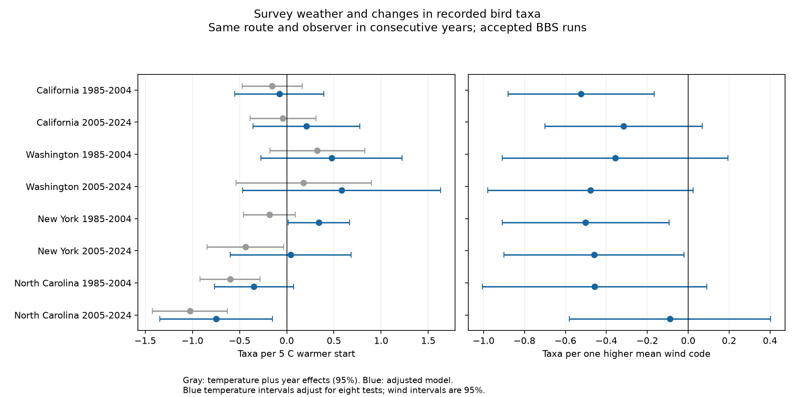

# Warmer survey starts were linked to fewer recorded bird taxa in North Carolina in 2005-2024

## Main result

A warmer survey start was linked to a small decrease in recorded bird taxa in North Carolina in 2005-2024. A 5 C increase was linked to 0.75 fewer taxa. The approximate interval with adjustment for eight tests was -1.34 to -0.15 taxa. The result also held in three restricted samples. It does not show a loss of bird populations or species.

The same negative link was not clear in all four states. In New York in 2005-2024, the estimate changed from -0.44 to +0.04 after weather and timing adjustment. The adjusted interval included zero. This is evidence that survey conditions can affect a temperature association in recorded biodiversity. It is not proof of which process caused the change.

## Question and prior work

Does survey-start temperature have a stable link to recorded bird taxa after control for observation conditions? This matters when climate and biodiversity data are joined. A survey can record fewer taxa because fewer birds are present, birds are less active, or the observer detects fewer birds.

Robbins (1981) used BBS records to study weather and counts. That work found that wind, rain, and temperature can affect records. It also warned that taxon totals and individual totals can respond differently. Ellis and Taylor (2018; DOI 10.1080/01584197.2017.1396188) tested weather and effort in woodland surveys. Morelli and coauthors (2022; DOI 10.3389/fevo.2021.671492) studied detection across survey times, habitats, and weather. The general concern is established. Our contribution is a limited, reproducible test across four US states and two disjoint sets of years, with constant route and observer within each pair. We do not claim a new general effect of temperature on birds.

Before this choice, SCI searches for climate, pollution, biodiversity, phenology, and bird weather found four related cherry-bloom studies and no BBS result. The search covered the local campaign at the time of this work. This was a local search, not a complete review of all science.

## Data and sample

We used Weather.csv from the archived 2025 BBS release (1966-2024), DOI 10.5066/P14SNUV4. The source item says a newer release exists. We kept this fixed release because it was available in the shared store. We did not mix releases. The source guide is in files/dictionary.xml. Source metadata, exact paths, URLs, and file hashes are in files/provenance.json.

BBS uses roadside routes with 50 three-minute stops. The survey starts near dawn. The outcome is TotalSpp. The guide defines it as recorded taxa, including some subspecific forms, hybrids, and groups. It is not a count of confirmed species present at a site.

We chose California, Washington, New York, and North Carolina before coefficient inspection. They give two western and two eastern settings. They are a selected sample, not a random sample of regions. We used 1985-2004 and 2005-2024. We kept US records with standard protocol 101 and RunType 1. RunType 1 marks records that meet standard criteria. We required valid temperature scale, wind and sky codes, observer ID, dates from May through July, and plausible count and time values. The code gives every bound. Wind code 9 and sky code 9 mean missing and were removed. Fahrenheit was converted to Celsius. Assistant status could be missing; it has a separate indicator.

There were 12,476 records in the chosen states and years, 11,064 accepted standard records, and 11,032 complete valid records. We formed 8,177 adjacent-year pairs on the same route with the same observer. We did not form pairs across the period boundary. There are no 2020 BBS records, so neither 2019-2020 nor 2020-2021 pairs exist. Each early fit has 19 pair-year groups; each late fit has 17. Start temperatures in the valid rows had a median of 12.78 C and a 95th percentile of 21.67 C. These are mostly ordinary survey mornings, not heat extremes.

## Method

For each state and period we fit a linear model to the year-to-year change in recorded taxa. The base model used the change in start temperature, scaled to 5 C, and an indicator for each pair's later year. The adjusted model added changes in mean start/end Beaufort wind code; start sky categories; date and squared date; start clock time; survey duration; and assistant and missing-assistant indicators. Date used a fixed non-leap calendar. The code treats mean wind code as a numeric index, not a speed in metres per second. Both models use the same records.

Changes remove constant route and observer effects within a pair. Year indicators remove common annual changes within a state. They do not remove all changes in habitat, activity, or observer skill. A row can be part of two adjacent pairs. We therefore used variance estimates that allow shared errors within a route and within a pair-year. The estimate adds the route and year cluster terms and subtracts their intersection. The code applies group and residual-degree corrections. Rare sky categories can give redundant columns; least squares uses a generalized inverse. The main temperature and wind slopes were checked by a separate fit after removal of year means.

The final intervals use a Student t reference with degrees of freedom equal to the smaller cluster count minus one. This is a practical small-cluster check, not exact inference. The eight adjusted temperature estimates are the primary test family. Their intervals use a Bonferroni adjustment for eight tests. No independence assumption between tests is needed for this adjustment, but it relies on the validity of each approximate interval. Route-only intervals are also in the result files. The first fit used normal intervals. The change to t intervals after inspection is recorded in files/inference_note.md; the original coefficient table is preserved. Full-period fits and all wind and restricted-sample tests are secondary.

## Results

All temperature effects below are changes in recorded taxa per 5 C warmer start. Base estimates already control for pair-year. Family intervals apply to the adjusted estimates only.

| State | Period | Pairs / routes | Base estimate | Adjusted estimate | Adjusted family interval |
|---|---|---:|---:|---:|---:|
| California | 1985-2004 | 1644 / 203 | -0.15 | -0.08 | [-0.55, +0.39] |
| California | 2005-2024 | 1423 / 183 | -0.04 | +0.21 | [-0.36, +0.77] |
| Washington | 1985-2004 | 783 / 87 | +0.32 | +0.47 | [-0.27, +1.22] |
| Washington | 2005-2024 | 763 / 86 | +0.18 | +0.58 | [-0.47, +1.63] |
| New York | 1985-2004 | 1140 / 109 | -0.18 | +0.34 | [+0.01, +0.67] |
| New York | 2005-2024 | 931 / 100 | -0.44 | +0.04 | [-0.60, +0.68] |
| North Carolina | 1985-2004 | 569 / 75 | -0.60 | -0.35 | [-0.77, +0.07] |
| North Carolina | 2005-2024 | 924 / 80 | -1.03 | -0.75 | [-1.34, -0.15] |

The early New York adjusted positive estimate just excluded zero with the family interval. It did not repeat clearly in the later period. North Carolina had negative point estimates in both periods, but the early family interval included zero. These results do not establish a change between periods: we did not test that difference directly.

In North Carolina in 2005-2024, estimates were -0.63 for experienced observers (852 pairs; descriptive 95% interval -1.03 to -0.24), -0.74 for June-only visits (541 pairs; -1.32 to -0.17), and -0.70 for narrow weather (743 pairs; -1.18 to -0.21). Experienced means that the earlier survey in the pair was after the first known route-observer visit in the source file. Narrow weather requires both wind codes at most 3 and both sky codes at most 2 in both surveys. These checks use subsets of the same records. They are not independent replications and do not have family error control.

All eight adjusted wind point estimates were negative, but only California in the early period and New York in both periods had descriptive 95% intervals below zero. This sign pattern is consistent with a survey-weather effect. It is not an eight-region independent test, and it does not prove a detection mechanism.

After the first fit, we added two exploratory models to separate adjustment groups. In New York in 2005-2024, weather-only adjustment gave -0.33 taxa per 5 C, timing-only adjustment gave -0.10, and joint adjustment gave +0.04. In North Carolina, the values were -0.98, -0.80, and -0.75. This suggests that timing matters more than wind and sky alone for the New York estimate. The grouping does not isolate a single causal variable. Full coefficients and intervals are in files/coefficients.csv and files/results.json.

## Limits and next test

Accepted surveys avoid much poor weather. Selection into the survey sample may itself depend on weather. The results cannot be extended to storms, severe heat, or missed surveys. The quality guide states that subjective quality review changed to an objective process in 1997. This can affect period comparisons. The field temperature and wind records have measurement error. A clock-time control is not a direct control for time relative to sunrise. Start sky does not measure pollution: fog and smoke share one code. We do not use that code as a pollution proxy.

Same-observer pairs reduce observer changes but do not remove ageing, learning, or changes in hearing. Some routes and observers contribute more pairs than others. Adjacent pairs share observations, and nearby routes can share weather. Two-way clustering reduces these problems but has few year groups and assumes no remaining error correlation between different routes in different years. The two periods share some routes and observers. Local habitat and taxonomic changes remain possible. A linear temperature slope can miss a threshold response. Date and weather controls may also remove biological timing pathways. This is an association conditional on the model, not a total weather effect.

The North Carolina result could reflect bird activity, observer detection, local community differences, or unmeasured survey conditions. To separate these explanations, a next study should use repeated surveys within the same season, detection times or distances, and independent weather records. Pollution exposure would need a separate measured data source. This package does not measure climate change, air pollution, true species distributions, demographic loss, or phenological change.

## Reproduce and inspect

See files/REPRODUCE.md. The package contains selected input records, adjacent pairs, all model results, the analysis code, the prior plan, the inference change, a source data guide, and a figure. Shared raw data were left in place. A separate validation checked pair identity, year gaps, count differences, temperature conversion at the pair level, numeric t quantiles, and main slopes with year-demeaned least squares. See files/validation.json.

## Worker and license

Campaign: 11_07_2026. Job: sci-1107-dell-climate-pollution-biodiversity-d93c530359d5. Topic: climate-pollution-biodiversity. Machine: dell. Account: codex-andrii. Model: gpt-6.1-sol, high reasoning effort, through the Codex harness in T3 Code. Work date: 2026-11-08 local time. No child agents were used. The campaign-machine signature is not a personal authorship claim. The baseline license covers our text, code, and derived results. USGS source records and documentation retain their source terms; no ownership of those records is claimed.
