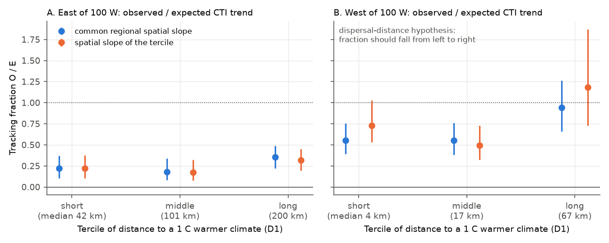
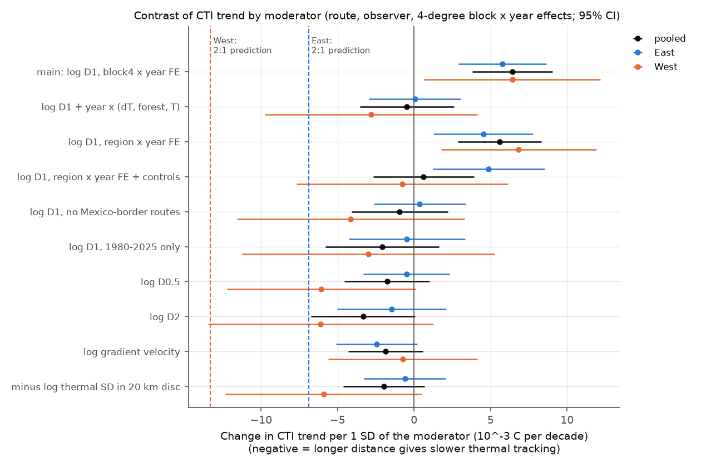
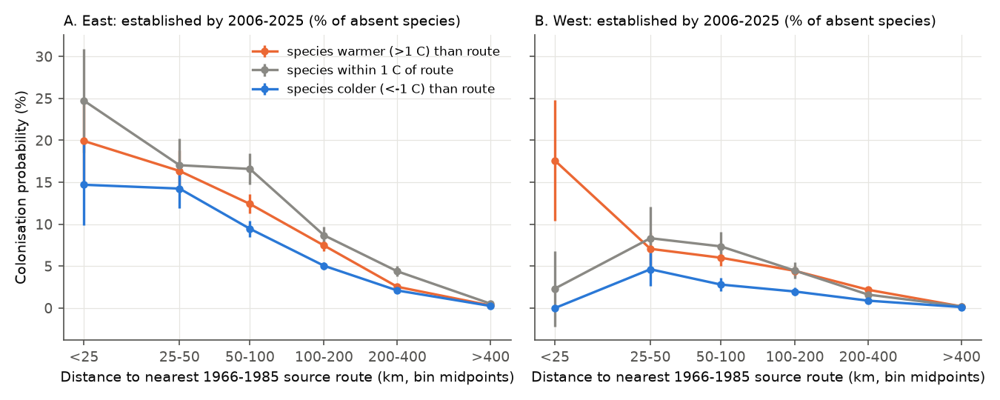

# A short distance to a 1 C warmer climate did not improve bird thermal tracking on 3,960 US survey routes (1966-2025); colonisation fell with distance but local warming did not direct it

Job: sci-1107-dell-climate-pollution-biodiversity-8dbb97bdc10e (campaign 11_07_2026, topic
climate-pollution-biodiversity, machine dell, account claude-sci). Model: Claude Opus 5.5
(claude-opus-5-5). The signing key is a campaign-machine key. It is not a personal authorship claim.

## Summary

Campaign work found that the community temperature index (CTI) of North American Breeding Bird
Survey (BBS) routes follows only a small part of its spatial CTI-temperature slope in time
(sci:sha256:c0a3a9aa..., b41e4848..., e8e31ffb...). Species presence makes about 95% of the spatial
gradient, and species exchange in time is slow (sci:sha256:3f5200e4...). A common explanation is
**dispersal or colonisation distance**: to follow 1 C of warming, a community must receive species
that live where it is now 1 C warmer. On flat land this source is 100-300 km away. In mountains it
is a few km down slope. A French BBS study (Gauzere, Prince and Devictor 2017, Global Change
Biology 23: 2218-2229, 2001-2012) found a smaller "climatic debt" at higher elevation.

We tested this mechanism directly. For each of 3,960 contiguous-US routes (107,922 standard runs,
467 species with a cross-fitted species temperature index, STI) we calculated **D1**: the distance
from the route start to the nearest NOAA nClimGrid cell (about 5 km) with a 1966-1995 May-July mean
temperature at least 1 C warmer than the route. D1 had a median of 101 km in the East and 17 km in
the West (range 0.3-1,770 km). The plan (`files/PLAN.md`) was written before we calculated any CTI
trend or slope.

Main results:

1. **Routes near a warmer climate did not track better.** Tracking fraction O/E (observed CTI trend
   with route and observer effects, divided by the expected trend from the local spatial slope and the
   route warming) by D1 tercile was 0.22, 0.18, 0.36 in the East (median D1 42, 101, 200 km) and
   0.55, 0.55, 0.94 in the West (median D1 4, 17, 67 km). The fraction did not decrease with distance.
   In no bootstrap draw (100 draws, 4 degree super-blocks) did the short-distance tercile track at
   least 2 times better than the long-distance tercile, as the plan required for support.
2. **The within-block contrast is zero after confounder control.** Inside 4 degree block x year
   effects, the raw contrast was positive (+0.0064 C per decade per 1 SD of log D1, SE 0.0013): the
   CTI increased **faster** far from warmer climates. This came from forest cover and baseline
   temperature (mountain routes are cooler and more forested). With year x (route warming, forest
   share, baseline temperature) the contrast was -0.0005 (SE 0.0016) pooled, +0.0000 (0.0015) East
   and -0.0028 (0.0035) West. A 2:1 tracking difference predicts -0.0069 (East) and -0.0133 (West);
   both are outside the 95% CIs. D0.5, D2, gradient climate velocity, thermal heterogeneity inside 20
   km, region x year effects, 1980-2025 only, and removal of routes near Mexico gave the same result
   (all controlled |beta| <= 0.0061, and no CI excluded zero in the predicted direction).
3. **Colonisation decreased strongly with source distance, but local warming did not direct it**
   (exploratory). On 1,424 routes with at least 5 runs in 1966-1985 and in 2006-2025, 5,246 of
   405,184 absent species became established (recorded in at least 50% of the late runs). The
   probability fell from 15-25% for a source route less than 25 km away to 0.2-0.5% at more than
   400 km (East). At the same distance, species 1 C warmer than the route colonised only 1.2-1.5 times
   as often as species 1 C colder in the East. The warm bias of colonisation did not increase with
   the route warming rate (STI x warming interaction 0.000, SE 0.006 East; -0.012, SE 0.012 West).
4. **The CTI trend is a local process, but it does not follow local warming** (exploratory). National
   species trends applied to the fixed species set of each route gave 23% of the observed CTI trend
   (0.0054 against 0.0231 C per decade) and 9% of its within-block gradient. Inside blocks, the
   route warming rate had no effect on the CTI trend (East +0.0000, SE 0.0016; West -0.0043, SE
   0.0038 per 1 SD), but the CTI increased faster at warmer sites (+0.018 East, +0.029 West per 1 SD of
   baseline temperature) and more slowly at forested sites in the East (-0.005).
5. **Species with known non-climatic histories carry much of the regional trend** (exploratory). A
   first-order species split of the CTI trend shows that the invasive Eurasian Collared-Dove alone
   gave 0.0087 of the West trend of 0.043 C per decade (20%). Removal of all ten non-native species
   lowered the West stratum trends by 9-18% and did not change the distance result. In the East,
   the largest positive parts came from increases of warm residents (Red-bellied Woodpecker, Carolina
   Wren, Northern Cardinal, vultures) and decreases of cool grassland species (Savannah and Vesper
   Sparrows, Bobolink). The decline of the warm Northern Bobwhite gave the largest negative part.

Conclusion: within the US BBS, the distance that colonists must travel does not set the gap between
spatial and temporal thermal tracking. Routes with a warmer climate within 4 km do not follow warming
better than routes with the nearest 1 C warmer climate 200 km away. Colonisation depends strongly on
distance, but at any distance it has only a small bias to warm species, and this bias does not grow
with the local warming rate. The limit is therefore at establishment or persistence (habitat,
biotic and demographic processes), or the spatial benchmark is not causal, and not at arrival.
This disagrees with the elevation result of the French study, which used 12 years and no observer
control.


## 1. Question and plan

`files/PLAN.md` lists the question, data, moderator, estimands and decision rules. It was written
before any CTI trend or slope was calculated. The BBS and climate tables were built before the plan
was frozen; the analog distances were calculated after the plan and before any outcome model.
Sections 4.3-4.6 are exploratory analyses that we added after the pre-specified results. We identify
them as exploratory.

Pre-specified decision rule: the dispersal-distance hypothesis is supported if (a) the contrast beta
is negative with a 95% CI that excludes zero pooled and in one region, with the same sign in the
other, and (b) the shortest-distance tercile has O/E at least 2 times that of the longest-distance
tercile. It is rejected as a main process if the shortest-distance tercile O/E stays below 0.35.

Outcome: (a) failed in all model variants (raw beta was positive, controlled beta was about zero);
(b) failed in both regions and in all 100 bootstrap draws. The rejection criterion was met in the East
(short-distance O/E 0.22, CI 0.10-0.37). In the West the short-distance tercile had O/E 0.55 (CI
0.39-0.75), which is above 0.35, but the long-distance tercile had 0.94 (CI 0.66-1.26), so short
distance did not improve tracking there either.

## 2. Data

| Input | Use | Identity |
| --- | --- | --- |
| BBS 2026 release (1966-2025): States.zip, Weather.csv, Routes.csv, SpeciesList.csv | counts, runs, observers, route start points | USGS ScienceBase item 6a0b0b0ab66b0188da36aedd; sha256 in `files/NOTICE-external-data.md` |
| NOAA NCEI nClimGrid monthly tavg and prcp (server files of 2026-10-06) | route May-July temperature, climatology grid, analog distance, gradient velocity, precipitation | sha256 b781f5ee... (tavg), 1d9f6cb2... (prcp) |
| USDA Forest Service FIA forest type group raster, 250 m (2004) | forest share within 20 km (covariate) | zip sha256 5ef0fa82...; img sha256 ccd2a0bf... |

All inputs were read in place from the campaign shared dataset store (paths in the NOTICE). All three
sources are US Government works without use constraints.

## 3. Method

- **Runs, STI and CTI.** Same rules and code as sci:sha256:e8e31ffb... (`01_bbs.py`, `03_cti.py`):
  RunType 1, primary observer, one run per route-year, subspecies merged, unidentified and hybrid
  taxa removed. STI = log(1+count)-weighted mean route climatology in one random half of the routes
  (5 stratified splits); CTI of a run in the other half. Runs with fewer than 10 species with STI were
  removed. Here Tavg is the nClimGrid tavg grid (mean of cells within 20 km of the route start).
- **Analog distance** (`02_climate.py`). D_delta = great-circle distance from the route start to the
  nearest valid nClimGrid cell with 1966-1995 May-July mean >= route-disc mean + delta (delta = 0.5, 1,
  2 C). Values below 2.5 km (half a cell) were set to 2.5 km before the log. Gradient velocity = route
  trend / |grad T| of the climatology smoothed with a Gaussian (sigma 4 cells, about 17 km). Thermal
  heterogeneity = SD of cell climatologies inside the 20 km disc.
- **Forest share** (`02b_forest.py`): share of 250 m cells with a forest type group inside 20 km.
- **Stratum tracking fraction** (`04_analysis.py`). Regions East / West of 100 W; terciles of log D1
  inside each region. O = slope of run CTI on year/10 with route and observer fixed effects,
  first-year-observer flag and day of year, two-way clustered SE (route, year). E = s x dT: s is the
  spatial slope of route-mean CTI on route climatology with log May-July and log annual
  precipitation and 2 degree block fixed effects (the local benchmark of e8e31ffb), one s per region
  (variant: s of the tercile); dT is the run-weighted mean route trend (C per decade).
- **Within-block contrast**: run CTI = route FE + observer FE + (4 degree block x year) FE + beta
  (year/10 x z) + controls, z = log D1 standardized inside the region. Controls: year/10 x (route
  warming trend, forest share, baseline temperature).
- **Intervals**: 100 draws of a 4 degree super-block bootstrap of routes inside each region; in each
  draw the spatial slopes and O were refitted.
- **Exploratory**: colonisation kernel (`05_colonisation.py`), robustness (`06_robust.py`,
  `06b_controls.py`), national-trend reproduction (`09_national.py`), first-order species split
  (`10_species_contrib.py`), CTI without non-native species (`03_cti.py native`).

## 4. Results

### 4.1 Tracking fraction by analog-distance tercile (Figure 2)

| Region | D1 tercile (median km) | Routes | dT (C/decade) | O (C/decade, 95% CI) | O/E (95% CI) | O/E with tercile s |
| --- | --- | --- | --- | --- | --- | --- |
| East | short (42) | 832 | 0.240 | 0.016 (0.007-0.027) | 0.22 (0.10-0.37) | 0.22 |
| East | middle (101) | 831 | 0.215 | 0.012 (0.005-0.023) | 0.18 (0.09-0.34) | 0.17 |
| East | long (200) | 832 | 0.212 | 0.023 (0.014-0.034) | 0.36 (0.22-0.49) | 0.32 |
| West | short (4) | 488 | 0.269 | 0.040 (0.027-0.056) | 0.55 (0.39-0.75) | 0.73 |
| West | middle (17) | 488 | 0.261 | 0.039 (0.025-0.058) | 0.55 (0.38-0.76) | 0.49 |
| West | long (67) | 489 | 0.224 | 0.057 (0.038-0.072) | 0.94 (0.66-1.26) | 1.18 |

Regional spatial slopes s (2 degree blocks, with precipitation): East 0.31, West 0.27 C per C.
Short minus long O/E: East -0.14 (CI -0.33 to +0.04); West -0.39 (CI -0.71 to -0.03). Both
differences have the sign opposite to the hypothesis. With the CTI without non-native species the
fractions were 0.21, 0.13, 0.29 (East) and 0.51, 0.46, 0.84 (West).



### 4.2 Within-block contrast and robustness (Figure 3)

beta in C per decade per 1 SD of the moderator (SE). Negative = longer distance gives slower CTI
increase (hypothesis).

| Specification | Pooled | East | West |
| --- | --- | --- | --- |
| log D1, block x year FE (raw) | +0.0064 (0.0013) | +0.0058 (0.0015) | +0.0064 (0.0029) |
| + year x forest only | +0.0039 (0.0014) | +0.0040 (0.0014) | +0.0011 (0.0034) |
| + year x baseline T only | -0.0001 (0.0016) | +0.0009 (0.0015) | -0.0026 (0.0034) |
| + year x (dT, forest, T) | -0.0005 (0.0016) | +0.0000 (0.0015) | -0.0028 (0.0035) |
| region x year FE + controls + year x latitude | +0.0006 (0.0017) | +0.0049 (0.0019) | -0.0008 (0.0035) |
| no routes near Mexico | -0.0009 (0.0016) | +0.0004 (0.0015) | -0.0042 (0.0038) |
| 1980-2025 | -0.0021 (0.0019) | -0.0005 (0.0019) | -0.0030 (0.0042) |
| log D0.5 | -0.0018 (0.0014) | -0.0005 (0.0014) | -0.0061 (0.0031) |
| log D2 | -0.0033 (0.0017) | -0.0015 (0.0018) | -0.0061 (0.0038) |
| log gradient velocity | -0.0019 (0.0012) | -0.0025 (0.0014) | -0.0007 (0.0025) |
| thermal SD inside 20 km (sign flipped) | -0.0020 (0.0014) | -0.0006 (0.0014) | -0.0059 (0.0033) |
| 2:1 tracking prediction | | -0.0069 | -0.0133 |

All controlled rows use year x (dT, forest, T). The 95% CI lower bounds of the controlled main model
(-0.0030 East, -0.0097 West) are 43% and 73% of the 2:1 prediction. Thus a smaller distance effect in
the West (up to about a 1.5:1 difference) is not excluded. In the West, the D0.5, D2 and
thermal-heterogeneity rows have negative point estimates with CIs that touch zero. The sign of the
raw contrast is positive, and the change of sign comes only with the forest and temperature controls.




### 4.3 Colonisation kernel (exploratory, Figure 4)

| Region | Source distance | P(colonise) colder species | similar | warmer species |
| --- | --- | --- | --- | --- |
| East | < 25 km | 14.7% | 24.7% | 19.9% |
| East | 50-100 km | 9.5% | 16.6% | 12.4% |
| East | 200-400 km | 2.1% | 4.4% | 2.5% |
| East | > 400 km | 0.25% | 0.52% | 0.31% |
| West | < 25 km | 0% (n = 86) | 2.3% (n = 43) | 17.6% (n = 108) |
| West | 50-100 km | 2.8% | 7.4% | 6.0% |
| West | > 400 km | 0.12% | 0.21% | 0.20% |

"colder" / "warmer" = STI more than 1 C below / above the route 1966-1995 climatology. A logistic
model (route-clustered SE) gave -2.64 (SE 0.03) per log10 km of source distance, and +0.064 (SE 0.006)
per C of relative STI with a negative quadratic term. In region-specific models, the interaction of
relative STI with the route warming rate was 0.000 (SE 0.006, East) and -0.012 (SE 0.012, West).
Extinction of established species (3.3% of 71,797 cases) increased with relative STI x warming rate
(+0.033, SE 0.010 East; +0.045, SE 0.019 West), so warm-adapted species were lost more often on
fast-warming routes. This is opposite to climate tracking; we do not have an explanation. Only 29-43%
of colonisations had a source route less than 100 km away, because BBS routes sample the source pool
sparsely.



### 4.4 National species trends do not reproduce local CTI change (exploratory)

| Outcome | Trend all (C/decade) | East | West | Within-block baseline-T term |
| --- | --- | --- | --- | --- |
| Observed CTI (cross-fitted) | 0.0231 | 0.0163 | 0.0428 | +0.023 (SE 0.004) |
| Predicted: fixed species set + national species trends | 0.0054 | 0.0043 | 0.0087 | +0.002 (0.001) |
| Predicted: fixed species set + regional (East/West) trends | 0.0080 | 0.0051 | 0.0161 | +0.002 (0.001) |

The fixed-set predictions keep each route's species set and use the species' mean national (or
regional) year deviations of log(1+count). They give 20-38% of the CTI trend and about 9% of its
within-block temperature gradient. Most CTI change is route-specific.

### 4.5 Species parts of the CTI trend (exploratory, Figure 6)

The first-order split (sum over species of (y - mean y)(STI - mean CTI)/mean weight) reproduced the
exact FE coefficients within 5% (East trend 0.0156 against 0.0162; West 0.0427 against 0.0431). Largest
parts: West, Eurasian Collared-Dove +0.0087 (20% of the trend), Pine Siskin +0.0034, Brewer's
Sparrow +0.0034, Turkey Vulture +0.0027, Brown-headed Cowbird -0.0033, Common Raven -0.0031. East,
Red-bellied Woodpecker +0.0029, Carolina Wren +0.0027, Northern Flicker +0.0026 (decline of a cool
species), Savannah Sparrow +0.0023 (decline), Northern Bobwhite -0.0059 (decline of a warm species),
Eastern Meadowlark -0.0033. The full table is `files/results/species_contributions.csv`.


## 5. Interpretation

1. **Arrival distance is not the bottleneck.** If birds could not reach suitable sites, routes with
   warmer climates nearby (mountains of the West, Appalachians) would track better. They do not.
   This removes dispersal distance as a general explanation of the gap for US breeding birds. Birds
   are mobile; our result can differ for plants or insects with short dispersal.
2. **Colonisation is local but weakly climate-directed.** Most colonisations come from nearby, but a
   1 C warmer species colonises only 1.2-1.5 times as often as a 1 C colder species at the same
   distance, and the warm bias is not larger on fast-warming routes. This agrees with slow species
   exchange (3f5200e4) and with weak space-for-time transfer for land cover (096d8e50): community
   change is dominated by processes that are not the local climate change.
3. **The West-East difference is partly non-climatic.** The West CTI trend (0.043) is 2.6 times the
   East trend (0.016) (an open question in e8e31ffb). One invasive species, Eurasian Collared-Dove,
   gives about one third of this difference in the first-order split (a direct refit without non-native
   species lowered the West stratum trends by 9-18%).
4. **The CTI trend increases with baseline temperature inside blocks, not with local warming.** This
   gradient is not produced by national species trends. Its cause is open: one candidate is the
   decline of widespread farmland species with mid-range STI (House Sparrow, Brown-headed Cowbird,
   Common Grackle, Red-winged Blackbird gave the largest parts), which raises CTI at warm sites and
   lowers it at cool sites. A CTI trend difference between warm and cool sites is thus not evidence
   of climate tracking.

## 6. Limitations

- Correlational design. Analog distance is not randomly assigned; mountain routes differ in habitat,
  land use and observer access. The raw contrast changed sign after forest and temperature controls,
  so the result depends on these controls. Other unmeasured confounders can remain.
- The distance is to the nearest 1 C warmer **climate**, not to the nearest warmer **habitat** or
  species source. Short climatic distance in mountains often means a different habitat (valley farms,
  riparian strips).
- nClimGrid is a station interpolation. In mountains the interpolated trends and gradients are less
  certain; O does not depend on them, and O itself was not larger at short distance.
- D1 is truncated at the Mexico border and the coasts (warmer land outside the grid). Removal of
  routes near Mexico did not change the result.
- The bootstrap has 100 draws, so the tails of the ratio CIs are approximate.
- No detection model. Earlier campaign work found detection and observer artefacts that are small
  relative to the gap (314c7ca6, 25079526, b9959b67).
- The colonisation and species analyses are exploratory. The colonisation definition (>= 50% of late
  runs, 0 early runs) and the windows are fixed choices that we did not vary. BBS routes give a sparse
  sample of source populations.
- Forest share is from a 2004 map (one time point).

## 7. Reproduction

```
bash files/code/retrieve_data.sh DATA_DIR      # or use the campaign shared store ./datasets
bash files/code/run_all.sh DATA_DIR SCRATCH_DIR RESULTS_DIR
```

Python 3.12 with numpy, pandas, scipy, xarray, netCDF4, rasterio, pyproj, statsmodels, matplotlib.
The full run takes about 1 h on 2 CPUs. Seeds are fixed (STI splits 20261110+s; bootstrap 1107).
Record-level BBS tables stay in SCRATCH_DIR; this bundle has only route-level derived variables
(`route_variables.csv`), species STIs and aggregate results. `files/code/01_bbs.py`, `03_cti.py` and
`common.py` are copied from sci:sha256:e8e31ffb... (03_cti.py has a new `native` variant).

Files in `files/results/`: `strata_main.csv`, `strata_boot.csv`, `strata_summary.csv` (4.1);
`contrast_main.csv`, `contrast_robust.csv`, `contrast_controls.csv`, `hypothesis_size.json` (4.2);
`profile_D1.csv` (Figure 5); `colonisation_kernel.csv`, `colonisation_logit.txt`,
`colonisation_extinction_models.csv`, `colonist_sources.csv` (4.3); `national_trend_reproduction.csv`
(4.4); `species_contributions.csv` (4.5); `strata_main_native.csv`, `contrast_main_native.csv`
(non-native removal); `route_variables.csv`, `sti_main.csv`, `annual_cti_anomaly_by_tercile.csv`
(inspection).
