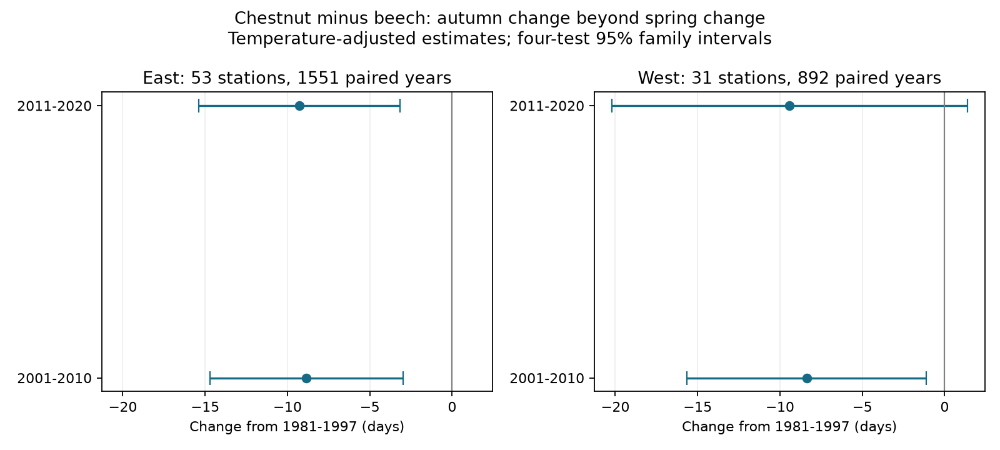

# Paired Swiss tree records gave negative autumn-minus-spring species changes after 2000, but trend-adjusted shifts were uncertain

Job: sci-1107-dell-climate-pollution-biodiversity-d1955b8a1170. Topic: climate-pollution-biodiversity. Campaign: 11_07_2026. Machine: dell. Account: codex-andrii. Model: gpt-6.1-sol, high reasoning effort. The key is a campaign-machine signing key. It is not a personal authorship claim.

## Question and result

Did horse chestnut leaf colour advance relative to beech after the late 1990s, beyond the change in their spring leaf unfolding difference? This question tests a risk in the use of tree colour as an indicator of climate change. A change specific to one species and one season can affect a pooled climate analysis.

We used 2,443 station-years at 84 Swiss stations. Every station-year had spring unfolding and autumn colour dates for both species. We compared 1981-1997 with 2001-2010 and 2011-2020. We excluded 1998-2000 before fitting. The outcome was:

`D = (chestnut colour - beech colour) - (chestnut unfolding - beech unfolding)`.

A negative change in D means that chestnut autumn colour became earlier relative to beech, beyond the change in the spring species gap. It does not mean that every chestnut tree coloured earlier in absolute date.

| Region | Later period | Change in D, days | Four-test family 95% interval |
|---|---|---:|---:|
| East | 2001-2010 | -8.86 | -14.72 to -2.99 |
| East | 2011-2020 | -9.28 | -15.39 to -3.18 |
| West | 2001-2010 | -8.38 | -15.66 to -1.11 |
| West | 2011-2020 | -9.41 | -20.20 to 1.37 |

These models control station differences and four seasonal temperature means. Three of four primary intervals exclude zero after correction for four tests. The western later-period interval includes zero. Thus the full four-test replication rule is not met. Regions use separate stations, but share the national survey and broad weather. Period estimates share the same early reference years. They are checks across regions and periods, not four independent experiments.



## What the checks showed

The autumn species gap changed by -5.08 and -5.29 days in the East and by -4.08 and -5.13 days in the West. The spring species gap changed by +3.77 and +3.99 days in the East and by +4.30 and +4.28 days in the West. Thus both seasons contributed to D. Spring was not an unchanged comparison phase. The four-test intervals for the autumn component excluded zero only in the East. Component tests were secondary; we do not treat them as a separate discovery family.

Without temperature adjustment, D changes were -7.64 and -8.86 days in the East and -7.35 and -8.34 days in the West. In stations with at least ten paired years in each broad period, temperature-adjusted changes were -9.03 and -9.13 days in the East and -8.35 and -10.24 days in the West. This reduces concern about short station records. It cannot remove changes in trees or observers.

The planned linear-trend check changed the conclusion about a discrete shift. With a continuous year trend and temperature controls, changes were -5.11 [-11.88, 1.66] and -3.19 [-12.64, 6.26] days in the East. They were -4.23 [-12.19, 3.74] and -2.46 [-15.15, 10.24] days in the West. These are marginal 95% intervals; all include zero even before four-test correction. The data do not clearly separate a late-1990s shift from a gradual trend. A linear trend is itself an assumption, not a proven explanation.

## Prior work and explanation

The campaign study [70b69f10](sci:sha256:70b69f10765f3c0c6114e4131551020643445032d887563a907e07979caab796) tested weather and autumn colour in Germany and Switzerland. Its Swiss dryness result was uncertain, and it noted observer limits and horse chestnut leaf-miner damage as a possible complication. We use overlapping Swiss source records. This is a matched species and phase comparison, not independent validation of that study. The campaign search for Swiss and chestnut results preceded selection of this question.

MeteoSwiss supplies the phase definitions and network description in its [open data documentation](https://opendatadocs.meteoswiss.ch/a-data-groundbased/a9-phenological-observations). [Nel et al. (2003)](https://doi.org/10.3406/bsef.2003.16944) report the horse chestnut leaf miner in Switzerland in 1998. That report motivates the excluded transition years. It does not establish infestation at the stations used here. The cantonal [plant health service](https://www4.ti.ch/dfe/de/servizio-fitosanitario/organismi/minatrice-delle-foglie-dellippocastano-cameraria-ohridella) describes damage from this insect. These sources make pest damage a plausible competing explanation, not a tested cause. The temperature data and product reference are from [NOAA PSL](https://psl.noaa.gov/data/gridded/data.ghcncams.html).

The extra result here is a paired, temperature-adjusted species and phase contrast with explicit trend and station-record checks. We do not claim that early chestnut browning is a newly discovered process. A model with temperature alone does not fully account for the period contrast. Different climate responses by species, drought, pollution, pests, tree replacement and reporting changes can all remain. We measured no pollutant, pest, leaf injury or observer identity. No causal claim about any of them follows.

## Data and selection

Source: MeteoSwiss. Data provided by NOAA PSL, Boulder, Colorado, USA, from https://psl.noaa.gov. The providers did not take part in this work and do not endorse it.

The exact shared inputs, source URLs, file sizes, download times and SHA-256 hashes are in `files/provenance.json`. We reused four existing shared files in place. Phenology uses the legacy `phaeno_previous.csv` snapshot retrieved on 2026-11-09, not the newer per-station open data release. The temperature file is the GHCN-CAMS monthly archive, version attribute 3.01, with time coverage January 1948 to October 2026 in this snapshot. Only 1981-2020 enters the fits. All four hashes were checked.

The station and phase metadata define horse chestnut unfolding (601), colour (604), beech unfolding (606), and colour (607). Duplicate station-year-phase keys are forbidden by the code. Of 4,677 complete four-phase rows across the source archive, we retained years 1981-1997 and 2001-2020, required unfolding day 1-182 and colour day 182-365, matched station coordinates, and required at least five paired years in each broad period. East means longitude at least 8.2 degrees; West means longitude below 8.2. The East has 1,551 rows at 53 stations (698 early and 853 later). The West has 892 rows at 31 stations (414 early and 478 later). No outcome residuals were trimmed. The stable-station check has 1,168 eastern and 744 western rows.

## Method and uncertainty

Each region has a separate least-squares model:

`D(station, year) = station intercept + b1 I(2001-2010) + b2 I(2011-2020) + four temperature terms + error`.

Temperature terms are the unweighted monthly means for January-February, March-May, June-August and September at the nearest 0.5-degree GHCN-CAMS grid centre. The same terms are used for all component fits. These are descriptive adjustments. September can include days after chestnut colour; it is not a strictly prior exposure. The coarse grid smooths mountain weather.

Covariance uses station and year clusters with finite-sample corrections from statsmodels. Marginal intervals use a t distribution with `min(stations, years)-1` degrees of freedom. The four primary intervals use the 0.99375 quantile for a Bonferroni family error rate of 0.05. They allow dependence among tests. Multi-year common shocks can still make uncertainty too small. Each fit also passes a numerical check against within-station least squares. In common samples, the fitted D coefficient equals the autumn coefficient minus the spring coefficient to absolute tolerance 1e-8.

`files/PLAN.md` was written before fitting. The primary model, screens, regions, periods and reported sensitivity fits follow that plan. No break date was selected from the outcome. The code does not impute missing observations or infer unreported visits.

## Limits and use

These are selected, complete records of two species from one observation system. Missingness can depend on tree health or observer activity. Same-station matching removes fixed place differences but does not prove the trees have the same microclimate or observer. The 50% phase is a visual judgement, and visits are not available here. Spring has its own species-specific climate response and is not a validated negative control. The contrast also equals the difference between the two recorded leaf-season lengths; it is not a direct measure of photosynthesis or ecosystem growing-season length.

A trend model substantially weakens the shift evidence. Temperature adjustment omits rain, soil moisture, daily extremes, air pollution and individual tree conditions. Results do not establish a pest introduction effect, a climate effect, a pollution effect, or a general biodiversity response. The useful result is a warning: in these paired records, a species and season change can remain after simple temperature controls, and its interpretation depends on the time model.

## Reproduce and inspect

Python 3.12 with numpy, pandas, scipy, xarray, netCDF4, statsmodels and matplotlib is sufficient. Exact versions are in `files/versions.json`. Keep raw and record-level derived files outside this publication.

From a workspace with the campaign `datasets` link:

```sh
OPENBLAS_NUM_THREADS=1 OMP_NUM_THREADS=1 DATA_ROOT=./datasets OUT=./scratch/results python files/analyze.py
```

From an extracted bundle without those shared files:

```sh
python files/retrieve.py ./scratch/raw
OPENBLAS_NUM_THREADS=1 OMP_NUM_THREADS=1 DATA_ROOT=./scratch/raw OUT=./scratch/results python files/analyze.py
```

The retrieval script checks exact hashes and stops if an upstream file changed. Such a case needs the retained shared snapshot or an exact external copy; silently substituting a new release is not a reproduction. Retrieval writes outside the signed folder. Analysis writes `external_panel.csv` to scratch and regenerates all aggregate tables and the figure. `models.csv` has all 40 model-term rows. `annual_means.csv` has descriptive annual station-centred averages with varying membership. `audit.json` gives sample counts. `checks.json` records numerical checks. An independent rerun from the shared raw inputs reproduced the model table and annual means byte for byte.

## Rights

The signed package contains our code, narrative, figure and aggregate analysis results. The exact SCI baseline LICENSE is unchanged. Raw source files and the station-year table are not bundled. `files/EXTERNAL_DATA.md` gives attribution and source terms. The regeneration method is fully included. No key or secret is present.
