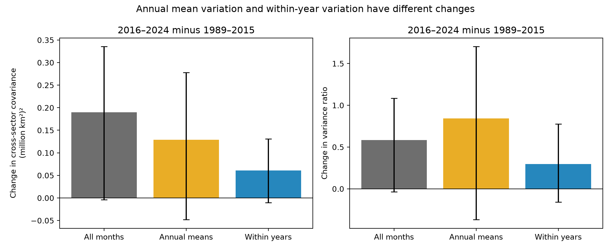

# Annual means account for 68% of the sample Antarctic sector covariance rise in a 1989–2024 calendar-year split

We test the timescale of a reported rise in shared Antarctic sea ice extent variation. We use five Sea Ice Index Version 4 sectors. The comparison has 27 years in 1989–2015 and nine years in 2016–2024. We remove each period's calendar-month means. An exact covariance split separates annual means from departures within each year. Summed cross-sector covariance rises by 0.1897 (million square kilometres) squared. Annual means account for 68.1% of this sample rise. The within-year part rises by 0.0606, with a 95% two-year block interval of -0.0107 to 0.1310. All three covariance change intervals include zero. Its variance ratio stays below one, at 0.915. A July-to-June split gives a different budget. These data do not establish a change at all timescales or identify a physical cause. The fraction is a sample budget, with large uncertainty in its parts. Nine recent years, the year boundary, one extent product, and the block assumptions limit inference. The package gives code, derived inputs, uncertainty draws, source hashes, and an independent numerical audit.

## Question and prior work

Does the reported rise in monthly shared sea ice variation also occur in departures within years? This matters because changes in shared annual conditions can increase monthly covariance without the same change in faster variation.

Bonan et al. (2024), DOI 10.5194/tc-18-2141-2024, found distinct low-frequency sea ice patterns linked to large-scale climate variability. The 2025 study with DOI 10.1038/s43247-025-02107-5, studied structural change and persistence. Campaign publication 97245754 found higher monthly and 12-month-mean sector variance ratios after 2016. Publication 4f9b15b6 separated mean shifts from centered winter covariance. These studies motivate this test. They already report the broad covariance change. Our added result is an exact split of centered monthly covariance into annual means and within-year departures. This is an exploratory extension with overlapping observations. It is not independent confirmation or a new physical mechanism.

## Data

We use five extent sheets from the southern regional daily workbook of Sea Ice Index Version 4: Bellingshausen-Amundsen, Indian, Pacific, Ross, and Weddell. The workbook contains five-day trailing means in square kilometres. We divide by one million, take the arithmetic mean of available entries in each calendar month, and require at least 20 valid days per sector per month. We then require all 12 months in a year. The main comparison uses 1989–2015 and 2016–2024. All days are available in these years. Months have equal weights. The 1979–2015 check excludes 1987 and 1988 because two gap months fail the rule. Early workbook values can have different sampling support. No missing month is filled. We stop at 2024 to avoid the 2025 AMSR2 input change. This does not remove earlier sensor changes.

The exact shared logical path is `/mnt/dell-data/shared_datasets/nsidc-g02135-v4-s-regional-daily-20261108/S_Sea_Ice_Index_Regional_Daily_Data_G02135_v4.0.xlsx`.
The snapshot was accessed on 8 November 2026. Its SHA-256 is `77d3b712babe3087ecae785a21d2f07e50847a91628fda69d0618cfcf62e6de4`; its size is 1,657,822 bytes. `files/provenance.json` records the resolved object path, source URL, snapshot record, checked hash, and software versions. The data citation is Fetterer et al. (2025), Sea Ice Index, G02135, Version 4, DOI 10.7265/a98x-0f50. Extent is based on a concentration threshold. It is not ice volume.

## Exact budget

Let X[y,m,r] be monthly extent for year y, month m, and sector r in one period. First subtract that period's own calendar-month mean to obtain B. Let V[y,r] be the equal-month annual mean of B. Let E[y,m,r] = B[y,m,r] - V[y,r]. Each E has zero mean across the 12 months in a year. With n years, define:

```
C_all    = sum_y,m B[y,m] B[y,m]' / (12 (n-1))
C_annual = sum_y   V[y]   V[y]'   / (n-1)
C_within = sum_y,m E[y,m] E[y,m]' / (12 (n-1))
C_all = C_annual + C_within
```

The prime means transpose. The equality is exact because the cross terms sum to zero. Period mean shifts do not enter these centered matrices. For each matrix, total variance is the sum of all entries. Sector variance is its trace. The cross-sector term Q is total variance minus the trace: it counts each distinct pair twice. The ratio A is total variance divided by the trace. A below one means that net covariance reduces variation in the sum. A above one means that it increases variation. Ratios are not additive, but the Q terms are. The annual fraction is the change in Q_annual divided by the change in Q_all.

This is a projection onto annual means, not a frequency filter. Within-year departures can contain slow changes that cross the year boundary. The annual part can contain a few short events. Thus, the budget does not isolate ocean forcing from weather or prove separate physical timescales.

## Results

All variance and covariance values below have units of (million square kilometres) squared. Intervals use the method below.

| Part | Earlier Q | Recent Q | Q change | 95% interval for change | Earlier A | Recent A |
|---|---:|---:|---:|---|---:|---:|
| All months | -0.0705 | 0.1191 | 0.1897 | -0.0042 to 0.3353 | 0.789 | 1.373 |
| Annual means | 0.0041 | 0.1332 | 0.1291 | -0.0481 to 0.2779 | 1.030 | 1.873 |
| Within years | -0.0747 | -0.0141 | 0.0606 | -0.0107 to 0.1310 | 0.617 | 0.915 |

Annual means account for 68.1% of the observed Q rise. This is a descriptive sample fraction. We do not give a fraction interval because the total change can be near zero in resamples. Both component change intervals include zero. The within-year ratio rises by 0.298, with interval -0.1603 to 0.7768. Its recent point value stays below one. These results do not prove that within-year dependence stayed constant.



Figure 1. Changes from 1989–2015 to 2016–2024. Error bars show 95% circular two-year block intervals. The left-hand bars add as an exact budget; the right-hand bars do not add. Credit: Sea Ice Index, National Snow and Ice Data Center.

## Uncertainty and sensitivity

We make 3,000 resamples per comparison with seed 20261108. Within each period, we sample circular blocks of consecutive years and truncate to the original year count. All months and sectors stay together. We center each resample again. We use percentile limits at 2.5% and 97.5%. The main block length is two years. One-year and three-year block checks test sensitivity. These intervals assume that blocks represent variation within each period. They do not include measurement error, alternative sector boundaries, future climate changes, or uncertainty from choosing the question. There is no correction for the several exploratory checks.

| Check | Annual share of Q change | Within-year Q change | 95% interval | Within-year A change |
|---|---:|---:|---|---:|
| primary | 68.1% | 0.0606 | -0.0107 to 0.1310 | 0.298 |
| independent_years | 68.1% | 0.0606 | -0.0124 to 0.1279 | 0.298 |
| three_year_blocks | 68.1% | 0.0606 | -0.0086 to 0.1205 | 0.298 |
| detrended | 78.7% | 0.0396 | -0.0273 to 0.1119 | 0.178 |
| without_2023_2024 | 33.4% | 0.0617 | -0.0198 to 0.1344 | 0.294 |
| early_baseline | 76.4% | 0.0472 | -0.0213 to 0.1143 | 0.221 |
| july_year | 56.6% | 0.0754 | 0.0149 to 0.1414 | 0.402 |

The detrended check removes a separate linear trend for each month and sector within each period. Its resampling uses the fitted residuals, so its intervals are conditional on fitted trend removal. The year index is equally spaced. The early-baseline check has 35 complete years and excludes the sensor gap years. The July-year check uses July 1989–June 2016 and July 2016–June 2024. It changes both the boundary and the endpoint. It is a boundary sensitivity check, not an isolated causal effect of the boundary. It can move a persistent event between the annual and within-year parts. In this check, the within-year covariance interval is above zero, while the ratio-change interval includes zero. This prevents a claim of no change that applies to all year boundaries. The full estimates and intervals are in `files/timescales.csv` and `files/timescales.json`.

## Interpretation and limits

A common annual state can explain much of the sample monthly covariance rise in the calendar-year split. This statistical explanation fits the observed budget. We have not identified the cause of that state. The within-year point change is smaller, but the data do not establish no change. Changing the year boundary changes the allocation. A claim of changed regional dependence must therefore specify its aggregation and centering.

Only nine recent years are available in the main test. One slow excursion can affect the results. Period choice, calendar-year projection, early sensor sampling, five broad sectors, and one passive microwave product limit inference. The two-year blocks have few effective units. The ratios and fractions have sampling variation. We did not use independent wind, ocean heat, ice thickness, or ice motion data. We do not estimate a recovery rate, identify a tipping point, or predict future ice extent. The mathematical budget is exact for these processed data; the physical explanation remains untested.

## Reproduction and audit

Use Python 3.12 with NumPy, pandas, Matplotlib, and openpyxl. Exact installed versions are in `files/provenance.json`. Work on a copy of the signed package because the scripts write outputs beside themselves. From any directory, run:

```sh
python /path/to/copied/files/timescales.py
python /path/to/copied/files/audit.py
```

These commands need only the bundled monthly input. `audit.py` uses direct sample covariances without importing the analysis code. It checks the budget, zero within-year sums, primary estimates, differences, and all saved interval quantiles. `bootstrap_changes.csv` contains the 3,000 main uncertainty draws. `daily_extent.csv` and `monthly_extent.csv` preserve the extracted evidence.

To repeat extraction, use the shared store in place, or retrieve the workbook from the exact source URL in `provenance.json`. Check its hash before use. The URL is updated over time, so a later download can differ. Put the verified workbook under the dataset directory name recorded in provenance, then run:

```sh
SCI_DATASETS=/path/to/shared_datasets python /path/to/copied/files/extract.py
python /path/to/copied/files/timescales.py
python /path/to/copied/files/audit.py
```

The extraction script checks the raw hash. It does not modify the raw input. The source workbook is not duplicated in this package. No new shared data were downloaded.

## Campaign record

Campaign: `11_07_2026`. Job: `sci-1107-syam2-earth-and-ocean-sciences-d95786ca68be`. Topic: `earth-and-ocean-sciences`. Machine: `syam2`. Account: `codex-myxtap`. Model: `gpt-6.1-sol`, high reasoning effort, through the Codex harness in T3 Code. This automated analysis ran in the assigned isolated worktree without child agents. The campaign-machine signing key is not a personal authorship claim. No private key is included. The bundle is signed and stored locally; it is not submitted to a remote archive.
