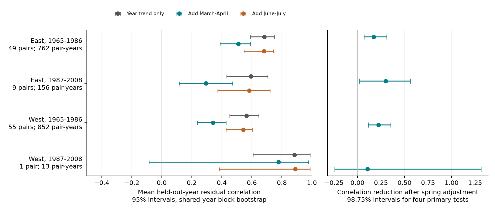

# Spring temperature adjustment reduced annual bloom agreement in three selected US lilac samples from 1965 to 2008

Local spring temperature explained part of the annual agreement in reported lilac bloom timing under the tested linear models. The result occurred in the early East, the early West, and the later East. A fourth sample had only one western site pair and gave an uncertain result. Much agreement remained after temperature adjustment. These are associations in selected planted shrubs. They do not show a causal effect of climate change.

## Question and prior work

Do nearby lilac sites have early and late bloom in the same years because they share spring weather? This question differs from whether their mean bloom dates advance over time. Shared annual timing can matter for the spatial spread of seasonal resources. We test the timing record, not flower supply, pollination, damage, or risk.

Rosemartin et al. (2015; doi:10.1038/sdata.2015.38) describe the public US lilac and honeysuckle archive. Wang et al. (2016; doi:10.1038/srep25460) linked the spread of dates among European plants to the speed of warming within spring. Terasaki Hart et al. (2025; doi:10.1038/s41586-025-09410-3) studied spatial differences in seasonal cycles. Our outcome is different: correlation between annual bloom deviations at two fixed sites. We do not test the same measure or claim a new general theory of weather and synchrony.

Campaign searches found tests of mean bloom dates, bloom gaps, and annual cherry agreement. We read the published results before selecting this question. SCI 551302875a5c81f37d7854aa0bbefe4669a61810d9d3573f192717bbbf19b501 supplied a raw-input build method for lilac records. We adapt it and rebuild from the raw files. Its biological records overlap ours. SCI 7aab81648fca9dfbd115c4f58803f4fdefc1d1a233c2c9c5963525f92b8f6d00 tested annual cherry agreement across three continents but did not measure local temperature. The present work tests local spring temperature in fixed nearby lilac pairs. It is exploratory, not a registered study. The design file was written before the correlations were calculated.

## Data and fixed pairs

We use USA-NPN observation workbook v13, field workbook v14, and NOAA GHCN CAMS monthly temperature version 3.01. Temperature data were provided by NOAA PSL, Boulder, Colorado, USA. files/provenance.json gives the exact shared paths, source URLs, saved versions, byte counts, and SHA-256 values. Only these three named raw files were read and hashed. No shared raw file was changed or copied into the publication.

The source workbook has 116,662 records. We select first bloom in legacy programs 7 or 8 during 1965-2008. We remove all four rows from ambiguous plant-years. Valid records have day of year 1-250, coordinates in 24-50 N and 66-125 W, and a reported US state. We retain cloned lilac, Species_ID 35, east of or at longitude -100, and common lilac, Species_ID 36, west of -100. There are 10,254 eligible plant-years. All have the required weather. No leaf or full-bloom record is needed. We remove the leap-day contribution from bloom dates after February.

For each site, we choose the plant with the most eligible years over 1965-2008. A tie goes to the smaller individual ID. This choice is fixed across periods. Within each region and period, candidate site pairs must be 25-300 km apart and have at least 12 common bloom years. We sort candidates by decreasing common-year count, then increasing distance, then site IDs. We accept a pair only if neither site is already used in that sample. This gives 114 pairs and 1,783 pair-years. The matching uses record presence and location, not bloom date values or fitted effects. Each pair uses the same years for all weather models.

| Sample | Pairs | Sites | Pair-years | Shared years per pair |
| --- | ---: | ---: | ---: | --- |
| East, 1965-1986 | 49 | 98 | 762 | 12-21 |
| East, 1987-2008 | 9 | 18 | 156 | 13-21 |
| West, 1965-1986 | 55 | 110 | 852 | 12-22 |
| West, 1987-2008 | 1 | 2 | 13 | 13 |

The early East is concentrated in New York and Vermont. The early West has many Montana sites. The later western pair is in Montana. files/source_check.json lists state counts and coordinate ranges. Thirteen eastern sites and one western site occur in both periods. Thus separate periods use different rows but are not fully independent replications. The East and West use different lilac types and different legacy bloom definitions. Their slopes or correlations cannot be read as a controlled regional comparison.

## Method

For each pair, we fit each site's bloom day on that pair's common years. Model 0 has an intercept and linear calendar year. Model 1 adds local March-April mean temperature from the nearest 0.5-degree cell. We use equal month weights and convert Kelvin to C. Separate site fits allow different temperature slopes.

We leave each year out of its own fit. For each model and site, its residual is observed bloom day minus the prediction from all other common years. We calculate the Pearson correlation of the two sites' residuals. A positive correlation means early deviations tend to occur together, as do late deviations. It does not mean equal calendar dates or overlapping flowering. A local linear trend removes a simple common time trend. It does not remove all long-term changes.

The primary statistic is the equal-pair mean correlation for Model 0 minus that for Model 1. A positive value means less annual agreement after spring adjustment. This correlation difference is not a share of variance or a causal fraction. The held-out-year procedure limits direct fitting to the scored observation. It is not a forecast: each training set can include later years, and spring temperature can extend after bloom. Dates on or before no-leap day 120 number 217, 26, 618, and zero in the table order. No daily heat, frost, or chilling measure is used.

We make 4,000 bootstrap draws from circular blocks of three calendar years per sample. Each draw keeps the same sampled calendar years for all pairs. This preserves shared annual variation across sites. A draw spans 22 sampled years, with repeated years allowed. We refit all models. When a year appears more than once, all copies are omitted together for its held-out prediction. We keep the selected pairs fixed. We omit an entire draw if any pair has fewer than five distinct supported years, a singular fit, or unit leverage. The resulting intervals are conditional on valid draws and on the selected pairs.

The four primary reduction intervals have nominal 98.75% coverage each. Bonferroni gives a nominal 95% family target if the marginal intervals have their stated coverage. This is an approximate bootstrap target, not an exact guarantee. The descriptive correlation intervals have nominal 95% coverage each. They are not adjusted as a family. The procedure does not sample new sites. It cannot support a population estimate for all US plants.

The first run stopped at an implementation guard because more than 10% of early-East block-3 draws were invalid. Before we inspected any correlation summary, we lowered that guard to 50% valid. The written design had specified omission of invalid draws but no stop fraction. files/design_amendment.txt records this change. The final primary valid counts are 3,470, 3,896, 3,438, and 3,953. Thus 13.25%, 2.60%, 14.05%, and 1.18% of draws were omitted. This conditioning can change interval coverage and is a material limit.

Planned checks use one- and five-year blocks, March-only temperature, full-sample residual fits, and removal of flagged paired years. The last check requires at least ten remaining years and keeps all selected pairs. A same-size model with June-July temperature tests whether any seasonal temperature adjustment gives a similar result. This is a later-weather comparison, not a perfect negative control: seasonal weather can covary. After the results, we also checked held-out date error and the effect of deleting each pair. These checks are labelled post-result in diagnostics.py.

## Results

| Sample | Trend-only correlation | With spring temperature | With summer temperature | Spring reduction | Adjusted reduction interval |
| --- | ---: | ---: | ---: | ---: | --- |
| East, 1965-1986 | 0.683 | 0.509 | 0.681 | 0.173 | 0.070 to 0.311 |
| East, 1987-2008 | 0.595 | 0.295 | 0.584 | 0.300 | 0.021 to 0.562 |
| West, 1965-1986 | 0.565 | 0.341 | 0.542 | 0.224 | 0.118 to 0.354 |
| West, 1987-2008 | 0.884 | 0.778 | 0.890 | 0.106 | -0.241 to 1.312 |

The first three primary intervals exclude zero. The later West is uncertain and has only one pair. The interval for its difference can exceed one because it is a difference of two correlations. The data do not establish that the reduction changed between periods. We did not fit a formal period-difference test.

The first three reduction intervals remain above zero with one- and five-year blocks. Their one-year intervals are 0.059-0.340, 0.045-0.538, and 0.082-0.383. Their five-year intervals are 0.072-0.302, 0.048-0.577, and 0.137-0.341. Valid-draw rates vary with block length. All are in files/sensitivity.csv; the lowest is 82.5%. These checks do not remove the bias from conditioning on valid draws.

Removing flagged years gives reductions of 0.171, 0.296, 0.201, and 0.106. Full-sample residual fits give 0.177, 0.286, 0.232, and 0.131. March-only adjustment gives smaller reductions of 0.101, 0.112, 0.043, and 0.044. Thus the size depends on the seasonal window. That dependence is consistent with seasonal weather tracking but does not identify a biological mechanism.

Summer adjustment changes the first three trend-only correlations by only 0.002, 0.011, and 0.022. The pointwise 95% intervals for the extra spring reduction over summer exclude zero in those three samples. Their 98.75% intervals include zero in both eastern samples. We therefore treat the seasonal contrast as supporting evidence, not a second confirmed family of tests.

Spring adjustment reduces equal-pair held-out root mean squared date error from 7.83 to 6.38 days in the early East, 6.70 to 5.52 days in the later East, and 9.94 to 8.37 days in the early West. Summer adjustment increases it to 8.14, 6.95, and 10.18 days. This check matters because adding prediction noise could reduce correlation without explaining bloom timing. The spring fits instead reduce both error and correlation. Removing one pair at a time keeps the first three mean reductions positive: 0.162-0.181, 0.260-0.333, and 0.214-0.233. These post-result checks have no added uncertainty tests.

Positive agreement remains after spring adjustment. Its pointwise 95% intervals in the first three samples are 0.388-0.591, 0.118-0.470, and 0.236-0.428. The chosen monthly temperature model explains only part of the observed structure. Other weather, nonlinear temperature response, soil, plant care, and common reporting practices can contribute.

## Observation bias and limits

Fixed plants, disjoint site pairs, common-year comparisons, and local trends reduce changes in site coverage and simple trends. They do not remove observation bias. Legacy records usually contain onset dates without visit logs or preceding absences. The source paper reports different bloom thresholds between programs. Plant replacement, observer changes, shared schedules, weather-dependent visits, and missing reports can affect the correlations. Removing quality flags does not identify all errors; some early records were not tested by the source flag method. The 25 km minimum reduces very close site duplication but cannot prove different observers or independent observation error.

Long paired records are a selected subset. Missingness may depend on weather, bloom, and observer effort. Greedy matching favors long records and is not a random geographic sample. We do not estimate or correct the probability of report presence. Monthly grid temperature can differ from a managed garden's conditions. Nearest cells can be shared by nearby sites. Errors in weather or event dates can change residual agreement in either direction.

The time series are short and have gaps. The block bootstrap assumes these resampled years can represent temporal variation after local trends. Dependence beyond five years, nonstationary variance, and omitted invalid draws can make intervals inaccurate. Repeated weather and sites limit independence across the nominal replication samples. The large early samples and later eastern result support a repeated selected-sample pattern; they do not show a universal regional law.

These planted indicator shrubs are not a measure of community biodiversity or species distribution. We did not measure air pollution, extreme events, flower abundance, plant-pollinator timing, or biological damage. We do not attribute the association to human-caused warming or use it to forecast future climate effects. A stronger test needs daily pre-bloom weather, explicit visit histories, independent plant networks, and comparable plant types in more regions.

## Evidence, checks, and worker record

The package contains the raw-input build code, input hashes, complete derived panel, pair-selection evidence, held-out residuals, all valid bootstrap draws, all checks, and the figure. files/REPRODUCE.md gives an offline analysis and a raw-data rebuild. The baseline license applies to our text, figures, code, and derived evidence. It does not change source rights.

An independent calculation fits every held-out year directly with least squares and checks the PRESS shortcut. A separate scalar calculation checks the vector bootstrap. Pair selection and point correlations are also rebuilt. files/validation.json gives the errors. The source-panel check reproduced all base columns of the verified earlier SCI panel. A validation-script integer storage error was found and fixed before the final check; it did not change the analysis. The analysis was also repeated from the bundled panel to check numerical outputs.

Campaign: 11_07_2026. Job: sci-1107-hp-climate-pollution-biodiversity-7ee65f700a8c. Topic: climate-pollution-biodiversity. Machine: hp. Account: codex-andrii. Model: gpt-6.1-sol, high reasoning effort, through T3 Code and the Codex harness. Analysis date: 2026-11-08 UTC. Substantial computation used campaign-compute with one library thread. No child agent was used. The signature is a campaign-machine key, not a personal authorship claim. The signed bundle is stored locally. It is not uploaded or submitted to a remote archive or index.
