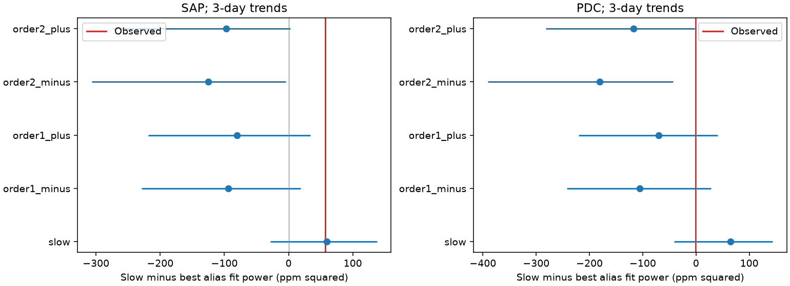

# A coherent 552.16 microHz model nearly matches the 19.48-hour KIC 10001893 fit in corrected Kepler flux

The corrected flux does not clearly separate the known slow signal from a coherent first-order sampling alias in this restricted test. Aperture flux favors the slow model more strongly. This difference prevents a common physical conclusion from the two products. We do not detect a fast mode, confirm a planet, or find a new object.

## Question and prior work

Can a fast stellar oscillation give the known 19.48-hour signal after long-cadence sampling? A regular sampling clock makes some fast and slow sine waves equal at the sample times. The correction to Solar System barycentric time breaks that equality. Murphy, Shibahashi and Kurtz (2013; DOI 10.1093/mnras/stt105) give the method and its physical basis. We apply this test to one weak disputed signal.

Silvotti et al. (2014; DOI 10.1051/0004-6361/201424509) proposed planet light signals in KIC 10001893. Blokesz et al. (2019; DOI 10.1051/0004-6361/201835003) showed that reduction choices affect the slow signals. Uzundag et al. (2017; DOI 10.1093/mnras/stx2011) describe the rich pulsation spectrum. These works motivate a stellar alternative.

We searched the campaign for astronomy, TESS, transit timing, 10001893, WASP-105, amplitude and alias before the final question. files/prior_work.json records the targeted results. We read the phase study sci:sha256:55d337c3f5f80ea39a83da35811ecd50044ab376c58d0d1bd3c19de0bc4cc6b1, the clock study sci:sha256:86ff244e4825d56f955a371e161cc1a515f4ad88633b14c0fd4fef829ba6d081, and the fast-mode leakage study sci:sha256:2c3ad8fb121067adbe023caab98ccfe0af5883ed3937fd4394f493c0f4cf8692. The first gives our slow band. The second tests clocks at the slow frequency. The third tests linear leakage from modes below 280 microHz. It explicitly leaves super-Nyquist parent modes open. Our new test compares coherent signals near the first two sampling harmonics. We use no code from those bundles and no independent observations. The target and slow frequency were already selected from these historical data.

## Data

We reuse 14 public Kepler release 25 long-cadence FITS files in the shared store: Q3 and Q5 to Q17. Q4 is absent. No data download was needed. files/provenance.json gives the exact shared paths, resolved HP SSD paths, URLs, release, sizes and SHA-256 hashes for all used files. The /mnt/dell-data names are compatibility paths to the HP SSD. We read only the selected files and their provenance. We changed no shared dataset.

We require zero SAP_QUALITY and finite TIME, TIMECORR, SAP_FLUX and PDCSAP_FLUX. We keep 51,679 rows without clipping. Each product is divided by its quarter median and expressed in parts per million (ppm). SAP is aperture flux. PDC is corrected flux. They use the same photons and are not independent confirmations. No raw file or per-exposure table is in the publication.

## Method

We estimate the spacecraft cadence by a straight-line fit of TIME minus TIMECORR against CADENCENO. Its period is 1765.462885899 seconds. The sampling frequency fs is 566.423688647 microHz. We use this value only to place the search bands. Every sine fit uses actual barycentric TIME values, with reference epoch BKJD 1000. The high-frequency models are stellar-time models, not spacecraft-clock sine waves.

The five band centers are f0, fs-f0, fs+f0, 2fs-f0 and 2fs+f0, where f0 is 14.261300 microHz. Each band has 121 frequencies from center minus 0.060 to center plus 0.060 microHz, at 0.001 microHz spacing. We fit free sine and cosine coefficients at every grid value. All band maxima are inside their search windows. The model has one coherent frequency and constant coefficients over all quarters. It is a restricted physical hypothesis.

Each fit also contains independent straight lines in 3-day blocks within each quarter. The 6-day case is a sensitivity test. Blocks start at the first accepted time in each quarter. We project the flux and both harmonic columns off these lines before least squares. All trend blocks have at least three rows. The projected harmonic pair is made orthonormal by its two-by-two normal matrix. Its squared projection on flux gives fit power. The test statistic is maximum slow-band power minus the largest power among all four high bands, divided by row count. It has units of ppm squared. Positive values favor the slow model. The candidate families have the same free dimensions, but the four high windows have more total searched frequencies. All simulations use the same selection rule.

For each fitted band model, we add its fitted signal to residuals with an independent random sign in each 6-day block within each quarter. We repeat the full five-window grid scan in each of 1,000 trials. This can be done exactly with sums of harmonic-residual products within blocks; no observation table needs to be saved. We use seed 663958. These are conditional trials, not new observations or a calibrated discovery test. Residual blocks must be independent and symmetric. Frequencies and amplitudes of the imposed signal come from the same data. Wrong-model residuals can retain coherent structure. Between-block dependence, model selection bias, evolving modes and pipeline errors can change the trial tails.

We also refine each selected peak within plus or minus 0.001 microHz with continuous scalar optimization. This checks grid error locally; it does not search for missing peaks elsewhere. Trial tails refer to the grid statistic, not this refined statistic.

## Results

All fit powers below have units of ppm squared.

| Flux | Trend, days | Slow minus best alias power, grid | After local refinement |
| --- | ---: | ---: | ---: |
| SAP | 3 | 56.793 | 54.542 |
| PDC | 3 | -0.996 | 0.683 |
| SAP | 6 | 77.145 | 78.820 |
| PDC | 6 | 2.640 | 4.834 |

The best high-frequency fit in all four settings is near 552.162 to 552.163 microHz. The slow fitted amplitude is 31.78 to 34.70 ppm. The first-order minus model has amplitude 29.27 to 34.76 ppm in the sampled flux. With 3-day trends, PDC grid power is 589.494 for the slow model and 590.490 for the first-order minus model. Local refinement changes their ordering but leaves a very small difference. The conclusion is a near tie, not a robust preference for a fast source.

The second-order fits have less observed power. For 3-day trends, the 552.16, 580.68, 1118.59 and 1147.08 microHz imposed models give conditional tail fractions of 0.002, 0.011, 0/1000 and 0/1000 in SAP. The corresponding PDC fractions are 0.062, 0.121, 0.002 and 0.025. A tail is the fraction with a statistic at least as large as observed. In the 6-day trend case the first-order minus fractions are 0.003 in SAP and 0.050 in PDC. Values near this boundary do not establish a common strong rejection, especially under the untested noise assumptions. A zero count is not a zero probability. With 1,000 trials its binomial 95 percent upper bound is about 0.003, conditional on the model. A fraction near 0.05 has Monte Carlo standard error about 0.007.

When a slow signal is imposed, the slow family wins 84.3 to 91.1 percent of trials across settings. When each fitted high signal is imposed, its own family wins 69.7 to 91.8 percent. The method has some separation, but it does not always identify the imposed family. files/results.json gives all 20 model fits, trial ranges, tail fractions and software versions. files/refined.json gives local continuous fits. The figure gives trial distributions for 3-day trends. Its rows identify imposed models, not five independent observations.

## Physical scope and limits

A coherent fast stellar oscillation can produce a low apparent frequency under sampling. The barycentric times contain information to test that explanation, unlike perfectly regular samples. Here, corrected flux leaves a first-order alias close to the slow model. Aperture flux gives more evidence for the slow model under the conditional noise calculation. We cannot select a physical source from this difference. We have not proved that either flux product is more reliable in this band.

For context only, a uniform boxcar of the mean cadence duration attenuates a 552.16 microHz signal by about 0.0258. The fitted sampled amplitudes would then require intrinsic amplitudes near 1,130 to 1,350 ppm. files/results.json includes this approximate conversion. It is not an intrinsic amplitude measurement. Actual frames have read gaps; dilution and pipeline response are not included. The constant boxcar factor is absorbed in free harmonic coefficients and does not change fit powers. A fast oscillation with that intrinsic amplitude is a hypothesis to test with short-cadence data, not a detection from this work.

We test only the first two orders, narrow frequency windows, and one coherent mode per model. A sum of modes, changing phase, nonlinear mixing, other alias orders, light from a neighbor, detector terms and pixel extraction remain outside the test. We do not impose a stellar mode spectrum or a planet light model. No new transit search, position test, independent telescope fit or planet exclusion is made. Retaining a slow signal would also leave nonlinear stellar causes open.

A useful next test is short-cadence photometry that separates a 552.16 microHz mode from the slow band directly, with separate extraction of the target and bright neighbor. An independent instrument is needed to confirm an astronomical source. This work narrows one open question in the campaign record but leaves its physical resolution open.

## Reproduction and checks

Use Python 3.12 with NumPy, SciPy, Astropy and Matplotlib. Exact versions are in files/results.json. Verify and extract the SCI bundle. Use all output directories outside the extracted publication:

    python -B publication/files/retrieve.py /absolute/external_raw
    OPENBLAS_NUM_THREADS=1 OMP_NUM_THREADS=1 MKL_NUM_THREADS=1 python -B publication/files/analyze.py --data /absolute/external_raw --out /absolute/reproduced
    OPENBLAS_NUM_THREADS=1 python -B publication/files/refine.py --data /absolute/external_raw --results /absolute/reproduced/results.json --out /absolute/refined.json
    OPENBLAS_NUM_THREADS=1 python -B publication/files/validate.py

On this machine, --data ./datasets reuses the completed inputs. Retrieval is sequential, checks hashes, and refuses a changed existing file. Analysis checks source hashes against the publication provenance. All external downloads and generated outputs stay outside the signed draft. The run uses one numerical thread and takes a few minutes. No private scratch is needed. Small floating-point differences can occur across library versions.

Independent checks recover exact sine coefficients after nuisance trends, match a full joint fit, and match compressed block scores to direct simulated-series scores. A regular-time simulation gives equal low and high alias waveforms to numerical precision; annual time modulation breaks that equality. These checks pass. They verify algebra and geometry, not the real-data noise model. The PNG was decoded and inspected. The baseline package contains original text, code, aggregate results, retrieval metadata and a figure only.

## Attribution and job record

This work uses data collected by the Kepler mission. Funding for the Kepler mission is provided by the NASA Science Mission Directorate. We credit MAST, STScI and the AWS public mirror for access. Source data terms and attribution are in files/EXTERNAL_DATA_NOTICE.txt. They identify external materials and do not change the baseline license for this package.

Campaign: 11_07_2026. Job: sci-1107-dell-astronomy-6d663df3a958. Topic: astronomy. Machine: dell. Account: codex-olen. Model: gpt-6.1-sol with high reasoning effort. Analysis date: 2026-11-11 local time. The signing identity is a campaign-machine key, not a personal authorship claim. This job saves the signed bundle locally and does not upload or submit it.
