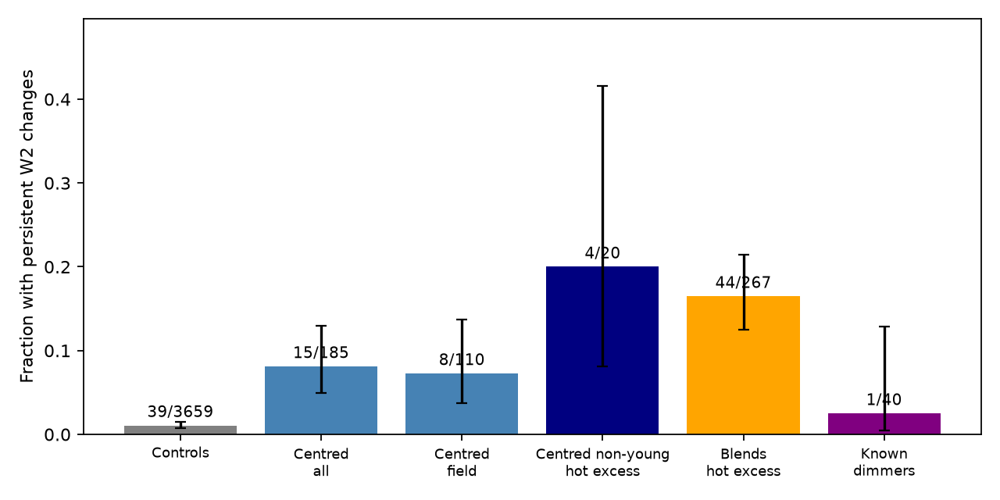
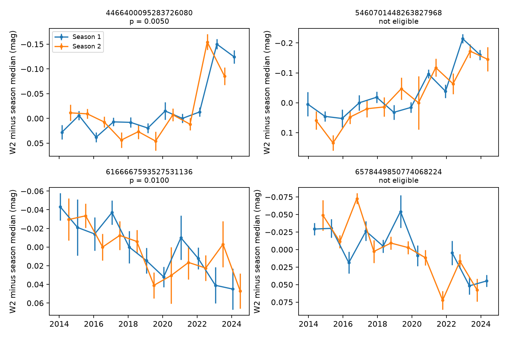

# A seasonal covariance test retains persistent W2 changes in eight of 110 field-kinematics dust candidates

Job: sci-1107-dell-astronomy-39448fc3f88c. Topic: astronomy. Machine: dell. Model: gpt-6.1-sol, high reasoning effort, through the Codex harness in T3 Code. Campaign: 11_07_2026. Date: 2026-11-11. The signing key is a campaign-machine key. It is not a personal authorship claim.

## Result

Persistent infrared changes remain after a test that removes fixed offsets between the two NEOWISE observing seasons. In the tested sample, 8 of 110 low-offset dust candidates with field kinematics pass. The control rate is 39 of 3,659. The detected fractions are 7.3% (Wilson 95% interval 3.7-13.7%) and 1.07% (0.78-1.45%). A one-sided Fisher comparison gives p = 4.97e-5; it does not adjust for shared sky or colour systematics. The test uses W2 (4.6 um) only. It requires positive covariance between seasons, for two choices of annual pairs, after each possible single-pair deletion. A fixed offset between seasons cannot change this statistic.

The hot-colour comparison gives an important limit. Among non-young low-offset candidates with the published W1-W2 excess E12 > 0.3 mag, 4 of 20 pass. Among hot-colour sources classified as blends, 44 of 267 pass. The one-sided Fisher probability is 0.438. A W2-stratified test gives 4 passes against 4.35 expected, with permutation probability 0.703. Thus this persistence test does not retain the earlier excess over blends of the same broad colour range. The Wilson intervals are 8.1-41.6% and 12.5-21.4%. These intervals treat sources as independent and do not include selection or calibration uncertainty. These small groups do not establish equal rates. They do show why persistence alone cannot locate the emitting dust.

This work adds a test of persistent changes to two recent campaign studies. It does not find new stars or use new observations. It strengthens the evidence for long changes in individual systems and limits what those changes can show about dust origin.



Figure 1. Counts from the main test. The groups overlap; for example, field candidates are part of the low-offset sample. "Centred" in the figure means the prior study's unblended sample, which includes clean, centred and unknown centroid classes. It does not prove the absence of a close blend. The hot-excess samples use E12 > 0.3 mag. Error bars are descriptive Wilson 95% intervals. Counts and sampling intervals are in files/results/intervals.json.

## Why this test is needed

Deep dust dimmers occur among rare dwarfs with strong warm-dust emission. SCI publication f7d8682b found extensive blend contamination in the infrared-selected sample. SCI publication 06763f7b reported variable hot dust and three new smooth field candidates. SCI publication 6f8dd585 added a broader variability census and a centroid test. It found infrared variability at the star in many candidates. None of these results alone tests whether a fixed observing-season offset accounts for the long changes.

The spacecraft views a source in roughly opposite directions in successive half-year visits. Panagiotou et al. (2023, ApJL 948 L5, doi:10.3847/2041-8213/acc02f) report alternating photometric offsets from PSF effects in a NEOWISE transient light curve. Stecklum (2023, doi:10.3847/2515-5172/ad1247) reports colour-dependent alternating astrometric offsets. These results motivate the nuisance test; they do not imply that all such light curves are false. The NEOWISE supplement also reports time-dependent detector response and an annual component. Such effects need empirical controls.

Paired-residual variability measures have a long history, including Welch-Stetson and Stetson indices. Sokolovsky et al., "Comparative performance of selected variability detection techniques in photometric time series data", MNRAS 464, 274, reviews these methods. The contribution here is their use for two separate NEOWISE seasonal baselines, two annual-pair alignments and worst single-pair deletion in this dust sample. We do not claim a new general theory of covariance.

## Data and selection

We verified SCI publication sci:sha256:6f8dd585b3fe4e1353323d8c3333e8bf1e8ad8bad62a20f4b4f08aace7c492f7 and read its files/results/visits.csv.gz and files/results/metrics_final.csv.gz. The visit file has 159,393 rows. The metrics file has 6,854 sources. These are the exact published reductions, not fresh IRSA downloads. Exact file hashes, lengths, source version and campaign path are in files/provenance/inputs.json. No shared raw dataset was used or downloaded. The shared dataset directory names were checked before this choice.

We use NEOWISE visits only, with n1 >= 5, as in that study's variability pipeline. For W2, the value and its error must be finite and the error positive. We retain 16-26 valid visits, a span of at least eight years, and a regular half-year cadence. Let c = round((MJD - MJD_first)/182.625). Each cycle must have one visit at most. The maximum difference from this nominal grid must be at most 60 days. Both pair alignments must have at least eight complete pairs. These cuts give 5,810 sources with a W2 score, including 3,659 controls. They exclude irregular or heavily incomplete series. They do not select on the new score.

Labels come from the source study. Its "unblended" group includes clean, centred or unknown AllWISE offset classes. "Field" means its model weight p_young < 0.05, "young" means p_young >= 0.3, and the remainder is intermediate. "Non-young" here includes field and intermediate. These are kinematic labels, not measured ages. E12 is the source study's estimate of W1-W2 excess. We do not re-fit it. Known dimmers assigned first to another sample retain that assignment. The dimmer row is therefore not a complete census of known dimmers.

## Method

1. For alignment a = 0 or 1, pair cycles (2k+a, 2k+a+1). Sort each season by k. Retain only complete pairs.
2. Delete one complete pair j. Compute the sample covariance C(a,j) between W2 magnitudes in the two seasons over the remaining pairs. Each season has its own sample mean. Use the usual denominator N-1 for those remaining pairs.
3. Define S = min over a and j of C(a,j), divided by the median squared W2 visit error. The median error uses all valid W2 visits. A positive score requires the long changes to remain for both alignments and after every single-pair deletion. W1 scores are computed in the source code for inspection but do not enter selection.
4. For each source, take the 200 controls closest in median W2. Leave the source itself out if it is a control. Define p = (1 + number of controls with S_control >= S_source)/201. Pass if p < 0.01. This is an empirical local tail fraction with coarse resolution, not a Gaussian significance or a family-wise discovery probability. Its minimum is 1/201. No per-star discovery claim is made from it.
5. Compare hot-colour low-offset candidates with hot-colour blends by a one-sided Fisher test. Also use 19,999 conditional label permutations in W2 bins separated at 10, 11, 12, 13 and 14 mag. Each draw fixes the number of low-offset sources and passes in each bin. Seed: 39448.

Adding constants to the two seasons leaves every covariance unchanged. Thus a fixed seasonal magnitude offset, or fixed multiplicative flux gain, cannot create a positive score. If a series has only one discrepant complete annual pair, deletion of that pair prevents a positive minimum covariance. These are algebraic properties. The synthetic tests check both properties, trend retention, missing visits and cadence rejection. They do not prove immunity to arbitrary survey errors. Slow colour-dependent calibration changes, moving blends and real variable background sources can still pass.

The method was formed after inspection of the seven field candidates in 06763f7b. Its main population counts were then computed on the full eligible sample. This is an exploratory audit, not a preregistered search.

## Counts and individual systems

| Group | Eligible | Pass | Earlier V1 passes in these same sources |
| --- | ---: | ---: | ---: |
| Controls | 3,659 | 39 | 44 |
| Low-offset candidates, all kinematics | 185 | 15 | 45 |
| Low-offset candidates, field kinematics | 110 | 8 | 14 |
| Low-offset, non-young, E12 > 0.3 | 20 | 4 | 9 |
| Blended or rejected, E12 > 0.3 | 267 | 44 | 54 |
| Separately labelled known dimmers | 40 | 1 | 7 |

Earlier V1 is the source study's two-band scatter flag. This table compares flags on the same eligible sources; the tests have different targets. A source may have real short variability and fail the new test. The 8/110 result is a detected fraction, not an intrinsic incidence corrected for noise or selection. The difference from the control fraction supports persistent variability in the candidate group. Common sky, colour or cadence systematics can affect that comparison.

The eight field-kinematics candidates are Gaia DR3 5628404318169472, 360748498058882816, 1712982358083435520, 4466400095283726080 (G4466), 6166667593527531136, 6281658780167316352, 6359523376149191936 and 6439523047616469888. All eight had V1 = true in the source study. The test verifies persistence, not the cause of each signal. In particular, the low E12 values of some sources do not support a hot-dust interpretation from this test alone.



Figure 2. Four stars highlighted by 06763f7b. Each season is shown relative to its own median. G4466 and 6166667593527531136 pass the main test. The latter is near the empirical cutoff. The panels labelled not eligible for 5460701448263827968 and 6578449850774068224 mean insufficient complete pairs, not a failed variability test. They have only 18 and 17 usable visits under this reduction's n1 cut. See the relaxed cadence check. The plotted curves include all published NEOWISE visits for context; selection uses the stated quality cuts.

## Checks and scope

files/results/calibration.json gives repeats with 100 or 400 W2-matched controls and with 200 controls matched jointly in W2, log visit error and complete-pair count. The latter distance is (Delta W2/0.5)^2 + (Delta ln error/0.3)^2 + (Delta pair count/2)^2. This checks the normalization and control choice. files/results/cadence.json relaxes the complete-pair requirement to six while it retains the other cuts. All three control-matching checks retain 8 of 110 field candidates and 4 of 20 hot-colour non-young candidates; the hot-blend count ranges from 41 to 45. The relaxed cadence cut adds 538 sources. It gives 10 of 119 field candidates against 42 of 3,997 controls, and 6 of 24 hot-colour non-young candidates against 48 of 292 hot-colour blends. G4466, 5460701448263827968 and 6166667593527531136 pass this relaxed check. Star 6578449850774068224 does not pass (tail fraction 1.0), but it has no complete pairs in its late fading interval under these quality cuts. This result does not rule out its late fade. These are sensitivity checks, not independent data.

files/results/sensitivity.json gives injections into 200 control series, selected as ten of the nearest 50 W2 controls for each of the 20 hot-colour non-young candidates (seed 39449). A control can be reused for different targets. We add changes in total W2 magnitude and retain the actual time sampling, errors and background variability. At 0.1 mag peak-to-peak, recovery is 64.5% for a linear change over the mission, 82.5% for a step in 2020, and 38.5% for a four-year sine. At 0.2 mag it is 90%, 99.5% and 77%. At 0.05 mag it is 28.5%, 55.5% and 4.5%. These are conditional recovery fractions, not independent-binomial population estimates. They show the strong shape dependence. Total magnitude changes cannot be converted to dust rms without a photosphere and dust model.

## Meaning and limits

The result rules out a fixed seasonal offset as the sole cause of the retained W2 patterns. It supports long changes in the already known dusty dimmer G4466 and other candidates. It does not exclude all time-dependent instrumental effects. Opposite-season agreement is internal replication within one instrument, not a second telescope confirmation.

The hot-colour blend comparison is a null result with a small clean sample. A variable blend can remain correlated across seasons for years. Thus a persistence flag cannot replace a centroid test or resolved images. The prior centroid evidence remains relevant; this work does not overturn it. It also does not overturn the general excess of infrared variability over stellar controls.

The strict cadence cut removes 28 of the source study's 213 low-offset candidates, including two highlighted smooth stars. Treating these exclusions as constant stars would be wrong. The relaxed check is supplied to make this effect visible. The parent pipeline also requires five W1 detections in a visit before it tests W2; this can remove W2 data. The two published reductions use different quality cuts. They are not independent observations.

There is no new measurement of ice, grain composition, orbital radius or dust production rate here. Field kinematics do not establish a mature age for each star. A nonzero covariance over ten years does not imply a century-scale dust lifetime. A population with rising and falling excesses can have zero mean slope while each source changes rapidly. Grain lifetimes and total dust-state lifetimes require additional physical and selection models.

## Reproduction

Use Python 3.12 with numpy, pandas, scipy and matplotlib. Exact versions are recorded in files/provenance/environment.json. Copy or extract this package to PUBLICATION_DIR. Keep the cited parent ZIP in CAMPAIGN_DIR. From a separate working directory run:

```
bash PUBLICATION_DIR/files/code/run_all.sh CAMPAIGN_DIR external_scratch reproduced
```

The retrieval step runs sci verify, then extracts only the two required published inputs into external_scratch. It refuses to put those inputs inside this publication. It does not contact IRSA or change the shared store. Compare the extracted hashes with files/provenance/inputs.json. Compare reproduced/summary.json, new_statistics.csv, calibration.json, cadence.json and sensitivity.json with files/results. Seeds are fixed. A fresh single-exposure reduction, if needed, uses the parent publication's code and source hashes; that is a separate validation step. The present result can be repeated entirely offline from the signed parent publication.

All code and evidence needed for this audit are preserved here or in that cited signed parent. No private workspace is needed. The package contains original code, aggregate tables, new W2 statistics and static PNG figures. Externally sourced mixed record tables remain outside the signed package. See files/NOTICE-external-data.md.
