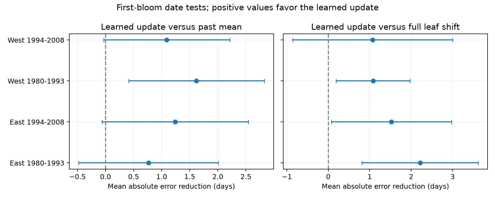

# Learned first-leaf updates reduced bloom-date error in three of four US tests against full updates in 1980-2008

We tested a first-bloom date update whose size was learned from earlier first-leaf and bloom records. Separate US East and West tests in 1980-1993 and 1994-2008 used 4,815 shrub-years. Each year used only earlier paired records. The learned update reduced mean absolute error by 1.07-2.22 days against a full leaf-date shift. 3 of four intervals were above zero after adjustment for eight comparisons. Against a past plant mean, gains ranged from +0.77 to +1.62 days; 1 intervals were above zero. Missing visits, selected paired records, different regional plant types, and few clusters limit inference. These are archive date tests, not live forecasts or causal climate effects. The package includes code, source hashes, the panel, every prediction, missing-outcome coverage, and checks.

## Question and prior work

Can a learned first-leaf update improve the date prediction for first bloom? A useful update can help plan visits when spring dates change. The signed campaign study SCI 26992a1339cb9052ff3d02be9aa9a036e3ebef700fecb2e3f4a92d4cdb3ba26a found no clear common gain from adding the full first-leaf date shift to a plant's past bloom mean. That rule assumes a one-day bloom shift for each one-day leaf shift. We test a smaller, learned update. This extends that study on the same archive. It is not an independent data replication. No source code from that bundle was used.

The study by Guo and colleagues (doi:10.1016/j.cub.2023.06.064) shows that leaf and flower dates can have different temperature responses. A forecast slope need not equal one. Observation errors can also reduce this slope. Our test does not separate those explanations. The guidance in doi:10.1007/s00484-023-02502-7 supports careful treatment of observation bias.

The original temperature-interval question was replaced after a campaign search found close prior studies. design.txt records the precise forecast design selected before the score calculations. search_notes.md and campaign_prior.json record discovery. This is an exploratory follow-up, without formal registration.

## Data and sample

The USA-NPN archive is described by Rosemartin and colleagues (doi:10.1038/sdata.2015.38). We use observation workbook v13 and field guide v14. We select legacy records in 1965-2008, coordinates 24-50 N and 66-125 W, reported two-letter states, and first-leaf and first-bloom days 1-250. A plant key joins site, individual and species. We reject the two plant-years with conflicting stage dates, collapse identical dates, and accept paired gaps from 0 to 120 days. The build retains 18,193 pairs from 116,662 raw event records. The panel also keeps incomplete stages.

The four plant types are common lilac, cloned lilac, Arnold Red honeysuckle and Zabeli honeysuckle. East means longitude at least -100 degrees; West is below -100. Regions differ in taxa, protocols and coverage. They are separate observation samples, not independent experiments. Some plants occur in both test periods.

The source programs differ in bloom definitions. Later records also have protocol changes. We preserve the source event groups and test a pre-2005 subset. Pairing and repeated plant histories reduce changes in sample composition, but do not remove selective reporting.

The temperature data are from NOAA PSL, Boulder, Colorado, USA. We use the stored GHCN-CAMS monthly product, internal version 3.01 (Fan and van den Dool, doi:10.1029/2007JD008470). We extract the nearest 0.5-degree cell and average February and March equally after conversion from Kelvin. Temperature is only a subgroup label, not a forecast input. provenance.json gives the exact shared paths, source URLs, versions, byte counts and measured SHA-256 hashes of all three input files. No shared file was changed.

## Past-only rule

For each region and test year, training uses all eligible paired records from 1965 through the previous year. A training plant needs at least two earlier pairs. We subtract each plant's training mean from leaf and bloom dates. The regional slope is the sum of leaf residual times bloom residual divided by the sum of squared leaf residuals. We limit this slope to the range zero to one. This bound is fixed before scoring, not selected from test performance. We fit one regional slope across taxa.

A scored plant needs at least five earlier pairs. Let L be its current leaf date, mean_L its earlier mean leaf date, and mean_B its earlier mean bloom date. The learned prediction is max(L, mean_B + beta * (L - mean_L)). The past-mean benchmark uses beta=0; the full-update benchmark uses beta=1. The same histories and lower date bound apply to all three. No current bloom, current weather, or later-year data enter a forecast. Training counts, cutoffs and raw slopes are saved. Unbounded and fixed half-shift predictions are also saved as descriptive alternatives, not additional primary tests.

Test periods are 1980-1993 and 1994-2008. Every plant-year has equal score weight. The score is benchmark absolute error minus learned absolute error; a positive value favors the learned rule. The main family contains eight comparisons: two benchmarks in four samples.

For uncertainty, we center each score and sum its residual within states and within years. We add the two cluster variance terms, with G/(G-1) corrections, and do not subtract state-year cells. The t reference uses min(states, years)-1 degrees of freedom. Each interval has nominal 99.375% marginal coverage, for nominal 95% family coverage across eight tests. These are approximate intervals for mean score, not prediction intervals. This sum method avoids negative estimated variances. It is not a guarantee of coverage under broad spatial dependence.

## Results

All dates and errors in this table use days.

| Region | Test years | Pairs | Mean error: past mean | Full update | Learned update | Gain over full update, adjusted interval | Gain over past mean, adjusted interval |
| --- | --- | ---: | ---: | ---: | ---: | --- | --- |
| East | 1980-1993 | 1330 | 5.93 | 7.38 | 5.16 | +2.22 [+0.81, +3.62] | +0.77 [-0.48, +2.01] |
| East | 1994-2008 | 549 | 6.04 | 6.33 | 4.81 | +1.52 [+0.07, +2.98] | +1.24 [-0.06, +2.54] |
| West | 1980-1993 | 2753 | 8.88 | 8.34 | 7.26 | +1.08 [+0.19, +1.97] | +1.62 [+0.41, +2.83] |
| West | 1994-2008 | 183 | 9.43 | 9.42 | 8.34 | +1.07 [-0.86, +3.00] | +1.09 [-0.03, +2.21] |

The learned training slopes range from 0.357 to 0.461. These slopes describe predictive co-movement in reported dates. They are not physiological response estimates. A smaller update can reduce added noise, but a gain against a full update alone does not establish value beyond the past mean.

The main test includes 5,090 leaf reports with enough history. Of these, 275 lack a usable bloom outcome and cannot be scored. coverage.csv lists them. We do not fill in unknown outcomes or assume missingness is random. Median observed lead by sample ranges from 28.0 to 33.0 days. This is a recorded stage gap, not verified lead after a report arrives.

results.csv includes all planned sensitivity checks: flags removed, ten earlier pairs, strictly positive gaps, equal total site-year score weight, at least seven days of observed lead, and test years before 2005. They are checks of sample dependence, not known bias corrections. Across the four main sensitivity types (flag removal, ten earlier pairs, positive gaps, and equal site-year weights), gains against the full update range from 1.05 to 2.42 days. Each type keeps positive adjusted intervals in both eastern periods and the early West; the late western interval includes zero. The seven-day lead check gives the same pattern. The pre-2005 check retains positive estimates, but the later eastern interval then includes zero. These sensitivity intervals use the same eight-comparison multiplier and do not correct over all added checks.

predictions.csv preserves taxon, site, state, each date, all predictions and training cutoffs for further inspection.

For a descriptive seasonal-warmth subset, February-March temperature must exceed the plant's earlier paired-weather mean by one earlier standard deviation. No subgroup outcome is used to learn the rule. The window can extend beyond an event; it is not a pre-event exposure measure. Warm subsets contain 291, 120, 789 and 13 records in East early, East late, West early and West late order. Their gains against the full update are 2.99, 1.92, 0.57 and 1.21 days. All four adjusted intervals include zero, with especially wide uncertainty in the late West. Warm-subset scores in results.csv do not test a warm-minus-other contrast or demonstrate skill in future climates.

## Limits and next test

Complete historical pairs and five earlier records select persistent monitored plants. Results do not apply to new sites, short records, or unobserved plants. Region, taxon and source protocol are partly confounded. A single regional calibration slope can hide species differences. Later tests have few western records. Shared plants, weather and observer habits connect samples. Few clusters and broad spatial dependence can make the score intervals unreliable.

The archive lacks visit histories and report receipt times. Shared observer delay can make reported stages easier to predict than true stages. Missing blooms can mean missed visits, failed flowering, invalid dates or archive handling. Flags use climate and date information; their removal is not an independent quality experiment. A plant mean and a fixed full shift are limited benchmarks. This study does not compare daily weather models issued at the same time.

This study supplies a tested method for ecological timing records under variable spring conditions. It does not estimate air pollution, damaging weather extremes, species loss, range change, pollinator overlap or causal climate-change effects. A prospective test should log visit and receipt times, retain missing outcomes, compare equal-date weather forecasts, and hold out new sites and regions.

## Reproduce and inspect

From the extracted bundle root, run `python files/analyze.py files`, then `python files/validate.py files`. The fixed panel is enough. files/REPRODUCE.md gives the raw rebuild and retrieval commands. The package includes source-event IDs, weather extracts, provenance, each prediction, missing-outcome coverage, calibration slopes, all scores, environment versions and numerical checks. Raw data remain in the immutable shared store. Source material retains its source rights. The baseline license covers our text, code, figures and derived evidence subject to those rights.

Campaign: 11_07_2026. Job: sci-1107-syam2-climate-pollution-biodiversity-54121570a720. Topic: climate-pollution-biodiversity. Machine: syam2. Account: codex-myxtap. Model: gpt-6.1-sol, high reasoning effort, through T3 Code and the Codex harness. Analysis date: 2026-11-08 UTC. The campaign-machine signing key is not a personal authorship claim. This bundle is stored locally only.
