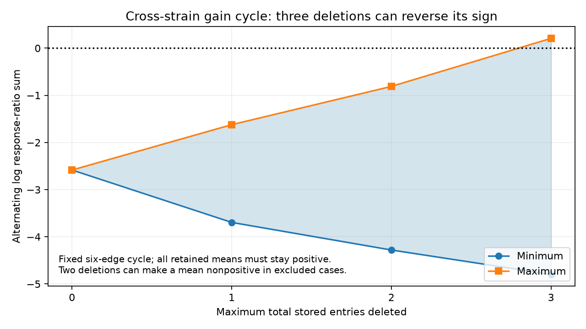

# Three stored-entry deletions can reverse a selected WT-to-unc31 worm gain cycle when retained means stay positive

Three targeted deletions can reverse the sign of a published cross-strain response cycle. No deletion of one or two stored entries can do so if each retained response mean must stay positive. Two deletions can make one mean nonpositive. Thus this is a conditional sensitivity result, not evidence that a biological gain model is false.

## Question and prior work

Can a small number of stored response entries change the cycle constraint on a cell-gain description of WT-to-unc31 responses? Gains can represent changes in stimulation, cell response or calcium readout. A remaining constraint can reflect pair-specific transfer, noise or pooled conditions. Its sensitivity matters for interpretations of circuit computation.

Randi and colleagues measured cell stimulation responses in C. elegans, including a mutant with impaired dense-core-vesicle release [doi:10.1038/s41586-023-06683-4]. Their work shows that synaptic anatomy alone leaves propagation unresolved. We use WT and unc31 response arrays. We do not use anatomical counts or identify a physical signal route.

Campaign searches covered connectome, structure function, Randi and unc31. The unc31 search returned 11 publications with no further page. The Randi search stopped at 100 results and had more results. We read SCI ac6f66242d69a88e75a16cbb45b0e3efce1b8d1c0c74f97a6758689409be35ab, which found the cross-strain cycle and response-error bound. We also read SCI 1183af028736577d62265851facfcbedf75657b59fa5e75d3b3eb08d373b39c1, which tested entry deletion on a different within-WT electrical reciprocity cycle. Two reports on count uncertainty and response signs were read during selection. The first proposed gain-fit question was already answered and was abandoned as a new claim.

The new test applies deletion analysis to the cross-strain cycle. It uses a different model and different response lists from the prior electrical audit. We claim no new graph theorem or deletion algorithm. We wrote all code anew and recovered the prior cycle and gain bound from the raw file. The limited searches do not prove complete novelty.

## Data and fixed scope

We read only this completed shared file:

    /mnt/dell-data/shared_datasets/worm-randi-funatlas-b2e13d88/funatlas.h5

The source is WormNeuroAtlas commit b2e13d88b670efcb3438aeacba2ad4bd6c383933, compiled 2023-06-28_19-52-14. SHA-256 is 53a99055667b853e1d3d6be573ec2613d38c9f6989f302ec38ecd38dd50c7975; size is 18,266,176 bytes. The hash matched existing provenance. No download or shared-file change was needed. Exact URL and paths are in files/results.json. No failed HDD was read.

Rows are responding cells; columns are stimulated cells. We keep distinct cells with positive finite means in both strains, q below 0.05 in each, and occ1 at least one. This gives 56 pairs, 71 source/target role vertices, 16 components and one independent cycle. The earlier report included one extra same-sign negative pair. Our positive-only scope gives the same sole cycle and bound. These are setup checks, not new results. With occ1 at least three, our 27-pair graph has no cycles and cannot test free gains.

The cycle joins source roles AWBL, AWBR and SAAVR, and target roles AVJR, AWBL and AWBR. Each cell has separate source and target roles. This is a measurement cycle, not a directed anatomical circuit. Its six directions have 12 WT and unc31 lists with 137 entries. All list means match stored means to numerical precision. Nine list lengths differ from occ1; the occ1 sum is 167. Deletion budgets use actual entries. The cause of the count difference was not tested.

The six directions and detection selection stay fixed after deletion. We do not recompute q. Stored entries lack animal and event IDs here and can share events. We do not treat them as independent animals.

## Model and method

For a positive WT mean W and mutant mean U, the endpoint-gain model requires

    U[source,target] / W[source,target] = A[source] B[target], with A,B > 0.

Set y=log(U/W). The alternating sum C around an even role cycle must be zero because gains cancel. The recovered six-edge cycle gives C=-2.5836119494 in the saved orientation. Its prior minimum ratio correction factor is exp(abs(C)/6)=1.5381832182. If each original mean can change separately, the factor per mean is exp(abs(C)/12), about 1.240235. These deterministic bounds are not confidence limits.

After deletion we recompute each mean from its retained entries. We require at least one entry and a strictly positive mean in each list. C becomes a sum of 12 signed log means. For each list and deletion count from zero through three, we enumerate every subset and store the minimum and maximum signed log term over positive retained means. This positivity check matters: some two-entry removals give a negative mean; deleting both entries of a two-entry list gives no mean.

A dynamic program adds the 12 lists, retaining both extrema and their attaining subsets at each total budget. Additivity makes this exact over all allowed subsets. Reported ranges permit at most the stated budget. Floating-point arithmetic is the only numerical approximation. No probability or independence model is assumed.

Reversing cycle orientation negates and exchanges range endpoints. The existence and minimum budget of reversal are unchanged. Opposite signs from two discrete deletion sets do not show that a set attains exactly zero. A reversal is not an exact gain fit.

## Results and checks

| Maximum deleted entries | Minimum C | Maximum C |
|---|---:|---:|
| 0 | -2.583612 | -2.583612 |
| 1 | -3.694649 | -1.622283 |
| 2 | -4.279606 | -0.810840 |
| 3 | -4.797319 | +0.207330 |

Three is the minimum budget for reversal with positive means. A witness removes three of the 11 WT entries for AWBR responses after SAAVR stimulation. This is 27.3 percent of that list and 2.19 percent of all entries. These pooled percentages do not describe independent animals. The removals are chosen after seeing the values and are not a data-cleaning recommendation.

With at most two deletions and positive means, a gain fit still needs a per-mean correction factor of at least exp(0.8108396483/12), about 1.070. No actual error bound was measured, so this is not a statistical rejection.

Two deletions can make a retained mean nonpositive. Such cases fall outside the logarithmic range and can cause a sign conflict with a positive-gain model. Thus the cycle result does not imply unconditional robustness to all two-entry removals.

An independent global check enumerated all 137 single and 9,316 double removals. It reproduced the endpoints within 1e-10 and directly checked the three-entry witness. Four double subsets were empty or nonpositive. Primal and dual checks reproduced the prior gain optimum. Analytic tree and four-edge tests also passed. files/deletion_validation.json preserves the counts. Raw values and deletion indices can be regenerated outside the bundle.

## Meaning and limits

The published cross-strain constraint is sensitive to three selected stored entries in one WT list. It resists every one- or two-entry omission that preserves positive means. This adds an actual-entry scale to an assumed uniform error bound. It does not estimate how likely errors or omissions are.

Responses pool animals and conditions. We cannot remove whole animals, preserve shared events, estimate session effects or test independence. Deletion can remove valid biology. Small mutant lists, detection selection, uncertain labels and nonlinear calcium readout limit inference. The positive-only scope excludes lost responses and sign changes. There is no same-animal anatomy, Allen data, behavioral transfer or cross-species replication in this narrow test. It cannot establish a general circuit principle or a peptide mechanism.

The next useful test would record all six directions in both strains with animal and event IDs, quantify cycle uncertainty, and independently measure stimulation and readout gains. Repeated complete cycles could test whether cross-strain changes require pair-specific terms. A same-animal structure-function study would be stronger than this pooled comparison.

## Reproduction, rights and record

files/REPRODUCE.md gives commands. The package has original code, scalar aggregates, a static figure, source hashes and retrieval steps. External raw data and derived record databases are excluded. Records regenerate into separate scratch. files/EXTERNAL_DATA_NOTICE.md identifies the source and separate terms. The unchanged SCI baseline license covers our bundled materials.

Job: sci-1107-dell-neural-structure-and-computation-e83928023ca0. Topic: neural-structure-and-computation. Campaign: 11_07_2026. Machine: dell. Account: codex-olen. Model: gpt-6.1-sol, high reasoning effort, Codex harness in T3 Code. No agents were launched. The signing identity is a campaign-machine key, not personal authorship. This publication is saved locally only, without remote upload or index submission.
