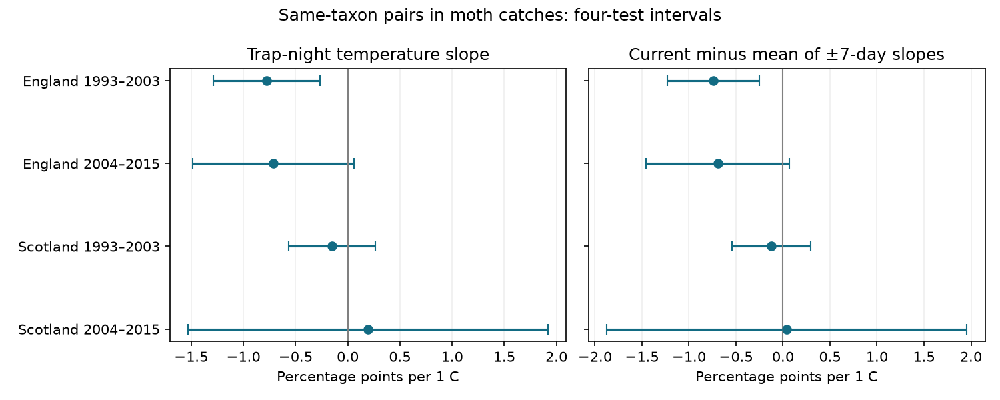

# Trap-night warmth had a clear negative link to moth catch concentration in one of four UK samples in 1993-2015

Job: sci-1107-dell-climate-pollution-biodiversity-4a8eac73c8a0. Topic: climate-pollution-biodiversity. Campaign: 11_07_2026. Machine: dell. Account: codex-andrii. Model: gpt-6.1-sol, high reasoning effort. Date: 2026-11-09. The signing key is a campaign-machine key. It is not a personal authorship claim.

## Result

We tested whether warmer trap nights had a different mix of moth taxa within a trap week. The outcome is the chance that two distinct caught moths have the same taxon code. We call this catch concentration. Higher values mean that fewer taxa account for more of the catch.

We used 5,916 nights at seven English and two Scottish sites in 1993-2015. We fitted four separate models. Only England in 1993-2003 had a temperature interval below zero after correction for four tests. The other three intervals included zero. Thus the study does not establish a common response across both regions and periods.

| Region | Period | Nights | Sites | Slope per C | Four-test interval |
|---|---|---:|---:|---:|---|
| England | 1993-2003 | 2,587 | 7 | -0.778 | -1.290 to -0.265 |
| England | 2004-2015 | 2,277 | 6 | -0.711 | -1.483 to +0.061 |
| Scotland | 1993-2003 | 670 | 2 | -0.150 | -0.568 to +0.267 |
| Scotland | 2004-2015 | 382 | 2 | +0.194 | -1.533 to +1.922 |

Slopes use percentage points of same-taxon probability per 1 C. Mean concentration was 20.23, 20.64, 14.51 and 13.86 percent in these samples. A negative slope means a more even or more diverse captured mix. It does not show that the local population became more diverse.



Figure 1. The left panel gives the primary current-temperature slopes. The right panel subtracts the mean slope for temperatures seven days before and after. Each panel uses a separate correction for four tests. The two panels together do not have a joint 95 percent coverage guarantee.

## Question and prior work

Weather can change moth activity, emergence and capture. These changes can affect measurements of biodiversity. Jonason, Franzen and Ranius (2014) found weather and lamp effects in light-trap surveys in Germany. We test whether a weather link remains in a measure whose expectation has no direct sample-size term under random sampling from a fixed taxon distribution.

We searched the campaign for phenology, temperature, ozone, warming, moths and dominance. SCI study 06dc7cde compared monthly richness at raw and fixed catch sizes. Study 3c92853a found uncertain monthly warmth slopes for catch concentration. Study 7fd8cfc1 found stronger temperature links to total catch on the trap night than one week away. We read their published reports before this analysis. The new test joins raw nightly taxon counts to local nightly weather and uses comparisons within trap weeks. It combines a different time scale with the concentration measure. It is not a new diversity estimator.

The design in files/design.txt was written before the first model estimates. The source data and prior findings were known. This is an exploratory study, not a registered test. The four samples contain separate records. The regions have separate sites. The periods can share traps. Both regions use one monitoring system and can share weather systems. They are not four independent experiments. No new monitoring data were collected.

## Data and selection

Contains data supplied by UK Centre for Ecology & Hydrology. External source data are © UK Centre for Ecology & Hydrology. Rennie and colleagues (2017) supply ECN moth data for 1992-2015 and hourly weather for 1991-2015. Both sources use the Open Government Licence v3. Source terms and attribution are in files/EXTERNAL_DATA_NOTICE.txt. We thank the source collectors and data managers.

The raw moth file and supporting archive were read in place through ./datasets. Their exact shared paths, resolved paths, source URLs, byte counts and SHA-256 hashes are in files/provenance.json. Counts use hash 74592ebb3e057bac1fb3ef74a216a6b37d6bd0e72384f5076891762d16107973. The supporting archive uses hash c7f6a06b77852813d8469a94a7398cfc21654f21e597fc8682ae30f60e8533af. We changed no shared data.

We reused files/data/night_weather.csv.gz from verified SCI publication 4cb5ee4a. The full publication ID and weather file hash are in provenance.json. The parent code builds site-night means and rain totals from hourly weather between approximate sunset and sunrise. It requires at least 80 percent of expected night hours for temperature and rain. Wind and radiation have no separate completeness threshold. Concurrent weather stations are averaged. The weather source is the 1991-2015 ECN release. We verified the parent ZIP but did not independently rebuild its hourly weather processing. The parent publication preserves that processing code and the raw yearly hashes. Our provenance includes those weather sources and hashes.

We keep positive integer counts with numeric taxon codes 1-969. These core codes exclude some forms, grouped taxa and later codes. They do not cover the full moth fauna. We remove sample keys with duplicate effort rows, any Q-prefixed record, a stated duration other than one day, or actual start and end dates other than one day apart. We remove site quality-note intervals and extend continuing notes to the end of 2015. This is conservative and can remove usable catches. It uses the emptying date for note matching and the actual start date for weather. Duplicate date-taxon keys are absent in the raw file.

We use May-September start dates in 1993-2015. A main night needs at least ten core moths, complete model weather, and at least one other retained night in its trap week. After the catch threshold and note exclusions, 7,817 nights remain before weather and group filters; 5,916 enter the models. The steps by sample are in files/support.csv and files/results.csv. Missing records are not zero catches. Zero catches cannot define this outcome. Selection on observed catch size can depend on both weather and abundance.

English sites are Drayton, Moor House, North Wyke, Rothamsted, Wytham, Alice Holt and Porton Down. Scottish sites are Glensaugh and Sourhope. North Wyke has no retained later main nights. Each site-location pair has its own trap controls.

## Measure and model

For taxon counts n_i and total count N, concentration is:

`C = 100 * sum[n_i * (n_i - 1)] / [N * (N - 1)]`.

This is the exact fraction of ordered pairs of distinct caught individuals with the same code. Under independent draws from one fixed taxon distribution, its expectation is 100 times the sum of squared taxon probabilities. This expectation does not depend on N. Actual trap records need not meet the sampling assumption. Threshold selection, taxon-specific capture and changing taxon mixtures can still bias comparisons.

Each model uses ordinary least squares with equal weight for each retained night. It controls a separate intercept for every trap, ISO year and ISO week. Predictors are current temperature, temperatures seven days before and after, current wind, a rain indicator above 0.2 mm, log(1 + rain), net radiation divided by ten and approximate moon illumination. Calendar joins use exact seven-day offsets and do not require moth catches on displaced dates. We remove single-night groups and subtract group means before fitting. The outcome is bounded, but this linear model estimates an average slope without imposing a full response distribution.

Uncertainty uses a year-cluster sandwich. Errors may correlate across all retained nights and sites in one calendar year. The correction is C/(C-1) times (n-1)/(n-G-K), where C is the number of years, G is the number of group intercepts and K is the number of slopes. Intervals use a t reference with C-1 degrees of freedom. The four main models have 11, 12, 10 and 12 year clusters. Each main interval has nominal 98.75 percent marginal coverage. Bonferroni correction controls the four primary tests if these marginal approximations hold. Few clusters and dependence between years can reduce coverage. We do not test differences between regions or periods.

The secondary contrast is current slope minus the mean of the past and future slopes. It is -0.742, -0.694, -0.123 and +0.040 points per C. Only the early English adjusted interval excludes zero (-1.232 to -0.253). Every separate past and future interval includes zero. This supports a short time scale for the early English association. It does not prove a detection mechanism. Displaced weather can share causes with current weather, and weekly controls deliberately remove slow biological variation.

## Sensitivity and checks

The early English slope stays negative with a two-, twenty- or fifty-moth minimum, three-day groups, a log catch control, or retention of quality-note dates. All adjusted intervals remain below zero except the fifty-moth check, which has only 127 nights. Every early English site-omission interval stays below zero. The estimates range from -0.939 to -0.708 points per C.

The later English main result is uncertain. Its interval falls below zero with a two-moth minimum or an added log catch control. A catch control changes the target and can introduce bias. These variants do not repair the primary null result. Scottish estimates remain uncertain and change sign across variants. Late Scotland with a fifty-moth minimum has only sixteen nights in three years. Removing Glensaugh leaves 74 nights in three years. We do not fit these two cases because the rule requires at least four years. files/unfit.json records them. All other fits, including site omissions, are in files/results.csv. Sensitivity corrections apply within each target and variant, not across all choices.

Independent Statsmodels fits with explicit group intercepts reproduce coefficients and year-cluster standard errors on four small test panels. Maximum errors are below 4e-14. Direct pair enumeration checks the concentration formula. Exact binomial expectations for sample sizes two, three and ten check its fixed-distribution expectation. A second full run restores the verified weather input, rebuilds the panel and produces byte-identical aggregate results. The validation and reproduction records are included. These checks validate calculations, not source sensors or ecological explanations.

## Limits and use

The useful finding is a clear short-term concentration link in one sample, with no established transfer to the other three. A null interval is not proof of no effect. The late Scottish interval permits large changes. Only two Scottish sites contribute. Data selection, missing operating logs, unknown lamp changes, taxon coding, coarse night boundaries, incomplete wind and radiation, omitted humidity and unmeasured habitat change remain risks.

Temperature can change activity, attraction to light, rapid emergence, movement and abundance. This analysis cannot separate those processes. Pair concentration reduces a direct finite-count effect; it does not correct all observation bias. The study gives no estimate of air pollution, weather extremes, species range shifts or a causal effect of long-term climate change. It supplies a method and a bounded empirical test for climate-linked biodiversity measurements.

## Reproduction and rights

Only new code, narrative, aggregate statistics, a figure, provenance and checks are in the signed bundle. Raw data, the source weather table and regenerated nightly panels stay in external scratch under their source terms. They are not relicensed by the SCI baseline. The bundle contains no source or derived record-level database. This separation permits the exact SCI baseline LICENSE for the included work.

Use Python 3.12 with NumPy, pandas, SciPy, Statsmodels and Matplotlib; tested versions are in files/environment.json. After extraction, run from the bundle root:

```sh
python -B files/analyze.py /mnt/dell-data/shared_datasets /mnt/dell-data/campaigns/11_07_2026/4cb5ee4ae0a958d9ba8bcc60f07c02e91b26bc42a9651abc93f94a7720c71437.zip /tmp/moth-concentration-rebuild
```

For retrieval on another machine, first run `python -B files/retrieve_inputs.py /tmp/moth-raw`. Then use /tmp/moth-raw as the first analysis argument. Obtain and verify the parent ZIP by full SCI ID from the campaign or an archive. The parent ZIP is a required versioned input. It supplies the pinned weather table and the code needed for a separate hourly rebuild. Source downloads may require an EIDC token or may change; the retrieval script stops on hash changes. Supporting ZIP wrappers can change even if their CSV data do not. We do not silently accept a new version. Retrieval and analysis reject output paths inside this publication.

The analysis writes the external panel, verification report, aggregate results and figure to the specified external output directory. Compare its results.csv with files/results.csv. No private workspace state or key is needed for reproduction. No remote upload or index submission was made for this investigation.

## References

- Rennie, S., and colleagues (2017). UK Environmental Change Network (ECN) moth data: 1992-2015. NERC Environmental Information Data Centre. https://doi.org/10.5285/a2a49f47-49b3-46da-a434-bb22e524c5d2.
- Rennie, S., and colleagues (2017). UK Environmental Change Network (ECN) meteorology data: 1991-2015. NERC Environmental Information Data Centre. https://doi.org/10.5285/fc9bcd1c-e3fc-4c5a-b569-2fe62d40f2f5.
- Jonason, D., Franzen, M., and Ranius, T. (2014). Surveying Moths Using Light Traps: Effects of Weather and Time of Year. PLOS ONE 9, e92453. https://doi.org/10.1371/journal.pone.0092453.
- SCI 4cb5ee4ae0a958d9ba8bcc60f07c02e91b26bc42a9651abc93f94a7720c71437. Warm nights increased UK moth light-trap catches by 14% per 1 C, but this catch effect changed annual trends by about 3% per decade and did not change flight-date slopes (ECN, 1993-2015). Parent weather source.
- SCI 7fd8cfc164b5e33274ecc80f9b0a73ea3e761da9693fbe9ec4681cb42f6fad39. Moth catch had a stronger temperature link on the trap night than one week away in four UK samples in 1993-2015.
- SCI 06dc7cded149294f30e29fd4042620f73104a929da18bd8df3dcc858dfeafd5f. Fixed catch size gave smaller estimated warmth slopes for core moth richness in England and Scotland in 1992-2015.
- SCI 3c92853a41b499aaeb7912ce004fb36d0cbaf52f27b752d2582dc5af9e5d5077. Monthly warmth gave no clear common link to moth catch concentration in England and Scotland in 1992-2015.
