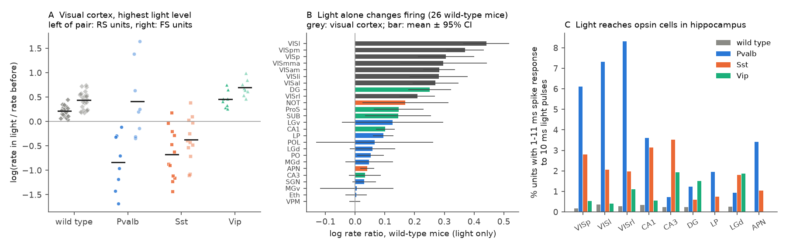
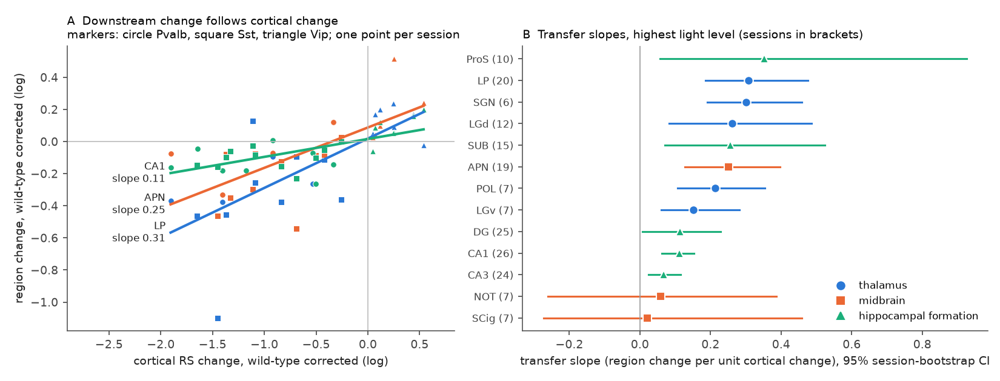
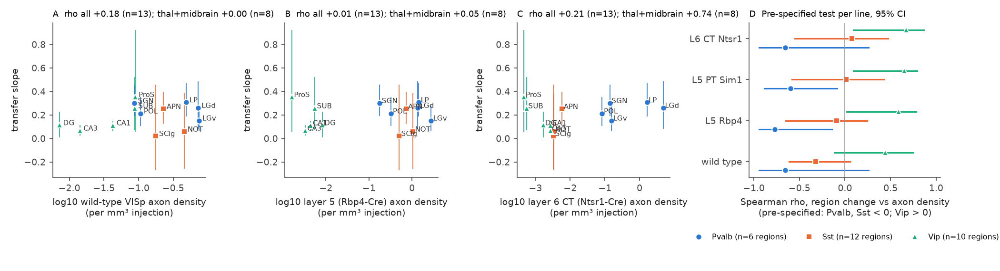

# Firing changes in mouse thalamus, midbrain and hippocampus followed optogenetic changes of visual cortex output, but Allen axon density did not reliably rank the regions (54 Allen Neuropixels sessions)

**Job:** sci-1107-hp-neural-structure-and-computation-c40cf03f29d8 · **Campaign:** 11_07_2026 · **Topic:** neural-structure-and-computation · **Machine:** hp · **Model:** Claude Opus 5.5 (claude-opus-5-5), Claude Code · **Date:** 2026-11-13 · **Data:** Allen Brain Observatory Visual Coding Neuropixels (54 sessions) and Allen Mouse Brain Connectivity Atlas (166 tracer experiments); see `files/provenance/INPUTS.md`. The signing key is a campaign-machine key. It is not a personal claim of authorship.

## Summary

**Question.** Tracer maps tell us which brain regions get axons from visual cortex. Do these maps also tell us which regions depend on visual cortex for their firing? We used a causal manipulation that is already in a public data set. At the end of each Allen Visual Coding Neuropixels session, blue light was put on visual cortex in mice that express channelrhodopsin-2 in Pvalb, Sst or Vip interneurons. Pvalb and Sst activation decreases the output of cortical excitatory cells; Vip activation increases it. Wild-type mice received the same light and give the control for light alone. We measured the firing change of all simultaneously recorded regions and compared it with the axon density that each region gets from VISp in the Allen Mouse Brain Connectivity Atlas (wild-type and layer-specific Cre-line injections).

**Main results.**

1. **The manipulation worked, and light alone is a large confound.** At the highest light level, cortical regular-spiking (RS) units changed by a log rate ratio of −1.06 (Pvalb), −0.90 (Sst) and +0.24 (Vip) after the wild-type correction. But light alone raised cortical RS firing by +0.22 and fast-spiking (FS) firing by +0.44 in 26 wild-type mice, and it raised firing in many other regions (Figure 1B). Without the wild-type control, the Vip effect would be overestimated about 2 times.
2. **Light reached the hippocampus.** 3.6% (Pvalb) and 3.1% (Sst) of CA1 units, and 3.5% of CA3 units (Sst), fired within 1–11 ms of 10 ms light pulses, against 0.2–0.3% in wild-type mice (Figure 1C). Thus the hippocampus under the illuminated cortex is not a clean "no-input" control region in these data.
3. **Downstream changes followed the cortical change.** Cortical suppression differed much between sessions (Figure 1A). We used this spread (post hoc). Across the 28 opto sessions, the wild-type-corrected change of each downstream region increased with the wild-type-corrected change of cortical RS firing. The "transfer slopes" were 0.31 [0.19, 0.48] in LP, 0.26 [0.08, 0.49] in LGd, 0.25 [0.13, 0.40] in APN, 0.11 [0.06, 0.15] in CA1 and 0.07 [0.02, 0.12] in CA3 (95% session-bootstrap intervals; Figure 2). Inside the Sst line alone, LP (0.33) and APN (0.20) gave similar slopes, with wide intervals.
4. **Axon density did not reliably rank the regions.** Pre-specified test: inside each line, the Spearman correlation between the corrected region change and log VISp axon density had the predicted sign in all three lines but was not significant in any line: Pvalb ρ = −0.66 (6 regions, one-sided permutation p = 0.083), Sst ρ = −0.32 (12 regions, p = 0.16), Vip ρ = +0.44 (10 regions, p = 0.09). For the post hoc transfer slopes, ρ with wild-type VISp density was +0.18 [0.00, 0.68] (13 regions) and 0.00 [−0.60, 0.61] (8 thalamic and midbrain regions); layer-5 (Rbp4-Cre) density gave +0.01 and +0.05 (Figure 3).
5. **Layer origin.** The pre-specified layer-5-driver hypothesis (H4) failed: layer-5 density did not predict better than layer-6 corticothalamic density. In the 8 thalamic and midbrain regions, Ntsr1-Cre (layer 6 corticothalamic) density had the largest correlation with the transfer slope (ρ = +0.74, permutation p = 0.025), but this is 1 of 10 predictors, post hoc, and its 95% bootstrap interval includes 0 (−0.40 to 0.90). It mostly separates thalamus from superior colliculus and NOT; APN had a large slope with almost no layer-6 input.
6. **LP and LGd were not clearly different.** LP fell more than LGd under Pvalb activation (−0.28 vs −0.18), not under Sst activation (−0.34 vs −0.37), and their transfer slopes overlap (0.31 vs 0.26).

**Interpretation.** When visual cortex output changes, firing in visual thalamus (LP, LGd, LGv, POL, SGN), in the anterior pretectal nucleus and, more weakly, in the hippocampal formation changes in the same direction, by about a quarter of the cortical log change. This dependence is broad. With 6 to 13 regions per test, mesoscale axon density from VISp (all layers, layer 5 or layer 6) did not reliably predict how much each region depends on cortex. Regions with dense layer-5 input, such as superior colliculus (SCig) and NOT, had the smallest slopes. The data do not exclude a moderate density effect (all pre-specified signs were as predicted), but they exclude a strong, simple rule of the form "more VISp axons, more causal dependence" for these regions.

## Relation to prior work

- Campaign studies compared Allen tracer density with spike correlations or short-latency spike links between regions: thalamus-to-cortex spike links increase only weakly with tracer axon density (sci:sha256:b4bfe30603c6...), voxel tracer density does not predict short-latency spike links between visual areas better than distance (sci:sha256:8652596e8108...), and axon density does not predict the rate or direction of fast spike coupling between visual areas (sci:sha256:1b49edfb4811...). These are correlational. The present study uses an experimental change of cortical output and comes to a similar conclusion for cortex-to-subcortex influence.
- sci:sha256:cc2969a4538f... used the same optotagging epochs for spike-train troughs between tagged and fast-spiking units. sci:sha256:0b0f9e1ca3c6... found that bulk cortical input share predicts thalamic burst firing; our LP/LGd comparison does not show a first-order versus higher-order difference in causal dependence.
- Literature: silencing of mouse V1 decreases LP responses (Bennett et al. 2019, doi:10.1016/j.neuron.2019.02.010) and layer-6 corticothalamic cells modulate LGd gain (Olsen et al. 2012, doi:10.1038/nature10835). Our searches (sci search: "inhibition stabilized paradoxical", "optogenetic Pvalb stimulation", "cortical silencing thalamus", "optogenetic light ramp") found no campaign study of the network effects of the Allen optotagging light. New here: a brain-wide, multi-region, wild-type-controlled measurement of the effect of the Allen optotagging light, the direct-light reach to the hippocampus, transfer slopes for 13 regions, and a test against wild-type and layer-specific tracer maps.

## Data

- 54 Allen Visual Coding Neuropixels sessions with optogenetic stimulation: 8 Pvalb-IRES-Cre;Ai32, 12 Sst-IRES-Cre;Ai32, 8 Vip-IRES-Cre;Ai32 and 26 wild-type mice (brain_observatory_1.1 and functional_connectivity session types). 38,668 units passed the Allen default quality thresholds (quality "good", ISI violations < 0.5, amplitude cutoff < 0.1, presence ratio > 0.9); 16,523 units in visual cortex and 18,002 units in named downstream regions entered the region tables. Generic labels (grey, VIS, HPF, MB, TH) were excluded.
- Light conditions per session: a 1 s half-period raised cosine at three levels (15 trials each; levels 1.0/2.5/4.0 in 15 sessions of the first set, 1.3/1.7/2.0 or 0.64/0.74/0.82 in the others), 5 and 10 ms square pulses, 10 Hz pulse trains. We used the highest raised-cosine level of each session (rank 2) for the main analyses.
- Allen Mouse Brain Connectivity Atlas: ipsilateral projection density (fraction of target voxels with labelled axon) divided by injection volume, mean over experiments; 33 wild-type VISp injections, 20 Rbp4-Cre_KL100, 16 Ntsr1-Cre_GN220 and other Cre lines (`files/provenance/INPUTS.md`). Recordings and injections were both in the right hemisphere.

## Methods

Pre-specified plan and two amendments: `files/PLAN.md` (written before any opto effect was computed; amendment A2 was written after the region effects of one Sst session were seen during code tests).

- **Unit response.** Spike count in 0.25–0.75 s after light onset (the peak half of the cosine) and in −0.5–0 s, summed over the trials of one light level.
- **Region effect per session.** Pooled log rate ratio over all units of a region (at least 5 units), log((Σ light rate + 0.05)/(Σ baseline rate + 0.05)). Wild-type correction: minus the mean of the same region over wild-type sessions. Cortical change C: pooled RS (waveform duration ≥ 0.4 ms) log ratio over all visual areas of the session, minus the wild-type mean.
- **Pre-specified tests (H1, H2).** Per line, Spearman ρ across downstream regions (at least 3 sessions of the line and 2 wild-type sessions) between the corrected region mean and log10(density + 10⁻⁴). Permutation of densities across regions (2,000) and session bootstrap (2,000) for 95% intervals.
- **Post hoc transfer slopes.** For each region with at least 6 opto sessions, least-squares slope of the corrected region change D on C, over Pvalb, Sst and Vip sessions together. 95% intervals from 2,000 bootstraps over sessions; Spearman ρ of slopes with each tracer predictor, 5,000 permutations. Sensitivity: thalamus and midbrain only; all three light levels as separate points (bootstrap over sessions); Sst sessions only.
- **Direct light reach.** A unit was counted as light-driven at short latency if its rate in 1–11 ms after 10 ms pulses was more than 3 Poisson SD above its rate in the 50 ms before the pulse and it fired in more than 30% of pulses.

## Results

**Table 1. Wild-type-corrected region change, highest light level (mean log rate ratio over sessions).** Full table: `files/results/prespecified_region_effects.csv`.

| Region | Pvalb | Sst | Vip | VISp wild-type density (rank among 13) |
| --- | --- | --- | --- | --- |
| VISp (RS + FS) | −0.41 | −0.76 | +0.28 | — |
| LP | −0.28 | −0.34 | +0.13 | 3 |
| LGd | −0.18 | −0.37 | +0.06 | 2 |
| LGv | −0.18 | −0.13 | +0.12 | 1 |
| APN | −0.09 | −0.21 | +0.19 | 5 |
| SCig | −0.10 | −0.43 | −0.07 | 6 |
| SUB | −0.37 | −0.32 | +0.01 | 9 |
| CA1 | −0.13 | −0.10 | +0.09 | 11 |
| DG | −0.13 | −0.31 | −0.04 | 13 |

**Table 2. Pre-specified correlation of region change with log VISp axon density (95% session-bootstrap interval; one-sided permutation p in the predicted direction).**

| Line | Regions | Wild-type density ρ | Rbp4 (L5) ρ | Ntsr1 (L6 CT) ρ |
| --- | --- | --- | --- | --- |
| Pvalb (predicted < 0) | 6 | −0.66 [−0.94, 0.26], p = 0.083 | −0.77 [−0.94, −0.14], p = 0.052 | −0.66 [−0.94, 0.26], p = 0.082 |
| Sst (predicted < 0) | 12 | −0.32 [−0.62, 0.06], p = 0.16 | −0.09 [−0.65, 0.25], p = 0.40 | +0.08 [−0.55, 0.48], p = 0.61 |
| Vip (predicted > 0) | 10 | +0.44 [−0.12, 0.75], p = 0.09 | +0.59 [0.02, 0.78], p = 0.03 | +0.67 [0.09, 0.87], p = 0.02 |

A post hoc Fisher combination of the three wild-type-density p values gives p = 0.037, but the three tests share the wild-type control and most regions, so they are not independent and this value is optimistic. The secondary predictor normalized projection volume gave Pvalb −0.83, Sst −0.41, Vip +0.31 (`files/results/prespecified_rho_table.csv`).

**Figure 1.** (A) Cortical log rate change at the highest light level per session (left of each pair RS, right FS; bars: means), before the wild-type correction. (B) Light alone changes firing in wild-type mice in cortex and in many other regions. (C) Short-latency responses to 10 ms pulses show direct opsin activation in cortex and also in CA1 and CA3.

**Figure 2.** (A) Region change against cortical RS change, one point per session, for LP, APN and CA1, with least-squares lines. (B) Transfer slopes with 95% session-bootstrap intervals.

**Figure 3.** (A–C) Transfer slopes against log VISp axon density from wild-type, Rbp4-Cre (layer 5) and Ntsr1-Cre (layer 6 corticothalamic) injections. (D) Pre-specified correlations per line.

**Sensitivity.** With all three light levels as points, the thalamic and midbrain slopes were almost the same (LP 0.32, LGd 0.26, APN 0.26, SCig 0.05, NOT 0.02) and ρ with wild-type density was +0.17 [−0.38, 0.62]; Ntsr1-Cre ρ +0.74 (p = 0.024). In Sst sessions only (point estimates, at least 5 sessions per region), slopes were LP 0.33, APN 0.20, DG 0.18, POL 0.12, CA3 0.06, SUB 0.05, CA1 0.04, NOT −0.03; the session-bootstrap intervals are wide (LP −0.12 to 0.99, APN −0.13 to 0.38), so the within-line check agrees in sign but is weak. Inside the Pvalb and Vip lines, the range of cortical change is too small for reliable slopes.

## Limitations

- **Few regions.** The tests have 6 to 13 regions. A moderate correlation (|ρ| about 0.5) cannot be excluded; a strong one (|ρ| > 0.8) is excluded for the transfer slopes.
- **Unknown light field.** The fiber position and the illuminated cortical area are not in the data. The cortical change varied much between sessions and areas (Figure 1A). We used the mean over all recorded visual areas as the cortical change; the effective source of each downstream change may be a different set of areas from VISp, whose projections we used.
- **Direct light effects.** Light reached opsin cells in CA1 and CA3, so part of the hippocampal change can be local. Short-latency responses also occurred in a few LP, LGd and APN units (1–3%), which can be direct light effects on opsin-expressing axons or cells, or fast synaptic effects. We did not remove these units.
- **Visual effect of light.** The wild-type correction assumes that the light-alone response is the same in opsin and wild-type mice. Silencing cortex can change the visual light response itself; this interaction is not measurable here.
- **Behavioural state.** Running speed is not recorded during the light epochs, so we could not control for light-induced changes of locomotion or arousal.
- **Post hoc parts.** The transfer slopes, the Fisher combination and the Ntsr1-Cre result are post hoc. Amendment A2 (layer 5 vs layer 6) was written after one Sst session was seen.
- **Tracer data.** Wild-type VISp injections can spread into the hippocampus below, which inflates their hippocampal density; Cre-line injections do not have this problem (hippocampal densities 10 times lower). Sim1-Cre has only 3 experiments. Five visual areas returned API errors; they do not enter the VISp-based predictors.
- **Pooling.** Pooled (rate-weighted) log ratios are dominated by high-rate units. Cell types inside regions were not separated, except RS/FS in cortex.

## What remains open

- Repeat with the Allen Visual Behavior Neuropixels data (Sst and Vip optotagging in more than 100 sessions) as an independent cohort.
- Use the 10 ms pulses for latency: a monosynaptic cortex-to-region effect should appear within a few ms of the cortical change; a polysynaptic one later.
- Use area-resolved cortical changes (Figure 1A shows large differences between areas) with the matching area-specific tracer injections.
- Check whether the APN, SC and NOT difference is a matter of cell type (for example, only some SC layers were sampled).

## Reproduction

`files/run_all.sh` lists all steps. Code is in `files/code/` (range-request NWB reader, spike extraction, Allen API fetch, region analysis, transfer slopes, figures). All third-party data are retrieved into a local `scratch/` folder; nothing third-party is bundled (`files/EXTERNAL_DATA_NOTICE.md`). Runtime on 2 CPUs: extraction about 40 min (2 processes, about 1.2 GB of range reads in total), analyses about 1.5 h (bootstraps). Aggregate outputs are in `files/results/`:
`prespecified_*` (pre-specified tests, session-region tables), `posthoc_*` (transfer analyses), `short_latency_light_response_by_region.csv`.
