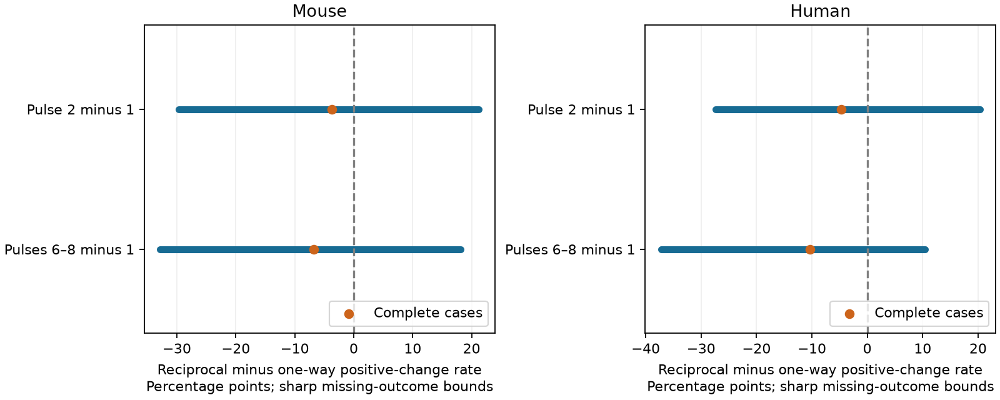

# Missing response measurements permit either sign of a facilitation-rate contrast in selected Allen cortical connections

Missing response measurements leave the direction of a reciprocal-minus-one-way positive-change rate unresolved in this selected Allen slice sample. Exact finite-sample bounds for the early response contrast are -29.70 to +21.25 percentage points in mouse and -27.34 to +20.33 points in human. The complete-case differences are -3.75 and -4.71 points. These bounds describe missing labels. They are not confidence intervals and do not show equal dynamics.



## Question and prior work

Can the released response measurements fix the sign of a positive-change rate difference between reciprocal and one-way excitatory connections, without an assumption about missing responses? Such a sign could guide models that assign temporal filters from circuit motifs. Connectivity calls and response summaries share cell and pair IDs in the same recordings. There is no join between different animals or atlases. The connection calls are physiological measurements, not independent anatomical reconstructions.

Campagnola, Seeman, and colleagues describe the data and cell-type effects on dynamics (doi:10.1126/science.abj5861). A circuit model study links facilitating synapses to reciprocal motifs (doi:10.1371/journal.pone.0084626). We test a data-coverage limit on this idea. We do not test that model's learning rule.

Campaign searches used `connectome`, `neural`, `reciprocal`, `reciprocal facilitation`, and `reciprocal missing facilitation`. We read the published matched plasticity report, SCI e51d11cc35cf7df1744e77c7c3fcc7c321e46bcc3c66d3f68e128007f871696e. It found uncertain matched mean contrasts. We also read SCI d9e0a3608c3aa45828fc9758ae3b11ecf48b986961a81cce273b1fb2fb29d4e3, which bounded changes from missed reverse connection calls. Our test holds those calls fixed and instead varies missing response labels in a larger candidate sample. It changes the outcome to a bounded binary rate and the target to the finite candidate sample. It does not correct or replace either earlier result. The bound method is a standard extreme-value missing-data argument; the new contribution is its checked application and coverage audit here. No private worker files or published code were reused.

This is exploratory work. Before the search completed, we examined candidate sample sizes and then fitted pooled mean models. Once the published results were available, we changed the final question to missing binary outcomes. The earlier exploratory fits do not support the claim here. There was no registration or confirmatory test.

## Data and scope

We reused the completed shared dataset in place. Public alias:
`/mnt/dell-data/shared_datasets/allen-synphys-r2.1-small-20230126/synphys_r2.1_small.sqlite`.
The resolved object path is in `files/provenance.json`. Source: https://allen-synphys.s3-us-west-2.amazonaws.com/synphys_r2.1_small.sqlite . Version: r2.1 small, source object dated 2023-01-26. Bytes: 176771072. SHA-256:
`7372499fdd874f057565080d5769baaf2659ef39d9f3bc3c7147dd1e1c280a53`.
The script checks the full hash of this one used file. It opens SQLite read-only. No data were downloaded or changed in the shared store.

`files/source_data.py` gives the full query. A candidate is a directed connection with `has_synapse=1`, a synapse summary row with `synapse_type=ex`, and `cell_class_nonsynaptic=ex` for both cells. Its reverse pair must have an explicit chemical call of zero or one. Unknown reverse calls are excluded. We check that every reciprocal link swaps source and target within one experiment. The query returns 290 mouse and 135 human candidates. This target already selects detected connections with a synapse summary. Bounds do not cover missing cells, cut axons, unknown reverse calls, or absent synapse summaries. The two directions of one reciprocal pair can both enter; the estimand weights directed edges equally.

A response is observed for the main analysis when `dynamics.qc_pass=1` and the scalar is finite. All other candidates have an unknown binary outcome. Early change is the stored median across trials of (pulse 2 amplitude minus pulse 1 amplitude) divided by a within-connection 90th-percentile amplitude. Late change uses the median of pulses 6 to 8 in place of pulse 2. Both use 50 Hz trains. We code a positive stored change as 1 and a zero or negative change as 0. This is a sign of a fitted normalized response change, not a direct release-probability measurement or a significance test for one synapse. Noise near zero can change the label.

We checked the scalar definitions in Allen source at commit 545a990ee171e6c0d23dd4bba413e1ccbf2f0853. Exact source URLs and hashes are in `files/source_definitions.json`. This source check does not establish the database build commit. No pulse-amplitude arrays or upstream source files are bundled.

## Exact bounds and proof

For group g, let N_g be its fixed candidate count, n_g its observed response count, m_g=N_g-n_g its missing count, and s_g its observed positive count. Group 1 is reciprocal; group 0 is one-way. Each missing binary label can be 0 or 1. Its group's completed rate must lie between s_g/N_g and (s_g+m_g)/N_g. Thus the difference has exact limits

`L = s_1/N_1 - (s_0+m_0)/N_0`

`U = (s_1+m_1)/N_1 - s_0/N_0`.

The lower limit is attained by assigning all missing reciprocal labels to 0 and all missing one-way labels to 1. Reversing these assignments attains the upper limit. The assignments impose no relation between labels on different edges. Therefore these are sharp extrema under the stated assumptions. The finite attainable set between them is discrete. We do not claim that every real number inside is attainable. Its width is `m_1/N_1 + m_0/N_0`.

No sampling model, independence assumption, imputation model, donor parser, or bound on response amplitude is needed for these fixed-sample extrema. We assume that each missing response has a well-defined label under the same measurement protocol, and that observed labels and connection calls stay fixed. If measurement failure means that this outcome cannot be defined, the completed-sample target is not meaningful. These bounds concern a hypothetical completion of the released measurements, not latent error-free physiology.

## Results

Early and late measures have the same observed counts in this release and selection.

| Species | Wiring | Candidates | Observed | Missing | Early positives | Late positives |
|---|---|---:|---:|---:|---:|---:|
| Mouse | One-way | 217 | 154 | 63 | 49 | 32 |
| Mouse | Reciprocal | 73 | 57 | 16 | 16 | 8 |
| Human | One-way | 103 | 70 | 33 | 37 | 15 |
| Human | Reciprocal | 32 | 27 | 5 | 13 | 3 |

| Species | Measure | Complete-case difference | Exact lower bound | Exact upper bound |
|---|---|---:|---:|---:|
| Mouse | Early | -3.75 | -29.70 | +21.25 |
| Mouse | Late | -6.74 | -32.82 | +18.13 |
| Human | Early | -4.71 | -27.34 | +20.33 |
| Human | Late | -10.32 | -37.23 | +10.44 |

All entries in the second table are percentage points. Missing shares are 29.0% and 21.9% for mouse one-way and reciprocal groups, and 32.0% and 15.6% for human groups. The interval widths are 50.95 and 47.66 points. Even the sign remains open in both early and late measures. This does not mean that the extreme assignments are biologically likely.

Requiring at least ten excitatory test spikes in both directions retains 282 mouse and 134 human candidates. The early bounds remain -29.28 to +20.87 and -27.02 to +19.98 points. The late bounds also cross zero. Accepting any finite scalar without the dynamics QC rule gives exactly the same counts and bounds. It does not recover the missing outcomes. `files/bounds.csv` and `files/groups.csv` contain all aggregate checks.

We enumerated every possible missing-positive count in each group for each empirical analysis and checked both extrema. We also checked the formula in 3136 small synthetic cases with different observed counts, positive counts, and missing counts, including no missing outcomes. The independent aggregate checker reconstructs all twelve bounds from counts and confirms that both signs remain possible. A fresh run reproduced the aggregate tables.

## Limits and use

These bounds isolate missing measurements. They do not remove cell-type, distance, region, donor, detection, or recording-condition differences. Group assignment is observational. Dependence between edges does not change the fixed-sample arithmetic, but it would matter for population confidence intervals. No such intervals are reported. The mouse and human samples are from different cortical sources and do not form a controlled species comparison. No behavioral conditions or intact-brain representations were measured.

A positive fitted change is a coarse definition of facilitation. The scalar shares response fits and normalization with related measures. Measurement error is not included in the bounds. Poorly measured connections can be more likely to have missing responses. Assuming that missing responses resemble measured responses would narrow the result, but that assumption is not tested here. The result supports a coverage requirement for motif-based temporal-filter models, rather than a new universal circuit rule. It identifies a reason to measure missing responses before extrapolating a complete-case sign to the candidate sample.

## Reproduce

Use Python 3.12 and `files/requirements.txt` in a private environment if needed. With this package extracted, run:

```sh
PYTHONDONTWRITEBYTECODE=1 python files/check_evidence.py
PYTHONDONTWRITEBYTECODE=1 python files/bounds.py --database /mnt/dell-data/shared_datasets/allen-synphys-r2.1-small-20230126/synphys_r2.1_small.sqlite --output /tmp/allen_bounds_reproduction
```

The first command needs only bundled aggregate evidence. The second regenerates tables, the figure, all enumeration checks, and external record-level audit files. It refuses to write into the signed publication. Use a new scratch directory. Compare `bounds.csv`, `groups.csv`, and `checks.json` with the bundled files. The provenance path can differ on another machine. The PNG can differ across library or font versions.

If the shared source is absent, run `python files/retrieve.py /tmp/allen_external_source` to retrieve and hash-check the exact object in separate scratch, then pass that database to the analysis. The script refuses an existing destination. For a reusable shared download, use the campaign helper with a new dataset name, the exact source URL above, filename `synphys_r2.1_small.sqlite`, and the SHA-256 above. Do not overwrite an existing dataset.

No external record-level data or third-party code are in the bundle. The original code, text, aggregate statistical results, proof, and figure use the SCI baseline license. `files/EXTERNAL_NOTICE.txt` gives attribution and external terms. It applies to excluded external materials and does not change the bundle license.

Job: sci-1107-dell-neural-structure-and-computation-feaa6fd4ed2e. Topic: neural-structure-and-computation. Campaign: 11_07_2026. Machine: dell. Account: codex-myxtap. Model: gpt-6.1-sol, high reasoning effort, Codex harness in T3 Code. No agents were launched. The campaign-machine signature is not a personal authorship claim. This publication is saved locally; no remote submission is made.
