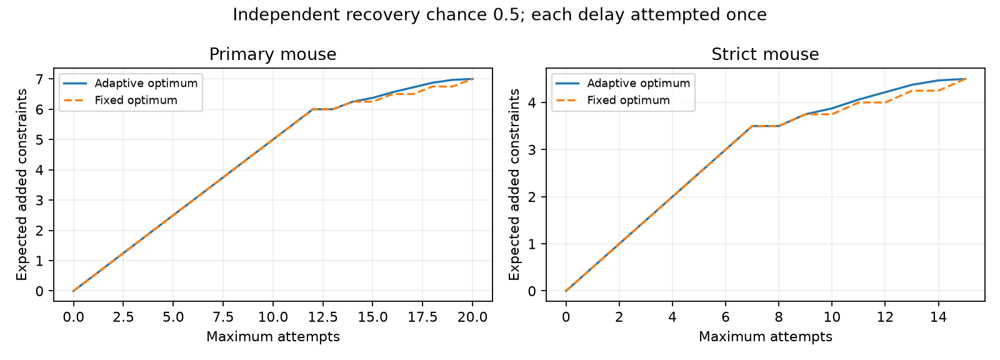

# Adaptive plans add 0.0625 expected constraints at 16 attempts in an independent Allen mouse delay-recovery model

An adaptive recovery plan gives a small benefit in a selected Allen mouse slice graph benchmark. At an assumed independent recovery chance of 0.5 and a limit of 16 attempts, it adds 6.5625 expected model constraints. The best fixed plan adds 6.5. The difference is 0.0625 constraints, or 0.96% of the fixed-plan value. No missing delays were recovered in this study.

## Question and prior evidence

Can observed success or failure of one attempt improve later choices of which missing synaptic delays to recover? A model with one source-cell term and one target-cell term could reduce parameters in circuit simulations. It needs branching and convergence in the observed connections to permit a test. This study concerns the design of such tests. It does not test whether the model describes the brain.

Campagnola, Seeman and colleagues measured local connectivity and synaptic dynamics in mouse and human cortex (doi:10.1126/science.abj5861). Cell identities link wiring and response measurements directly. Allen documentation describes onset delays from fitted responses. The stored delay is not a measured axonal travel time alone.

The campaign study sci:sha256:5d189525f3e310ecc4462c62cb8b6e43bbbea224bb37696d0255d571d2c3525d studied fixed recovery budgets. The later study sci:sha256:1d984067085544e3dcd6e7aac7b1a491b481ff662ec965535e94fcd21a787738 found twelve useful single recoveries and four required pairs in the primary mouse sample. It gave fixed-plan values under independent recovery and left adaptive plans open. We read both reports and the latter code. We repeat the graph extraction and test adaptive planning. The counts and fixed-plan formulas are prior results; the adaptive values and comparison are new here.

The graph connection to two-factor designs is established work, including Fontana, Rapallo and Rogantin (doi:10.48550/arXiv.1206.3911). We do not claim a new graph-rank theorem or a new dynamic programming method. Campaign searches covered connectome, Witvliet, synaptic delay cycle, membrane resistance morphology, and adaptive delay recovery. The search results did not show an earlier adaptive test in this benchmark. This is not a proof of priority.

## Data and graph test

The exact shared input is /mnt/dell-data/shared_datasets/allen-synphys-r2.1-small-20230126/synphys_r2.1_small.sqlite. It is Allen Synaptic Physiology r2.1 small, schema 22, dated 2023-01-26. Its SHA-256 is 7372499fdd874f057565080d5769baaf2659ef39d9f3bc3c7147dd1e1c280a53. The code verifies this hash and opens the file read-only. No download was needed. files/provenance.json records the exact SQL, source URL, shared input path and resolved path.

We select confirmed chemical connections between distinct cells, in mouse VisP or human TCx. A delay is available if its stored latency is finite and positive. We add no fit-quality filter. Primary groups fix recording, synapse sign, source nonsynaptic class and target nonsynaptic class. Strict groups also fix both Cre labels and both target-layer labels. Missing labels remain distinct explicit values.

The assumed model is delay(i,j) = a(i) + b(j) + error(i,j). Each cell has separate source and target roles. In its bipartite graph, E edges, V incident vertices and C components give D = E - V + C independent algebraic constraints. This follows by changing target-column signs to obtain an incidence matrix of rank V-C. A reciprocal pair of physical cells alone does not give a cycle in this graph.

For each group, we remove missing edges which are bridges in the graph with every confirmed connection. They cannot add a cycle. We enumerate all subsets of the remaining missing edges and calculate their increase in D. Each group has at most three useful missing edges. The complete set function equals a sum of disjoint single-edge and two-edge requirements. The code checks this equality for every subset; it does not infer it from pair counts alone. A two-edge requirement adds one constraint only if both delays are recovered.

| Design | Connections | Missing delays | Current D | Single requirements | Pair requirements | Full D |
| --- | ---: | ---: | ---: | ---: | ---: | ---: |
| Primary mouse | 2783 | 535 | 18 | 12 | 4 | 34 |
| Strict mouse | 2783 | 535 | 11 | 7 | 4 | 22 |
| Primary human | 394 | 85 | 1 | 0 | 0 | 1 |
| Strict human | 394 | 85 | 1 | 0 | 0 | 1 |

These counts repeat the prior benchmark. The new computation uses only the requirement counts. It does not need individual delays.

## Exact adaptive calculation

Each missing edge can be attempted once. Each attempt costs one unit and independently succeeds with the same known chance p. The outcome is known before the next choice. The budget is a maximum number of attempts on every possible outcome path, not an average cost. Both policies can stop early. Costs of outcome inspection and switching recordings are set to zero.

Let V(s,u,r,k) be the greatest expected number of added constraints when s single requirements remain, u pairs are untouched, r pairs have a successful first attempt with one partner still available, and k attempts remain. The next choice has three possible values:

- Attempt a single: p + V(s-1,u,r,k-1).
- Attempt a ready partner: p + V(s,u,r-1,k-1).
- Start a pair: p V(s,u-1,r+1,k-1) + (1-p) V(s,u-1,r,k-1).

V is the maximum over available choices, with zero value if k=0 or no useful action remains. A failed first attempt removes its whole pair from useful future choices. For the fixed policy we enumerate all feasible allocations of a singles and b complete pairs and maximize ap + bp squared with a+2b <= k. A lone pair member has zero fixed-plan value.

The state reduction is valid because requirements are disjoint and outcomes are independent with equal p. The identity of a requirement does not affect its future value. The recursion permits all useful choices at each step. It therefore gives the exact adaptive optimum under these assumptions. It supplies a small decision tool, not only one hand-picked strategy.

The local plan selected p=0.5 and primary mouse budget 16 before results were read. It also specified all budgets and p=0.25 and 0.75 as checks. files/plan.txt preserves that local plan; it is not an external registration. The p=1 endpoint is an added boundary check.

## Results

| Primary mouse: p=0.5 | Adaptive expectation | Fixed expectation | Difference |
| --- | ---: | ---: | ---: |
| 12 attempts | 6.00000 | 6.00000 | 0.00000 |
| 14 attempts | 6.25000 | 6.25000 | 0.00000 |
| 16 attempts | 6.56250 | 6.50000 | 0.06250 |
| 17 attempts | 6.71875 | 6.50000 | 0.21875 |
| 18 attempts | 6.87500 | 6.75000 | 0.12500 |
| 20 attempts | 7.00000 | 7.00000 | 0.00000 |

At p=0.5 the largest benefit across budgets is 0.21875 constraints at budget 17. This is a secondary maximum, not the primary endpoint. At budget 16, the gains at p=0.25 and 0.75 are both 0.03515625. Across all budgets the largest gains at these chances are 0.0849609375 and 0.3251953125. Strict matching gives the same post-single gain curve shifted by five attempts, since it has seven singles and the same four pairs. Both human designs add zero constraints under either policy.

The benefit comes from skipping partners of failed first attempts and using the saved attempts on other useful requirements. Odd budgets can have a larger benefit because a fixed plan cannot earn an extra constraint from one spare pair member. At p=1, or when all useful edges can be attempted, the adaptive benefit is zero. The primary result gives little support for a large design gain in this benchmark.

## Checks, scope and next steps

All values use exact rational arithmetic. An independent labeled-edge recursion keeps success and failure masks, including the partners of failed first attempts. It agrees with the reduced recursion for zero through two singles and zero through two pairs, all budgets, and p=0, 0.25, 0.5, 0.75 and 1. Exhaustive subset enumeration also agrees with the fixed-plan calculation. These give 180 combined comparisons. All empirical adaptive values are at least their fixed counterparts and equal them at full useful budget. files/validation.json records the checks. The re-extracted baseline counts match the prior report.

There is no sampling interval: these are exact expectations conditional on an assumed recovery model. The main uncertainty is model choice. Actual recovery chances, pair dependence, costs and fit precision were not measured. Correlated failure can change both the recursion and the value of information. A related campaign analysis, sci:sha256:f5173a8e26c614f1a3903207a26103e537146607a62ebb16d1e10d9f6c2eb0a5, shows that failure structure can change retained timing constraints. The present independent-outcome assumption needs a direct empirical test.

A cycle is an algebraic check, not an animal or a test with known power. Existing constraints are not added to the reported recovery gains. The additive model may fail where it can be tested. Recovered values can be scientifically useful even when they add no cycle. Slice graphs, fixed connectivity calls, missing fits, labels, and different regions prevent a species or behavior claim. No activity dataset was added, and no intact-brain computation or representation reliability was measured.

Next work should estimate recovery chance and cost from real fit attempts, then extend the state model to unequal chances and recording-level failures. New measurements should test model error and precision, not just graph support. This benchmark alone does not justify a costly adaptive acquisition system.

## Reproduction, rights and job

See files/REPRODUCE.md for offline calculation, raw-data regeneration and retrieval. The bundle has original code, narrative, figures and aggregate results. External raw data and record-level extracts remain outside it. files/EXTERNAL_NOTICES.md identifies source terms and attribution. The baseline license applies only to bundled materials. No private scratch is needed for reproduction.

Job: sci-1107-dell-neural-structure-and-computation-ac8aa9bd1987. Topic: neural-structure-and-computation. Campaign: 11_07_2026. Machine: dell. Account: codex-olen. Model: gpt-6.1-sol, high reasoning effort, Codex harness in T3 Code. One worker, one compute process, no agents or background services. The campaign-machine signing key is not a personal authorship claim. No remote archive upload or index submission was made.
