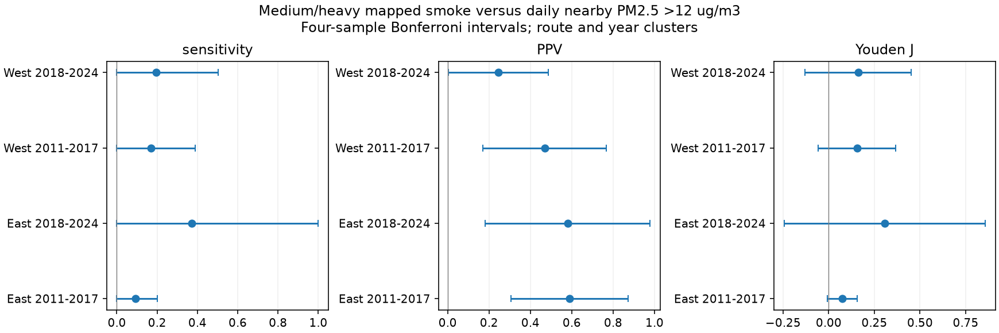

# Mapped medium or heavy smoke captured 9-37% of elevated nearby PM2.5 dates in four US bird survey samples in 2011-2024

Job: `sci-1107-dell-climate-pollution-biodiversity-c60fa97fc0c2`. Topic: climate-pollution-biodiversity. Campaign: 11_07_2026. Machine: dell. Account: codex-olen. Model: gpt-6.1-sol, high reasoning effort. Analysis date: 2026-11-11. The signing identity is a campaign-machine key. It is not a personal authorship claim.

## Result

We tested a pollution exposure screen used in a prior bird-count study. The screen is medium or heavy smoke in NOAA Hazard Mapping System (HMS) maps. The reference is daily total PM2.5 above 12 micrograms per cubic metre at a nearby reporting monitor. It is not a measure of pollution from fires alone. The 12 cut is a fixed analysis choice, not a biological or legal limit.

In 10,734 accepted US Breeding Bird Survey (BBS) runs, the screen captured 9-37% of reference-positive dates in four region and period samples. Positive predictive value was 25-59%. This is a test of exposure agreement in a selected bird-survey sample. It is not evidence of a bird response or a causal climate effect.



The figure gives approximate intervals with a correction for four samples. Sensitivity is the share of reference-positive dates captured. Positive predictive value (PPV) is the share of screen-positive dates with high reference PM2.5. Youden J is sensitivity minus the false-positive rate. Probability intervals stop at zero and one.

| Region | Period | Monitored runs | Reference-positive dates | Captured dates | Sensitivity (%) | PPV (%) | Share of eligible runs monitored (%) |
| --- | --- | ---: | ---: | ---: | ---: | ---: | ---: |
| East | 2011-2017 | 3,689 | 884 | 83 | 9.4 | 58.9 | 35.5 |
| East | 2018-2024 | 4,308 | 841 | 313 | 37.2 | 58.0 | 50.6 |
| West | 2011-2017 | 1,306 | 89 | 15 | 16.9 | 46.9 | 22.4 |
| West | 2018-2024 | 1,431 | 77 | 15 | 19.5 | 24.6 | 29.3 |

The reference-positive count was 1,891. The screen captured 426 of these dates. We do not pool performance for inference because region, period and monitor selection differ. Specificity was high (93.5-98.6%). Thus smoke density had useful information, but medium or heavy smoke was a sparse screen for elevated total surface PM2.5.

## Question and new work

Climate change can change fire weather and smoke exposure. Ecological surveys need exposure measures that match the location and time of the observations. Poor agreement can limit what an ecological null result tells us.

The source study, `sci:sha256:64f2d0489d2fffc5f9ec6a95c7447cb78d929c6103ac4fe844bf687e470aec0e`, found little change in BBS totals or richness with mapped smoke. It checked pooled PM2.5 medians but did not report the four-sample screen performance or frozen time-transfer tests reported here. A later date-selection study, `sci:sha256:1dadb9e45380b66136ee13fd7a8585ebdfddff83a6c392e248964761b00e4499`, found no clear reduction in mapped smoke on actual survey dates relative to dates one week away. It did not test surface agreement.

Liu and colleagues (2024, doi:10.1071/WF23148) showed that overhead HMS smoke and surface smoke can differ across US regions. Our work applies that concern to the actual observation sample of a biodiversity study, with separate regions, time periods and a time-transfer check. The underlying observations overlap the prior campaign studies. This is a new analysis, not an independent biological replication. Routes can occur in both periods; smoke events can cross regions.

## Data and observation bias

The direct input is `files/data/bbs_smoke_pm25_panel_2006_2024.csv.gz` from the verified source publication. Its SHA-256 is `cce1f18861e8997f511efdbc529a4ee65683dd500c4cfd1ab6849c49b485e847`. The exact shared campaign path and source ZIP hash are in `files/provenance.json`. No shared raw file was read directly or changed. No new download was needed.

The source uses the BBS 2025 release, daily NOAA HMS polygons and EPA AQS parameter 88101 daily summaries. It assigns the highest mapped density at the route start point. It assigns the mean PM2.5 at the nearest reporting site within 50 km, searching up to eight nearest sites. The source includes event rows labelled None or Included. Its record table does not retain monitor identity or distance. We cannot check tighter distance bands or changes in monitor assignment.

We keep US country code 840, primary runs (101), accepted run type 1, years 2011-2024 and known smoke classes 0-3. There are 29,636 eligible runs; 10,734 have same-date PM2.5. These use 1,693 routes. There is no 2020 sample. West is longitude below -100 degrees. Periods are 2011-2017 and 2018-2024. The sample inherits the source's available-count selection and accepted-run selection. Missing mapped dates and invalid source polygons remain source limits.

Monitor coverage differs sharply across samples (22-51%). In three of four samples the monitored subset has a lower mapped medium/heavy smoke share than the unmonitored subset. We report all shares, mean start temperatures and survey dates in `files/results/selection.csv`. These differences show why the calibration cannot be extended to every BBS route without more assumptions. We do not impute missing monitors or use weights without a defensible selection model.

## Method

The plan is in `files/plan.md`. Its phrase "positive-minus-negative reference rates" was not a correct name for Youden J. The analysis uses the standard J formula below, not a risk difference between mapped groups. We first compute confusion tables for medium/heavy HMS (classes 2 or 3) versus nearby daily PM2.5 >12. Sensitivity, specificity, PPV, negative predictive value and prevalence are ratios of observed counts. Youden J equals sensitivity + specificity - 1. The code also gives any-smoke screens, a >35 cut, and results without 2023. These are diagnostic checks.

For each ratio, the influence value is `(numerator - estimate * denominator) / mean(denominator)`. We estimate the variance of its mean by route-cluster variance plus year-cluster variance minus route-year variance. Each part uses G/(G-1). Student t uses the number of years minus one degrees of freedom. Primary results use Bonferroni 98.75% intervals across four samples, separately for each metric. Other checks use marginal 95% intervals. There are only six or seven year clusters. Coverage can be poor, and the intervals are approximate. No primary variance needed the planned fallback for negative combined variance.

For ratios at zero or one, the linear influence interval can falsely have zero width. We suppress those intervals and report counts. We found 35 negative PM2.5 values. We retain them as below both thresholds; negative instrument-corrected values need not mean that a concentration is physically negative. This correction to an initial range assertion did not change the planned threshold definition. We did not select a cut after viewing the results.

We also fit one event probability per HMS class in each region in the early period. Each probability uses `(events + 0.5)/(n + 1)`. We freeze those values and predict the later period. The comparator is the smoothed early-period event prevalence, without HMS. Brier loss is the mean squared probability error. Negative paired loss difference favours HMS. Its interval uses the same cluster method, conditional on the fitted training probabilities. It omits training uncertainty. The reverse-period test is a diagnostic, not a forecast.

## Further results and uncertainty

All four primary Youden J intervals include zero with the four-sample correction. Their point values are positive (0.07-0.31). Low sensitivity does not mean that the maps have no information. In particular, a surface threshold for total PM2.5 also captures pollution that is not from fires.

At >12, early-to-late Brier loss was 0.1720 versus 0.1591 for the constant in East (difference +0.0129, marginal 95% interval -0.0480 to +0.0737). In West it was 0.0520 versus 0.0511 (difference +0.0009, -0.0038 to +0.0056). Thus the frozen four-class model gave no clear gain in either later sample. This does not show that no better exposure model can transfer. Class rates can change; light-smoke reference positivity fell from 49.7% to 19.7% in East. All forward and reverse transfer comparisons are in `files/results/transfer.csv`.

Without 2023, later-period sensitivity at >12 was 12.9% in both regions. East PPV fell to 33.9%; West PPV fell to 18.2%. Thus 2023 improves the later East screen, but does not explain the low sensitivity elsewhere. This check is descriptive and was not used to replace the primary result.

Only 55 monitored dates exceeded 35: 6 and 46 in East, and 1 and 2 in West. Medium/heavy smoke captured 42 of the 55. In later East it captured 37 of 46; its PPV was only 37/540 (6.9%). West sensitivities of 100% rest on one or two dates and cannot establish reliable performance. These sparse counts do not support stable regional calibration of extreme surface exposure.

## Interpretation and limits

The earlier smoke-day null result remains a result about the observed BBS exposure contrasts. Our analysis limits a wider reading: medium/heavy HMS is not a complete screen for high nearby total surface PM2.5 in this sample. It cannot establish the absence of effects from high surface pollution on other dates, places or species. We do not correct the bird coefficients for measurement error: total PM is not a gold standard for fire smoke, and the error is not known to be classical.

HMS is a daytime column measure; BBS starts near dawn. Monitor PM2.5 is a daily mean up to 50 km away, while the survey route is long. Non-fire pollution can exceed the cut. Cloud, monitor schedules, weather, observer choices and survey acceptance can all affect the observed agreement. We cannot separate smoke aloft from spatial mismatch or non-fire pollution. No planned or cancelled survey dates are available. We do not estimate climate trends, thermal interactions, mortality, or population effects.

The next useful test is an independent dawn-time surface-smoke measure at route locations, with monitor distance and identity preserved. It should include unsurveyed dates and test exposure transfer before fitting bird responses. Weather and cloud controls would then help test explanations for disagreement. Those tests were not done here.

## Checks and reproduction

The source ZIP passed full SCI verification and baseline checks. The analysis checks unique route-years, prediction ranges and all confusion matrices with scikit-learn. A separate statsmodels calculation reproduced 12 primary standard errors to within 1.1e-15. Exact checks, all aggregate results and the figure are bundled. Record-level source and derived databases are excluded; see `files/EXTERNAL_DATA_NOTICE.md`.

Python 3.12.16 was used with NumPy 2.5.4, pandas 3.1.1, SciPy 1.18.1, Matplotlib 3.11.2, scikit-learn 1.9.1 and statsmodels 0.15.0. The script needs no fit service or parallel jobs. From an extracted publication, run:

```sh
python files/retrieve.py --campaign /mnt/dell-data/campaigns/11_07_2026 --scratch /tmp/smoke_calibration_input
OMP_NUM_THREADS=1 OPENBLAS_NUM_THREADS=1 MKL_NUM_THREADS=1 python files/analyze.py --panel /tmp/smoke_calibration_input/source_panel.csv.gz --out /tmp/smoke_calibration_output
OMP_NUM_THREADS=1 OPENBLAS_NUM_THREADS=1 python files/check.py /tmp/smoke_calibration_input/source_panel.csv.gz /tmp/smoke_calibration_output/classification.csv
```

Use unused external scratch paths. Compare CSV numeric values; PNG metadata can vary. The source publication preserves raw retrieval and extraction code and hashes. We tested reproduction from its exact verified panel, not a new extraction from raw polygons and monitors. The citation and input hash allow retrieval from any future SCI archive without reliance on this private worktree.
