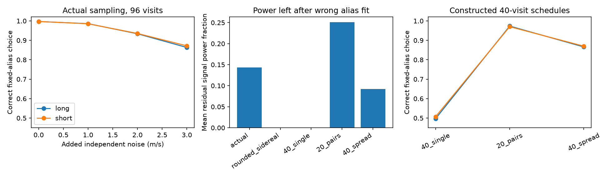

# Four-hour pairs separate two fixed GJ 3543 alias models in a 40-visit Gaussian-noise test

We test whether observing time can separate the known 9.161-day and near-1.119-day velocity models for GJ 3543. In a constructed 40-visit test, four-hour pairs give the correct fixed-period choice in 97.0 to 97.4% of trials. Visits at one sidereal phase give about 50%. This result assumes a stable sinusoid with semi-amplitude 2.73 m/s, a 1.3 m/s measurement error, and 1 m/s added independent Gaussian noise. It is an observation design result. It does not confirm a planet or a new signal.

## Question and prior work

Astudillo-Defru et al. (2015), section 6, report competing short and long periods. Their signal changes between seasons, which supports an activity explanation. Mignon et al. (2024; arXiv version 2502.06513v1), section 7.4.2, call the short-period object a planet and note recovery when they extend their period search below 1.6 days. This difference in interpretation makes the observing-time ambiguity useful to test. Our calculation does not resolve this difference. Both studies use HARPS. RVBank also uses HARPS spectra. These sources do not provide independent instrument confirmation in this study.

We searched the local campaign with `sci search` for `astronomy`, `GJ 3543`, `GJ3543`, and `3543` before the analysis. The first search gave broad astronomy results. No relevant GJ 3543 result appeared in the returned target searches. This is a limited catalog search, not a proof of novelty. Public searches covered the 2015 paper, the RVBank releases, the 2024 survey, and GJ 3543 with HIRES and CARMENES. We did not obtain an independent velocity series. The general benefit of observations at different hours is known. The added result here is the quantified projection test and fixed-period schedule comparison for this target and these input errors.

## Data and selection

The frozen inputs are the 80-row VizieR table J/A+A/575/A119/tablea3 and the 97-row HARPS RVBank version 02 CSV. We reuse both shared datasets in place and include small byte-identical source copies for offline use. `files/provenance.json` gives the exact shared paths, source URLs, retrieval time, size, and SHA-256. The shared locations are `datasets/gj3543-harps-2015-a119-5d0b04b8/gj3543_harps.tsv` and `datasets/gj3543-harps-rvbank-v02-5d0b04b8/gj3543_rvbank_v02.csv` under this worktree. Their hashes are respectively `c3e06cd014c09710f2c53d29c8b7782d1c97b18b35adf04c413a769188effc5a` and `d5cac548b814b988bc0053fef8a4c769916b441bdf91310b94e11e278078dbb3`.

We retain RVBank rows with f_RV=0, finite corrected SERVAL velocity, and positive reported error. One row with flag 64 is excluded. All 96 accepted visits fall on separate integer-BJD nights and span 2330.68 days. The time match uses BJD_DRS for the published table. All 80 published times match RVBank within 0.00005 seconds. Thus, these products share exposures. This check establishes data overlap; it is not independent confirmation. The selected analysis uses the RVBank BJD column, subtracts its minimum, and keeps velocities in m/s. The published table gives km/s.

## Method and exact control

A circular reflex velocity and a simple rotation harmonic can each give a sinusoid. For each trial frequency f, we fit a constant plus cos(2 pi f t) and sin(2 pi f t) by weighted least squares. We do not fit eccentricity, activity evolution, or a planet mass.

The primary fixed pair uses f_long=1/9.161 and f_short=1.00273790935-f_long in cycles/day. The short period is 1.119094582 days. This enforces exact sidereal alias closure and is close to the published short period of 1.11913 days. A separate sensitivity test uses both published central periods without closure.

Let A be the design matrix divided row by row by the total error. Let Q contain its orthonormal columns. For a true sinusoid with two-column matrix S and phase vector v=(cos phi,sin phi), the squared distance to the wrong model is lambda=K^2 v' R' R v, where R=(I-Q_wrong Q_wrong')S and K=2.73 m/s. Eigenvalues of K^2 R'R give the minimum and maximum over phase. Half the trace gives the phase mean. We also report that mean divided by the mean unprojected weighted sinusoid power. This ratio describes geometry, not a detection probability.

At integer multiples of a sidereal day, the two sinusoid spaces are equal: their sampled angles differ by an integer number of full turns and a sign. Thus, no precision can separate these exact fixed aliases at those times. Rounding the actual relative times to integer sidereal days gives lambda below 5e-23. This is a constructed control; no measured velocity is fitted at an altered time.

We simulate 6000 independent trials for each design and each true branch. Phase is uniform. Noise is Gaussian with variance equal to the reported error squared plus the specified extra variance. The fit uses this same variance. We select the branch with lower residual sum of squares. Equal scores within 1e-9 receive a random choice. These are fixed-frequency classification rates, not false alarm rates. Period uncertainty and a search over other periods are excluded.

The 40-single design uses nights 0 through 39 at one sidereal phase. The 20-pair design uses even nights 0 through 38, with two visits four hours apart. Thus, both use 40 visits across about 39 days. The spread design uses 40 consecutive sidereal nights with a linear hour shift from -2 to +2 hours. These are constructed barycentric times. Visibility, weather, barycentric timing changes, exposure length, and telescope scheduling are not modeled.

## Results

| Design, added noise 1 m/s | Mean power fraction, long / short | Correct choice, long / short |
| --- | --- | --- |
| Actual 96 visits | 0.1436 / 0.1432 | 98.60% / 98.55% |
| Rounded actual times | less than 3e-25 / less than 3e-25 | 49.87% / 50.50% |
| 40 single visits | less than 7e-29 / less than 7e-29 | 49.68% / 50.70% |
| 20 four-hour pairs | 0.2507 / 0.2512 | 97.35% / 97.03% |
| 40 visits with hour drift | 0.0923 / 0.0924 | 86.60% / 87.00% |

The standard Monte Carlo errors for the paired rates are about 0.21 to 0.22 percentage points. They cover simulation error only. With the two published central periods, the paired rates are 97.27% and 97.05%, versus 49.62% and 49.93% for single visits. The paired geometry thus does not depend on exact alias closure. For actual times, the primary classification rate drops to 86.3 to 87.2% with 3 m/s extra independent noise. The 96 actual times can distinguish an ideal stable signal under the assumed errors. This says little about a changing activity signal.

We also scan each measured velocity product within 0.002 cycles/day of each alias center. Each scan has 2001 points and a local refinement at the lowest grid value. These are branch fits, not a full search. The corrected SERVAL fits give periods 1.119009 and 9.167674 days, with chi-square 331.33 and 368.55. Corrected DRS gives 373.28 and 415.75; uncorrected SERVAL gives 477.08 and 521.69. All favor the short branch. Each optimized fit has four parameters, so even the lowest chi-square divided by 92 is 3.60 with the quoted errors. A stable sinusoid and those errors give an incomplete description. We do not convert the chi-square difference into planet odds. The shared spectra and shared observing times limit this reduction check.

## Checks and limits

`validate.py` compares the projection score with direct least squares and compares the phase trace with a 128-phase numerical mean. Both agree within 1e-10. `analyze.py` checks the exact-alias control and input counts. The source hashes agree with the shared dataset provenance. Tables preserve the full results, including controls and Monte Carlo errors.

The useful output is a small tool for alias geometry and a target-specific schedule test. It does not prove an activity or planet cause. We do not model correlated stellar noise, nightly calibration covariance, unknown instrument offsets, spot lifetimes, or changing amplitudes. Since each actual visit is on a separate night, an unrestricted offset for every night would remove all actual-time information. The independent-noise sensitivity is not a substitute for such a model. The paired test requires coherence over about 39 days. The known seasonal instability makes that assumption material. We did not optimize pair separation or compare all possible schedules. The 4-hour spacing is a tested example, not a best schedule. New observations should record activity indicators and instrument reference data as well as velocities.

## Reproduce

From the extracted bundle, run `python files/analyze.py`, then `python files/validate.py`. All numerical inputs are included, and no network is needed. These commands rewrite derived tables and the PNG; run them on a copy to preserve the signed draft. `environment.json` records versions. The seed is 191429. `provenance.json` gives public retrieval URLs if source data must be fetched again. No shared data are changed. The figure is a static PNG below SCI display limits.

Job: sci-1107-dell-astronomy-191cf429a72c. Topic: astronomy. Campaign: 11_07_2026. Machine: dell. Account: codex-andrii. Model: gpt-6.1-sol, high reasoning effort. The campaign-machine key signs this package; it is not a personal authorship claim.
