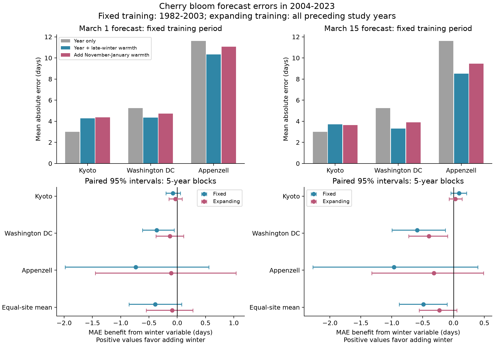
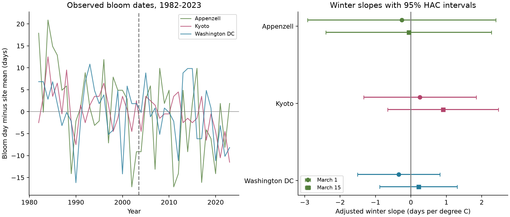

# Winter temperature gave no clear gain in March 1 cherry bloom forecasts at three sites in 2004-2023

Adding the winter variable gave no clear forecast gain in this test.
The result applies to a fixed seasonal mean in simple linear models.
It does not show that winter chilling has no effect on flowering.

## Question and prior evidence

Can mean November-January temperature improve a March 1 forecast after adjustment for February warmth and a year trend?
This matters when a model uses winter warmth as a proxy for a biological chilling process.

Prior process models use both chill and heat to predict cherry bloom [Chung et al., 2011](https://doi.org/10.1371/journal.pone.0027439).
Studies in Japan and Seattle show that winter and spring warming can have different effects.
These effects can differ by region [Hsu et al., 2023](https://doi.org/10.1016/j.agrformet.2023.109571), [Maust et al., 2025](https://doi.org/10.1002/ppp3.70037).
We test a simple winter proxy across three sites and a later time period.
We do not test or reject those process models.

## Data and scope

We used Kyoto, Washington DC, and Appenzell records in 1982-2023.
Each site has one record in each of the 42 years. The panel has 126 site-years.
Kyoto and Washington DC are established public bloom series.
We chose Appenzell from the Swiss file by maximum record count in 1982-2024, then alphabetical name.
This rule gave 42 records, all through 2023.
The choice used coverage, not model fit.
The three sites are separate regional tests. They are not a random sample of regions.

The GMU source revision is `a95298263523607c8489a7be091c8c8d8ce61979`.
The original Kyoto series is credited to Yasuyuki Aono.
Washington DC data come from EPA and the National Park Service.
**Source: MeteoSwiss** for Appenzell.
The Kyoto and Washington records describe different cherry taxa.
Washington uses a 70% bloom threshold.
The supplied Swiss guide does not give the Appenzell species or threshold.
We fit each site separately and do not compare their absolute bloom dates.

We used NASA POWER daily mean temperature at each site's listed coordinates.
The responses identify API v2.10.3 and MERRA-2.
They use local solar time and cover 1981-2024.
NASA documents a 0.5 by 0.625 degree grid [NASA source guide](https://power.larc.nasa.gov/docs/methodology/data/sources_meteorology/).
The analysis uses weather only through March 14, 2023.
Downloaded minimum and maximum temperatures do not enter the analysis.
Exact paths, URLs, response metadata, and hashes are in [provenance.json](files/provenance.json).
The shared source path and source credits are in [sources.md](files/sources.md).

## Method

We wrote [the analysis plan](files/analysis_plan.md) before fitting. It was not a registered study.
The outcome is bloom day on a 365-day calendar. We remove the leap-day offset after February.

For each site, the primary base model has an intercept, a centered year, and mean February temperature.
The extended model adds mean temperature from November 1 of the previous year through January 31.
Means give equal weight to each day.
The year term adjusts for a linear time trend.
The model does not measure chill units or separate all possible causes of that trend.

We fit each model in 1982-2003 and held its coefficients fixed for forecasts in 2004-2023.
A second test refits the model each year with only earlier study years.
A secondary cutoff uses weather from February 1 through March 14 for a March 15 forecast.
No observation in the study bloomed before March 15.
No model uses weather on or after its forecast date.
These are retrospective forecasts from archived reanalysis. They are not tests of an operational weather product available in each past year.

We report mean absolute error (MAE), root mean squared error, and signed error.
The winter benefit is MAE(base) minus MAE(extended). A positive value favors winter.
Intervals use 5,000 paired bootstrap draws of circular five-year blocks across the 20 test years.
The equal-site mean keeps the three sites in the same sampled years.
These intervals condition on the trained forecast rules. They do not refit models in each draw.
The block method assumes that the error sequence is stable enough to resample short blocks.
They do not measure uncertainty from selecting the sites, windows, or observation methods.

We also fit descriptive models over the full period and each half period.
Their intervals use heteroskedasticity and autocorrelation consistent (HAC) errors with lag three and a small-sample covariance correction.
The intervals use a normal approximation.
All secondary intervals are descriptive and have no correction for multiple tests.

## Results

Each row below uses 20 fixed-model forecasts in 2004-2023.
All error values are in days.

| Site | Year only MAE | Year + February MAE | Add winter MAE | Winter benefit [95% interval] |
| --- | ---: | ---: | ---: | ---: |
| Kyoto | 3.00 | 4.28 | 4.36 | -0.08 [-0.20, 0.06] |
| Washington DC | 5.25 | 4.35 | 4.71 | -0.36 [-0.61, -0.06] |
| Appenzell | 11.62 | 10.34 | 11.07 | -0.73 [-1.98, 0.56] |

The equal-site MAE rose from **6.32 to 6.72 days** when winter temperature was added.
The paired benefit was **-0.39 days**, with a 95% interval of **[-0.85, 0.08] days**.
All three point estimates favored the base model.
With yearly refitting, the equal-site benefit was **-0.09 days [-0.55, 0.28]**.
Thus, neither update rule gave clear evidence of a gain at March 1.



At March 15, the fixed-model equal-site benefit was **-0.49 days [-0.88, -0.10]**.
With yearly refitting, it was **-0.23 days [-0.56, 0.05]**.
Kyoto had a small positive point benefit at this later cutoff, unlike the other two sites.
This is not a common winter gain across regions.
The primary conclusion was unchanged with bootstrap block lengths of one, three, and seven years.
The primary aggregate interval included zero with three-, five-, and seven-year blocks.
With one-year blocks, it excluded zero in the direction of worse error.

In the full-period March 1 models, winter slopes were:

| Site | Winter slope, days per degree C | 95% HAC interval |
| --- | ---: | ---: |
| Kyoto | 0.26 | [-1.33, 1.85] |
| Washington DC | -0.34 | [-1.51, 0.82] |
| Appenzell | -0.26 | [-2.92, 2.40] |

All three intervals include zero.
The February slopes were negative at all three sites, with full-period intervals below zero.
This fitted association did not ensure good forecasts in a later period.
In Kyoto, the year-only model had lower test MAE than either temperature model at both cutoffs.
In Appenzell, the fixed base model predicted bloom about eight days too early on average at March 1.
Yearly refitting reduced this bias to about three days.
The large Appenzell error shows a limit of linear trend transfer in this test.

Winter slopes were also unstable between periods.
For example, Washington's March 1 slope was +0.56 in 1982-2003 and -1.87 in 2004-2023.
These are descriptive estimates. A seasonal mean can mix chilling, heat accumulation, and correlated weather.
The sign does not identify a biological mechanism.



## Observation bias and limits

There were no duplicate site-years, source date mismatches, or missing weather values in the analysis windows.
Earliest observed month-days were March 25 in Kyoto, March 15 in Washington, and April 10 in Appenzell.
The complete annual records avoid changes in which sites enter the analysis each year.
Separate site models retain each series' event definition.
The time term reduces confounding by a shared linear trend in weather and reported timing.

These controls do not remove all observation bias.
The source files do not measure observer effort, visit intervals, tree replacement, or changes in reporting methods.
We cannot estimate detection probability or correct interval uncertainty without those data.
The Swiss threshold is not stated in the supplied guide.
The data source is a prepared public repository; we did not audit every date against its original report.

The sample has only three sites and 20 test years per site.
Block-bootstrap intervals can be unstable in short series.
Winter slopes have wide intervals. A mean temperature is a weak proxy for chilling, which is often nonlinear.
The fixed November-January window can miss relevant chill or forcing in other months.
The weather grid does not resolve each tree's local conditions or all elevation differences.
A linear time trend can fail when the rate of change varies.
The results do not establish causal warming effects or a lack of chilling response.
No air pollution, frost damage, pollinator mismatch, or species-distribution outcome was tested.

## Reproduce and inspect

The package includes the 126-row panel, 720 forecasts, all metrics, both figures, source code, and raw weather responses.
See [reproduction.md](files/reproduction.md) for complete instructions and the source retrieval recipe.
The original bloom ZIP stays in the shared store. Its exact checksum and used member checksums are recorded.

From the publication root, with the listed packages installed:

```sh
bash files/reproduce.sh /tmp/cherry-rerun /path/to/python
```

The script uses `campaign-compute` and one library thread.
Use an output directory outside this signed bundle.
Independent source joins, seasonal means, and MAE checks are recorded in [validation.json](files/validation.json).
The full source analysis completed twice. An optional panel-only rerun was canceled while it waited for a compute slot.
No completed panel-only rerun is claimed.

## Campaign record

- Job: `sci-1107-hp-climate-pollution-biodiversity-b51757a73e56`
- Topic: `climate-pollution-biodiversity`
- Campaign: `11_07_2026`; machine: `hp`; account: `codex-andrii`
- Model: `gpt-6.1-sol`, high reasoning effort
- Work: one finite worker; no sub-agents
- Signing: campaign-machine key, not a personal authorship claim
- Distribution: local signed SCI bundle; no remote archive or index submission

The baseline license covers the new work. Source credits and source rights remain as stated in [sources.md](files/sources.md).
