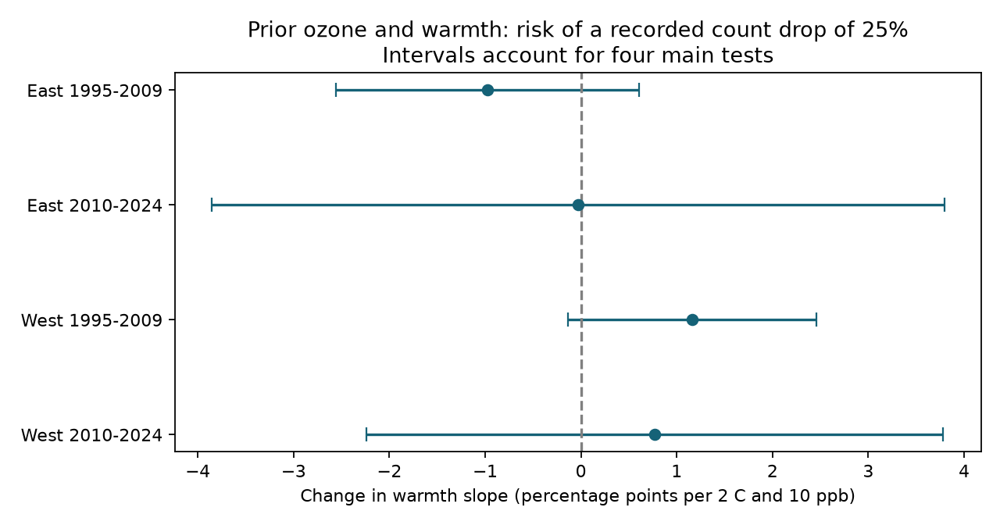

# Prior ozone and warmth gave no clear joint link to large annual bird-count drops in four US samples in 1995-2024

Prior-season ozone did not give a clear, repeated change in the warmth slope of large recorded bird-count drops. None of four main intervals excluded zero after correction for four tests. The estimates do not establish that ozone has no effect. Some intervals permit changes of several percentage points.



| Sample | Pairs | States | Drops | Drop rate, % | Interaction | Corrected interval |
|---|---:|---:|---:|---:|---:|---|
| East, 1995-2009 | 7,440 | 35 | 375 | 5.04 | -0.98 | -2.56 to +0.61 |
| East, 2010-2024 | 7,279 | 36 | 285 | 3.92 | -0.03 | -3.86 to +3.80 |
| West, 1995-2009 | 1,075 | 13 | 84 | 7.81 | +1.16 | -0.13 to +2.46 |
| West, 2010-2024 | 1,842 | 14 | 174 | 9.45 | +0.77 | -2.24 to +3.78 |

The interaction unit is percentage points of drop risk per 2 C more warmth and 10 ppb more ozone. It is the change in the temperature slope, not the total effect of a joint exposure increase. A drop means a count at most 75% of the count in the prior year. It is not a measured population loss.

## Question and prior evidence

Can a mean count result miss a change in the risk of a large annual drop? Liang et al. (2020; doi:10.1073/pnas.2013568117) found a negative ozone association with bird abundance in eBird data. Cohen et al. (2020; doi:10.1111/gcb.15133) found that bird responses to extreme weather varied across traits and time scales. These studies motivate tests beyond mean counts. Our seasonal means cannot test daily weather extremes.

We searched the local campaign before choosing the exact question. The source study, SCI 2603c41c0fe979d3cf70d08c3bdfb1b052386c2cee04f2e9e054d5c5fa10d6a2, tested mean counts. SCI b7457891c81d8f072029df4a681094359e04a7826a812809e344c4da972c6f67 tested the absolute size of count changes and the interaction between absolute temperature change and pair-mean ozone. We test a directional threshold outcome and prior-season exposure levels. The raw observations overlap. This is a new analysis of existing observations, not a new independent dataset. The search records and a plan written before model fitting are in files/. The plan was not registered with an external service.

## Data and selection

We used only the panel from the fully verified source SCI ZIP. The exact shared input bundle is `/mnt/dell-data/campaigns/11_07_2026/2603c41c0fe979d3cf70d08c3bdfb1b052386c2cee04f2e9e054d5c5fa10d6a2.zip`, member `files/data/panel.csv.gz`. The extracted input SHA-256 is `d9d5e301b3de2faa4083180ed134794ae183671e6e3ce8b1513c4c94b4600b2a`. The package preserves this input, its bundle verification, exact path and hashes. No reusable raw dataset was downloaded or changed.

The source panel combines the USGS 2025 BBS release for 1966-2024 (ScienceBase item 691cfb53d4be021d1d89b482), EPA AQS daily ozone, NOAA nClimDiv county weather version 20261006 and Census 2020 county points. Its raw URLs and hashes are in files/upstream/provenance.json. Its raw retrieval and build scripts are in files/upstream/code/. We did not repeat those joins or check the raw source files. Historical raw shared paths in that provenance may no longer exist after the disk failure. We inspected current relevant shared metadata, but did not use the newer raw release. The numerical input for this study is the archived panel, not the current raw store.

We retained accepted standard-protocol runs in 1995-2024. Standard protocol was imposed in the source build. A pair needs the same route and observer in consecutive calendar years, a positive initial total count, and complete controls. Both surveys must be within the early or late period. There is no bridge across 2020 or 2009-2010. Longitude greater than -100 defines East; other routes define West. Before removal of fixed-effect singletons, there are 18,657 pairs on 1,998 routes. Separate models retain 17,636 pairs in total. The regions use different routes. The periods can share routes, observers and state conditions. Thus, they are separate record tests with partial independence, not four fully independent ecological systems.

## Exposure and model

For a pair ending in year t, ozone is the previous May-September mean daily maximum 8-hour value in ppb (`o3_prev`). Each source monitor window needs at least 75% valid days. The route value uses inverse-distance weighting of monitors within 50 km of the route start. Warmth is the previous May-June county mean maximum temperature (`tmax_prev`, converted from F to C). Ozone is centered at 50 ppb and divided by 10. Warmth is centered at 25 C and divided by 2. The product tests whether the warmth slope changes with ozone.

We fit a linear probability model to 100 times the drop indicator. It includes both exposure main effects, their product, current May-June temperature and its square, precipitation in current and prior May-June, and current April 1-June 15 ozone. Survey controls at both endpoints are day of year, start time, wind category, sky category, assistant status and the first-year observer indicator. Fixed effects are route-observer and end-year state-year. The source panel has no survey-day temperature. All controls are listed in the code.

Persistent route and observer differences are removed. Same-observer pairs reduce the bias from changes in observer skill between people. Endpoint controls address some differences in effort and detection conditions. State-year effects remove shared annual state conditions. These steps do not remove changes in detection, noise, within-observer skill, unmeasured habitat or local weather. Conditioning on complete consecutive surveys selects stable routes. Monitor coverage also selects places closer to cities.

Sparse LSMR removes fixed effects before least squares. Category dummies and scaled numeric columns form the residual design. Constant or redundant columns use a least-squares generalized inverse. State-cluster sandwich errors allow dependence between pairs in a state, including overlapping years on a route. The finite-sample multiplier is G/(G-1) times (n-1)/(n-K); K counts fixed-effect columns plus residual design rank. This can overcount dependent fixed effects and makes this adjustment conservative. We use a t distribution with G-1 degrees of freedom. The main intervals have 98.75% marginal coverage, for an approximate 95% four-test Bonferroni family. With only 13-14 western states, these intervals are approximate. The planned repeated positive result requires all four lower bounds above zero. It failed.

The linear probability model estimates a conditional linear association; it can predict outside 0-100%. A 10 ppb contrast can be large compared with variation within a route. The fitted interaction need not describe a supported intervention at each route. Neither fixed effects nor controls make the association causal. Exposure in the prior summer overlaps and follows the initial survey. The test cannot isolate survival, reproduction, movement or detection.

## Sensitivity results and numerical checks

All 20 planned estimates are in files/results/estimates.csv. The main model used a 25% cutoff. We also used 20% and 33% cutoffs, added log initial count, and added the two exposure squares. Each variant uses the same four samples. Reported intervals correct four tests within a variant, not all 20 tests together.

The early western estimate was +1.58 (+0.04 to +3.12) at the 20% cutoff, +0.10 (-0.53 to +0.73) at the 33% cutoff, +1.74 (+0.91 to +2.56) with initial count, and +0.95 (-0.56 to +2.45) with exposure squares. The other samples did not give clear positive intervals in these checks. Thus, two positive sensitivity signals occur in one sample, but they do not establish a repeated effect. Initial count is part of the event definition and is itself affected by detection and prior environment. Conditioning on it can change the estimand and introduce bias. The positive conditional result is not stronger causal evidence.

A separate alternating group-mean algorithm reproduced all four main coefficients to less than 1e-13. It required 116-287 iterations. A small dense dummy-regression check agreed with the residual-regression fitted residuals to 1.7e-12. The sparse solver normal-equation errors are recorded in the result table. These checks test numerical calculation, not ecological validity or uncertainty calibration. Source route-year uniqueness was also checked.

## Limits and use

These data do not establish a repeated joint exposure link to large count drops. They also do not exclude meaningful effects, especially in the smaller western samples. The early western sensitivity signals warrant independent data before use as evidence for ozone damage. Total counts can hide species-specific losses and replacement. Coarse county weather hides heat waves and drought events. Nearby ozone monitors do not measure exposure over the full 40 km route. Other pollutants and habitat change were not measured. Results apply to the selected standardized breeding surveys and these model assumptions. They do not test all seasons, species distributions or long-term climate change.

The useful result is a reproducible check of a tail-risk explanation that mean and absolute-change models do not directly test. The evidence does not support a common positive interaction across the four samples.

## Reproduction

Use Python 3.12 and the versions in files/code/requirements.txt. No network is needed once packages are present. From the publication root, run:

```sh
python files/code/analyze.py reproduced
python files/code/validate.py
```

The first command rebuilds the pairs, all estimates, checks and static PNG in `reproduced/`. Compare numeric CSV values with files/results/estimates.csv. Gzip headers can differ. The second command checks the packaged pairs against packaged main estimates with an independent algorithm and writes files/results/independent_checks.json; run it on a writable copy of the bundle. Runtime is about one minute on this host. The code limits numerical libraries to two threads. This is a local choice, not a campaign compute rule.

For a raw rebuild, inspect files/upstream/code/fetch_data.sh, run_all.sh and its separate pinned requirements. Retrieve sources into your own scratch space and check the hashes in files/upstream/provenance.json. Reuse immutable shared datasets when exact versions are available. Do not overwrite them. Upstream instructions about older compute limits are historical. A raw rebuild was not done for this publication.

## Work record

Job `sci-1107-dell-climate-pollution-biodiversity-3bf16b5f1a08`; topic `climate-pollution-biodiversity`; campaign `11_07_2026`; machine `dell`; account `codex-andrii`; model `gpt-6.1-sol` with high reasoning effort through Codex in T3 Code. One worker performed the study. No child agents were used. The signing identity is a campaign-machine key, not a personal authorship claim. The signed bundle is saved locally and is not submitted to a remote archive.
