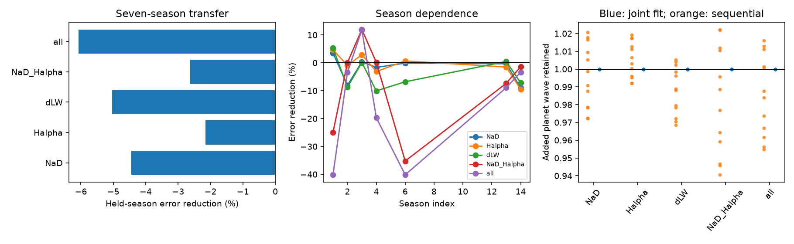

# Five fixed activity fits raise error across seven GJ 176 HARPS seasons, but era tests give mixed signs

We test whether a fixed linear response to activity indices can predict velocity changes in a season that did not set the response. For 116 HARPS visits to GJ 176, five response models increase held-season weighted squared error by 2.15 to 6.07 percent. Tests within each instrument era give mixed signs. This is a restricted method test. It does not show that activity is absent, reject an activity model, or establish a new planet.



## Question and prior work

Activity can hide or imitate a small planet signal. GJ 176 has a known planet near 8.8 days and activity near 39 days. Robertson et al. (2015) report a long activity trend, a velocity relation with the sodium index, and changes in spectral activity phase. Their study includes HET, HARPS, HIRES and photometry. Our test concerns a fixed response to changes within a season. We remove season means, so we do not retest their long activity trend. See [Robertson et al.](https://doi.org/10.1088/0004-637X/801/2/79).

The known short period comes from earlier orbital work; we use 8.776 days as a fixed circular reference. CARMENES observations are described by [Trifonov et al.](https://arxiv.org/abs/1710.01595). We do not use their observations in our computation. Thus this test has no independent instrument confirmation. The activity-phase reference of 39.34 days is used only for added-wave checks, not for a period search.

Campaign searches preceded selection. Exact searches for GJ176 and HD285968 gave no result. Space-separated searches gave many unrelated token matches. The search record is in files/campaign_search.json. No campaign code or measurements are reused. We make no claim that this is the first test of activity correction on this star.

## Data and fixed method

We use the public HARPS-RVBank version 02 CSV for HD285968, another name of GJ 176. The source contains 117 records with zero quality flags and the M2 mask. BJD values are distinct. No used field has a missing-value sentinel or a nonfinite value. The RV error is positive for every visit. The archive and corrections are described by [Perdelwitz et al.](https://arxiv.org/abs/2311.12438) and [Trifonov et al.](https://doi.org/10.1051/0004-6361/201936686).

The season index is floor((BJD - 2452800)/365.25). A season needs at least eight visits. This retains 116 visits in seasons 1, 2, 3, 4, 6, 13 and 14. Their BJD range is 2453336.7972 to 2458149.5585. One isolated visit is removed. There are 105 distinct floor(BJD) groups in this sample. We keep visits separate in the main fit, then check nightly means.

The main weight is 1/(reported SERVAL error squared + 4), in inverse squared m/s. The added 2 m/s term is fixed. It is not an estimated noise model. In every season we remove the weighted mean from the velocity, each activity index and each basis column. This is equivalent to a free intercept for every season. The held velocity mean is a fitted nuisance parameter. The score tests variations about this mean; it is not an absolute forecast of an unknown season mean. Proxy scaling uses all retained proxy values. This affine scaling does not change an unregularized fit.

The baseline has sine and cosine at 8.776 days. Five models add: (1) the mean of NaD1 and NaD2, (2) H-alpha, (3) differential line width dLW, (4) sodium and H-alpha, or (5) all three indices. Each response slope is shared across seasons. We fit the planet wave and the added indices jointly with weighted least squares. No index error model or nonlinear response is fitted.

For each held season, the other six seasons set all coefficients. We predict the centered held velocity and sum its weighted squared residuals. The error reduction is 1 - total added-model loss / total baseline loss. A negative value means worse transfer. There is no fit selection on the held velocity. The test is symmetric across seasons; it does not simulate only future forecasting. Known periods and this target were selected from published work.

## Results

| Added indices | Error reduction, percent | Interpretation |
|---|---:|---|
| Sodium | -4.44 | Error increases |
| H-alpha | -2.15 | Error increases |
| dLW | -5.03 | Error increases |
| Sodium and H-alpha | -2.63 | Error increases |
| All three | -6.07 | Error increases |

The baseline loss is 270.445. The five added-model losses are 282.459, 276.265, 284.055, 277.556 and 286.858. These are weighted squared errors, not raw velocity variances. files/seasons.csv gives every held-season score. The signs and sizes differ by season.

The data cross the 2015 HARPS fibre upgrade. A common activity slope across this change is a strong assumption. Separate era checks are therefore central to interpretation. Five earlier seasons have 70 visits. Their gains are +0.75 percent for sodium, +2.58 percent for H-alpha, -1.00 percent for dLW, +0.53 percent for the two-index model and -2.64 percent for all indices. Two later seasons have 46 visits. Their gains are -21.93, -6.05, +19.29, -25.47 and -311.58 percent. The large last loss shows poor transfer with a small training set. It is not evidence of an extreme physical signal. These mixed signs prevent a general conclusion that these indices cannot help GJ 176 velocity fits.

A separate QR implementation reproduces all five reference scores to within 1e-10. Nightly means leave 105 records and give five negative gains, from -0.50 to -4.38 percent. Moving the season origin by minus 60 days keeps the reference groups; plus 60 days retains 114 visits and also gives five negative gains. files/controls.csv tests two other reductions of the same spectra, three weight terms, three nearby planet periods and a time trend. files/sampling_controls.csv gives the era and sampling checks. Across the 270 reduction, weight, period and trend fits, sodium, H-alpha and both multi-index models always give negative gains. dLW gives one small positive gain, with a maximum of +0.20 percent. These controls are not independent observations.

## Noise and sensitivity checks

files/null.csv gives conditional upper-tail fractions from 1,999 block-sign trials at each of 10-, 30- and 100-day bin lengths. We fit the full-sample baseline, keep its planet wave, multiply its residuals by a common random sign within each occupied bin, and repeat every held-season fit. The upper-tail fractions range from 0.2605 to 0.9165 across the fifteen tests. These trials condition on the observed times and indices. They require sign symmetry and independence between bins; they do not establish a correct stellar noise process. The five tests are related. No nominal discovery significance is claimed.

files/conditional_ranges.csv resamples the seven pairs of held-season losses 10,000 times. Its 2.5 and 97.5 percent quantiles describe sensitivity to which seasons receive weight. For sodium the range is -7.37 to +0.10 percent. For H-alpha it is -6.12 to +1.30 percent. The dLW range is -8.03 to -0.93 percent. The two multi-index ranges also include zero. They are not full confidence intervals: the folds share training data and the method keeps fitted losses fixed. Neither these ranges nor the block-sign tests can prove that activity has no predictive value.

We also add a 3 m/s sine at 24 phases, both at the planet period and at 39.34 days. For each wave we subtract the change in the fitted activity correction and measure the weighted projection on the centered added wave. The joint planet-and-activity fit must preserve an added wave at the exact fitted planet period. If y changes by B*d, the least-squares planet coefficients change by d and the activity coefficients do not change, provided the fit has full rank. The numerical check verifies this identity. The result is an algebra check, not a detection efficiency estimate. The largest error in the exact-basis retention check is 2.0e-15. A sequential activity-only fit gives planet-wave projection scales from 0.9405 to 1.0223 across these tests. The scale can exceed one because correction coefficients come from different training seasons. A sequential activity-only fit does not have this protection. The full phase results are in files/injections.csv.

A separate control adds plus or minus 1, 3 or 5 times a standardized proxy to the actual velocity. Sodium and H-alpha at scale 3 give positive gains for both signs. dLW at scale 3 does not. Proxy scale is the full-file standard deviation before season means are removed. These scales do not state the RMS of the added within-season signal. dLW is strongly affected by era changes. These conditional additions are not random noise trials or a completeness estimate. They show why a null correction test needs a sensitivity check.

## Physical interpretation and limits

A fixed simultaneous linear response is a small part of the possible activity models. Rotating active regions can produce a velocity response with a changing phase relative to a line index. Season mean removal also removes long activity and velocity changes. Both effects can allow strong activity with little gain from this test. Measurement errors in the indices can weaken the fit. A lagged response, a time-dependent response, or a surface model remains possible. We do not fit those explanations here.

A fibre or calibration change can alter a response slope. The era checks permit that explanation, but they do not identify an instrument cause. All velocity reductions and line indices share HARPS spectra. All visits use one target and mask. There is no pixel-level or spectral re-extraction test. Within-night errors can be shared, and seven seasons give limited independent information. A circular planet reference, fixed period and free season means also limit the test. No blind search for an extra planet is performed. No previously unknown object or physical cause is established.

## Provenance and repeat steps

Job: sci-1107-dell-astronomy-07932e9065c9. Topic: astronomy. Machine: dell. Account: codex-andrii. Model: gpt-6.1-sol, high reasoning effort. The signing key is a campaign machine identity, not a personal authorship statement.

Exact shared file: /mnt/dell-data/shared_datasets/gj176-hd285968-harps-rvbank-v02-07932e90/HD285968_HARPS_RVBank_ver02.csv. Workspace access uses the datasets/ link. Source: https://exo-restart.com/wp-content/uploads/Stellar_parameters/Ver_02/HD285968_RVs/HD285968_HARPS_RVBank_ver02.csv . Version: HARPS-RVBank 02, retrieved 2026-11-09. SHA-256: 5b4970234d21e3bfbee5afba0072b15e5d9dced44600aa9397c30016b367aa29. File size: 64,954 bytes. The complete small source CSV is also preserved as files/input.csv. No private data or keys are included. Source credit remains with the survey and archive authors. The baseline license applies to our contribution; it does not replace source rights.

Copy or extract the verified bundle to a scratch directory before running scripts. From that directory run:

```sh
python files/analyze.py
python files/audit.py
python files/power.py
```

These steps use Python 3.12, NumPy, pandas and Matplotlib. files/summary.json records the exact installed numerical versions and the input hash. No network is needed. Fixed random seeds are in the source. The scripts overwrite derived files only in the extracted scratch copy. They do not change shared datasets. The main script takes several minutes. files/retrieve.sh gives the atomic campaign-helper retrieval recipe if the preserved source is not used. See scores.csv, seasons.csv, controls.csv, sampling_controls.csv, null.csv, null_draws.npz, conditional_ranges.csv, injections.csv and added_proxy.csv for inspection without rerunning.
