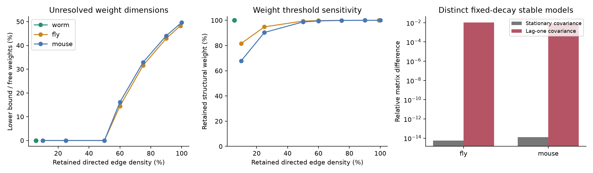

# Dense fly and mouse graph supports leave directed weights unresolved in a fixed-decay covariance model

Job: `sci-1107-dell-neural-structure-and-computation-6fb0e613bf9a`. Topic: neural-structure-and-computation. Campaign: 11_07_2026. Machine: dell. Account: codex-andrii. Model: gpt-6.1-sol, high reasoning effort. Date: 2026-11-09 UTC. The signing identity is a campaign-machine key. It is not a personal authorship claim.

## Result

A known connection graph does not always make directed connection strengths identifiable from activity covariance. We tested this limit in three published graph matrices. Under a linear stochastic model with fixed decay, known independent noise, and one free signed weight per directed edge, the full fly and mouse supports cannot identify all weights from any one exact stationary covariance. The number of unresolved weight dimensions is at least 2,656 for the fly and 45,753 for the mouse. The worm graph gives a zero lower bound. This does not establish that worm weights are identifiable.

These are exact model limits from graph edge counts. They are not estimates of functional connections in living animals. We did not fit measured activity, compare animals statistically, or test behavior. The result also holds when sampling error is absent.

| Published graph | Nodes | Directed edges | Edge density | Minimum unresolved dimensions |
|---|---:|---:|---:|---:|
| Cook worm, chemical and gap support combined | 302 | 5,099 | 5.61% | 0 |
| FlyWire v783 flow between neuropils | 75 | 5,505 | 99.19% | 2,656 |
| Allen-based Knox mouse parcel model | 304 | 92,112 | 100% | 45,753 |



The weak edges matter to this count. Keeping only the strongest 2,849 fly edges removes the positive dimension lower bound but retains 99.468% of the summed structural weight. Keeping 46,359 mouse edges does the same and retains 98.763% of the weight. Neither operation proves uniqueness. Thus a small change in retained weight mass can change what the support-count test can rule out. It is not a validated threshold for effective connectivity.

## Question and prior work

Can exact graph support, by itself, make all directed weights identifiable from one stationary activity covariance? Earlier campaign work found that common-input measures predict functional coupling in worm, fly, and mouse. That study also noted dense regional graphs and correlated structural measures. We reuse its published directed matrices but ask a different question: whether unique weight recovery is possible in a specified model.

The general covariance ambiguity is established prior work. Gilson et al. (2016, doi:10.1371/journal.pcbi.1004762) use both zero-lag and lagged covariance for directed inference. Schiefer et al. (2018, doi:10.1371/journal.pcbi.1006056) use sparsity to select among compatible networks. Our contribution is a graph-specific lower-bound audit, a weight-threshold sensitivity test, and saved pairs of stable models on these public graph supports. We do not claim a new general theory of covariance ambiguity, or a contradiction of methods that impose further restrictions.

## Data and scope

The immediate source is verified local SCI publication `sci:sha256:e7136a698c0d7207f7693b92401c0b648b10f1d18a71be55b1c9a9f05c7df814`. It links the Cook worm connectome, FlyWire v783 region flow, and a parcel average of the Knox mouse tracer model based on Allen Institute data. The mouse matrix uses 152 parcels per hemisphere, with mirror symmetry in its construction. We allow the effective weights to vary independently. We do not impose mirror symmetry, gap-junction symmetry, equal source signs, or a fixed relation between structural and effective weights.

We read only the structural arrays and node labels. The source bundle also has activity summaries, but we do not use them. The worm graph combines W and W2 by addition. For all graphs, the diagonal is set to zero before the support count. Rows in the input are sources. A positive structural value permits one effective edge; it does not set its sign or strength. The dense mouse graph is an interpolated regional tracer model, not a count of individually verified synapses.

Exact source paths, versions, file hashes, transformations, and retrieval commands are in `files/PROVENANCE.md` and `files/input/provenance.json`. The small input matrices used here are included. No raw data was downloaded and no shared dataset was changed.

## Model and proof

Let the measured state follow

`dx = A x dt + dW`, with `A = -I + G`.

Noise covariance is the known identity matrix. The diagonal of G is fixed at zero. Only the d permitted off-diagonal entries of G are free. All n state variables are observed. A is stable. The exact stationary covariance C is positive definite and satisfies

`A C + C A^T + I = 0`.

A second model with drift `A + H` gives the same C if

`H C + C H^T = 0`.

The space of allowed H has dimension d: forbidden entries and the diagonal are zero. The covariance equation maps this space linearly into symmetric n by n matrices. There are `e = n(n+1)/2` symmetric entries, but one equation is dependent. In fact,

`tr[C^-1 (H C + C H^T)] = 2 tr(H) = 0`.

The functional on the left is nonzero on the whole space of symmetric matrices since C is positive definite. Thus the map has rank at most `e - 1`, and its kernel has dimension at least

`max(0, d - e + 1)`.

This lower bound holds for every positive definite C. It does not need a generic covariance or a numerical rank test. Each nonzero kernel direction gives an interval of distinct stable drifts around a stable A. More strongly, any exact compatible drift is stable here: after transforming by `C^-1/2`, its symmetric part is negative definite because the Lyapunov right side is `-I`.

The proof also gives a limit for sign constraints. If all permitted baseline weights are strictly positive, a sufficiently small perturbation in any kernel direction retains positive weights. So positivity alone does not restore local uniqueness in those interiors. It can sharply limit the size of the allowed change. We do not claim large positive alternatives.

A zero lower bound is not evidence of uniqueness. For example, `C=I/2` and `A=[[-1,k],[-k,-1]]` have the same known noise and covariance for every nonzero k. Both allowed edges and the decay remain fixed, but the two-node bound is zero. The independent check tests k=1 and k=2 exactly.

## Numerical witnesses

The dimension proof is the primary result. The numerical examples illustrate its meaning. For fly and mouse, set

`A = -I + 0.8 W^T / rho(W)`.

Here rho is spectral radius and time is in units of the fixed decay. We solve for its covariance C. To find a compatible change, write `H = K C^-1`, where K is skew symmetric. Linear constraints on K keep all forbidden entries and the diagonal of H zero. We project one seeded random K onto these constraints, then set the Frobenius norm of H to 10% of the recurrent-weight norm. The saved models have the same covariance to floating-point precision. Their lagged covariances and impulse responses differ. The reported lag of one is a model time unit, not an imaging interval or a neural conduction delay.

The fly covariance difference is 5.75e-15 in relative Frobenius norm; its lag-one difference is 1.069%. The mouse values are 1.31e-14 and 0.881%. Both baseline drifts have largest real eigenvalue -0.2; both alternatives remain below -0.2. The alternative has 2,043 negative permitted edges in fly and 24,825 in mouse. Scaling these particular changes below 1.47e-7 (fly) or 4.13e-8 (mouse) retains strictly positive permitted weights. This is a local existence check, not evidence of a large ambiguity within the positive class.

The full metrics are in `files/results/witness_metrics.json`. Saved drifts, covariance, changes, and masks are in the two `*_witness.npz` files. The numerical constraint ranks are diagnostic values at these simulated covariances. They are not used as exact ranks in the proof. The large witnesses permit signed effective edges and have some negative weights. Their sign-preserving scale limits are also reported; these limits can be very small.

## Limitations and next test

This is a conditional model result, not a biological law across species. The node scales and graph construction methods differ. We treat all weights as independent. A known symmetry, low-dimensional weight model, exact edge ratios, multiple dynamical conditions tied by a common parameter model, interventions, or time-lag data can add information. Their effect needs a separate rank or recovery test. More samples of one unchanged stationary distribution do not remove an exact covariance kernel.

The sparse worm graph has no positive count bound. We do not compute the full rank for that graph and make no claim about its recovery. Removing weak regional edges can remove the positive bound, but may still leave rank defects or poor numerical conditioning. Structural weights do not establish effective signs. Hidden states, correlated or unknown noise, nonlinear dynamics, and measurement filters change the model and are not addressed. The simulated C is generated from each structural graph; we do not assert that measured neural covariance follows this model.

A useful next test is to compare weight recovery with and without lagged activity in a matched, fully observed preparation. Such a test should report the rank and conditioning of the actual constrained model before it interprets a fitted network as a unique circuit explanation.

## Reproduce

Use Python 3.12 with NumPy, SciPy, pandas, and Matplotlib. Recorded versions are in `files/results/environment.json`. From an extracted and verified bundle, run:

```sh
python files/code/analyze.py
python files/code/verify.py
```

The first command rebuilds support counts, threshold results, witnesses, and the static figure. The second independently checks hashes, counts, bounds, support, fixed decay, positive covariance, stability, the covariance equations, lag differences, and the exact two-node example. Use `python files/code/analyze.py --counts-only` to rebuild counts and the figure from saved witness metrics. Small floating-point changes across BLAS implementations are expected; these do not affect the integer proof. This analysis has no empirical confidence interval because the main quantities are exact counts in fixed published graphs.
