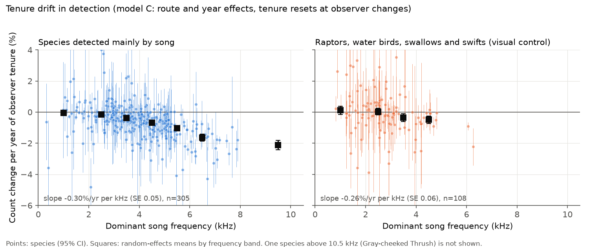
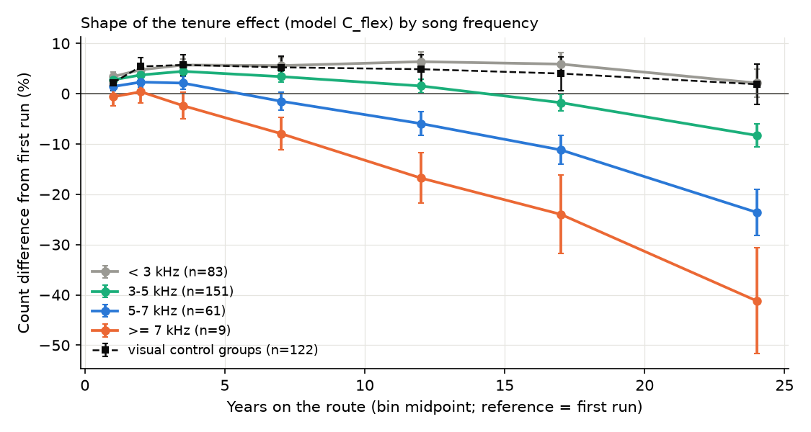
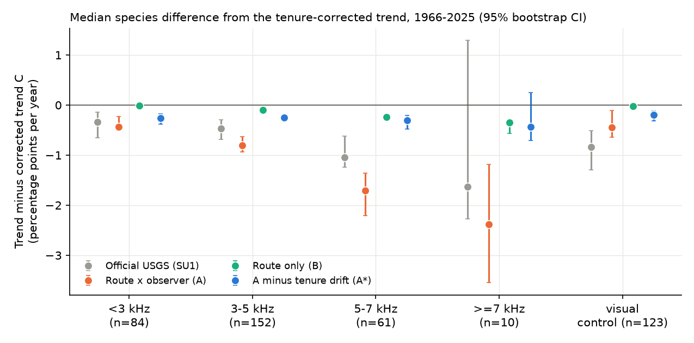

# BBS observers recorded about 41% fewer birds that sing at 7 kHz or more after 20 years on a route; route x observer models put this loss into 1966-2025 trends of 446 species

Job: sci-1107-dell-climate-pollution-biodiversity-e6b874917bf2. Topic: climate-pollution-biodiversity. Campaign 11_07_2026. Machine: dell. Account: claude-sci. Model: Claude Opus 5.5 (claude-opus-5-5), an automated research worker. The signing key is a campaign-machine key. It is not a personal authorship claim.

## Summary

Earlier campaign work (sci:sha256:b113aa1b...) found that long-serving North American Breeding Bird Survey (BBS) observers record fewer high-pitched birds. Because cold-adapted species sing higher, this makes part of the apparent warming of the bird Community Temperature Index (CTI). That study did not examine species population trends. Standard BBS trend models use observer-route effects. They assume that detection does not drift while one observer serves. We measured the drift for 446 species and its effect on 1966-2025 trends.

Main results:

1. Drift increases with song frequency. In a model with route and year effects and a tenure term (model C), counts changed per year of tenure by -0.13% for species below 3 kHz, -0.55% at 3-5 kHz, -1.23% at 5-7 kHz and -2.06% at 7 kHz or more (random-effects means of species that are detected mainly by song). The slope was -0.30% per year per kHz (SE 0.05; 305 species; Spearman -0.48).
2. The loss accelerates with tenure. With tenure bins (post-hoc), all groups first gained 2-6% in their first 2-4 years on a route. After 20 or more years, counts were +2% for species below 3 kHz, -8% at 3-5 kHz, -24% at 5-7 kHz and -41% at 7 kHz or more, relative to the first run (Figure 2). Raptors, water birds, swallows and swifts (visual control) stayed at +2%.
3. A model with route x observer fixed effects (model A, the usual "observer effect" model) put all of this drift into the trend. Song frequency, which comes from outside the BBS, gave a fraction of 1.16 (family bootstrap 95% CI 0.96-1.44). The median trend of species at 5-7 kHz was 1.7 percentage points per year lower in model A than in model C; for species below 3 kHz it was 0.4 points lower (Figure 3).
4. When we subtracted the drift from model A (A* = A - beta), the frequency dependence went away (fraction 0.05, CI -0.14 to 0.20). A frequency-independent difference of about -0.2 to -0.4 points per year between models A and C stayed in all groups, also in the visual control. We cannot assign it to observers or to birds.
5. The official USGS 1966-2025 survey-wide trends carried an uncertain part of the drift: fraction 0.39 (CI -0.27 to 0.77). The pre-specified regression tests did not find the drift in the official trends.
6. Cold-adapted species had more drift (+0.053% per year of tenure per 1 C of species temperature index, p < 0.001). The implied CTI increase was +0.04 C per 10 years of tenure (abundance weights). Across species, no trend estimator showed a clear decline of cold-adapted relative to warm-adapted species. With drift removed (A*), the slope became -0.047% per year per C (SE 0.022), so warm-adapted species declined slightly more.

Conclusion: an observer-age-type detection loss for high-pitched birds is large in the BBS. It is a property of the observers and not of the birds. Users who fit their own trend models with route x observer effects get trends for high-pitched species that are too negative by about 1-2 percentage points per year, unless they model tenure. This artefact also adds a false "cold species decline" signal to climate analyses. Its size in the official USGS trends is not determined.

## 1. Question and plan

Earlier campaign work showed weak climate tracking of North American birds, for example a CTI that followed less than 10% of warming (sci:sha256:c0a3a9aa...). It also found observer effects, and showed that observer tenure reduces detection of high-pitched birds (sci:sha256:b113aa1b...). If detection drifts by beta per year while one observer serves, then a model with route x observer effects measures the trend only from change inside each observer's period. Inside that period, tenure and year increase together. Thus the model adds beta to the trend.

We asked: how large is this bias in BBS species trends for 1966-2025, which species does it affect, and does it change the species patterns that people use as evidence of climate effects?

We wrote files/ANALYSIS_PLAN.md before we calculated any trend. The plan has five tests (H1-H5). We added a simulation, tenure-shape models, end-of-service models, outlier-resistant regressions and a frequency instrument after the first results. These are post-hoc. We identify them below.

## 2. Data

- BBS 2026 release (1966-2025), USGS and ECCC, doi:10.5066/P144YU3S: 10-stop counts (States.zip), runs and observer numbers (Weather.csv), routes, species list. We used 130,303 standard runs (RunType 1, RPID 101) on 5,319 routes by 10,417 observers. The BBS has no 2020 runs.
- USGS BBS Analysis Results 1966-2025 (Hostetler et al. 2026, doi:10.5066/P1OSNSFC, CC0): survey-wide (SU1) core trends. We added this file to the campaign dataset store.
- Song frequency: Sagar et al. (2024), Dryad doi:10.5061/dryad.69p8cz99k (CC0), dominant frequency from xeno-canto recordings; Nearctic values when available. 417 of 446 species had a value.
- Species temperature index (STI): abundance-weighted mean 1981-2010 May-July GHCN_CAMS temperature of the routes of the species.

Exact paths, URLs and SHA-256 values are in files/PROVENANCE.md. Licences and attribution are in files/NOTICE-external-data.md.

## 3. Methods

Species: all orders, forms combined by binomial, 446 species recorded on 50 or more routes. A priori visual control groups: Accipitriformes, Cathartiformes, Falconiformes (raptors); Anseriformes, Pelecaniformes, Suliformes, Podicipediformes, Gaviiformes, Gruiformes, Ciconiiformes and Laridae (water birds); Hirundinidae and Apodidae (aerial insectivores). 123 species. The other 323 species are "detected mainly by song" in this text.

Tenure: years since the observer's first standard run on the route. Career: years since the observer's first BBS run.

Models (one per species; Poisson; all runs on routes where the species was recorded at least once):

- A: route x observer effects + year effects + first-run dummy (the usual observer-effect model).
- B: route effects + year effects + first-run dummy.
- C: route effects + year effects + first-run dummy + beta x tenure. Tenure goes back to 0 at each observer change. These resets identify beta; the year effects remove the common time pattern.
- Variants: C with an end-of-service dummy (last two runs of an observer who left the route before 2024), C with tenure capped at 20, C with career instead of tenure. Post-hoc: A with the end-of-service dummy (A_end), B with it (B_end), and C_flex with tenure bins (1, 2, 3-4, 5-9, 10-14, 15-19, 20+ years; reference = first run).

We concentrated out the route or route x observer effects exactly (conditional Poisson likelihood) and used Newton steps for the year effects and covariates. Standard errors are cluster-robust by route. On a synthetic test, the solver gave the same estimates as a Poisson GLM with dummy variables. The trend tau is the least-squares slope of the year effects on year (log units per year; we report 100 x (exp(tau) - 1) % per year). A* = tau_A - beta_C, because tenure increases by one each year inside an observer period.

Independent drift estimate (beta_ev): at 5,740 observer changes on 2,941 routes, the log ratio of the mean count in the incoming observer's first 3 runs to the outgoing observer's last 3 runs, regressed on outgoing tenure and gap, with BCR x decade effects (method of b113).

Across species we used random-effects weighted regressions (DerSimonian-Laird between-species variance) with standard errors clustered by family, medians with bootstrap intervals, and Huber regressions. Post-hoc frequency instrument: fraction of drift in an estimator = slope of (estimator - C) on song frequency divided by slope of beta on song frequency (Huber fits, 323 non-visual species, 300 family bootstrap draws). Song frequency does not come from the BBS, so it does not share estimation error with the trends.

Simulation (post-hoc): for four template species (Golden-crowned Kinglet, Blackburnian Warbler, Mourning Dove, Grasshopper Sparrow) we made synthetic counts on the real run and observer structure. Counts were gamma-Poisson with a true trend of -1.0% per year, a true drift of 0, -1% or -2% per year of tenure, and a random observer skill (SD 0.2). Four replicates each.

## 4. Results

### 4.1 Drift by song frequency (H1)

| Group (detected mainly by song) | Species | Drift per year of tenure, model C (random-effects mean, SE) |
| --- | --- | --- |
| below 3 kHz | 83 | -0.13% (0.05) |
| 3-5 kHz | 151 | -0.55% (0.04) |
| 5-7 kHz | 61 | -1.23% (0.09) |
| 7 kHz or more | 10 | -2.06% (0.21) |
| visual control groups | 121 | -0.19% (0.07) |

- Slope on frequency: -0.30% per year per kHz (SE 0.05) for species detected mainly by song; -0.34 (0.07) for passerines only; -0.24 (0.06) with log body mass (all species).
- Robustness: the end-of-service, capped-tenure and career variants gave the same frequency pattern (Table in files/results/results.json, H1). The independent turnover estimate beta_ev correlated with beta_C (Spearman 0.49, 414 species) and had a slope on frequency of -0.26% per year per kHz (SE 0.03).
- Species with the strongest drift include Blackpoll Warbler, Grasshopper Sparrow, Brown Creeper, Golden-crowned Kinglet, Boreal Chickadee, Blue-gray Gnatcatcher, LeConte's Sparrow and Bay-breasted Warbler (-2.3% to -3.3% per year of tenure).
- Negative control, pre-specified linear version: it partly failed. In the visual groups, beta also decreased with frequency (-0.26% per year per kHz, SE 0.06). Ducks had no mean drift (+0.29%, SE 0.17). Gulls and terns, cormorants, swifts and swallows had negative values. Swallows and swifts are often detected by their high calls, and colonial water birds are often counted as distant flocks. Thus the a priori group does not show pure visual detection.
- Negative control, tenure shape (post-hoc, Figure 2): the visual groups had the same early gain as the low-frequency species and no late loss (+1.9% at 20+ years, SE 2.0). The late loss occurred only in the higher-frequency song groups.
- End-of-service: in model C_end the last two runs of an observer were 5.3% lower (SE 0.2) for all species. In model A_end the dip was 2.2% (SE 0.2), and slightly larger for higher frequency (-0.29% per kHz, p = 0.02). The tenure drift stayed the same with this term.

### 4.2 Bias in species trends (H2)

Median species difference from the tenure-corrected trend C, percentage points per year (95% bootstrap CI), from files/results/trend_difference_by_class.csv:

| Group | A - C | B - C | A* - C | Official - C |
| --- | --- | --- | --- | --- |
| below 3 kHz | -0.43 (-0.51, -0.23) | -0.02 | -0.27 (-0.38, -0.17) | -0.33 (-0.65, -0.15) |
| 3-5 kHz | -0.80 (-0.93, -0.63) | -0.10 | -0.25 (-0.30, -0.21) | -0.47 (-0.69, -0.30) |
| 5-7 kHz | -1.71 (-2.20, -1.36) | -0.24 | -0.31 (-0.48, -0.21) | -1.04 (-1.24, -0.62) |
| 7 kHz or more | -2.38 (-3.55, -1.18) | -0.34 | -0.44 (-0.71, 0.26) | -1.63 (-2.28, 1.30) |
| visual control | -0.45 (-0.64, -0.11) | -0.02 | -0.19 (-0.32, -0.12) | -0.84 (-1.30, -0.51) |

- Model A had a frequency gradient in trends: -0.33% per year per kHz (SE 0.11, p = 0.003; 289 non-visual species). In the 278 non-visual species that also have an official trend, the gradient was -0.29 (SE 0.09) for A, +0.09 (0.09) for B, +0.12 (0.10) for C, +0.07 (0.10) for A* and -0.09 (0.08) for the official trends.
- The frequency instrument gave the part of the drift that each estimator carries: A 1.16 (0.96-1.44), A_end 1.14 (0.96-1.43), B 0.19 (0.18-0.20), A* 0.05 (-0.14 to 0.20), official 0.39 (-0.27 to 0.77).
- Pre-specified test: the regression of (A - C) on beta (random-effects weights) was 0.65 (SE 0.42). A few species with very large trends (for example colonising species) made this test imprecise. A Huber fit gave 0.98 (SE 0.02).
- Simulation (files/results/simulation.csv): with a true drift of -2% per year and a true trend of -1.0% per year, model C gave -1.00% (SD 0.04) and beta -1.98%; model A gave -2.98%; model B gave -1.35%. With no drift, all three models gave -0.99%.
- The end-of-service dummy did not remove the frequency-independent part of A - C (median difference -0.70 points per year with A_end, against -0.75 with A). After the drift correction (A*), the median remaining difference was -0.22 points per year. We do not know its cause. Possible causes are observer cohort differences (newer observers are better or worse), which a model without observer effects puts into the trend, or route weights that are different between the models. This part does not depend on frequency.

### 4.3 Official USGS trends (H3)

- The correlation of the official trends with our national trends was moderate: r = 0.68 for A, 0.69 for B and 0.68 for C (398 species). The official trends use area-weighted strata and other model forms, so they differ from our route-weighted national year effects.
- Pre-specified tests: the slope of (official - C) on beta_C was 0.10 (SE 0.31), and on beta_ev -0.53 (SE 0.34). The slope of (official - A) on beta_ev was -1.01 (SE 0.40). These tests do not show the drift in the official trends.
- Post-hoc tests: by frequency class, the median of (official - C) became more negative with frequency (-0.33 to -1.04 points per year from below 3 kHz to 5-7 kHz), about 55% of the change in (A - C) over the same classes. A Huber fit of (official - C) on beta_C gave 0.45 (SE 0.05), but shared estimation error between C and beta_C can make part of this value. The frequency instrument gave 0.39 (-0.27 to 0.77).
- Conclusion for H3: the hypothesis that official trends carry the full drift was not supported. A partial effect (about 0 to 0.8 of the drift) is possible. Mean official trends of species at 6 kHz or more were -0.48% per year; with the full drift removed they would be +1.33% per year. The true value is between these limits.

### 4.4 Climate pattern across species (H4)

- The STI did not have a clear relation to song frequency when we used all species and family-clustered errors (-0.30 C per kHz, SE 0.27). The b113 landbird estimate was -0.57 C per kHz.
- Drift had a clear relation to the STI: cold-adapted species lost more detection (+0.053% per year of tenure per 1 C of STI, SE 0.009, non-visual species). The implied abundance-weighted CTI increase from drift alone was +0.037 C per 10 years of tenure (+0.072 C with equal species weights). b113 found +0.011 to +0.019 C per decade with log weights.
- Slopes of species trends on STI (random-effects weights; % per year per 1 C; all 398 species with an official trend): official +0.022 (SE 0.014), A -0.004 (0.027), B -0.021 (0.021), C -0.030 (0.020), A* -0.047 (0.022). Without weights, the official slope was +0.048 (SE 0.019). For non-visual species, A* gave -0.056 (0.023) and the official trend minus the full drift gave -0.048 (0.020).
- Thus, in national BBS trends for 1966-2025, cold-adapted species did not clearly decline more than warm-adapted species. The drift adds a "cold species decline" component of about 0.04% per year per 1 C to estimators that carry it. When we remove it, warm-adapted species declined slightly more. The pre-specified "fraction removed" ratios in results.json are not useful, because the uncorrected slopes are near zero.

### 4.5 Consequences (H5)

- Species with a significant decline (95% CI below 0): 179 with model A, 94 with A*, 110 with C, 119 with B, 150 in the official results (399 matched species) and 60 for the official trends minus the full drift. These counts use approximate standard errors for A* (we added the variances of tau_A and beta).
- Wood-warblers (Parulidae, 43 species): mean trend -0.83% per year with A, +0.30% with A*, +0.72% with C; official -0.18%, official minus the full drift +0.95%.
- Species at 6 kHz or more (29 species): -0.87% per year with A, +0.84% with A*.
- Cumulative effect: a drift of -2.06% per year sustained for 59 years corresponds to -70% (log-linear), or -65% from the mean log drift of the class. Inside one observer period of 20 years, the observed loss at 7 kHz or more was -41% (Figure 2).

The mean observer experience in the network increased from 0 in 1966 to about 10 years on the same route and 15 years in the BBS by 2021 (Figure 6). Thus a model without observer effects also takes some of the drift (about 0.19 of it, from the frequency instrument and the simulation).

## 5. Interpretation

1. The frequency-dependent drift is a robust result. Two estimators, four model variants, a tenure-shape model and a simulation agree. The comparison between high- and low-frequency species on the same routes, with the same observers and in the same years, removes observer effects that are common to all species. The shape (a small early learning gain, then a loss that increases with tenure and with frequency) agrees with age-related high-frequency hearing loss. We do not have observer ages, so this is consistent evidence and not proof.
2. Models with route x observer fixed effects are common in research use of the BBS. They take the full drift. For species that sing at 5 kHz or more, their 1966-2025 trends are too negative by about 1-2 percentage points per year relative to the high-frequency-neutral estimators. A tenure term, or the A* correction, removes this frequency dependence.
3. The size of the bias in the official USGS trends is not determined by our tests. We recommend that the USGS models add a tenure or observer-age term, or test the drift with turnover contrasts as we did.
4. For climate analyses: cold-adapted species sing higher, so the drift makes a false warming of the CTI and a false relative decline of cold species in estimators that carry it. This agrees with b113 and extends it from the CTI to species trends. After the drift is removed, national BBS trends do not show more decline in cold-adapted species. Thus the weak climate signal in BBS trends found by the earlier campaign work is not hidden by the drift. The drift makes it look stronger in some estimators.
5. Absolute trend levels depend on how a model treats differences between observer cohorts (about 0.2-0.4 points per year in all species). This is an age-period-cohort identification problem that the BBS design cannot solve without observer ages or independent detection data.

## 6. Limitations

- Observer ages are not known. Tenure is a proxy. Hearing loss is the most likely mechanism for the frequency gradient, but other age effects (attention, effort) can contribute.
- The correction assumes that the tenure effect seen across observers at turnovers is the same as the drift inside one observer, and that it does not depend on observer cohort. A linear tenure term is a simplification; the tenure-bin model gave almost the same trends (correlation of tau_C and tau_C_flex 0.9999).
- The a priori visual control groups contain species that observers often detect by sound (swallows, swifts, colonial water birds). The linear negative control partly failed. The tenure-shape control did not fail.
- Our trends are national year-effect slopes with route weights. The official trends use stratum area weights and other model forms. Comparisons with the official trends are therefore imprecise.
- BBS counts are an index. We did not model detection distance, time of day or weather.
- Song frequencies come from xeno-canto recordings and not from survey conditions. Some values are uncertain (for example Gray-cheeked Thrush, 14.6 kHz). 29 species had no value.
- Only 10 species are in the class of 7 kHz or more, so the estimates for this class are imprecise.
- The post-hoc analyses (sections 4.1-4.3, marked) were added after we saw the first results. The pre-specified H3 test was not supported, and we report it.
- The A* standard errors ignore the covariance between tau_A and beta_C.

## 7. Reproduce

1. `bash files/code/00_fetch.sh <scratch_root>` downloads the raw data into `<scratch_root>/datasets/`, unpacks the acoustic table into `<scratch_root>/work/scratch/acoustic` and prints SHA-256 values. In the campaign, the same files are in the shared store (files/PROVENANCE.md).
2. `bash files/code/run_all.sh <root> [nproc]`, where `<root>/datasets` holds the data. The scripts write intermediates to `<root>/work/scratch` and results to `<root>/work/result/files/{results,figures}`. 02_models.py and 07_extra_models.py save one checkpoint per species and can continue after an interruption. The model fits need about 1-2 CPU-hours in total; the run needs about 4 GB RAM. Set BLAS threads to 1 (run_all.sh does this).
3. Software: Python 3.12.16, numpy 2.5.4, pandas 3.1.1, scipy 1.18.1, statsmodels 0.15.0, xarray 2026.9.0, matplotlib 3.11.2. Random seeds are fixed in the scripts.

## 8. Files

- files/ANALYSIS_PLAN.md: the plan written before any trend was calculated.
- files/code/: 00_fetch.sh, run_all.sh, 01_prep.py (tables), 02_models.py (models A, B, C and variants), 03_events.py (turnover estimator), 04_analysis.py (H1-H5), 05_figures.py, 06_simulation.py, 07_extra_models.py, 08_posthoc.py, 09_export_indices.py.
- files/results/species_results.csv: one row per species: STI, song frequency, trends of A, B, C and A* with SE, drift beta (model C and variants), beta_ev, the official trend and interval. Trends and beta are in log units per year.
- files/results/results.json (pre-specified tests), posthoc.json (post-hoc tests), tenure_shape.csv, trend_difference_by_class.csv, simulation.csv, network_tenure_by_year.csv.
- files/results/annual_year_effects_ABC.csv: national log year effects per species for models A, B and C (first year = 0).
- files/figures/: Figures 1-6.
- files/PROVENANCE.md and files/NOTICE-external-data.md: sources, hashes, licences and attribution.

Route-level, run-level and observer-level tables are not in the bundle. The scripts make them again from the public BBS release.
