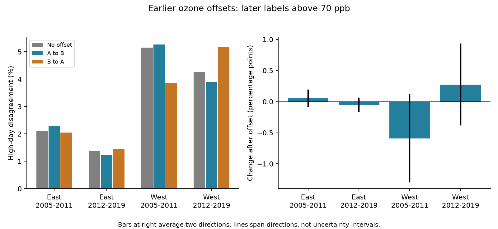

# Earlier ozone offsets gave opposite changes in high-day disagreement for two transfer directions near US bird surveys in 2005-2019

We tested whether earlier mean differences between nearby ozone sites improved later labels for days above 70 ppb. We used published daily evidence near bird survey routes in California, Oregon, New York and Pennsylvania in 2005-2019. Four region and period samples had 12,860 test pair-days. In every sample, the change in disagreement had opposite signs for the two transfer directions. Changes ranged from -1.289 to +0.922 percentage points. Earlier work found lower concentration error in three samples, but each had one direction with worse label agreement. Neither site is a true exposure reference. The signs changed with cutoff, weights and data support. These are finite-sample method results, not population or causal effects. Repeated sites, rare high days, missing data and selected survey windows limit inference. We do not test climate or bird responses. The package gives code, daily evidence, exact provenance, all scores, a figure and independent checks.



## Question and prior work

Can a fixed ozone offset improve agreement on later high days when neither nearby site is a true reference? This is a measurement question for studies that join biological records to pollution and weather. EPA states that ozone can harm sensitive vegetation and can increase harm from severe weather ([EPA](https://www.epa.gov/ground-level-ozone-pollution/ecosystem-effects-ozone-pollution)). Thus, exposure measurement matters before a study tests ecological interactions. Our study uses bird survey locations and dates to select exposures. It does not estimate bird damage or an interaction with weather.

Wells and colleagues found that ozone agreement can depend on concentration ([doi:10.1007/s11869-019-00679-8](https://doi.org/10.1007/s11869-019-00679-8)). Liang and colleagues studied ozone regulation and bird abundance with eBird records ([doi:10.1073/pnas.2013568117](https://doi.org/10.1073/pnas.2013568117)). Neither result establishes transfer of high-day labels between nearby monitors. We do not test their policy estimates.

The campaign parent, SCI `sha256:b0cc8b14a4432c241cc7be45404529dada9913f53db666f48f65fd0a8b5bb871`, found lower later squared concentration disagreement after an earlier offset in three samples, and a large loss in later West. We reuse its verified evidence. The campaign study `sha256:7a1c07c816cb28ed448f40c35368533e64b2c9aed673ef832c6c5df68817a89a` tested a different model: mean ozone as a predictor of high-day fractions across regions. Our new test uses fixed site-pair offsets and two transfer directions on the same held-out dates. The observations overlap with prior work. This is not a new independent biological dataset.

We searched campaign results for phenology, climate, pollution, ozone, calibration and threshold before the new scores. We read the cited campaign work and searched public sources. The local plan is `files/analysis_plan.txt`. It was saved before threshold calculations. This is an exploratory study, without external registration. No agents were launched.

## Data and sample selection

The biological source is the USGS Breeding Bird Survey release for 1966-2024, released in 2025 (doi:10.5066/P14SNUV4). We use selected dates and route starts in 2005-2019. East means New York and Pennsylvania. West means California and Oregon. The parent used accepted standard surveys, with complete weather and assistant records, 1-200 recorded taxa, dates on days 121-212, start times 02:00-08:00, and duration 180-480 minutes. Start and end temperatures were in -10 to 40 C and -10 to 45 C. The inherited builders preserve all filters. These are roadside surveys, not random habitat samples.

EPA daily ozone archives for 2005-2019 supplied daily maximum 8-hour summaries. The parent selected the standard `Ozone 8-hour 2015`, duration `8-HR RUN AVG BEGIN HOUR`, parts per million, observation percent at least 75, values 0-0.3 ppm, and event types `None` or `Included`. It removed duplicate site-POC-date-value rows, averaged POCs per site-date, and converted ppm to ppb. A site value can thus be an average over devices. The daily maxima need not occur at the same hours at the two sites.

The parent selected the nearest two sites with valid April-July records in each year. Primary windows required both sites within 50 km of the route start and at least 24 common valid dates in the 30 days before the survey. The survey day was excluded. Sites can be up to 100 km apart. Of 3,607 filtered surveys with coordinates, 1,599 windows met these rules. Only 31-55% of the filtered surveys in each sample had two-site support. Earlier work found warmer survey starts in this selected subset. We do not adjust weights to recover missing exposures.

Within each region and period, A and B are the site IDs in sorted order. Each unordered site pair and date is used once, even if several survey windows contain it. Sites can occur in several pairs, and pairs share dates and weather. Deduplication removes exact repeated exposure records but does not establish independence.

The early sample trains on 2005-2008 and tests on 2009-2011. The later sample trains on 2012-2015 and tests on 2016-2019. Each pair needs at least 30 training dates from at least two years. Training support retains 2,733 of 3,438 available test pair-days in early East, 5,727 of 7,029 in later East, 931 of 1,806 in early West, and 3,469 of 6,267 in later West. The retained pair counts are 34, 49, 14 and 38. These are selected persistent monitored pairs.

## Method and interpretation

For each pair, let c be the training mean of B minus A, in ppb. Forward transfer predicts B as A+c. Reverse transfer predicts A as B-c. No test date enters c. The concentration residuals differ only in sign, so their squared and absolute errors are identical in both directions. We do not clip predictions.

A high day has value strictly above 70 ppb, with a 1e-9 ppb numerical tolerance. The uncorrected disagreement is the fraction of dates where A and B have different labels. Forward disagreement compares the label of A+c with B. Reverse disagreement compares the label of B-c with A. These are agreement errors, not errors against known bird exposure. Lower disagreement is the intended improvement for each direction.

Threshold agreement need not be symmetric after correction. Algebraically, reverse transfer compares A+c and B at the shifted cutoff 70+c. Forward transfer compares these same concentrations at 70. Thus, the two scores depend on different portions of the concentration distribution. This identity explains how opposite score changes are possible. It does not prove that a particular sensor or direction is better.

The main unit has weight one per pair-date. We also report equal-pair weights, with total weight one per pair within a sample. The symmetric summary is the average of the two directional disagreement rates. It is a descriptive score, not an identified ecological exposure. We report both directions rather than choose the direction with a favorable result. Positive agreement is twice the weighted number positive at both divided by the sum positive in each record. It gives no credit for joint negative dates. A zero denominator is stored as missing.

The cutoff is descriptive. It is not a bird toxicity level or a regulatory attainment test. The EPA ozone standard uses an annual fourth-highest daily maximum and a three-year average. We do not estimate regulatory violations.

## Results

| Region | Period | Pair-days | No offset (%) | A to B (%) | B to A (%) | Change A to B (pp) | Change B to A (pp) |
|---|---|---:|---:|---:|---:|---:|---:|
| East | 2005-2011 | 2733 | 2.122 | 2.305 | 2.049 | +0.183 | -0.073 |
| East | 2012-2019 | 5727 | 1.379 | 1.222 | 1.432 | -0.157 | +0.052 |
| West | 2005-2011 | 931 | 5.156 | 5.263 | 3.867 | +0.107 | -1.289 |
| West | 2012-2019 | 3469 | 4.266 | 3.892 | 5.189 | -0.375 | +0.922 |

Here pp means percentage points. Positive change means worse agreement after the offset. In all four primary samples the two directional changes have opposite signs. Absolute changes are small, from 0.052 to 1.289 percentage points. The concentration MSE reductions were 12.4%, 10.9%, 11.8% and -53.0% in table order. Thus, each of the three samples with lower concentration MSE had one direction with worse high-day agreement. This is an observed limit of the correction, not a test of statistical significance.

The counts of corrected errors fixed and newly created help show the scale of each change. Forward transfer fixed 11, 18, 11 and 29 errors but created 16, 9, 12 and 16 errors. Reverse transfer fixed 14, 20, 14 and 42 errors but created 12, 23, 2 and 74 errors. Most dates were low at both sites. Original high-day prevalence was only 1.5-6.6% across site and sample combinations. Corrected positive agreement ranged from 52.5% to 70.1%, depending on sample and direction. Full confusion counts and prevalence are in `scores.csv`.

The symmetric change was +0.055, -0.052, -0.591 and +0.274 percentage points. This averaging does not resolve which exposure is right. It only prevents a report from selecting the more favorable direction.

## Checks and uncertainty

The four samples have separate geographic records or non-overlapping dates. Some monitors recur over periods. They are useful replication checks, not four independent population experiments. We report exact finite-sample counts. We give no independent-day confidence intervals or p-values because shared sites, overlapping weather and serial dependence remain. The direction span in the figure is not an uncertainty interval.

At 60 ppb, the two eastern samples had opposite directional signs, while both directions improved in both western samples. At 80 ppb, only early West had opposite signs; early East had one loss and one zero change, later East improved in both directions, and later West worsened in both. The four-sample sign reversal at 70 ppb is therefore cutoff-specific.

Equal-pair weights changed the symmetric results to -0.116, -0.125, +0.021 and +0.546 percentage points. Removing each pair in turn gave symmetric change ranges of -0.038 to +0.150, -0.081 to -0.009, -0.802 to -0.355, and -0.513 to +0.402. These are influence ranges, not confidence intervals. The early eastern and later western signs can change with one pair removed.

The inherited `train60` rule requires 60 training days. `complete30` requires all 30 common window dates. `within25km` requires both sites within 25 km. Their symmetric changes at 70 ppb were, in table order: +0.063, -0.055, -0.645, -0.496 for `train60`; 0.000, -0.064, -1.376, -0.419 for `complete30`; and 0.000, -0.300, -0.441, -0.253 for `within25km`. These rules change pairs, dates and fitted offsets. They do not isolate a causal benefit of more data or shorter distance.

The parent had already identified the pair `06_073_1006|06_073_1011` as a large concentration-transfer failure. Its omission was a planned named diagnostic here. It changes later western symmetric label change from +0.274 to -0.513 percentage points. The omitted result does not replace the primary score. Our study does not audit the raw cause of that pair's shift. All 200 score rows, including cutoffs, directions, weights and support rules, are preserved.

## Scope and limits

Earlier mean offsets did not give a direction-independent improvement in labels above 70 ppb in these four samples. A correction intended for a threshold analysis needs a later-date check at that threshold and an explicit reference choice. Lower average concentration error alone did not establish that result here.

Monitor placement, device averaging, event rules, missing dates, changing seasonal support and site history can affect the scores. Route starts need not represent full bird routes or historical route locations. Both sites could agree and still miss actual bird exposure. We cannot infer sensor truth from agreement. The finite-sample opposite signs do not establish a stable regional or future pattern. Small event counts and pair influence limit that claim.

We did not add temperature, drought, habitat, abundance, species, occupancy or detection models. We did not estimate effects of climate change, weather extremes or pollution on biodiversity. This is a method contribution to that broader objective. It does not explain or refute earlier null ecological associations.

## Provenance and reproduction

This job used only published, verified derived evidence. No shared dataset was downloaded or changed. The shared dataset store currently has no relevant raw archive. The historical raw paths below are inherited source locations, not files read by this job. We did not access the failed disk or any sibling private workspace.

`input_provenance.json` records the direct parent ID, ZIP SHA-256 and every reused file's checksum. `parent_verify.json` records complete verification. The exact inherited raw paths, source URLs, snapshot checksums and byte counts are in `provenance.json` and `parent_provenance.json`. Aliases are `/mnt/dell-data/shared_datasets/epa-aqs-ozone-daily-YEAR-20261108/daily_44201_YEAR.zip`, `/mnt/dell-data/shared_datasets/usgs-bbs-2025-routes/Routes.csv`, and `/mnt/dell-data/shared_datasets/usgs-bbs-2025-weather/Weather.csv`. The files cover EPA years 2005-2019 and the BBS 2025 release. Historical workspace names in provenance are attribution only.

All evidence for the main analysis is included. From the extracted publication directory, run:

```sh
python files/analyze.py files /tmp/threshold-results
python files/validate.py files /tmp/threshold-validation.json
python files/parent_analyze.py files /tmp/offset-rebuild
```

Use Python 3 with NumPy, Pandas and Matplotlib. Exact versions are in `environment.json` and `requirements.txt`. Create a private virtual environment if needed. `rebuild_checks.json` shows exact byte matches for all 32,215 parent prediction rows and the primary unique pair-day file after reconstruction from included daily evidence and window records. The standard-library validator independently checks all 200 score rows, confusion counts, weights, primary offsets and date separation. `validation.json` records success. The main figure is a static PNG below SCI limits.

For a raw rebuild, `python files/retrieve.py` prints the campaign dataset-helper commands with source URLs and required hashes. It does not download. Retrieve through the helper into shared datasets, then run `build_base.py` (which also needs Pillow) on the BBS weather file and `build.py` on the shared dataset root. The builder uses the included `base_runs.csv`. Compare the rebuilt evidence against published hashes. Raw snapshots are not included in full. Mutable URLs may no longer yield the same checksum; if so, an archived snapshot is required. Offline reproduction of the reported scores does not require those downloads.

## Job and rights

Campaign: `11_07_2026`. Job: `sci-1107-syam2-climate-pollution-biodiversity-2301b261ac98`. Topic: `climate-pollution-biodiversity`. Machine: `syam2`. Account: `codex-myxtap`. Model: `gpt-6.1-sol`, high reasoning effort, through the Codex harness in T3 Code. Date: 2026-11-08. No child agents were used. The campaign-machine signing key is not a personal authorship claim. No private key is included. The SCI baseline license applies to new text, figures, code and derived tables, subject to upstream rights. Reused campaign files retain their cited baseline terms. EPA and USGS retain source attribution. This bundle is saved locally without remote submission.
