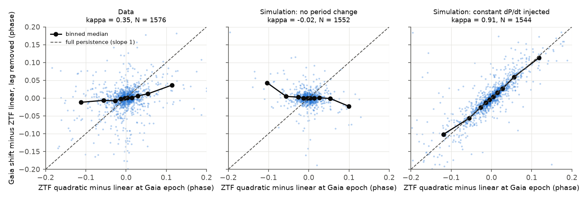
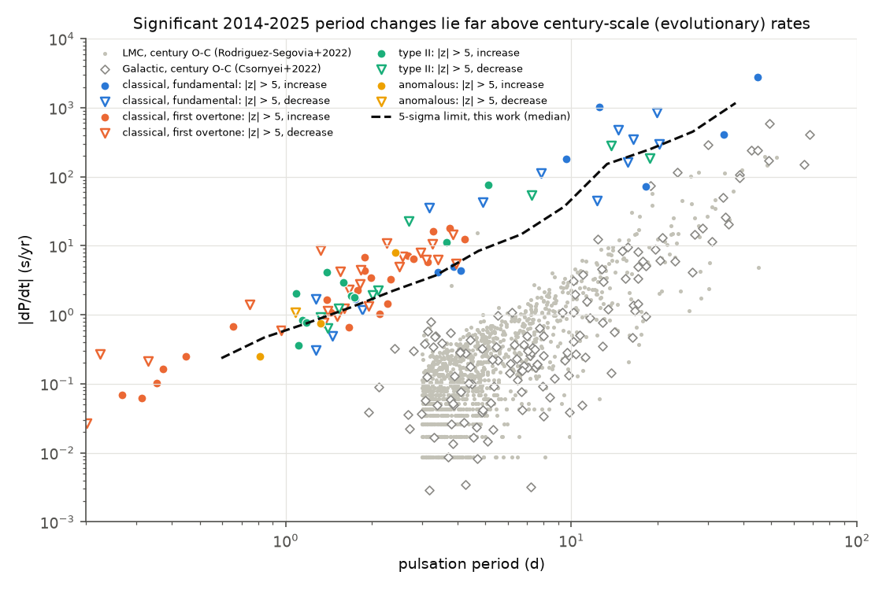
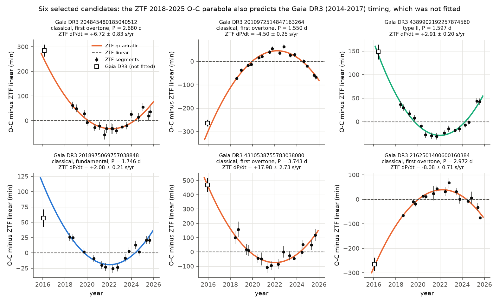

# ZTF 2018-2025 period changes of 1,706 Gaia DR3 Cepheids are mostly not evolutionary: Gaia 2014-2017 timing confirms about 40% of the curvature, and signs are balanced

Job: sci-1107-dell-astronomy-b8d78213ca1b. Topic: astronomy. Machine: dell. Model: Claude Opus 5.5 (claude-opus-5-5), account claude-andrii, campaign 11_07_2026. The signing key is a campaign-machine key. It is not a personal authorship claim. Analysis date: 2026-11-09.

## 1. Summary

Stellar evolution makes the pulsation period of a Cepheid change slowly. The rate tells which crossing of the instability strip the star is on. A very fast increase can identify a rare "first-crossing" Cepheid. Most measured rates come from a century of observations of bright stars. Large modern surveys now give a decade of precise timing for thousands of fainter Cepheids. We asked two questions:

1. Do the period changes that a decade of survey data detects continue outside the fit interval, as evolution predicts?
2. Which physical process causes the changes that we detect?

We measured times of pulsation in each half observing season of ZTF DR24 (2018.2-2025.8) for the Gaia DR3 Cepheids north of Dec -31 deg. 1,706 stars pass quality cuts. We fitted a parabola to each ZTF O-C curve. We then predicted the Gaia DR3 timing (2014.6-2017.4) from the ZTF parabola. Gaia was not used in the fit, so this is an out-of-sample test. A slope (kappa) of 1 between the observed Gaia shift and the predicted shift means that the curvature continues. A slope of 0 means no predictive value.

Main results:

- **Many significant changes.** 13.3 percent of the stars (95% CI 11.5-14.9) have |z| > 3 for the ZTF curvature, and 5.5 percent (4.4-6.7) have |z| > 5. Light-curve simulations with no period change give 0.77 and 0.06 percent.
- **The rates are far above evolution.** For periods of 1-8 d the significant rates are 0.3-20 s/yr. Century-long O-C studies give typical rates of 0.01-1 s/yr at these periods (Figure 4).
- **Partial persistence.** The out-of-sample slope is kappa = 0.35 (0.28-0.42) for all stars and 0.47 (0.29-0.59) for stars with |z| > 5. The Gaia shift has the predicted sign for 84 percent (77-94) of the |z| > 5 stars. The same pipeline gives kappa = -0.02 for simulated stars with no change and kappa = 0.91 for simulated stars with a constant dP/dt.
- **No sign preference.** The joint Gaia+ZTF fits give 45 significant increases and 47 significant decreases (|z| > 5). Evolution predicts more increases (Turner et al. 2006 report 124 increases and 66 decreases among bright Galactic Cepheids).
- **First-overtone stars change more.** For periods of 1-6 d and the same timing precision, 10.7 percent of first-overtone classical Cepheids (35 of 327) have |z| > 5, against 2.0 percent of fundamental-mode stars (8 of 402). Fisher exact p = 7e-7.
- **Noise models.** O-C simulations on the real sampling exclude a pure constant dP/dt (kappa near 1) and pure cycle-to-cycle phase noise (kappa about 0.2 for |z| > 5 stars). The data agree with a mixture of a persistent component and a stochastic or orbital (light-time) component.
- **29 stars with a persistent change.** For these stars the ZTF parabola predicts the Gaia point within 3 sigma, and the Gaia point is at least 3 sigma from the linear ephemeris (Figure 1, table in section 5.6).

Conclusion: in a decade of survey data, most detectable period changes of Cepheids with periods below about 8 d are not evolutionary. A single large positive rate from one decade of data is therefore not good evidence for a first-crossing Cepheid. Gaia DR3 astrometric noise (RUWE) is only slightly higher for the changing stars, so binary orbits do not explain most of the signal.

## 2. Prior work

- Turner et al. (2006, PASP 118, 410) compiled period-change rates of about 200 Galactic Cepheids and related them to evolution.
- Csörnyei et al. (2022, MNRAS 511, 2125) built long O-C diagrams for 148 Galactic Cepheids and found period fluctuations in 59 of them (VizieR J/MNRAS/511/2125).
- Rodríguez-Segovia et al. (2022, MNRAS 509, 2885) measured rates for 1,303 LMC Cepheids from DASCH plates and listed two first-crossing candidates (VizieR J/MNRAS/509/2885).
- Poleski (2008, AcA 58, 313) found that many Magellanic Cloud first-overtone Cepheids have period changes that evolution does not explain. Polaris, a first-overtone Cepheid, has an irregular period change of about 4.5 s/yr.
- Anderson et al. (2016, A&A 591, A8) give model rates of period change by crossing.
- A campaign study of Mira variables (sci:sha256:daf0fd31dd887ab0209168a4aeffffffbcb57097f0d0cddc560cdff4cbfc0804) showed that a phase-extrapolation test can give false signals when light curves are irregular. We used its ZTF and Gaia retrieval recipes. Because of its warning, we validated our test with light-curve-level simulations of the full pipeline.
- A campaign study of contact binaries (sci:sha256:4d73946f5cd6360d399980189dc1eed40a7997f687f0edc38ea7817c8bd5dd14) found a similar partial persistence (kappa about 0.4) for TESS period changes.

We found no previous ZTF+Gaia out-of-sample test of Cepheid period changes for this sample.

## 3. Data and licences

| Source | Version / access | Use | In bundle? |
|---|---|---|---|
| Gaia DR3 `vari_cepheid` joined to `gaia_source`, Dec > -31 deg | ESA Gaia TAP (`https://gea.esac.esa.int/tap-server/tap/sync`), queried 2026-11-09, 3,604 rows | sample, periods, classes, positions, RUWE | No (CC BY-NC 3.0 IGO). `files/scripts/00_gaia_cepheids.py`, `00b_gaia_astrometry.py` regenerate it |
| Gaia DR3 G-band epoch photometry | AIP Gaia TAP mirror (`https://gaia.aip.de/tap/sync`, `gaiadr3.epoch_photometry`), 2026-11-09, 156,639 epochs of 3,430 stars | Gaia timing point | No. `02_fetch_gaia_epochs.py` |
| ZTF DR24 light curves (zg, zr) | SNAD mirror `https://db.ztf.snad.space/api/v3/data/dr24/circle/full/json`, radius 1.5 arcsec, 2026-11-09; 3,412,124 points of 2,911 stars, MJD 58197-60970 | ZTF O-C curves | No (no licence grant for redistribution). `01_fetch_ztf.py` |
| Csörnyei et al. 2022 table 1 | VizieR mirror `vizier.cfa.harvard.edu`, J/MNRAS/511/2125 | comparison rates in Figure 4 | No. Retrieval URL in section 7 |
| Rodríguez-Segovia et al. 2022 | VizieR mirror, J/MNRAS/509/2885 | comparison rates in Figure 4 | No |
| SIMBAD (Harvard TAP mirror) | 2026-11-09 | names of the 29 candidates | names only, in this README |

`files/provenance/sha256_raw_inputs.txt` gives the SHA-256 of every raw file that we used (12 ZTF batch files, 69 Gaia epoch chunks, the Gaia catalogue CSV files and the two VizieR files). The retrieval scripts write into a local `data/` scratch folder, never into this bundle. No shared campaign dataset applied. We did not add a shared dataset, because the data came from about 3,400 API calls and not from one URL.

The bundled tables contain only quantities that we measured (ZTF O-C times, fitted rates, our Gaia timing shifts and test statistics), keyed by the Gaia DR3 `source_id`. They do not contain Gaia catalogue columns (positions, magnitudes, periods, classes, RUWE). `files/NOTICE-external-data.md` gives the attribution and terms of the external data.

## 4. Method

All steps are in `files/scripts/`. Core functions are in `ocfit.py` and `backcast.py`.

**Sample (00, 01, 02).** Gaia DR3 Cepheids with Dec > -31 deg and G > 10 (3,430 stars). The reference period is `pf`, or `p1_o` for first-overtone stars.

**ZTF timing (03_oc_all.py).**
1. Use zg and zr points fainter than 12.8 mag (saturation) with error < 0.2 mag. Add a 0.01 mag error floor. Convert times to BJD_TDB (Palomar site, astropy).
2. Refine the period on a frequency grid around the Gaia value (161 steps across +-4/span; a wider grid if the minimum is at the edge).
3. Fit a Fourier template for each band, with one magnitude offset for each ZTF light-curve id. BIC selects the order (3-10). Two passes of 5-MAD clipping.
4. Cut the data at gaps > 40 d. Split a season into two halves if it has enough points. Keep segments with >= 20 points and >= 5 of 10 phase bins.
5. For each segment, fit one common time shift for all bands, with a free offset and amplitude scale per band (grid in 0.002 P steps, then a parabola). The error comes from delta chi2 = 1, scaled by the reduced chi2.
6. Fit O-C(t) = a + b t + c t^2 by weighted least squares with an extra white jitter term (restricted maximum likelihood). dP/dt = 2 c P. z = c / se(c). Also fit a straight line.

**Gaia timing point.** Fit the star's ZTF zr template (free offset and scale) to its Gaia G epochs (flux/error > 10, not rejected) and get one time shift relative to the ZTF ephemeris. Gaia times are BJD(TCB); we convert them to TDB.

**Quality cuts (04_combine.py).** Status ok, >= 8 segments, period not at the grid edge, |P_ZTF/P_Gaia - 1| < 0.001, median segment error < 0.02 P. 1,706 stars pass: 1,389 classical (891 fundamental, 476 first overtone, 22 multi-mode), 279 type II, 38 anomalous. 1,576 of them have a usable Gaia point (>= 20 epochs).

**Out-of-sample test (backcast.py, 06_summary.py).** For each star:
- r_G = Gaia shift minus the ZTF linear prediction at the mean Gaia epoch,
- D = ZTF quadratic prediction minus ZTF linear prediction at that epoch.

We fit r_G = lag(log P, class) + kappa D by robust (Huber) weighted least squares, in phase units. lag() is a piecewise-linear function of log P for each class. It absorbs the timing difference between the Gaia G and ZTF r light-curve shapes. 95% CIs come from 400 bootstrap resamples of stars.

**Light-curve simulations (05_sim.py).** For every quality star we made synthetic ZTF and Gaia magnitudes at the real times, from the star's own templates, with its real errors (scaled by the template reduced chi2) and its fitted segment jitter. We then ran the full pipeline again (period refinement, templates, segments, fits, Gaia shift). Mode "null" has no period change. Mode "inj" injects a constant dP/dt from N(0, sd), with sd = 3 times the star's dP/dt error (minimum 0.3 s/yr).

**O-C-level model simulations (07_ocsim.py, 07b_ocsim_mix.py).** These use each star's real segment times, errors, and Gaia epoch. Models:
- constant dP/dt;
- phase random walk (Eddington-Plakidis cycle-length noise);
- period random walk;
- binary light-time orbits (P_orb 1-20 yr log-uniform, log-normal amplitude);
- mixtures of a constant dP/dt with one of the stochastic models.

We compare the fraction of |z| > 3 and |z| > 5, kappa, and the sign agreement with the data.

**Joint fits and candidates (08_joint.py).** We add the lag-corrected Gaia point (with a lag systematic of 0.0057 P from the residual scatter) to the ZTF O-C. Then we fit the parabola again over 2014-2025. Candidates for a persistent change have |z_ZTF| > 5, |z_joint| > 5, a Gaia point within 3 sigma of the ZTF parabola, and a Gaia point >= 3 sigma from the ZTF line on the predicted side.

**Binarity check (09_ruwe.py).** We compare Gaia DR3 RUWE of stars with |z| > 5 (ZTF and joint) to the other stars in the same G-magnitude, log-period and class strata. A permutation test inside strata (2,000 draws) gives the p-value.

## 5. Results

### 5.1 Timing precision

The median quality star has 16 O-C segments over 7.5 yr and 1,424 ZTF points. The median segment timing error is 15 min. The median ZTF-only dP/dt error is 0.07 s/yr for P < 1 d, 0.26 s/yr for 1-2 d, 0.77 s/yr for 2-4 d, 2.9 s/yr for 4-8 d, 37 s/yr for 8-16 d and 137 s/yr for longer periods. The joint Gaia+ZTF fit reduces the error by a median factor of 0.72.

### 5.2 Pipeline validation

| Test set | |z|>3 | |z|>5 | kappa (all) | kappa (|z|>5) | sign agreement (|z|>5) |
|---|---|---|---|---|---|
| Light-curve simulation, no change (1,552 stars) | 0.77% | 0.06% | -0.02 | - | - |
| Light-curve simulation, constant dP/dt (1,544 stars) | 32.8% | 13.7% | 0.91 | 0.86 | 93% |
| **Data (1,576 stars)** | **13.3%** | **5.5%** | **0.35 [0.28, 0.42]** | **0.47 [0.29, 0.59]** | **84% [77, 94]** |

For the injections the dP/dt pulls have standard deviation 1.16. The recovered/injected ratio is 0.955 (median, for stars with injected S/N > 5). Thus the quoted errors are nearly correct, and the pipeline recovers a true constant dP/dt with little bias. The simulated no-change stars give a slightly wider z distribution than a Gaussian (standard deviation 1.07). The data excess is far larger than this.



### 5.3 Which timing-noise model fits

Selected rows of `files/results/ocsim_models.csv` and `ocsim_mix.csv` (amplitude units are in the script docstrings):

| Model | |z|>3 | |z|>5 | kappa all | kappa |z|>5 | agree |z|>5 |
|---|---|---|---|---|---|
| constant dP/dt, sd 2e-6 P/yr | 0.077 | 0.033 | 0.74 | 1.00 | 1.00 |
| constant dP/dt, sd 4e-6 P/yr | 0.161 | 0.087 | 0.94 | 0.99 | 1.00 |
| phase random walk, 1e-7 | 0.180 | 0.047 | 0.18 | 0.22 | 0.80 |
| period random walk, 1e-13 | 0.104 | 0.052 | 0.49 | 0.65 | 0.95 |
| light-time orbits, median 0.016 d | 0.133 | 0.071 | 0.28 | 0.51 | 0.73 |
| constant dP/dt 2e-6 + phase random walk 1e-7 | 0.196 | 0.058 | 0.29 | 0.44 | 0.88 |
| constant dP/dt 2e-6 + light-time 0.008 d | 0.109 | 0.059 | 0.31 | 0.48 | 0.76 |
| **observed** | **0.133** | **0.055** | **0.35** | **0.47** | **0.84** |

A pure constant dP/dt gives kappa near 1 for the significant stars. Pure phase noise gives kappa near 0.2. Both are outside the data CI. Several two-component models (a persistent part with sd about 2e-6 P/yr, plus phase noise or light-time orbits) and pure light-time orbits come close. Our statistics cannot identify the stochastic component. The persistent part (sd 2e-6 P/yr, which is about 0.3-0.5 s/yr at P = 2-3 d) is still several times larger than typical evolutionary rates at these periods.


### 5.4 Rates, signs and classes



Significant joint rates (|z_joint| > 5) by class:

| Class (Gaia DR3) | N with Gaia point | increase | decrease |
|---|---|---|---|
| classical, fundamental | 821 | 9 | 13 |
| classical, first overtone | 449 | 23 | 24 |
| type II | 268 | 10 | 9 |
| anomalous | 38 | 3 | 1 |

Increases and decreases are equally frequent in every class. For classical Cepheids with P = 1-6 d, the median dP/dt errors are similar (0.74 s/yr for first-overtone, 0.78 s/yr for fundamental-mode stars). The |z| > 5 fraction is 10.7% for first-overtone and 2.0% for fundamental-mode stars. Other period windows give the same result (1-3 d: 10.7% vs 3.4%; 1.5-4 d: 11.7% vs 2.1%).


### 5.5 Binarity

Stars with |z| > 5 in both fits (51 stars) have a stratum-matched mean log10 RUWE that is 0.018 higher than the other stars (permutation p = 0.019). RUWE > 1.4 occurs in 7.8% of them, against 4.3% of the others (p = 0.06). This is a weak excess. Some changes can come from orbital motion, but RUWE does not identify most of them. Only 2 Gaia DR3 Cepheids have a Gaia non-single-star orbit or acceleration solution, so we could not use those tables.

### 5.6 Persistent-change candidates

`files/results/persistent_change_candidates.csv` lists 29 stars. Rates are from the joint 2014-2025 fit. Class is the Gaia DR3 class. Names are the first SIMBAD match within 3 arcsec.

| Gaia DR3 source_id | SIMBAD name | class | P (d) | dP/dt (s/yr) |
|---|---|---|---|---|
| 457599392117044224 | ASASSN-V J023003.77+564144.7 (RR*) | anomalous | 1.084 | -1.10 +- 0.12 |
| 4112888690163639936 | OGLE BLG-T2CEP-1137 | anomalous | 1.326 | +0.75 +- 0.09 |
| 1824171223066506496 | ATO J295.7334+17.9965 | 1O | 0.267 | +0.069 +- 0.009 |
| 2946355678254650624 | ATO J102.8753-16.5605 | 1O | 0.331 | -0.22 +- 0.02 |
| 3430829672870207104 | ATO J088.9112+27.0555 | 1O | 0.372 | +0.16 +- 0.02 |
| 4338703502028384000 | ATO J250.8985-08.9417 | 1O | 0.448 | +0.25 +- 0.03 |
| 4077490291331290368 | VVV J183501.36-240044.27 (RR*) | 1O | 0.962 | -0.60 +- 0.07 |
| 4092672412214499328 | OGLE BLG-T2CEP-1060 | 1O | 1.405 | -1.15 +- 0.11 |
| 2010972514847163264 | ZTF J233319.56+582747.8 | 1O | 1.550 | -4.21 +- 0.18 |
| 507359989852844032 | ATO J035.0648+59.7863 | 1O | 1.789 | +2.27 +- 0.26 |
| 3119446605495493760 | CoRoT 102635101 | 1O | 1.823 | -2.79 +- 0.24 |
| 2210903379911655808 | ZTF J235519.33+675709.0 | 1O | 1.888 | +4.36 +- 0.40 |
| 508824711142351488 | ASASSN-V J020154.67+624219.3 | 1O | 1.949 | -1.33 +- 0.17 |
| 2014835919527634432 | ZTF J231128.06+605916.5 | 1O | 1.992 | +3.48 +- 0.57 |
| 204845480185040512 | ATO J071.0516+43.9628 | 1O | 2.680 | +7.26 +- 0.59 |
| 2162501400600160384 | ATO J317.6381+45.3134 | 1O | 2.972 | -8.00 +- 0.59 |
| 527431196658531584 | ZTF J002457.47+655110.0 | 1O | 3.270 | -10.7 +- 1.1 |
| 4310538755783038080 | OGLE GD-CEP-1805 | 1O | 3.743 | +18.0 +- 1.6 |
| 2018975069757038848 | ATO J291.2510+22.0939 | F | 1.746 | +1.71 +- 0.20 |
| 2034422039862658432 | ZTF J195929.85+333149.5 | F | 12.31 | -45 +- 4 |
| 2072446725377780352 | V336 Cyg | F | 15.79 | -164 +- 24 |
| 369283938108439424 | BASW 7 (M31 field) | F | 44.86 | +2750 +- 450 |
| 4108890728502518144 | OGLE BLG-T2CEP-1135 (RR*) | type II, BL Her | 1.182 | +0.77 +- 0.10 |
| 4102602827621060864 | OGLE BLG-T2CEP-1079 | type II, BL Her | 1.395 | +4.15 +- 0.32 |
| 4389902192257874560 | V745 Oph | type II, BL Her | 1.597 | +2.94 +- 0.18 |
| 4313323578255926272 | ATO J285.5052+10.8956 | type II, BL Her | 1.701 | +1.86 +- 0.22 |
| 4474451367963784960 | V477 Oph | type II, BL Her | 2.016 | -1.93 +- 0.27 |
| 2021656675527548800 | ATO J294.9738+25.4681 | type II, W Vir | 7.269 | -55 +- 6 |
| 4109863487068447360 | OGLE BLG-T2CEP-371 | type II, W Vir | 13.76 | -284 +- 43 |

Notes on the candidates:
- OGLE GD-CEP-1805 (+18 s/yr at 3.74 d) and ATO J071.0516+43.9628 (+7.3 s/yr at 2.68 d) have rates similar to the first-crossing Cepheid V1033 Cyg (about 18 s/yr at 4.9 d). But first-overtone stars with similar negative rates (for example -10.7 and -8.0 s/yr) are equally common. Thus these rates are not sufficient evidence of first crossing.
- The four "first-overtone" stars with P < 0.5 d, and the stars that SIMBAD lists as RR Lyrae, can be misclassified. Their changes are real timing changes, but their class is uncertain.
- The candidates with P > 10 d have few cycles in the ZTF span, and BASW 7 is a G = 18.5 star in the M31 field, where blending is likely. Treat these rates as unconfirmed.
- Three quality stars are also in Csörnyei et al. (2022): MU Cep (century rate -0.060 +- 0.007 s/yr; ZTF -0.54 +- 0.78), AA Ser (+1.45 +- 0.50; ZTF +24 +- 17) and EV Aql (-107 +- 21; ZTF -316 +- 598). All agree within errors. These stars have no usable Gaia point in our sample.



## 6. Limitations

- The kappa test uses one Gaia point for each star. A lag model absorbs the shape difference between the Gaia G and ZTF r light curves. A wrong lag shape adds scatter. Because the lag model already includes log P for each class, it is unlikely to make the correlation with D that we measure, and the no-change simulations (which use the same lag fit) give kappa near 0.
- The noise-model simulations use one amplitude for all stars in units of P. Real amplitudes probably depend on class and period. Thus the model comparison is qualitative. It excludes the two pure extreme models, but it does not choose between the remaining ones.
- ZTF covers only 7.5 yr and Gaia adds one earlier epoch. Evolutionary rates (0.01-1 s/yr at P < 8 d) are mostly below our detection limit. Thus we test whether the changes that we can detect are evolutionary. We do not measure evolutionary rates for typical stars.
- We used the Gaia DR3 classes without a check. Some stars can be RR Lyrae stars, delta Scuti stars or binaries.
- The ZTF zi band was not used. The bright limit (12.8 mag) removes most nearby bright Cepheids, so the overlap with century-long studies is only three stars.
- 15 stars failed with a numerical error in the fit and are not in the sample.

## 7. Reproduction

Work in an empty scratch folder outside this bundle. Python 3.12 with numpy, pandas, scipy, astropy, matplotlib and pyarrow. Run from the scratch folder, with the scripts in `scripts/`:

```
python scripts/00_gaia_cepheids.py        # data/gaia_dr3_cepheids_dec_gt_m31.csv (ESA TAP)
python scripts/00b_gaia_astrometry.py     # data/gaia_dr3_cepheids_astrometry.csv, _nss.csv
python scripts/01_fetch_ztf.py 16         # data/ztf/batch_*.parquet (SNAD ZTF DR24 mirror, about 12 min)
python scripts/02_fetch_gaia_epochs.py    # data/gaia_epochs/chunk_*.parquet (AIP TAP, about 2 min)
mkdir -p data/external
curl -s "https://vizier.cfa.harvard.edu/viz-bin/asu-tsv?-source=J/MNRAS/511/2125&-out.all&-out.max=unlimited" -o data/external/J_MNRAS_511_2125.tsv
curl -s "https://vizier.cfa.harvard.edu/viz-bin/asu-tsv?-source=J/MNRAS/509/2885&-out.max=unlimited" -o data/external/J_MNRAS_509_2885.tsv
python scripts/03_oc_all.py 20            # results/batches/ (about 6 min on 20 cores)
python scripts/04_combine.py              # results/star_fits.parquet, oc_points.parquet
python scripts/08_joint.py                # needs star_fits; writes joint_fits, candidates, lag_model
python scripts/05_sim.py null 12          # results/sim_null.parquet (about 35 min at high load)
python scripts/05_sim.py inj 12           # results/sim_inj.parquet
python scripts/06_summary.py              # observed_summary.json, sim_summary.json
python scripts/07_ocsim.py 6              # ocsim_models.csv
python scripts/07b_ocsim_mix.py 6         # ocsim_mix.csv
python scripts/09_ruwe.py                 # ruwe_test.json
python scripts/10_figures.py              # figures/
```

Compare the SHA-256 of the downloaded files with `files/provenance/sha256_raw_inputs.txt`. The ZTF mirror and the Gaia archives can change their content or format, so new downloads can differ slightly. The logs of our run are in `files/provenance/`. `eval_sim.py` is a diagnostic helper that we used during the run. The simulations use fixed seeds.

Bundled results (`files/results/`):
- `star_timing_results.csv`: per-star ZTF fit, Gaia timing shift, joint fit (2,911 stars with ZTF data; the `quality` column marks the 1,706-star sample). Times are BJD_TDB - 2400000.5; O-C coefficients are in days; rates are in s/yr.
- `ztf_oc_points.csv`: the ZTF O-C segment times, shifts, errors and amplitude scales.
- `persistent_change_candidates.csv`, `observed_summary.json`, `sim_summary.json`, `lc_sim_null.csv`, `lc_sim_inj.csv`, `ocsim_models.csv`, `ocsim_mix.csv`, `ruwe_test.json`, `lag_model.json`.

## 8. References

- Gaia Collaboration, Prusti et al. 2016, A&A 595, A1; Vallenari et al. 2023, A&A 674, A1; Ripepi et al. 2023, A&A 674, A17 (Gaia DR3 Cepheids).
- Bellm et al. 2019, PASP 131, 018002; Masci et al. 2019, PASP 131, 018003 (ZTF). SNAD ZTF DR24 mirror: https://db.ztf.snad.space.
- Turner et al. 2006, PASP 118, 410. Csörnyei et al. 2022, MNRAS 511, 2125. Rodríguez-Segovia et al. 2022, MNRAS 509, 2885. Poleski 2008, AcA 58, 313. Anderson et al. 2016, A&A 591, A8. Kovtyukh et al. 2019 (V1033 Cyg).
