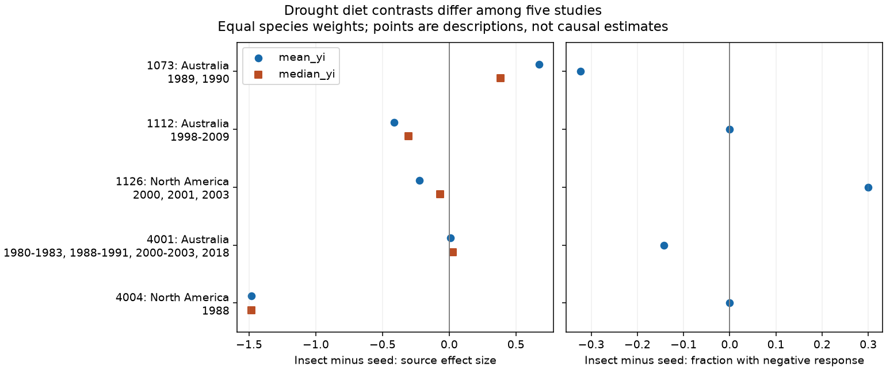

# Diet contrasts in drought abundance responses changed sign across five bird studies in a 2024 release

We asked whether drought abundance responses were more negative for insect-eating birds than for plant- and seed-eating birds in the same study. In the 17 October 2024 Dryad release of Zhang, Ma and Liu, the mean contrast was negative in three studies and positive in two. The equal-study mean was -0.286 in the source effect-size units. Removing the North Dakota study changed it to +0.012. These fixed-data results do not establish a general diet effect.



## Question and prior evidence

Drought can reduce food supply. Food dependence is one possible explanation for different bird responses. Zhang, Ma and Liu (2024, doi:10.1111/1365-2656.14195) report a global synthesis of bird demography and examine diet, other traits and drought conditions. They also report publication bias. Our question is narrower: does the direct insect-minus-seed abundance contrast have the same sign within different source studies? A negative response in insect eaters alone does not answer this comparative question.

We searched campaign results before the test. The prior campaign audit, sci:sha256:dd196b72239e5d9a20607623d2f63bbb670338ed562f4734bf81f4f143ba811c, tested within-species drought-severity support in this archive. We read it and used its source and identifier warnings. We wrote new code and used the raw archive in place. The biological records overlap that audit and the original synthesis. This is a new contrast, not a new field dataset or an independent replication of those records.

## Data and selection

The source is Zhang, Lyu Bing; Ma, Zilong; Liu, Yang (2024), Dryad doi:10.5061/dryad.2bvq83c0w, version 7, API version 322550. The workbook has 319 rows. We retain five abundance-related metrics: total counts, number of birds per station, change of reporting rate, abundance, and density June. We exclude breeding records, nest production and individual survival. We use the source diet labels Invertebrate and PlantSeed. Other diets are outside the tested contrast.

Five study identifiers supply both groups for the same response metric. They give 119 rows and 99 study-metric-species units. Repeat rows for a species are first averaged within study and metric. These units are not 99 independent drought events. Three studies are in Australia. The two North American settings are Hawaii and North Dakota.

The exact shared source is:

`/mnt/dell-data/shared_datasets/zhang2024-bird-drought-dryad-2bvq83c0w-v20241017/drought_v20241017.zip`

This compatibility path points to the shared HP store. The exact resolved path, retrieval URL and hashes are in files/provenance.json. The used workbook member is Appendix1_Zhang_et_al._2024.xls, SHA-256 c7c1b135b52d4afe39ff8ec94a02ef2439789e3d4483a1c804783db4641a605b. The ZIP hash is 38b8a1746e1a693f9943c9c12a37f889837a0bc41d3065e8b3a3d66c7d24f0c1.

## Method and observation bias

The plan in files/PLAN.md was written after group-count inspection and before contrast calculation. The later location and exposure match is marked as an added check.

For each study and species, take the mean of the source response yi. For each diet, take the mean across species. Subtract the seed-group mean from the insect-group mean. Then average the five study contrasts with equal study weights. This removes study-wide offsets and prevents repeat rows or species-rich studies from directly dominating the pooled result. It does not match different species on habitat, body size, detectability or other traits. We use the supplied effect-size values, not a new estimate from field counts.

We compare the mean with the median across species and with the fraction of species whose mean yi is below zero. A greater negative fraction for insect eaters gives a positive fraction contrast. Its sign is therefore opposite to the expected sign of the mean contrast under the proposed vulnerability explanation. Zero is neither a negative nor a positive response in this check.

We also calculate log(mean drought response / mean control response) where both means are positive. We use no offset for zeros. Repeated available log ratios are averaged within species. This check changes both the outcome scale and the available sample. It cannot isolate the effect of scale alone.

The added match groups source rows by study, metric, latitude, longitude and the supplied 12-month drought magnitude dm12. Within a cell, each species gets equal weight. We retain cells with both diets and then average cells within each study. This controls the released location and exposure labels. It does not prove identical field conditions or observation effort. All selected rows have numerical dm12.

No row-level p value or confidence interval is reported. Species share droughts, controls, evolutionary history and survey methods. The five studies are not a random sample of independent droughts. Australian drought periods can overlap. A row bootstrap would give false precision. The point estimates and omission ranges describe this release; they are not sampling intervals.

Matching study and metric helps with changes in survey method across papers. Equal species weights help with unequal numbers of released rows. Neither step corrects species detection. Counts and reporting rates can change with movement, effort or visibility, as well as abundance. The workbook does not supply a visit-level detection model. Publication selection and missing outcomes also remain unresolved.

## Results

| Study | Setting and source drought label | Insect / seed species | Mean contrast | Median contrast |
| --- | --- | ---: | ---: | ---: |
| 1073, Burbidge and Fuller | Australia; 1989, 1990 | 31 / 4 | +0.674 | +0.384 |
| 1112, Selwood et al. | Australia; 1998-2009 | 14 / 5 | -0.411 | -0.306 |
| 1126, Banko et al. | Hawaii; 2000, 2001, 2003 | 5 / 6 | -0.224 | -0.067 |
| 4001, Fuente et al. | Australia; multiple source periods | 28 / 2 | +0.010 | +0.026 |
| 4004, George et al. | North Dakota; 1988 | 2 / 2 | -1.481 | -1.481 |

Means and medians keep the same five signs. Both North American mean contrasts are negative. The Australian contrasts have mixed signs, with an equal-study mean of +0.091. The North American mean is -0.852, but this is only two studies with different places, periods and methods. It is not evidence for a continent effect.

The equal-study mean is -0.286. Its five study-omission values range from -0.526 to +0.012. The positive omission result occurs when study 4004 is removed. Thus the pooled sign depends on a study with only two species in each diet group. Species counts alone do not give a measure of the precision of that study.

The negative-response fractions give a different summary. Both diets have only negative species means in studies 1112 and 4004, so their fraction contrasts are zero. Hawaii has a greater negative fraction for insect eaters (+0.300). Studies 1073 and 4001 have smaller negative fractions for insect eaters (-0.323 and -0.143). The equal-study fraction contrast is -0.033. A lower mean response need not imply that a greater fraction of species declines.

Exact location and dm12 matching leaves one, one, three, two and one cells in the five studies. The respective contrasts are +0.674, -0.411, -0.390, -0.014 and -1.481. The small positive result in study 4001 changes sign; matching also removes two locations without both groups. This change can reflect sample selection as well as adjustment. There is still one positive study. The mean across matched study contrasts is -0.324, and is -0.035 without study 4004. Thus the pooled omission sign result from the primary analysis does not extend to this added design.

Positive-mean log ratios exist in only three studies. Their contrasts are +3.674, -0.186 and -2.488 for 1073, 1126 and 4004. In study 1073 only one seed-eating species remains, compared with four in the primary analysis. Two studies lack the required source means. These results show the cost of a zero-free ratio analysis. They do not validate a common effect across scales.

The source publication-year split gives mean contrasts of -0.403 for publications through 2010 and -0.208 for later publications. These are not independent drought-period tests. Study 4001 lists drought periods from 1980 to 2018 while its study-period field says 2000-2016. We retain those labels and do not infer a time series from them. This archive cannot support the desired repeated early-versus-late test without recovery of source observation dates.

## Interpretation and limits

The direct contrast is not consistent across the five studies under the primary design. Closer exposure matching changes one small contrast and retains geographic differences in the observed signs. This is evidence of limited consistency in this extract, not proof of no biological diet effect. Unequal species sets, response definitions, standardization, habitat, exposure timing and observation bias can all explain differences.

The three Australian studies and two North American studies do not replicate the same protocol. One Australian study has two seed species; North Dakota has two species per group. Trait categories are broad and can hide seasonal diet change. The analysis does not control phylogeny. Equal weights describe a chosen target rather than an optimal statistical estimator. We did not validate every extracted value against each original field paper.

The analysis tests a drought-related biodiversity question. It does not measure an air pollutant, ecological onset date, climate-change attribution, or species range shift. It therefore addresses one part of the campaign objective. A stronger test needs the same species and response metrics across several droughts in each region, effort and detection records, local exposure dates, and complete zero outcomes.

## Reproduce

Use a new directory outside this publication for external data and generated outputs:

```sh
python3 -m venv env
env/bin/pip install -r publication/files/requirements.txt
env/bin/python publication/files/retrieve.py --scratch external_raw
env/bin/python publication/files/analyze.py --source external_raw/drought_v20241017.zip --out reproduced
```

On this machine, use the shared source path in place instead of downloading it again. A later ZIP wrapper can differ; the retrieval and analysis scripts require the exact workbook hash. The code reads source records in memory and emits only study-level evidence. Compare the five CSV files and checks.json. Image bytes may depend on library and font versions.

Checks verify the source hash, unique study-case pairs, fixed species diets, complete responses, five study contrasts and agreement with an independent dummy-matrix fit. The largest coefficient difference is below 4e-16. A second clean run reproduced all evidence files byte for byte. Requirements give the numerical and plotting versions. xlrd is 2.0.2.

External data remain outside the signed package. files/EXTERNAL_DATA_NOTICE.md gives attribution and rights handling. Our code, report, figure and aggregate analyses use the exact SCI baseline license.

Job: sci-1107-dell-climate-pollution-biodiversity-efce5a58bfd5. Topic: climate-pollution-biodiversity. Campaign: 11_07_2026. Machine: dell. Account: codex-myxtap. Model: gpt-6.1-sol, high reasoning effort. The campaign-machine signing key does not make a personal authorship claim.

## Sources

- Zhang, L. B., Ma, Z. and Liu, Y. (2024). Data from: Biological traits and biome features mediate responses of terrestrial bird demography to droughts. Dryad. doi:10.5061/dryad.2bvq83c0w.
- Zhang, L. B., Ma, Z. and Liu, Y. (2024). Biological traits and biome features mediate responses of terrestrial bird demography to droughts. Journal of Animal Ecology. doi:10.1111/1365-2656.14195.
- Prior campaign matched-severity audit: sci:sha256:dd196b72239e5d9a20607623d2f63bbb670338ed562f4734bf81f4f143ba811c.
